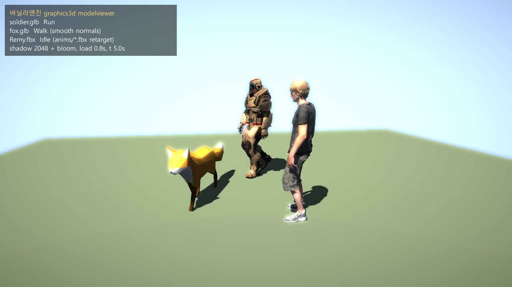
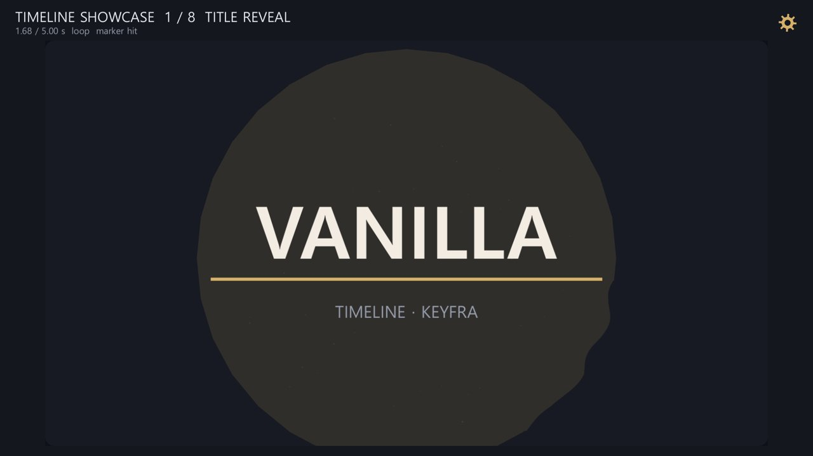
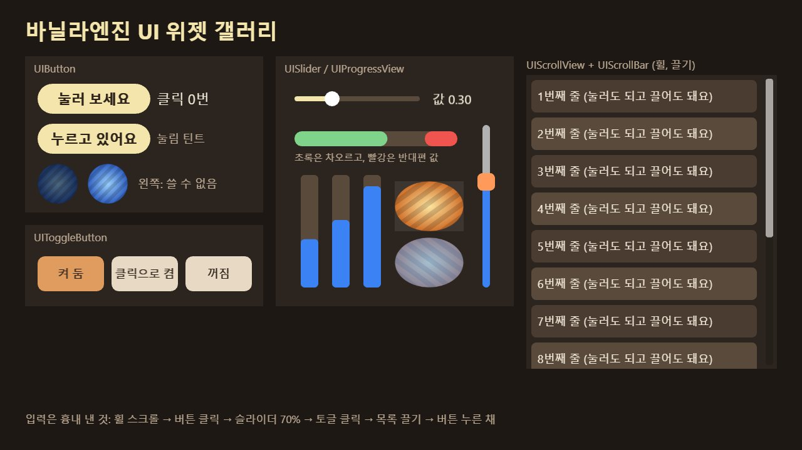

<div align="center">

# 바닐라엔진

**한 번 짠 러스트 게임 코드가 윈도우 창에서도, 웹 브라우저에서도 그대로 돕니다.**

[](UPDATE.md)
[](LICENSE)
[](Cargo.toml)
[](src/core/graphic.rs)
[](src/platform)

[왜 바닐라엔진인가](#왜-바닐라엔진인가) / [빠른 시작](#빠른-시작) / [사용법](#사용법) / [예제](#예제) / [기술 노트](#기술-노트) / [성능](#성능) / [업데이트 기록](UPDATE.md)


</div>

---

## 왜 바닐라엔진인가

바닐라엔진은 실제 게임을 만들며 다듬어 온 웹게임 엔진 [vanilla.js](https://github.com/ddukbaek2/vanilla.js) 를 러스트로 옮긴 2D/3D 게임 엔진입니다. 검증된 API 와 씬 구조는 그대로 가져오고, 러스트의 속도와 안전함, 네이티브 실행을 더했습니다.

- **코드 하나로 데스크탑과 웹.** 같은 게임 코드로 윈도우 실행 파일(OpenGL 3.3)과 브라우저용 wasm(WebGL2)을 만듭니다. 창, GL, 입력, 애셋 읽기, 오디오, 클립보드, 한글 입력(IME)의 차이는 엔진의 플랫폼 층이 모두 맡습니다.
- **빌림 검사기와 싸우지 않는 씬 그래프.** 노드는 세대 번호가 붙은 핸들(`NodeId`)로 가리킵니다. `Rc<RefCell>` 없이 노드를 마음껏 만들고 지우고, 지운 노드를 가리키는 핸들은 `None` 이 되어 댕글링 참조가 생기지 않습니다.
- **익숙한 노드와 컴포넌트.** ECS 를 새로 배울 필요 없이, 유니티나 코코스처럼 노드에 컴포넌트를 붙여 게임을 짭니다. vanilla.js 와 이름과 흐름이 같아서 자바스크립트 게임을 옮기기도 쉽습니다.
- **기본으로 빠른 2D.** 자동 배칭과 화면 밖 걸러내기가 처음부터 켜져 있습니다. 적 3만 2천 마리가 움직이는 장면에서 드로우 콜이 32,008 번에서 73 번으로 줄어듭니다.
- **바로 쓰는 UI 위젯 20종.** 버튼, 슬라이더, 스크롤 뷰, 리스트 뷰, 드롭다운, 대화 상자, 토스트, 차트, 그리고 한글 조합까지 되는 입력 필드와 리치텍스트가 들어 있습니다.
- **연출 도구가 엔진 안에.** 파티클, 셰이더 스프라이트 효과 50종, 화면 효과 58종, 트레일, 이징 31종을 갖춘 타임라인과 애니메이터, 트윈.
- **3D 도 같은 화면에서.** glTF/GLB 와 FBX(순수 러스트 로더) 스키닝 모델, PBR 머티리얼, 그림자, 블룸, 앰비언트 오클루전, 서브서피스 스캐터링. 3D 장면 위에 2D UI 를 바로 얹습니다.
- **게임에 필요한 잡일까지.** 길찾기, 2D 충돌, 조향, 플랫포머 몸체, 상태 기계, 오브젝트 풀, 시드 난수(vanilla.js 와 비트까지 같은 수열), 다국어, 대사, 타자기 효과, 로컬 저장, 게임패드, 웹소켓, 오디오.
- **async 없는 게임 코드.** 애셋은 요청해 두면 엔진이 다 읽힐 때까지 로딩 화면을 그리고, 다 읽히면 씬을 초기화합니다. 게임 코드에 `async` 와 `await` 가 필요 없습니다.

| UI 위젯 | 한글 입력 필드와 리치텍스트 |
| --- | --- |
|  |  |
| **셰이더 스프라이트 50종, 화면 효과, 트레일** | **스키닝 3D, 그림자, 블룸** |
|  |  |
| **타임라인** | **같은 UI 갤러리를 크롬(wasm)에서** |
|  |  |

## 빠른 시작

`Cargo.toml`:

```toml
[dependencies]
vanilla-engine = { git = "https://github.com/ddukbaek2/vanilla-engine" }
```

크레이트 이름은 `vanilla-engine` 이고, 코드에서는 짧게 `vanilla` 로 씁니다. (고도가 `godot`, 베비가 `bevy` 로 쓰는 것과 같은 꼴입니다)

`src/main.rs`:

```rust
#![allow(non_snake_case)]

use vanilla::{Colors, Engine, EngineConfiguration, Graphic, Rect, Scene, SceneBase, Vector2};

struct MainScene {
	sceneBase: SceneBase,
}

impl Scene for MainScene {
	fn getSceneBase(&self) -> &SceneBase {
		&self.sceneBase
	}

	fn getSceneBaseMut(&mut self) -> &mut SceneBase {
		&mut self.sceneBase
	}

	fn preDraw(&mut self, engine: &mut Engine, graphic: &mut Graphic) {
		self.sceneBase.drawSceneBackground(engine, graphic);
	}

	fn draw(&mut self, _engine: &mut Engine, graphic: &mut Graphic) {
		graphic.setFillColor(Colors::white);
		graphic.drawRect(Rect::create(100.0, 100.0, 200.0, 120.0));
	}
}

fn main() {
	let mut engineConfiguration = EngineConfiguration::new();
	engineConfiguration.title = String::from("바닐라엔진");
	engineConfiguration.referenceResolutionSize = Vector2::create(1280.0, 720.0);
	let engine = Engine::new(engineConfiguration);
	let mainScene = MainScene {
		sceneBase: SceneBase::new(),
	};
	if let Err(error) = engine.run(Box::new(mainScene)) {
		eprintln!("{}", error);
		std::process::exit(1);
	}
}
```

```bash
cargo run --example quickstart
```

`referenceResolutionSize` 는 게임이 그리는 기준 해상도입니다. 창이나 브라우저 크기가 달라도 엔진이 그 크기에 맞춰 늘리고 줄입니다.

## 사용법

### 씬의 한살이

| 단계 | 하는 일 |
| --- | --- |
| `create` | 애셋을 요청하고 `sceneBase.trackAsset` 으로 맡깁니다 |
| `drawOnLoad` | 맡긴 애셋이 다 읽힐 때까지 매 프레임 불립니다. 로딩 화면을 그립니다 |
| `initialize` | 애셋이 다 읽힌 뒤 한 번 불립니다. 노드 트리를 만듭니다 |
| `tick` | 매 프레임. 기본 구현이 노드와 컴포넌트, 터치, 트윈을 돌립니다 |
| `preDraw`, `draw`, `postDraw` | 매 프레임. 기본 `draw` 가 노드 트리를 그립니다 |
| `destroy` | 씬을 내릴 때 |

### 노드와 컴포넌트

노드를 만들고 컴포넌트를 붙입니다. 직접 만든 컴포넌트는 `tick` 에서 자기 노드를 움직입니다. ([`examples/nodebasics.rs`](examples/nodebasics.rs))

```rust
struct Spin {
	componentBase: ComponentBase,
	degreesPerSecond: f32,
}

impl Component for Spin {
	fn getComponentBase(&self) -> &ComponentBase {
		&self.componentBase
	}

	fn getComponentBaseMut(&mut self) -> &mut ComponentBase {
		&mut self.componentBase
	}

	fn getComponentType(&self) -> &'static str {
		"Spin"
	}

	fn tick(&mut self, context: &mut ComponentContext, timeDelta: f32) {
		let transform = context.getTransformMut();
		let localRotation = transform.getLocalRotation();
		transform.setLocalRotation(localRotation + self.degreesPerSecond * timeDelta);
	}
}

// 씬의 initialize 에서
let rootId = self.sceneBase.getRootId();
let nodeTree = self.sceneBase.getNodeTreeMut();
let squareId = nodeTree.createChild(rootId, "square");
let squareNode = &mut nodeTree[squareId];
squareNode.setLocalPosition(Vector2::create(640.0, 360.0));
squareNode.setContentSize(Vector2::create(160.0, 160.0));
squareNode.setPivot(Pivot::middleCenter);
squareNode.addComponent(Paint::createWithColor("#f3e5ab"));
squareNode.addComponent(Spin {
	componentBase: ComponentBase::new(),
	degreesPerSecond: 90.0,
});
```

- `ComponentContext` 로 자기 노드와 트랜스폼, 트리 전체(다른 노드 찾기, 만들기, 지우기), 엔진(입력, 시간, 뷰, 오디오)을 꺼냅니다.
- 같은 노드의 다른 컴포넌트는 `context.getNodeMut().getComponentMut::<T>()` 로 찾습니다.
- 씬 코드에서 컴포넌트와 트리를 함께 만질 때는 `nodeTree.withComponentMut::<T, _>(nodeId, |component, tree| ...)` 를 씁니다.
- `nodeTree.destroyNode(nodeId)` 는 자손까지 지웁니다. tick 이나 터치 도중에 불러도 순회가 끝난 뒤에 지웁니다.

### 애셋 읽기

```rust
struct GameScene {
	sceneBase: SceneBase,
	logoAsset: ImageAsset,
}

impl Scene for GameScene {
	// ...

	fn create(&mut self, engine: &mut Engine) {
		self.logoAsset.load(engine, "images/logo.png");
		self.sceneBase.trackAsset(&self.logoAsset);
	}

	fn initialize(&mut self, _engine: &mut Engine) {
		let rootId = self.sceneBase.getRootId();
		let logoImage = self.logoAsset.getImage();
		let nodeTree = self.sceneBase.getNodeTreeMut();
		if let Some(logoImage) = logoImage {
			let logoId = nodeTree.createChild(rootId, "logo");
			nodeTree[logoId].addComponent(Sprite::createWithImage(logoImage));
		}
	}
}
```

- 데스크탑은 `EngineConfiguration.assetDirectoryPaths` 의 폴더에서 그 자리에서 읽고, 웹은 `assetBaseUrl + 경로` 를 fetch 합니다. 게임 코드는 같습니다.
- 이미지(png, jpg, webp), 글, JSON, 바이너리, 글꼴(ttf, otf, woff, woff2), 오디오(ogg, mp3, wav)를 읽습니다.
- 읽기에 실패한 애셋도 끝난 것으로 쳐서 씬이 멈추지 않습니다.

### 웹으로 빌드

wasm32 타깃과 [wasm-bindgen](https://github.com/rustwasm/wasm-bindgen) CLI 가 있으면 됩니다.

```bash
rustup target add wasm32-unknown-unknown
cargo build --profile wasm-release --example uigallery --target wasm32-unknown-unknown
wasm-bindgen --target web --no-typescript --out-dir web target/wasm32-unknown-unknown/wasm-release/examples/uigallery.wasm
```

`web/index.html`:

```html
<!doctype html>
<html>
<head><meta charset="utf-8"><style>html, body { margin: 0; overflow: hidden; background: #000; }</style></head>
<body>
<script type="module">
import init from "./uigallery.js";
init();
</script>
</body>
</html>
```

캔버스는 `EngineConfiguration.canvasId`(기본 `mainCanvas`)로 찾고, 없으면 엔진이 만듭니다.

## 예제

| 예제 | 내용 |
| --- | --- |
| `quickstart` | 빠른 시작과 같은 코드 |
| `nodebasics` | 노드, Paint, Text, 직접 만든 컴포넌트 |
| `uigallery`, `uigallery2` | UI 위젯 전부 |
| `inputgallery` | 입력 필드, 한글 IME 조합, 선택 영역, 리치텍스트 |
| `effectgallery` | 셰이더 스프라이트 50종, 화면 효과, 트레일 |
| `misctour` | 카메라, 길찾기, 대사, 흔들기, 떠오르는 글자 |
| `timelineshowcase` | 타임라인 문서 재생 |
| `modelviewer` | 스키닝 3D(glTF, FBX), 그림자, 블룸 |
| `audiotone` | 소리 재생, 효과음 풀, 비프 |
| `gamepadlist` | 연결된 게임패드 목록 |

```bash
cargo run --example uigallery
cargo run --release --example modelviewer
```

`modelviewer` 와 `timelineshowcase` 는 vanilla.js 의 예제 애셋을 씁니다. vanilla.js 저장소를 이 저장소 옆에 받아 두면 됩니다. (`Github/vanilla.js`, `Github/vanilla-engine`)

## 기술 노트

러스트로 게임 엔진을 만들 때 부딪히는 문제를 바닐라엔진은 이렇게 풀었습니다. 자세한 구조는 [ARCHITECTURE.md](ARCHITECTURE.md) 에 있습니다.

**세대 번호 핸들로 만든 노드 트리.** 씬의 `NodeTree` 가 모든 노드를 [slotmap](https://crates.io/crates/slotmap) 저장소 하나에 담고, 부모와 자식을 `NodeId`(칸 번호 + 세대 번호)로 잇습니다. 노드를 지운 뒤 같은 칸이 다시 쓰여도 세대 번호가 달라서 옛 핸들은 `None` 을 돌려줍니다. 순회 도중의 삭제는 비활성으로 표시해 두었다가 순회가 끝난 뒤에 지웁니다.

**컴포넌트가 자기 노드와 트리를 같이 만지는 법.** 컴포넌트의 `tick` 을 부를 때는 그 컴포넌트 하나만 노드에서 잠깐 빼고 자리 표시자를 끼워 둡니다. 그래서 컴포넌트는 `&mut self` 를 쥔 채로 자기 노드, 트리 전체, 같은 노드의 형제 컴포넌트, 엔진까지 빌림 충돌 없이 만질 수 있습니다.

**한 곳으로 모이는 2D 그리기.** 스프라이트, 도형, 글자, 파티클이 모두 `Graphic.drawVertices` 한 곳을 지납니다. 정점을 CPU 에서 변환해 모아 두었다가 같은 텍스처가 이어지는 동안 한 번에 그리고, 블렌드가 바뀌거나 클립을 걸 때, 프레임이 끝날 때 내보냅니다. 정점마다 색을 싣는 셰이더를 파티클과 같이 써서 색이 다른 그리기도 한 묶음에 들어갑니다. 벤치 장면에서 묶어 그린 화면과 묶지 않은 화면을 견주면 픽셀까지 같습니다.

**그릴 것만 그리고, 돌릴 것만 돌리기.** 영역 안에만 그리는 컴포넌트(Paint, Sprite, Mask)만 붙은 노드는 화면 밖이면 그리지 않습니다. 그리기만 하는 컴포넌트만 붙은 노드는 tick 때 꺼내지도 않습니다.

**async 없는 애셋 읽기.** 애셋을 요청하면 읽기 손잡이를 받고, 바이트가 다 오면 상태가 바뀝니다. 데스크탑은 그 자리에서 파일을 읽어 `create` 바로 뒤에 `initialize` 가 불리고, 웹은 fetch 가 끝나는 프레임까지 `drawOnLoad` 로 로딩 화면을 그립니다. 같은 게임 코드가 두 플랫폼에서 그대로 돕니다.

**글자 굽기.** 문자열 하나를 [fontdue](https://crates.io/crates/fontdue) 로 래스터화해 텍스처 한 장으로 굽고, 최근에 쓴 512 개를 캐시합니다. 첫 글꼴에 없는 글자는 기본 글꼴, 대체 글꼴 순으로 찾습니다. 웹 글꼴(WOFF, WOFF2)을 풀어 읽고, 웹에서 글꼴을 하나도 주지 않으면 브라우저 Canvas2D 로 구워 시스템 글꼴이 나옵니다.

**GL 컨텍스트 하나에 2D 와 3D.** 씬의 `preDraw` 에서 그림자, 3D 장면, 블룸 패스를 그리고 `graphic.restoreRenderState()` 로 2D 상태를 되살린 뒤 UI 를 그립니다. 화면 효과는 화면(또는 영역)을 텍스처로 떠 와 전체 화면 패스를 사슬로 겁니다.

**웹에서도 제대로 되는 한글 입력.** 웹에서는 입력 필드마다 숨긴 DOM `<input>` 을 맞춰 두고 IME 조합 이벤트를 받아 캔버스에 그립니다. iOS 처럼 사용자 입력 안에서만 키보드가 뜨는 브라우저를 위해 터치 핸들러 안에서 포커스를 줍니다. 데스크탑은 winit 의 IME 이벤트를 씁니다.

**플랫폼 층 분리.** 창, GL, 입력, 프레임 루프, 애셋 바이트, 오디오는 `platform/desktop` 과 `platform/web` 에만 있고, 엔진 본체는 플랫폼을 모릅니다. 새 플랫폼은 이 층에 모듈을 더하면 됩니다.

## 성능

둥근 사각형 적과 사각형 탄환이 노드 하나씩으로 움직이는 벤치 장면의 결과입니다. 적 하나, 탄환 하나가 모두 노드 하나와 Paint 컴포넌트 하나입니다. (데스크탑 네이티브, RTX 2070 SUPER, 수직 동기 끔)

| 적 수 | 배칭 끔 | 배칭 켬 | 드로우 콜 (배칭 전 → 켬) |
| --- | --- | --- | --- |
| 4,000 | 125.5 fps | **153.1 fps** | 4,165 → 15 |
| 8,000 | 59.8 fps | **86.6 fps** | 8,097 → 23 |
| 16,000 | 26.2 fps | **36.8 fps** | 16,015 → 40 |
| 32,000 | 10.4 fps | **15.5 fps** | 32,008 → 73 |

웹(wasm, 크롬, 배칭 켬)에서는 적 1만 6천 마리 장면이 배칭 전 24.5 fps 에서 40.4 fps 가 되었습니다.

## 진행 상황

- 판 0.3.2. 판 번호는 vanilla.js 0.3.2 에서 이어 받았습니다.
- vanilla.js 의 원본 160 파일 가운데 121 파일을 옮겼습니다. 20 파일은 러스트에 필요 없어서(컬렉션, 죽은 코드 같은 것) 옮기지 않았습니다.
- 다음에 옮길 것: UINode, UIScene, UIDocument, 오토레이아웃, DevTools, DynamicFont, web/Pane, HumanSkinRenderer
- 윈도우 11 데스크탑과 크롬에서 확인했습니다. macOS, 리눅스, 실제 모바일 기기는 아직 돌려 보지 않았습니다.

## 코드 꼴

vanilla.js 와 같은 꼴을 씁니다.

- 이름은 모두 camelCase 입니다. 줄임말을 쓰지 않습니다. (러스트 기본 이름 경고는 끕니다)
- 중괄호를 늘 쓰고, `else` 는 새 줄에서 시작합니다. 들여쓰기는 탭입니다.
- 함수마다 `//====` 머리 주석을 달고, 파일 머리에 원본의 어느 파일을 옮겼는지 적습니다.
- rustfmt 는 쓰지 않습니다.

## 개발 환경

- Windows 11 Pro
- Rust 1.99.1
- 주요 크레이트: glow, winit, glutin, fontdue, image, kira(데스크탑 오디오), gilrs(게임패드), ewebsock(웹소켓), wasm-bindgen(웹)

## 링크

- 원본 엔진: <https://github.com/ddukbaek2/vanilla.js>
- 배포 페이지: <https://ddukbaek2.com>

## 라이선스

[MIT](LICENSE) © ddukbaek2
