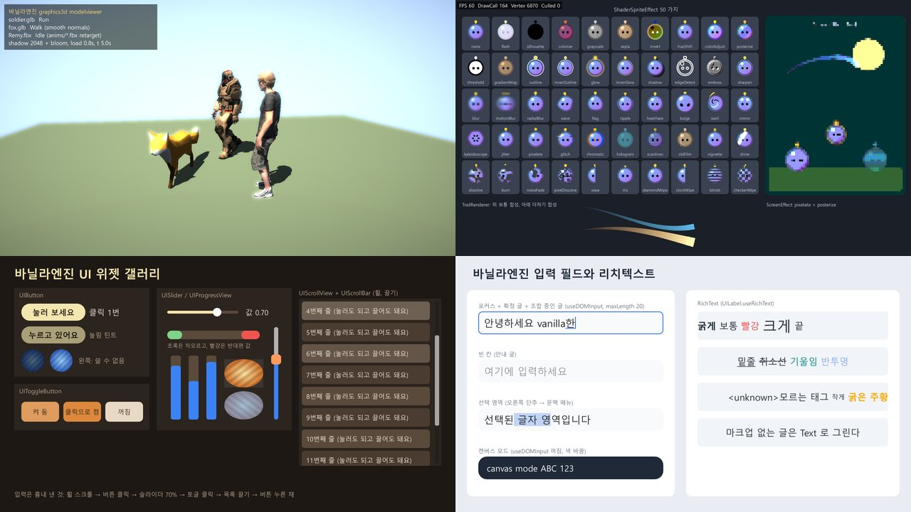
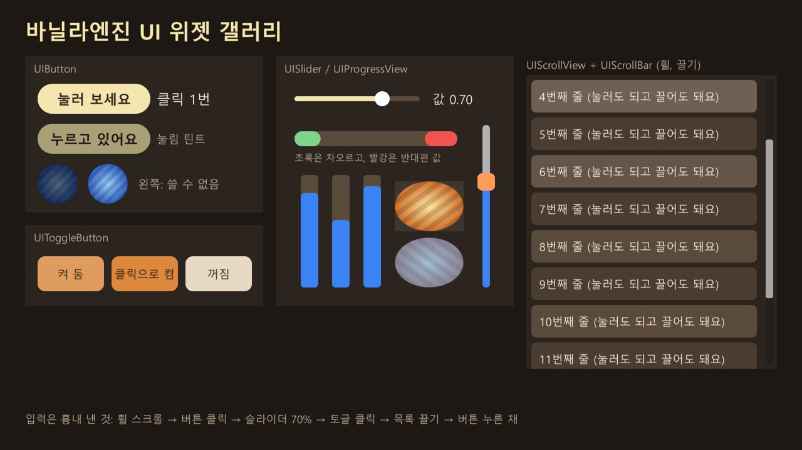
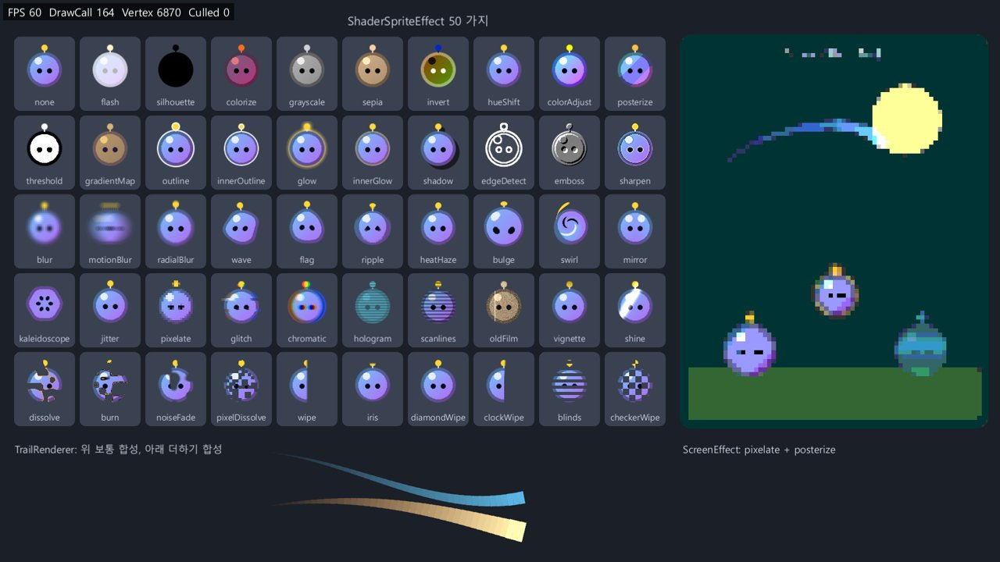
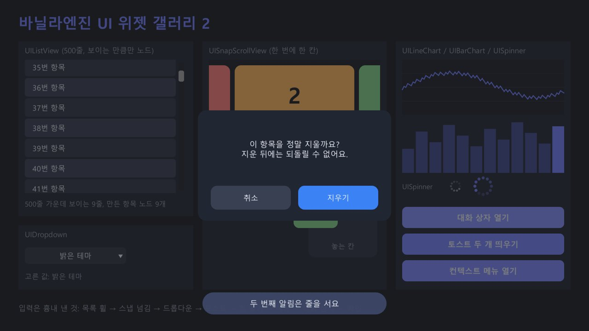
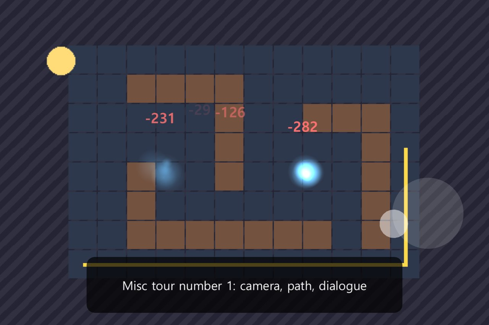
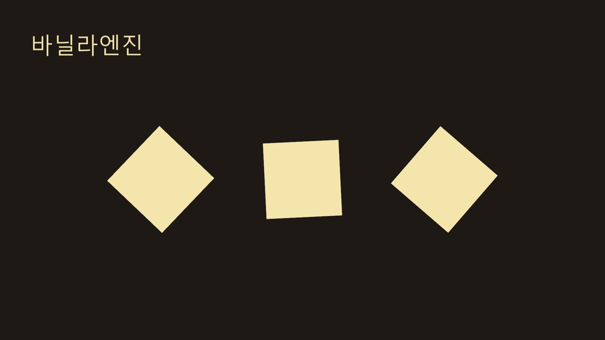

<div align="center">

# 바닐라엔진

**한 번 짠 러스트 게임 코드가 데스크탑 창에서도, 웹 브라우저에서도 그대로 돕니다.**

[](UPDATE.md)
[](LICENSE)
[](Cargo.toml)
[](src/core/graphic.rs)
[](src/platform)

[왜 바닐라엔진인가](#왜-바닐라엔진인가) / [빠른 시작](#빠른-시작) / [사용법](#사용법) / [예제](#예제) / [기술 노트](#기술-노트) / [성능](#성능) / [외부 의존성](#외부-의존성) / [업데이트 기록](UPDATE.md)



</div>

---

## 왜 바닐라엔진인가

바닐라엔진은 실제 게임을 만들며 다듬어 온 웹게임 엔진 [vanilla.js](https://github.com/ddukbaek2/vanilla.js) 를 러스트로 옮긴 2D/3D 게임 엔진입니다. 검증된 API 와 씬 구조는 그대로 가져오고, 러스트의 속도와 안전함, 네이티브 실행을 더했습니다.

- **코드 하나로 데스크탑과 웹.** 같은 게임 코드로 데스크탑 실행 파일(윈도우, macOS, OpenGL 3.3)과 브라우저용 wasm(WebGL2)을 만듭니다. 창, GL, 입력, 애셋 로딩, 오디오, 클립보드, 한글 입력(IME), 시스템 글꼴의 차이는 엔진의 플랫폼 레이어가 모두 처리합니다.
- **빌림 검사기(borrow checker)와 싸우지 않는 씬 그래프.** 노드는 제너레이셔널 핸들(`NodeId`)로 가리킵니다. `Rc<RefCell>` 없이 노드를 마음껏 만들고 지우고, 지운 노드를 가리키는 핸들은 `None` 이 되어 댕글링 참조가 생기지 않습니다.
- **익숙한 노드와 컴포넌트.** ECS 를 새로 배울 필요 없이, 유니티나 코코스처럼 노드에 컴포넌트를 붙여 게임을 짭니다. vanilla.js 와 이름과 흐름이 같아서 자바스크립트 게임을 옮기기도 쉽습니다.
- **기본으로 빠른 2D.** 자동 배칭과 화면 밖 컬링이 처음부터 켜져 있습니다. 적 3만 2천 마리가 움직이는 장면에서 드로우 콜이 32,008 번에서 73 번으로 줄어듭니다.
- **바로 쓰는 UI 위젯.** 버튼, 슬라이더, 스크롤 뷰, 리스트 뷰, 드롭다운, 대화 상자, 토스트, 차트, 진행 고리, 창 쌓기와 확인 창, 단추 반응과 토스트 모션, 누름 자리 넓히기, 제약 기반 오토레이아웃, 그리고 한글 조합까지 되는 입력 필드와 리치텍스트가 들어 있습니다.
- **연출 도구가 엔진 안에.** 파티클, 셰이더 스프라이트 효과 49종, 화면 효과 58종, 트레일, 아지랑이, 이징 31종을 갖춘 타임라인과 애니메이터, 트윈. 블렌드 모드는 Canvas2D 합성 26 가지를 모두 그립니다.
- **3D 도 같은 화면에서.** glTF/GLB 와 FBX(순수 러스트 로더) 스키닝 모델, PBR 머티리얼, 사람 피부 렌더러, 그림자, 블룸과 다단 블룸, 멀티샘플 렌더 타겟, 앰비언트 오클루전, 서브서피스 스캐터링. 툰 3D 는 셀 셰이딩과 바깥선(껍데기, 화면 공간), 빛 묶음(점광, 림, 정반사, 띠 램프), 셰이더 조각을 끼우는 머티리얼, 인스턴스 꼴과 영구 인스턴스 버퍼, 그리기 단계 콜백, HDR 마무리(MSAA, 다단 블룸, 색 보정), GPU 효과(파티클, 불덩이, 충격파, 자국, 빔, 번개)를 갖췄습니다. 3D 장면 위에 2D UI 를 바로 얹고, 노드 사각형 안에도 3D 를 그립니다.
- **게임 제작에 필요한 기능까지.** 길찾기, 2D 충돌, 스티어링, 플랫포머 캐릭터 물리, 상태 머신(FSM), 오브젝트 풀, 고정 걸음, 시드 기반 난수(vanilla.js 와 비트까지 같은 수열), 다국어와 언어 묶음, 대화 시스템, 타자기 효과, 로컬 저장소, 입력 동작(키, 패드 단추, 축 묶기), 게임패드와 진동, 카메라 손짓, 애셋 함께 받기와 로딩 진행률, 스프라이트 아틀라스, 소리 표와 음악, 효과음 버스, 화질 자동 조절, 웹소켓(wss 포함).
- **원본처럼 쓰는 async/await.** 엔진이 스레드 하나짜리 실행기를 품고 매 프레임 작업을 폴링합니다. 씬 작업 안에서 `asset.wait_for_load().await`, `wait::seconds(1.0).await` 처럼 vanilla.js 의 async 함수를 위에서 아래로 그대로 옮겨 쓰고, await 다음 줄에서는 `scene_context.with(|scene, engine| ...)` 로 씬과 엔진을 만집니다. tokio 같은 외부 런타임 없이 데스크탑과 웹이 같은 코드로 돌고, await 없이 손잡이를 맡겨 두는 꼴도 그대로 됩니다.

| UI 위젯 | 한글 입력 필드와 리치텍스트 |
| --- | --- |
|  |  |
| **셰이더 스프라이트 49종, 화면 효과, 트레일** | **스키닝 3D, 그림자, 블룸** |
|  |  |
| **타임라인** | **같은 UI 갤러리를 크롬(wasm)에서** |
|  |  |
| **리스트, 스냅 스크롤, 차트, 대화 상자** | **카메라, 길찾기, 대화 시스템, 플로팅 텍스트** |
|  |  |

## 빠른 시작

`Cargo.toml`:

```toml
[dependencies]
vanilla-engine = { git = "https://github.com/ddukbaek2/vanilla-engine" }
```

크레이트 이름은 `vanilla-engine` 이고, 코드에서는 짧게 `vanilla` 로 씁니다. (고도가 `godot`, 베비가 `bevy` 로 쓰는 것과 같은 꼴입니다)

`src/main.rs`:

```rust
use vanilla::{Colors, Engine, EngineConfiguration, Graphic, Rect, Scene, SceneBase, Vector2};

struct MainScene {
	scene_base: SceneBase,
}

impl Scene for MainScene {
	fn get_scene_base(&self) -> &SceneBase {
		&self.scene_base
	}

	fn get_scene_base_mut(&mut self) -> &mut SceneBase {
		&mut self.scene_base
	}

	fn pre_draw(&mut self, engine: &mut Engine, graphic: &mut Graphic) {
		self.scene_base.draw_scene_background(engine, graphic);
	}

	fn draw(&mut self, _engine: &mut Engine, graphic: &mut Graphic) {
		graphic.set_fill_color(Colors::WHITE);
		graphic.draw_rect(Rect::create(100.0, 100.0, 200.0, 120.0));
	}
}

fn main() {
	let mut engine_configuration = EngineConfiguration::new();
	engine_configuration.title = String::from("바닐라엔진");
	engine_configuration.auto_resize_on_window_resize = true;
	engine_configuration.reference_resolution_size = Vector2::create(1280.0, 720.0);
	let engine = Engine::new(engine_configuration);
	let main_scene = MainScene {
		scene_base: SceneBase::new(),
	};
	if let Err(error) = engine.run(Box::new(main_scene)) {
		eprintln!("{}", error);
		std::process::exit(1);
	}
}
```

```bash
cargo run --example quickstart
```

`reference_resolution_size` 는 게임이 그리는 기준 해상도입니다. 창이나 브라우저 크기가 달라도 엔진이 그 크기에 맞춰 늘리고 줄입니다.

## 사용법

### 씬 생명주기

| 단계 | 하는 일 |
| --- | --- |
| `create` | 애셋 로딩을 요청하고 `scene_base.track_asset` 으로 등록합니다. 원본 `async load` 처럼 await 로 불러오려면 `engine.spawn_scene_task` 로 작업을 맡기고 `scene_base.track_task` 로 등록합니다 |
| `draw_on_load` | 등록한 애셋과 작업이 끝날 때까지 매 프레임 호출됩니다. 로딩 화면을 그립니다 |
| `initialize` | 로딩이 끝난 뒤 한 번 호출됩니다. 노드 트리를 만듭니다 |
| `tick` | 매 프레임 업데이트. 기본 구현이 노드와 컴포넌트, 터치, 트윈을 업데이트합니다 |
| `pre_draw`, `draw`, `post_draw` | 매 프레임 렌더링. 기본 `draw` 가 노드 트리를 그립니다 |
| `destroy` | 씬이 언로드될 때. 그 씬의 작업도 함께 버려집니다 |

### 노드와 컴포넌트

노드를 만들고 컴포넌트를 붙입니다. 직접 만든 컴포넌트는 `tick` 에서 자기 노드를 움직입니다. ([`examples/nodebasics.rs`](examples/nodebasics.rs))



```rust
struct Spin {
	component_base: ComponentBase,
	degrees_per_second: f32,
}

impl Component for Spin {
	fn get_component_base(&self) -> &ComponentBase {
		&self.component_base
	}

	fn get_component_base_mut(&mut self) -> &mut ComponentBase {
		&mut self.component_base
	}

	fn get_component_type(&self) -> &'static str {
		"Spin"
	}

	fn tick(&mut self, context: &mut ComponentContext, time_delta: f32) {
		let transform = context.get_transform_mut();
		let local_rotation = transform.get_local_rotation();
		transform.set_local_rotation(local_rotation + self.degrees_per_second * time_delta);
	}
}

// 씬의 initialize 에서
let root_id = self.scene_base.get_root_id();
let node_tree = self.scene_base.get_node_tree_mut();
let square_id = node_tree.create_child(root_id, "square");
let square_node = &mut node_tree[square_id];
square_node.set_local_position(Vector2::create(640.0, 360.0));
square_node.set_content_size(Vector2::create(160.0, 160.0));
square_node.set_pivot(Pivot::MIDDLE_CENTER);
square_node.add_component(Paint::create_with_color("#f3e5ab"));
square_node.add_component(Spin {
	component_base: ComponentBase::new(),
	degrees_per_second: 90.0,
});
```

- `ComponentContext` 로 자기 노드와 트랜스폼, 트리 전체(다른 노드 찾기, 만들기, 지우기), 엔진(입력, 시간, 뷰, 오디오)에 접근합니다.
- 같은 노드의 다른 컴포넌트는 `context.get_node_mut().get_component_mut::<T>()` 로 찾습니다.
- 씬 코드에서 컴포넌트와 트리를 함께 수정할 때는 `node_tree.with_component_mut::<T, _>(node_id, |component, tree| ...)` 를 씁니다.
- `node_tree.destroy_node(node_id)` 는 자식 노드까지 삭제합니다. tick 이나 터치 처리 도중에 호출해도 순회가 끝난 뒤에 안전하게 삭제합니다.

컴포넌트의 `impl` 블록과 `impl Component` 블록에 `#[vanilla::reflect]` 를 붙이면 vanilla.js 의 실행 중 반사처럼 get, is, set 함수를 찾아 씁니다. UI 문서(`UIDocument`)가 등록 한 줄로 그 컴포넌트를 vanilla.js 와 같은 키로 저장하고 읽으며, 개발자 도구 인스펙터가 게터를 모두 불러 보입니다. ([`examples/devtoolsshowcase.rs`](examples/devtoolsshowcase.rs))

```rust
#[vanilla::reflect]
impl Spin {
	pub fn set_degrees_per_second(&mut self, degrees_per_second: f32) {
		self.degrees_per_second = degrees_per_second;
	}

	pub fn get_degrees_per_second(&self) -> f32 {
		self.degrees_per_second
	}
}

#[vanilla::reflect]
impl Component for Spin {
	// 위와 같다
}

// UI 문서에 등록하면 { "DegreesPerSecond": 90, ..., "type": "Spin" } 으로 저장하고 읽습니다
ui_document.register_component_type("Spin", || Spin {
	component_base: ComponentBase::new(),
	degrees_per_second: 0.0,
});
```

- 게터는 인자 없는 `pub fn get_*`, `pub fn is_*` 이고, 같은 이름의 `set_*` 이 있으면 저장 속성입니다. 키는 접두어를 뗀 vanilla.js 이름(`get_line_width` → `LineWidth`)입니다.
- 저장할 수 없는 꼴의 게터(그림, 콜백 같은 것)도 컴파일 에러 없이 저장에서 빠지고 인스펙터에는 `[종류 이름]` 으로 보입니다.
- 트리를 받는 게터(`fn get_leader_name<'a>(&self, node_tree: &'a NodeTree) -> &'a str`)는 인스펙터가 트리를 넘겨 부르고, `&mut self` 게터는 인스펙터가 tick 에서, 문서는 `to_json_text_mut` 가 부릅니다. 트리와 값을 받는 세터(`fn set_slot(&mut self, node_tree: &mut NodeTree, slot: usize)`)는 문서를 읽을 때 vanilla.js 처럼 그 자리에서 부릅니다.
- 함수에 `#[reflect(skip)]`(반사에서 빼기), `#[reflect(transient)]`(인스펙터에만 보이기), `#[reflect(unsaved)]`(속성 목록에는 두고 저장에서 빼기), `#[reflect(name = "UIScale")]`(키 이름 정하기), `#[reflect(after = "getScreenRect")]`(`impl Component` 블록의 게터를 vanilla.js 클래스 몸통의 자리에 두기)를, 블록에 `#[vanilla::reflect(base = 필드)]`(품은 컴포넌트를 vanilla.js 의 상위 클래스처럼 잇기)를 붙일 수 있습니다.
- 매크로를 빠뜨리면 한쪽만 붙였을 때는 컴파일 에러가, 둘 다 빠뜨렸을 때는 UI 문서 쓰기 경고와 인스펙터의 "반사 없음" 줄이 알려 줍니다.
- `ui_document.register_editor_types()` 한 줄이 vanilla.js UI 에디터가 등록하는 종류(컴포넌트 35, `UIWindow`, `UIDialog`, `UIDropdown`, `UIToast`, `UIInputField`, `UIScrollBar` 같은 노드 종류 12)를 모두 등록해 에디터가 저장한 문서를 그대로 읽고 씁니다.

### 애셋 로딩

```rust
struct GameScene {
	scene_base: SceneBase,
	logoAsset: ImageAsset,
}

impl Scene for GameScene {
	// ...

	fn create(&mut self, engine: &mut Engine) {
		self.logoAsset.load(engine, "images/logo.png");
		self.scene_base.track_asset(&self.logoAsset);
	}

	fn initialize(&mut self, _engine: &mut Engine) {
		let root_id = self.scene_base.get_root_id();
		let logoImage = self.logoAsset.get_image();
		let node_tree = self.scene_base.get_node_tree_mut();
		if let Some(logoImage) = logoImage {
			let logoId = node_tree.create_child(root_id, "logo");
			node_tree[logoId].add_component(Sprite::create_with_image(logoImage));
		}
	}
}
```

vanilla.js 의 `async load(engine) { await this.logoAsset.load("images/logo.png"); }` 를 await 로 그대로 옮기면 이렇습니다. 작업은 매 프레임 엔진이 폴링하고, `with` 클로저 안에서만 씬과 엔진을 빌립니다.

```rust
impl Scene for TitleScene {
	// ...

	fn create(&mut self, engine: &mut Engine) {
		let load_task = engine.spawn_scene_task(self, |mut scene_context| async move {
			// 원본: await this.logoAsset.load("images/logo.png");
			let logo_load = scene_context.with(|scene, engine| {
				scene.logo_asset.load(engine, "images/logo.png");
				scene.logo_asset.wait_for_load()
			});
			logo_load.await.ok();
			// 원본: await Wait.seconds(0.5);
			wait::seconds(0.5).await;
			scene_context.with(|scene, _engine| scene.is_intro_ready = true);
		});
		// 원본 SceneManager 가 await scene.load() 를 기다린 뒤 initialize 를 부르는 자리
		self.scene_base.track_task(&load_task);
	}
}
```

| 원본 (vanilla.js) | 바닐라엔진 |
| --- | --- |
| `await asset.load(경로)` | `asset.load(engine, 경로); asset.wait_for_load().await` (AssetLoader, SpriteAtlas, BuildInfo, AudioAsset, SoundSystem, LanguagePack, UIFont 도 같은 꼴) |
| `await FbxLoader.loadFromUrl(url)`, `await Material.loadImageDescription(url)` | 돌려준 손잡이를 그대로 `.await` |
| `await Timeline.loadFromUrl(url)`, `await SkinnedModel.loadFromUrl(gl, url, renderer)` | `Timeline::load_from_url(engine, 경로).await`, `SkinnedModel::load_from_url_async(engine, 경로, &renderer).await` |
| `await Wait.seconds(1)`, `await Wait.nextFrame()` | `wait::seconds(1.0).await`, `wait::next_frame().await` |
| `await engine.readClipboardText()`, `await engine.requestFrameCapture(n)` | `engine.read_clipboard_text_async().await`, `engine.request_frame_capture_async(n).await` |
| `await sceneManager.loadScene(scene)` | `engine.load_scene_async(scene).await` (`unload_scene_async`, `unload_all_scenes_async`) |
| `this.fadeScreen(async () => { ... })` | `scene.fade_screen_async(engine, \|scene_context\| async move { ... })` |
| `new Promise((resolve) => ...)` | `let (promise, resolver) = Promise::create();` |

- 데스크탑은 `EngineConfiguration.asset_directory_paths` 폴더에서 바로 읽고, 웹은 `asset_base_url + 경로` 를 fetch 합니다. 게임 코드는 같습니다.
- 이미지(png, jpg, webp, gif 첫 장, bmp, ico, svg, avif), 텍스트, JSON, 바이너리, 폰트(ttf, otf, woff, woff2), 오디오(ogg, mp3, wav, flac, m4a)를 지원합니다. 데스크탑은 엔진이 풀고, 웹은 원본처럼 브라우저가 풉니다.
- 여러 애셋을 함께 받을 때는 `AssetLoader` 가 동시 수만큼 요청하고 진행률과 실패 목록을 셉니다.
- 로딩에 실패한 애셋도 완료로 처리해서 씬이 멈추지 않습니다.

### 웹으로 빌드

wasm32 타깃과 [wasm-bindgen](https://github.com/rustwasm/wasm-bindgen) CLI 가 있으면 됩니다.

```bash
rustup target add wasm32-unknown-unknown
cargo build --profile wasm-release --example uigallery --target wasm32-unknown-unknown
wasm-bindgen --target web --no-typescript --out-dir web target/wasm32-unknown-unknown/wasm-release/examples/uigallery.wasm
```

`web/index.html`:

```html
<!doctype html>
<html>
<head><meta charset="utf-8"><style>html, body { margin: 0; overflow: hidden; background: #000; }</style></head>
<body>
<script type="module">
import init from "./uigallery.js";
init();
</script>
</body>
</html>
```

캔버스는 `EngineConfiguration.canvas_id`(기본 `mainCanvas`)로 찾고, 없으면 엔진이 만듭니다.

### 기능 플래그와 빌드 메모

- 기능 `tls`(기본 켬): 데스크탑 `WebSocketClient` 가 `wss://` 를 엽니다. (ewebsock 의 tls, rustls 와 암호 공급자 ring) `default-features = false` 로 쓰면 데스크탑은 `ws://` 만 열립니다. 웹은 브라우저 WebSocket 이라 상관없습니다.
- 맥에서 윈도우 대상 검사: ring 이 C 를 빌드해서 윈도우 C 헤더가 없는 맥에서는 `tls` 를 끄고 검사합니다.

  ```bash
  rustup target add x86_64-pc-windows-msvc
  cargo check --target x86_64-pc-windows-msvc --no-default-features
  ```

- 리눅스 대상 검사: cpal 의 alsa-sys 와 gilrs 의 libudev-sys 가 pkg-config 를 부릅니다. 맥에서는 빈 플래그를 내는 pkg-config 를 `PKG_CONFIG` 로 주고 `PKG_CONFIG_ALLOW_CROSS=1` 로 검사합니다.
- 데스크탑 AVIF 는 [rav1d](https://crates.io/crates/rav1d) 로 풉니다. rav1d 는 opt-level 0 이면 느려서(1600 x 1200 한 장이 dev 빌드 2.9 초, rav1d 만 opt-level 3 이면 0.9 초) 게임의 `Cargo.toml` 에 아래를 두기를 권합니다.

  ```toml
  [profile.dev.package.rav1d]
  opt-level = 3
  ```

### 검증용 화면 저장

데스크탑은 환경 변수, 웹은 주소 쿼리로 정한 프레임을 PNG 로 저장합니다. (게임 코드에서는 `engine.request_frame_capture`, 작업 안에서는 `engine.request_frame_capture_async(번호).await`)

| 데스크탑 | 웹 | 하는 일 |
| --- | --- | --- |
| `VANILLA_CAPTURE_PATH` | `captureName` | 저장 경로. `{frame}` 은 프레임 번호로 바뀝니다. 데스크탑은 이 변수가 있으면 찍기 모드이고, 웹은 파일 이름(기본 `capture_{frame}.png`)으로 내려받습니다 |
| `VANILLA_CAPTURE_FRAMES` | `capture=120,240` | 저장할 프레임 번호, 쉼표로 여럿 (기본 120). 웹은 `capture` 가 있으면 찍기 모드입니다 |
| `VANILLA_CAPTURE_EXIT=1` | `captureExit=1` | 마지막 저장 뒤 끝냅니다 |
| `VANILLA_CAPTURE_SHOW_WINDOW=1` | | 찍기 모드의 데스크탑 창은 기본으로 숨기고 돕니다. 창을 보려면 켭니다 |

```bash
VANILLA_CAPTURE_PATH=shots/uigallery_{frame}.png VANILLA_CAPTURE_FRAMES=60 VANILLA_CAPTURE_EXIT=1 cargo run --example uigallery
```

## 예제

| 예제 | 내용 |
| --- | --- |
| `quickstart` | 빠른 시작과 같은 코드 |
| `nodebasics` | 노드, Paint, Text, 직접 만든 컴포넌트 |
| `uigallery`, `uigallery2` | UI 위젯 전부 |
| `inputgallery` | 입력 필드, 한글 IME 조합, 선택 영역, 리치텍스트, 게임패드 진동 시험 (패드의 A, B, X, Y) |
| `effectgallery` | 셰이더 스프라이트 49종, 화면 효과, 트레일, 파티클(렌더 모양 넷, 끌개, 흔들림, edge, 월드 공간) |
| `misctour` | 카메라, 길찾기, 대화 시스템, 화면 흔들림, 플로팅 텍스트 |
| `timelineshowcase` | 타임라인 문서 재생 |
| `modelviewer` | 스키닝 3D(glTF, FBX), 그림자, 블룸 |
| `oldface` | 원본 OLD FACE 장면: 사람 피부 렌더러(피부, 눈, 머리카락), 그림자, AO, SSS, 블룸, ACES, FXAA, 표정 모프와 주름 맵 (숫자 키로 표정) |
| `engineextras` | 테, 진행 고리, 부드러운 그늘, 마우스 커서, 카메라 손짓, 마우스 단추와 손가락 입력 (직접 눌러 본다) |
| `devtoolsshowcase` | 개발자 도구(F2): 하이어라키, 인스펙터, 통계, 로컬 스토리지, 설정 |
| `toonshowcase` | 툰 3D: 기본 도형과 바깥선, GLB 모형의 뼈대 움직임, 셀 셰이딩, 바위 2 천 개 인스턴싱과 화면 밖 거르기, 그림자, HDR 블룸 |
| `toonview` | 노드 사각형 안 툰(ToonView3D), Camera3D 로 3D 점 위에 얹은 2D, 비치는 것 정렬, 툰 색 보정 |
| `toonfx` | 툰 화면 공간 바깥선과 GPU 효과(터짐, 연기 기둥, 흐르는 자국, 빔, 번개, 리본, 빛 점) |
| `toonpost` | 툰 HDR 마무리 세 판(기본, 멀티샘플 4 와 다단 블룸, LDR 길의 밝기와 밝힌 자리), 새 자국 꼴과 발밑 그늘 |
| `toonmaterial` | 툰 머티리얼 셰이더 조각, 바탕색 텍스처와 데칼, 점광과 정반사와 림, 반 램버트 띠, 더하기 홀로그램, 평면 거울, 영구 인스턴스 버퍼 |
| `audiotone` | 소리 재생, 효과음 풀, 비프 |
| `gamepadlist` | 연결된 게임패드 목록 |
| `uiscenelayout` | UIScene 과 UINode 오토레이아웃(세이프 에어리어 가이드, 여백 가이드, 같은 너비 단추, 글의 자연 크기) |
| `windowshowcase` | 창 쌓기와 긴 글 확인 창, 바깥 누르기와 모두 닫기, 화면 페이드, UI 가 받지 않은 누름만 놀이 입력으로 |
| `loadingshowcase` | AssetLoader 로 함께 받기(없는 파일은 실패 목록), 바꾼 로딩 화면, 빌드 판, FixedStepper 로 움직이는 공 |
| `asyncawait` | 원본처럼 async/await: 불러오기 작업이 아틀라스를 await 로 받는 동안 로딩 화면, 이야기 작업이 wait::seconds, wait::next_frame, fade_screen_async, Promise 로 차례로 돈다 |
| `textnodeextras` | 글자 칸 맞춤, 배율이 움직이는 글, 반투명 고리와 호와 선분, 스프라이트 아틀라스, 구운 그림을 나눠 쓰는 그림자 글 |
| `panelayout` | DOM 화면 분할 패널(Pane): 도구 막대, 끌어서 크기를 바꾸는 패널, 오른쪽 패널의 엔진 캔버스 (웹 전용) |
| `blendmodes` | 블렌드 모드 26 가지를 칸마다: 반투명 그림과 도형, 글자, 나인슬라이스, 자르기, 파티클, 바꿔 끼운 셰이더, 반투명 렌더 타겟 |
| `textshaping` | 글자 모양 짓기: 오른쪽에서 왼쪽 글(아랍어 글자 잇기), 가짜 기울임과 굵게, 한중일 낱말 줄바꿈, 글자 묶음 표시 수, 그림자 글의 기울임과 밑줄, DynamicFont 글자 아틀라스 |
| `scenedocument` | UI 문서: vanilla.js 비주얼 에디터 꼴의 씬 파일(.scene.json)을 읽어 노드 트리를 짓고, 다시 내보내 견준다 |

```bash
cargo run --example uigallery
cargo run --release --example modelviewer
```

`modelviewer`, `oldface`, `toonshowcase`, `timelineshowcase`, `loadingshowcase`, `scenedocument` 는 vanilla.js 의 예제 애셋을 씁니다. vanilla.js 저장소를 이 저장소 옆에 받아 두면 됩니다. (`Github/vanilla.js`, `Github/vanilla-engine`)

## 기술 노트

러스트로 게임 엔진을 만들 때 부딪히는 문제를 바닐라엔진은 이렇게 풀었습니다. 자세한 구조는 [ARCHITECTURE.md](ARCHITECTURE.md) 에 있습니다.

**제너레이셔널 핸들 기반 노드 트리.** 씬의 `NodeTree` 가 모든 노드를 [slotmap](https://crates.io/crates/slotmap) 하나에 담고, 부모와 자식을 `NodeId`(슬롯 인덱스 + 세대 번호)로 연결합니다. 노드를 지운 뒤 같은 슬롯이 재사용되어도 세대 번호가 달라서 예전 핸들은 `None` 을 반환합니다. 순회 도중의 삭제는 비활성으로 표시해 두었다가 순회가 끝난 뒤에 처리합니다.

**컴포넌트가 자기 노드와 트리에 동시에 접근하는 방법.** 컴포넌트의 `tick` 을 호출할 때는 그 컴포넌트 하나만 노드에서 잠시 꺼내고 플레이스홀더로 바꿔 둡니다. 그래서 컴포넌트는 `&mut self` 를 가진 채로 자기 노드, 트리 전체, 같은 노드의 형제 컴포넌트, 엔진에 빌림 충돌 없이 접근할 수 있습니다.

**하나의 경로로 모이는 2D 렌더링.** 스프라이트, 도형, 텍스트, 파티클이 모두 `Graphic.draw_vertices` 하나를 거칩니다. 버텍스를 CPU 에서 변환해 모아 두었다가 같은 텍스처가 이어지는 동안 드로우 콜 한 번으로 그리고, 블렌드 모드가 바뀌거나 클리핑이 걸릴 때, 프레임이 끝날 때 플러시합니다. 정점마다 색과 틴트를 싣는 배치 셰이더라서 색이나 틴트가 다른 그리기도 같은 배치에 들어갑니다. 벤치 장면에서 배칭을 켠 화면과 끈 화면을 비교하면 픽셀까지 같습니다. 블렌드 모드는 Canvas2D 합성 26 가지를 모두 그립니다. overlay, soft-light, hue 같은 13 가지와 렌더 타겟에 그리는 multiply 는 그릴 영역 아래를 떠 와 W3C Compositing and Blending 공식대로 셰이더로 섞습니다. (이 모드에서는 배칭하지 않습니다)

**컬링과 업데이트 생략.** 영역 안에만 그리는 컴포넌트(Paint, Sprite, Mask)와 글(Text, UILabel, ShadowText), 그림자 그림(ShadowImage)만 붙은 노드는 화면 밖이면 그리지 않습니다. 글은 정렬, 넘침, 줄바꿈 결과로 실제로 그리는 사각형을 셈해 판정합니다. 그리기만 하는 컴포넌트만 붙은 노드는 업데이트에서 아예 건너뜁니다.

**프레임 루프 안의 async/await.** 엔진이 스레드 하나짜리 실행기를 품습니다. `spawn_task`, `spawn_scene_task` 로 맡긴 퓨처를 매 프레임 시간과 입력을 갱신한 뒤, 씬의 `tick` 앞에서 깨어난 것만 한 번씩 폴링합니다. 깨우기는 작업마다 `Arc` 에 든 원자 표시를 `std::task::Wake` 로 만든 Waker 이고, 엔진 상태를 보는 퓨처(애셋 손잡이, `wait::seconds`)는 아직이면 스스로 깨워 다음 프레임에 다시 봅니다. 퓨처는 `&mut` 를 await 너머로 쥘 수 없으므로, 작업은 컨텍스트의 `with(|scene, engine| ...)` 클로저 안에서만 씬과 엔진을 빌립니다. 폴링하는 동안만 스레드 지역 칸에 둔 포인터를 `with` 가 꺼내 쓰고 되돌리므로 두 번째 `&mut` 가 생기는 길이 없고, 클로저 인자의 수명이 클로저마다 새로 매겨져 참조가 밖으로 새지 않습니다. 퓨처는 `Send` 가 아니어도 되고, 웹 Promise 는 wasm-bindgen-futures 의 `JsFuture` 가 깨웁니다. await 없이 손잡이를 `track_asset` 으로 맡기는 꼴도 그대로 되어, 데스크탑은 파일을 바로 읽고 웹은 fetch 가 끝나는 프레임까지 `draw_on_load` 로 로딩 화면을 그립니다. 다 읽힌 뒤에는 원본처럼 0.3초 더 로딩 화면을 보이고 `initialize` 를 부릅니다.

**텍스트 렌더링.** 문자열 하나를 텍스처 한 장으로 베이크하고, 최근에 쓴 512 개를 LRU 캐시에 둡니다. 데스크탑은 [rustybuzz](https://crates.io/crates/rustybuzz) 로 글자 모양을 짓고(양방향 정렬, 아랍어 글자 잇기, 합자, 커닝) [fontdue](https://crates.io/crates/fontdue) 로, 가변 글꼴은 [skrifa](https://crates.io/crates/skrifa) 윤곽으로 래스터라이즈합니다. 기본 글꼴은 원본의 시스템 글꼴 목록을 운영체제 글꼴에서 찾아 잇고, 글꼴에 없는 글자는 운영체제가 고른 대체 글꼴(맥 CoreText, 윈도우 DirectWrite, 리눅스 fontconfig)로 그립니다. 일반 이름(serif, monospace 같은 것)의 기본 글꼴, 폰트 문자열의 CSS 단위와 `calc()`, 맥 시스템 UI 글꼴의 광학 크기와 자간, 가짜 기울임과 굵게까지 크롬 Canvas2D 와 맞췄습니다. 웹은 원본처럼 브라우저 Canvas2D 로 굽고, 받은 글꼴(WOFF, WOFF2 포함)은 FontFace 로 올립니다. 밑줄, 취소선, 낱말 단위와 글자 단위 줄바꿈(공백 없는 한중일과 태국어는 사전으로 낱말을 나눕니다)을 지원하고, 도트 폰트용으로 글자 안티앨리어싱을 끌 수 있습니다(`set_text_antialias_enabled`). 색 이모지는 글꼴의 색 글리프(sbix, CBDT, COLR v0/v1)를 직접 그려 브라우저처럼 제 색으로 나옵니다.

**GL 컨텍스트 하나에 2D 와 3D.** 씬의 `pre_draw` 에서 그림자, 3D 장면, 블룸 패스를 그리고 `graphic.restore_render_state()` 로 2D 상태를 되살린 뒤 UI 를 그립니다. 2D 그리기 사이에 끼우는 3D 는 `graphic.run_external_pass` 로 감싸고, `ToonView3D` 는 이 길로 노드 사각형 안에 툰 3D 를 그립니다. 화면 효과는 화면(또는 영역)을 텍스처로 캡처해 풀스크린 패스를 체인으로 연결합니다.

**웹에서도 제대로 되는 한글 입력.** 웹에서는 입력 필드마다 숨겨진 DOM `<input>` 을 두고 IME 조합 이벤트를 받아 캔버스에 그립니다. iOS 처럼 사용자 입력 안에서만 키보드가 뜨는 브라우저를 위해 터치 핸들러 안에서 포커스를 줍니다. 데스크탑은 winit 의 IME 이벤트를 씁니다.

**컴파일 때 짓는 반사(리플렉션).** vanilla.js 는 실행 중에 객체의 프로토타입을 훑어 get, is, set 함수를 찾아 UI 문서 저장과 인스펙터에 씁니다. 러스트에는 실행 중 반사가 없어, 언리얼의 UHT 나 Qt 의 moc 처럼 컴파일 때 코드를 짓습니다. 절차 매크로 `#[vanilla::reflect]` 가 impl 블록의 함수 목록과 그 함수를 부르는 코드를 만들고, 값으로 바꿀 수 없는 꼴의 게터는 자동 참조 특수화(autoref specialization)로 골라내 건너뜁니다. 저장 결과는 vanilla.js 가 쓰는 JSON 과 키, 차례, 값까지 같습니다.

**플랫폼 레이어 분리.** 창, GL, 입력, 메인 루프, 파일 읽기, 오디오는 `platform/desktop` 과 `platform/web` 에만 있고, 엔진 코어는 플랫폼에 의존하지 않습니다. 새 플랫폼은 이 레이어에 모듈을 추가하면 됩니다.

## 성능

둥근 사각형 적과 사각형 탄환이 노드 하나씩으로 움직이는 벤치 장면의 결과입니다. 적 하나, 탄환 하나가 모두 노드 하나와 Paint 컴포넌트 하나입니다. (데스크탑 네이티브, RTX 2070 SUPER, 수직 동기 끔)

| 적 수 | 배칭 끔 | 배칭 켬 | 드로우 콜 (배칭 전 → 켬) |
| --- | --- | --- | --- |
| 4,000 | 125.5 fps | **153.1 fps** | 4,165 → 15 |
| 8,000 | 59.8 fps | **86.6 fps** | 8,097 → 23 |
| 16,000 | 26.2 fps | **36.8 fps** | 16,015 → 40 |
| 32,000 | 10.4 fps | **15.5 fps** | 32,008 → 73 |

웹(wasm, 크롬, 배칭 켬)에서는 적 1만 6천 마리 장면이 배칭 전 24.5 fps 에서 40.4 fps 가 되었습니다.

## 외부 의존성

엔진이 직접 쓰는 크레이트입니다. (반사 매크로 크레이트 `macros/` 가 쓰는 것 포함) 버전은 `Cargo.lock` 기준이고, 라이선스는 각 크레이트의 `Cargo.toml` 에 적힌 것입니다. 직접 의존성은 모두 MIT, Apache-2.0, Zlib, BSD, ISC, Unicode-3.0 같은 허용적 라이선스입니다. (self_cell 은 Apache-2.0 과 GPL-2.0 가운데 하나를 고르는 이중 라이선스입니다. kira 가 데스크탑 소리 해석에 쓰는 symphonia 는 MPL-2.0 입니다)

**데스크탑, 웹 공통**

| 크레이트 | 버전 | 쓰는 곳 | 하는 일 | 라이선스 |
| --- | --- | --- | --- | --- |
| [glow](https://crates.io/crates/glow) | 0.18.0 | `core/graphic.rs`, `graphics3d/`, `effect/` | OpenGL 3.3 과 WebGL2 를 같은 API 로 감싼 GL 바인딩. 모든 렌더링이 이 위에서 돕니다 | MIT / Apache-2.0 / Zlib |
| [fontdue](https://crates.io/crates/fontdue) | 0.9.5 | `core/textshaping.rs`, `core/textstringtexturecache.rs` | 데스크탑 글리프 래스터라이즈. (웹은 브라우저 Canvas2D 가 굽습니다) | MIT / Apache-2.0 / Zlib |
| [skrifa](https://crates.io/crates/skrifa) | 0.50.0 | `core/textshaping.rs` | 가변 글꼴의 축 값을 건 글리프 윤곽. fontdue 와 ttf-parser 가 그리지 못하는 맥 SFNS 같은 글꼴을 그립니다 (크롬도 skrifa 를 씁니다) | MIT / Apache-2.0 |
| [self_cell](https://crates.io/crates/self_cell) | 1.3.0 | `core/textshaping.rs` | 글꼴 바이트와 그 바이트를 빌리는 rustybuzz 얼굴을 한 값에 들어, 글꼴을 내리면 바이트도 돌려줍니다 | Apache-2.0 / GPL-2.0 |
| [wuff](https://crates.io/crates/wuff) | 0.2.10 | `core/textstringtexturecache.rs` | WOFF, WOFF2 웹 폰트 디코딩 | MIT |
| [rustybuzz](https://crates.io/crates/rustybuzz) | 0.20.1 | `core/textshaping.rs`, `core/colorglyph.rs` | 글자 모양 짓기(HarfBuzz 를 옮긴 것). 아랍어 글자 잇기, 합자, 커닝, 결합 부호 자리를 브라우저처럼 잡습니다. 다시 내보내는 ttf-parser 로 색 글리프 표(sbix, CBDT, COLR)를 읽습니다 | MIT |
| [unicode-bidi](https://crates.io/crates/unicode-bidi) | 0.3.18 | `core/textshaping.rs` | 양방향 정렬(UAX #9). 오른쪽에서 왼쪽 글과 섞인 글의 그리는 차례 | MIT / Apache-2.0 |
| [unicode-properties](https://crates.io/crates/unicode-properties) | 0.1.5 | `core/textshaping.rs` | 이모지 성질(UTS #51 Emoji_Presentation)과 일반 범주. 글자 묶음을 색 이모지 글꼴로 그릴지 가리고, 크롬 캔버스처럼 낱말마다 모양 지을 때 결합 부호를 앞 글자에 붙입니다 | MIT / Apache-2.0, Unicode-3.0 |
| [unicode-script](https://crates.io/crates/unicode-script) | 0.5.9 | `core/textshaping.rs` | 글자의 문자(Script). 크롬 캔버스처럼 낱말을 나눌 때 씁니다 | MIT / Apache-2.0 |
| [unicode-segmentation](https://crates.io/crates/unicode-segmentation) | 1.13.3 | `core/component/text.rs`, `core/textshaping.rs`, `misc/typewriter.rs`, `misc/dynamicfont.rs` | 글자 묶음 나누기(UAX #29). 줄바꿈과 표시 글자 수가 받침, 결합 부호, 이모지 묶음을 쪼개지 않습니다 | MIT / Apache-2.0 |
| [image](https://crates.io/crates/image) | 0.25.10 | `core/image.rs`, `graphics3d/material.rs`, `graphics3d/toon/glbmeshreader.rs`, `core/colorglyph.rs`, 창 아이콘, 화면 저장 | png, jpeg, webp, gif, bmp, ico 디코딩과 PNG 저장 (이 여섯 형식만 켭니다). 색 이모지 글꼴(sbix, CBDT)의 PNG 글리프도 풉니다 | MIT / Apache-2.0 |
| [slotmap](https://crates.io/crates/slotmap) | 1.1.1 | `core/node/nodetree.rs` | 노드 저장소. 제너레이셔널 핸들 `NodeId` 를 만듭니다 | Zlib |
| [serde_json](https://crates.io/crates/serde_json) | 1.0.154 | JSON 애셋, 타임라인, 애니메이터, 파티클 설정, 다국어, 로컬 저장소, 애니메이션 클립, 아틀라스, 웹소켓 메시지, UI 문서(씬 파일) | JSON 파싱과 저장. 객체 키는 적힌 차례를 지킵니다 (preserve_order) | MIT / Apache-2.0 |
| [flate2](https://crates.io/crates/flate2) | 1.1.11 | `graphics3d/fbxloader.rs` | FBX 의 압축 배열(zlib) 해제. 순수 러스트 백엔드라 wasm 에서도 돕니다 | MIT / Apache-2.0 |
| [web-time](https://crates.io/crates/web-time) | 1.1.0 | `core/engine.rs`, `base/math.rs` 외 | 프레임 시계와 난수 시드. 데스크탑은 `std::time`, 웹은 `performance.now()` 를 같은 API 로 씁니다 | MIT / Apache-2.0 |
| [ewebsock](https://crates.io/crates/ewebsock) | 0.8.0 | `web/websocketclient.rs` | 웹소켓. 데스크탑은 tungstenite(`tls` 기능이면 rustls 로 wss), 웹은 브라우저 WebSocket 을 씁니다 | MIT / Apache-2.0 |

**반사 매크로 (`macros/`, 컴파일할 때만 돌고 게임 실행 파일에는 들지 않습니다)**

| 크레이트 | 버전 | 쓰는 곳 | 하는 일 | 라이선스 |
| --- | --- | --- | --- | --- |
| [syn](https://crates.io/crates/syn) | 2.0.119 | `macros/src/lib.rs` | `#[reflect]` 를 붙인 impl 블록과 함수 꼴을 읽습니다 (full, visit, visit-mut 기능) | MIT / Apache-2.0 |
| [quote](https://crates.io/crates/quote) | 1.0.47 | `macros/src/lib.rs` | 반사 구현 코드를 씁니다 | MIT / Apache-2.0 |
| [proc-macro2](https://crates.io/crates/proc-macro2) | 1.0.107 | `macros/src/lib.rs` | syn 과 quote 가 쓰는 토큰 흐름 | MIT / Apache-2.0 |

**데스크탑만**

| 크레이트 | 버전 | 쓰는 곳 | 하는 일 | 라이선스 |
| --- | --- | --- | --- | --- |
| [winit](https://crates.io/crates/winit) | 0.30.13 | `platform/desktop.rs` | 창, 키보드, 마우스, 터치, IME 이벤트와 이벤트 루프 | Apache-2.0 |
| [glutin](https://crates.io/crates/glutin), [glutin-winit](https://crates.io/crates/glutin-winit) | 0.32.3, 0.5.0 | `platform/desktop.rs` | OpenGL 3.3 코어 컨텍스트 생성 (깊이 24, 스텐실 8) | Apache-2.0, MIT |
| [raw-window-handle](https://crates.io/crates/raw-window-handle) | 0.6.2 | `platform/desktop.rs`, `platform/desktop/windowsplatform.rs` | winit 창을 glutin 과 윈도우 창 서브클래싱에 넘깁니다 | MIT / Apache-2.0 / Zlib |
| [gilrs](https://crates.io/crates/gilrs) | 0.11.2 | `core/gamepadmanager.rs` | 게임패드 입력과 진동(리눅스, 윈도우). OS 입력을 W3C Standard Gamepad 꼴로 바꿉니다. 웹은 원본처럼 `navigator.getGamepads()` 를 직접 읽습니다 | MIT / Apache-2.0 |
| [kira](https://crates.io/crates/kira) | 0.12.6 | `platform/audio/desktop.rs` | 오디오 재생과 믹서 트랙. ogg, mp3, wav, flac, m4a(isomp4 와 aac) 해석만 켭니다 (symphonia) | MIT / Apache-2.0 |
| [resvg](https://crates.io/crates/resvg) | 0.50.0 | `core/image.rs`, `animation/timeline.rs` | SVG 그림을 usvg 로 읽고 tiny-skia 로 그립니다 | MIT / Apache-2.0 |
| [rav1d](https://crates.io/crates/rav1d) | 1.1.0 | `core/avifimage.rs` | AVIF 의 AV1 해석(dav1d 를 러스트로 옮긴 것). asm 을 꺼 nasm 이나 C 컴파일러 없이 빌드합니다. HEIF 상자는 엔진이 읽습니다 | BSD-2-Clause |
| [icu_segmenter](https://crates.io/crates/icu_segmenter), [icu_provider](https://crates.io/crates/icu_provider), [icu_collections](https://crates.io/crates/icu_collections) | 2.4.0 | `core/component/text.rs` | 낱말 나누기. 공백 없이 쓰는 한중일과 태국어 같은 동남아 글자를 사전으로 나누고, 한중일은 사전(cjdict)의 낱말 값으로 크롬 ICU4C 처럼 값의 합이 가장 작은 나누기를 고릅니다. 웹은 원본처럼 브라우저 Intl.Segmenter 를 씁니다 | Unicode-3.0 |
| [unicode-normalization](https://crates.io/crates/unicode-normalization) | 0.1.26 | `core/component/text.rs` | 한중일 사전을 찾기 전에 NFKC 로 바꿉니다 (ICU4C CjkBreakEngine 과 같게) | MIT / Apache-2.0, Unicode-3.0 |
| [arboard](https://crates.io/crates/arboard) | 3.7.0 | `platform/desktop/textinput.rs` | 시스템 클립보드. 입력 필드의 복사, 잘라내기, 붙여넣기 | MIT / Apache-2.0 |
| [sys-locale](https://crates.io/crates/sys-locale) | 0.3.2 | `misc/localization.rs` | 시스템 선호 언어 목록 (원본 navigator.languages 자리) | MIT / Apache-2.0 |
| [rustls](https://crates.io/crates/rustls) | 0.23.46 | `web/websocketclient.rs` | `tls` 기능일 때만. ewebsock 의 wss 에 쓰는 TLS 의 암호 공급자를 ring 0.17.14 로 정합니다 | MIT / Apache-2.0 / ISC (ring 은 Apache-2.0 과 ISC) |

**윈도우만**

| 크레이트 | 버전 | 쓰는 곳 | 하는 일 | 라이선스 |
| --- | --- | --- | --- | --- |
| [windows-sys](https://crates.io/crates/windows-sys) | 0.52.0 | `platform/desktop/windowsplatform.rs`, `platform/desktop/systemfont.rs`, `platform/desktop/windowsinputpane.rs`, `platform/desktop.rs` | 잠자기에서 깸(WM_POWERBROADCAST)을 받는 창 서브클래싱, 주된 손이 손가락인지, system-ui 의 메뉴 글꼴과 ClearType 켜짐, 대체 글꼴을 고를 사용자 기본 언어, 터치 키보드 스레드의 메시지 큐, 개발자 도구의 힙 사용량(HeapSummary). 켜는 기능은 Win32_Foundation, Win32_Devices_Display, Win32_Globalization, Win32_Graphics_Gdi, Win32_System_Memory, Win32_System_Power, Win32_System_Threading, Win32_UI_Shell, Win32_UI_WindowsAndMessaging 뿐입니다 | MIT / Apache-2.0 |
| [windows](https://crates.io/crates/windows), [windows-core](https://crates.io/crates/windows-core) | 0.62.2 | `platform/desktop/systemfont.rs`, `platform/desktop/windowsinputpane.rs` | DirectWrite 로 글꼴 이름의 파일을 찾고, 글꼴에 없는 글자의 대체 글꼴을 IDWriteFontFallback 으로 고릅니다. 크롬 윈도우처럼 창에 묶은 WinRT InputPane 으로 터치 키보드를 띄우고 내리며 가린 영역을 받습니다 (cpal, gilrs 가 쓰는 같은 판) | MIT / Apache-2.0 |

**macOS 만**

| 크레이트 | 버전 | 쓰는 곳 | 하는 일 | 라이선스 |
| --- | --- | --- | --- | --- |
| [objc2-core-text](https://crates.io/crates/objc2-core-text), [objc2-core-foundation](https://crates.io/crates/objc2-core-foundation) | 0.3.2, 0.3.2 | `platform/desktop/systemfont.rs`, `platform/desktop/coretextglyph.rs` | CoreText 로 글꼴 이름과 시스템 UI 글꼴의 파일을 찾고, 글꼴에 없는 글자의 대체 글꼴을 CTFontCreateForString 으로 고릅니다 | Zlib / Apache-2.0 / MIT |
| [objc2-core-graphics](https://crates.io/crates/objc2-core-graphics) | 0.3.2 | `platform/desktop/coretextglyph.rs` | 색 이모지와 열린 해석기가 없는 글꼴(PingFang 의 hvgl)의 글리프를 CoreText 로 그립니다 | Zlib / Apache-2.0 / MIT |
| [objc2-game-controller](https://crates.io/crates/objc2-game-controller), [objc2-core-haptics](https://crates.io/crates/objc2-core-haptics) | 0.3.2, 0.3.2 | `platform/desktop/gamepadhaptics.rs` | 게임패드 진동. gilrs 가 맥에서 진동을 대지 않아 GameController 의 컨트롤러 햅틱으로 CoreHaptics 엔진을 지어 떱니다 (쓰는 기능만 켭니다) | Zlib / Apache-2.0 / MIT |
| [objc2](https://crates.io/crates/objc2), [objc2-foundation](https://crates.io/crates/objc2-foundation), [block2](https://crates.io/crates/block2) | 0.6.5, 0.3.2, 0.6.2 | `platform/desktop/gamepadhaptics.rs` | 오브젝티브 C 메시지, NSArray 같은 기본 타입, 햅틱 엔진의 멈춤과 리셋 처리기(블록) | MIT |

**리눅스와 그 밖의 유닉스만**

| 크레이트 | 버전 | 쓰는 곳 | 하는 일 | 라이선스 |
| --- | --- | --- | --- | --- |
| [yeslogic-fontconfig-sys](https://crates.io/crates/yeslogic-fontconfig-sys) | 6.0.1 | `platform/desktop/systemfont.rs` | fontconfig 로 글꼴 이름과 대체 글꼴을 고릅니다. 라이브러리는 빌드할 때 잇지 않고 실행할 때 엽니다 (dlopen) | MIT |
| [x11-dl](https://crates.io/crates/x11-dl), [wayland-client](https://crates.io/crates/wayland-client) | 2.21.0, 0.31.15 | `platform/desktop/linuxplatform.rs`, `platform/desktop/waylandframecallback.rs` | 주된 손이 손가락인지 화면 서버의 입력 장치로 읽습니다 (X11 XInput, 웨이랜드 wl_seat). 웨이랜드 창의 가려짐과 수직 동기는 winit 의 wl_display 에 손님으로 붙어 wl_surface.frame 콜백으로 봅니다 (libwayland 를 쓰는 system 백엔드). glutin, winit 이 쓰는 같은 판입니다 | MIT |

**웹(wasm)만**

| 크레이트 | 버전 | 쓰는 곳 | 하는 일 | 라이선스 |
| --- | --- | --- | --- | --- |
| [wasm-bindgen](https://crates.io/crates/wasm-bindgen), [js-sys](https://crates.io/crates/js-sys) | 0.2.130, 0.3.107 | `platform/web.rs` 외 | 러스트와 자바스크립트 연결 | MIT / Apache-2.0 |
| [web-sys](https://crates.io/crates/web-sys) | 0.3.107 | `platform/web.rs`, `platform/web/`, `platform/audio/web.rs`, 입력 필드, 로컬 저장소 | 캔버스, WebGL2, DOM 이벤트, WebAudio, fetch, localStorage, Canvas2D 글자 굽기, HTMLImageElement 그림 풀기 | MIT / Apache-2.0 |
| [wasm-bindgen-futures](https://crates.io/crates/wasm-bindgen-futures) | 0.4.80 | `platform/web.rs`, `platform/audio/web.rs` | fetch, 오디오 디코딩, 그림 풀기, 클립보드 같은 브라우저 Promise 를 러스트 퓨처(`JsFuture`)로 바꿔 기다립니다. 게임 코드의 async 작업은 이 크레이트가 아니라 엔진의 실행기(`core/task.rs`)가 돌립니다 | MIT / Apache-2.0 |

## 진행 상황

- 버전 0.3.2. 버전 번호는 vanilla.js 0.3.2 에서 이어 받았습니다.
- vanilla.js 의 원본 200 파일 가운데 182 파일을 옮겼습니다. (같은 이름 176, 다른 파일에 합친 것 6) 18 파일은 빈 파일, 죽은 코드, 러스트 표준이 맡는 것(컬렉션, 객체 모델 도우미)이라 일부러 옮기지 않았습니다. 목록과 까닭은 [ARCHITECTURE.md](ARCHITECTURE.md) 9장에 있습니다.
- 두 엔진은 기능 차이를 두지 않습니다. 언어나 플랫폼 때문에 정말 맞출 수 없는 것과 러스트에 맞게 정한 꼴은 [ARCHITECTURE.md](ARCHITECTURE.md) 10장에 모았습니다.
- 윈도우 11 데스크탑, macOS(애플 실리콘) 데스크탑, 크롬에서 돌려 확인했습니다. 윈도우와 리눅스의 시스템 글꼴 갈래(DirectWrite, fontconfig), 리눅스 손가락 판정, 윈도우 터치 키보드(InputPane), 웨이랜드 프레임 콜백의 가려짐과 수직 동기는 그 대상으로 컴파일해 본 것까지입니다. 리눅스와 실제 모바일 기기는 아직 돌려 보지 않았습니다.

## 코드 스타일

이름은 러스트 규칙([Rust API Guidelines C-CASE](https://rust-lang.github.io/api-guidelines/naming.html))을 따르고, 나머지는 vanilla.js 와 같은 스타일을 씁니다.

- 함수, 메서드, 변수, 필드, 모듈은 snake_case, 타입과 트레이트와 열거 값은 UpperCamelCase, 상수는 SCREAMING_SNAKE_CASE 입니다. 그래서 vanilla.js 의 `setFillColor` 는 `set_fill_color`, `Colors.white` 는 `Colors::WHITE` 입니다. 줄임말을 쓰지 않습니다.
- 중괄호를 늘 쓰고, `else` 는 새 줄에서 시작합니다. 들여쓰기는 탭입니다.
- 함수마다 `//====` 머리 주석을 달고, 파일 머리에 원본의 어느 파일을 옮겼는지 적습니다.
- rustfmt 는 쓰지 않습니다.

## 개발 환경

- Windows 11 Pro, macOS(애플 실리콘)
- Rust 1.100.0
- 쓰는 크레이트는 [외부 의존성](#외부-의존성) 에 정리했습니다

## 링크

- 원본 엔진: <https://github.com/ddukbaek2/vanilla.js>
- 배포 페이지: <https://ddukbaek2.com>

## 라이선스

[MIT](LICENSE) © ddukbaek2
