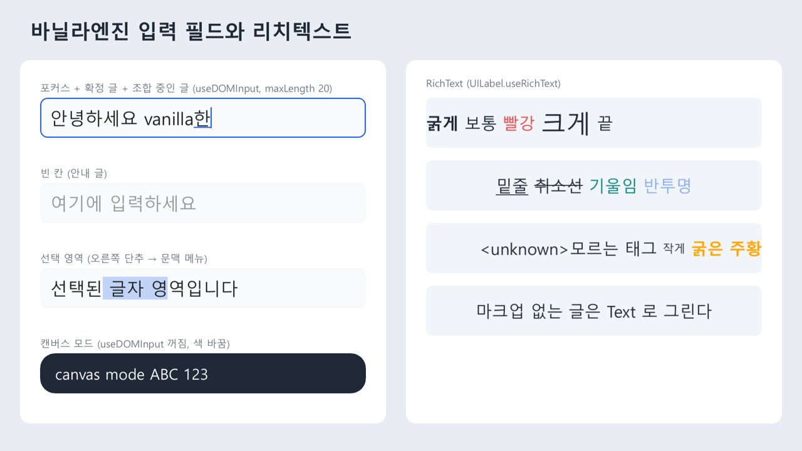

<div align="center">

# 바닐라엔진

**한 번 짠 러스트 게임 코드가 윈도우 창에서도, 웹 브라우저에서도 그대로 돕니다.**

[](UPDATE.md)
[](LICENSE)
[](Cargo.toml)
[](src/core/graphic.rs)
[](src/platform)

[왜 바닐라엔진인가](#왜-바닐라엔진인가) / [빠른 시작](#빠른-시작) / [사용법](#사용법) / [예제](#예제) / [기술 노트](#기술-노트) / [성능](#성능) / [외부 의존성](#외부-의존성) / [업데이트 기록](UPDATE.md)


</div>

---

## 왜 바닐라엔진인가

바닐라엔진은 실제 게임을 만들며 다듬어 온 웹게임 엔진 [vanilla.js](https://github.com/ddukbaek2/vanilla.js) 를 러스트로 옮긴 2D/3D 게임 엔진입니다. 검증된 API 와 씬 구조는 그대로 가져오고, 러스트의 속도와 안전함, 네이티브 실행을 더했습니다.

- **코드 하나로 데스크탑과 웹.** 같은 게임 코드로 윈도우 실행 파일(OpenGL 3.3)과 브라우저용 wasm(WebGL2)을 만듭니다. 창, GL, 입력, 애셋 로딩, 오디오, 클립보드, 한글 입력(IME)의 차이는 엔진의 플랫폼 레이어가 모두 처리합니다.
- **빌림 검사기(borrow checker)와 싸우지 않는 씬 그래프.** 노드는 제너레이셔널 핸들(`NodeId`)로 가리킵니다. `Rc<RefCell>` 없이 노드를 마음껏 만들고 지우고, 지운 노드를 가리키는 핸들은 `None` 이 되어 댕글링 참조가 생기지 않습니다.
- **익숙한 노드와 컴포넌트.** ECS 를 새로 배울 필요 없이, 유니티나 코코스처럼 노드에 컴포넌트를 붙여 게임을 짭니다. vanilla.js 와 이름과 흐름이 같아서 자바스크립트 게임을 옮기기도 쉽습니다.
- **기본으로 빠른 2D.** 자동 배칭과 화면 밖 컬링이 처음부터 켜져 있습니다. 적 3만 2천 마리가 움직이는 장면에서 드로우 콜이 32,008 번에서 73 번으로 줄어듭니다.
- **바로 쓰는 UI 위젯 20종.** 버튼, 슬라이더, 스크롤 뷰, 리스트 뷰, 드롭다운, 대화 상자, 토스트, 차트, 그리고 한글 조합까지 되는 입력 필드와 리치텍스트가 들어 있습니다.
- **연출 도구가 엔진 안에.** 파티클, 셰이더 스프라이트 효과 50종, 화면 효과 58종, 트레일, 이징 31종을 갖춘 타임라인과 애니메이터, 트윈.
- **3D 도 같은 화면에서.** glTF/GLB 와 FBX(순수 러스트 로더) 스키닝 모델, PBR 머티리얼, 그림자, 블룸, 앰비언트 오클루전, 서브서피스 스캐터링. 3D 장면 위에 2D UI 를 바로 얹습니다.
- **게임 제작에 필요한 기능까지.** 길찾기, 2D 충돌, 스티어링, 플랫포머 캐릭터 물리, 상태 머신(FSM), 오브젝트 풀, 시드 기반 난수(vanilla.js 와 비트까지 같은 수열), 다국어, 대화 시스템, 타자기 효과, 로컬 저장소, 게임패드, 웹소켓, 오디오.
- **async 없는 게임 코드.** 애셋을 요청해 두면 엔진이 로딩이 끝날 때까지 로딩 화면을 그리고, 끝나면 씬을 초기화합니다. 게임 코드에 `async` 와 `await` 가 필요 없습니다.

| UI 위젯 | 한글 입력 필드와 리치텍스트 |
| --- | --- |
|  |  |
| **셰이더 스프라이트 50종, 화면 효과, 트레일** | **스키닝 3D, 그림자, 블룸** |
|  |  |
| **타임라인** | **같은 UI 갤러리를 크롬(wasm)에서** |
|  |  |
| **리스트, 스냅 스크롤, 차트, 대화 상자** | **카메라, 길찾기, 대화 시스템, 플로팅 텍스트** |
|  |  |

## 빠른 시작

`Cargo.toml`:

```toml
[dependencies]
vanilla-engine = { git = "https://github.com/ddukbaek2/vanilla-engine" }
```

크레이트 이름은 `vanilla-engine` 이고, 코드에서는 짧게 `vanilla` 로 씁니다. (고도가 `godot`, 베비가 `bevy` 로 쓰는 것과 같은 꼴입니다)

`src/main.rs`:

```rust
use vanilla::{Colors, Engine, EngineConfiguration, Graphic, Rect, Scene, SceneBase, Vector2};

struct MainScene {
	scene_base: SceneBase,
}

impl Scene for MainScene {
	fn get_scene_base(&self) -> &SceneBase {
		&self.scene_base
	}

	fn get_scene_base_mut(&mut self) -> &mut SceneBase {
		&mut self.scene_base
	}

	fn pre_draw(&mut self, engine: &mut Engine, graphic: &mut Graphic) {
		self.scene_base.draw_scene_background(engine, graphic);
	}

	fn draw(&mut self, _engine: &mut Engine, graphic: &mut Graphic) {
		graphic.set_fill_color(Colors::WHITE);
		graphic.draw_rect(Rect::create(100.0, 100.0, 200.0, 120.0));
	}
}

fn main() {
	let mut engine_configuration = EngineConfiguration::new();
	engine_configuration.title = String::from("바닐라엔진");
	engine_configuration.auto_resize_on_window_resize = true;
	engine_configuration.reference_resolution_size = Vector2::create(1280.0, 720.0);
	let engine = Engine::new(engine_configuration);
	let main_scene = MainScene {
		scene_base: SceneBase::new(),
	};
	if let Err(error) = engine.run(Box::new(main_scene)) {
		eprintln!("{}", error);
		std::process::exit(1);
	}
}
```

```bash
cargo run --example quickstart
```

`reference_resolution_size` 는 게임이 그리는 기준 해상도입니다. 창이나 브라우저 크기가 달라도 엔진이 그 크기에 맞춰 늘리고 줄입니다.

## 사용법

### 씬 생명주기

| 단계 | 하는 일 |
| --- | --- |
| `create` | 애셋 로딩을 요청하고 `scene_base.track_asset` 으로 등록합니다 |
| `draw_on_load` | 등록한 애셋의 로딩이 끝날 때까지 매 프레임 호출됩니다. 로딩 화면을 그립니다 |
| `initialize` | 로딩이 끝난 뒤 한 번 호출됩니다. 노드 트리를 만듭니다 |
| `tick` | 매 프레임 업데이트. 기본 구현이 노드와 컴포넌트, 터치, 트윈을 업데이트합니다 |
| `pre_draw`, `draw`, `post_draw` | 매 프레임 렌더링. 기본 `draw` 가 노드 트리를 그립니다 |
| `destroy` | 씬이 언로드될 때 |

### 노드와 컴포넌트

노드를 만들고 컴포넌트를 붙입니다. 직접 만든 컴포넌트는 `tick` 에서 자기 노드를 움직입니다. ([`examples/nodebasics.rs`](examples/nodebasics.rs))


```rust
struct Spin {
	component_base: ComponentBase,
	degrees_per_second: f32,
}

impl Component for Spin {
	fn get_component_base(&self) -> &ComponentBase {
		&self.component_base
	}

	fn get_component_base_mut(&mut self) -> &mut ComponentBase {
		&mut self.component_base
	}

	fn get_component_type(&self) -> &'static str {
		"Spin"
	}

	fn tick(&mut self, context: &mut ComponentContext, time_delta: f32) {
		let transform = context.get_transform_mut();
		let local_rotation = transform.get_local_rotation();
		transform.set_local_rotation(local_rotation + self.degrees_per_second * time_delta);
	}
}

// 씬의 initialize 에서
let root_id = self.scene_base.get_root_id();
let node_tree = self.scene_base.get_node_tree_mut();
let square_id = node_tree.create_child(root_id, "square");
let square_node = &mut node_tree[square_id];
square_node.set_local_position(Vector2::create(640.0, 360.0));
square_node.set_content_size(Vector2::create(160.0, 160.0));
square_node.set_pivot(Pivot::MIDDLE_CENTER);
square_node.add_component(Paint::create_with_color("#f3e5ab"));
square_node.add_component(Spin {
	component_base: ComponentBase::new(),
	degrees_per_second: 90.0,
});
```

- `ComponentContext` 로 자기 노드와 트랜스폼, 트리 전체(다른 노드 찾기, 만들기, 지우기), 엔진(입력, 시간, 뷰, 오디오)에 접근합니다.
- 같은 노드의 다른 컴포넌트는 `context.get_node_mut().get_component_mut::<T>()` 로 찾습니다.
- 씬 코드에서 컴포넌트와 트리를 함께 수정할 때는 `node_tree.with_component_mut::<T, _>(node_id, |component, tree| ...)` 를 씁니다.
- `node_tree.destroy_node(node_id)` 는 자식 노드까지 삭제합니다. tick 이나 터치 처리 도중에 호출해도 순회가 끝난 뒤에 안전하게 삭제합니다.

### 애셋 로딩

```rust
struct GameScene {
	scene_base: SceneBase,
	logoAsset: ImageAsset,
}

impl Scene for GameScene {
	// ...

	fn create(&mut self, engine: &mut Engine) {
		self.logoAsset.load(engine, "images/logo.png");
		self.scene_base.track_asset(&self.logoAsset);
	}

	fn initialize(&mut self, _engine: &mut Engine) {
		let root_id = self.scene_base.get_root_id();
		let logoImage = self.logoAsset.get_image();
		let node_tree = self.scene_base.get_node_tree_mut();
		if let Some(logoImage) = logoImage {
			let logoId = node_tree.create_child(root_id, "logo");
			node_tree[logoId].add_component(Sprite::create_with_image(logoImage));
		}
	}
}
```

- 데스크탑은 `EngineConfiguration.asset_directory_paths` 폴더에서 바로 읽고, 웹은 `asset_base_url + 경로` 를 fetch 합니다. 게임 코드는 같습니다.
- 이미지(png, jpg, webp), 텍스트, JSON, 바이너리, 폰트(ttf, otf, woff, woff2), 오디오(ogg, mp3, wav)를 지원합니다.
- 로딩에 실패한 애셋도 완료로 처리해서 씬이 멈추지 않습니다.

### 웹으로 빌드

wasm32 타깃과 [wasm-bindgen](https://github.com/rustwasm/wasm-bindgen) CLI 가 있으면 됩니다.

```bash
rustup target add wasm32-unknown-unknown
cargo build --profile wasm-release --example uigallery --target wasm32-unknown-unknown
wasm-bindgen --target web --no-typescript --out-dir web target/wasm32-unknown-unknown/wasm-release/examples/uigallery.wasm
```

`web/index.html`:

```html
<!doctype html>
<html>
<head><meta charset="utf-8"><style>html, body { margin: 0; overflow: hidden; background: #000; }</style></head>
<body>
<script type="module">
import init from "./uigallery.js";
init();
</script>
</body>
</html>
```

캔버스는 `EngineConfiguration.canvas_id`(기본 `mainCanvas`)로 찾고, 없으면 엔진이 만듭니다.

## 예제

| 예제 | 내용 |
| --- | --- |
| `quickstart` | 빠른 시작과 같은 코드 |
| `nodebasics` | 노드, Paint, Text, 직접 만든 컴포넌트 |
| `uigallery`, `uigallery2` | UI 위젯 전부 |
| `inputgallery` | 입력 필드, 한글 IME 조합, 선택 영역, 리치텍스트, 게임패드 진동 시험 (패드의 A, B, X, Y) |
| `effectgallery` | 셰이더 스프라이트 50종, 화면 효과, 트레일, 파티클(렌더 모양 넷, 끌개, 흔들림, edge, 월드 공간) |
| `misctour` | 카메라, 길찾기, 대화 시스템, 화면 흔들림, 플로팅 텍스트 |
| `timelineshowcase` | 타임라인 문서 재생 |
| `modelviewer` | 스키닝 3D(glTF, FBX), 그림자, 블룸 |
| `engineextras` | 테, 진행 고리, 부드러운 그늘, 마우스 커서, 카메라 손짓, 마우스 단추와 손가락 입력 (직접 눌러 본다) |
| `devtoolsshowcase` | 개발자 도구(F2): 하이어라키, 인스펙터, 통계, 로컬 스토리지, 설정 |
| `toonshowcase` | 툰 3D: 기본 도형과 바깥선, GLB 모형의 뼈대 움직임, 셀 셰이딩 |
| `toonview` | 노드 사각형 안 툰(ToonView3D), Camera3D 로 3D 점 위에 얹은 2D, 비치는 것 정렬, 툰 색 보정 |
| `audiotone` | 소리 재생, 효과음 풀, 비프 |
| `gamepadlist` | 연결된 게임패드 목록 |
| `uiscenelayout` | UIScene 과 UINode 오토레이아웃(세이프 에어리어 가이드, 여백 가이드, 같은 너비 단추, 글의 자연 크기) |
| `panelayout` | DOM 화면 분할 패널(Pane): 도구 막대, 끌어서 크기를 바꾸는 패널, 오른쪽 패널의 엔진 캔버스 (웹 전용) |
| `textshaping` | 글자 모양 짓기: 오른쪽에서 왼쪽 글(아랍어 글자 잇기), 가짜 기울임과 굵게, 한중일 낱말 줄바꿈, 글자 묶음 표시 수, 그림자 글의 기울임과 밑줄, DynamicFont 글자 아틀라스 |
| `scenedocument` | UI 문서: vanilla.js 비주얼 에디터 꼴의 씬 파일(.scene.json)을 읽어 노드 트리를 짓고, 다시 내보내 견준다 |

```bash
cargo run --example uigallery
cargo run --release --example modelviewer
```

`modelviewer` 와 `timelineshowcase` 는 vanilla.js 의 예제 애셋을 씁니다. vanilla.js 저장소를 이 저장소 옆에 받아 두면 됩니다. (`Github/vanilla.js`, `Github/vanilla-engine`)

## 기술 노트

러스트로 게임 엔진을 만들 때 부딪히는 문제를 바닐라엔진은 이렇게 풀었습니다. 자세한 구조는 [ARCHITECTURE.md](ARCHITECTURE.md) 에 있습니다.

**제너레이셔널 핸들 기반 노드 트리.** 씬의 `NodeTree` 가 모든 노드를 [slotmap](https://crates.io/crates/slotmap) 하나에 담고, 부모와 자식을 `NodeId`(슬롯 인덱스 + 세대 번호)로 연결합니다. 노드를 지운 뒤 같은 슬롯이 재사용되어도 세대 번호가 달라서 예전 핸들은 `None` 을 반환합니다. 순회 도중의 삭제는 비활성으로 표시해 두었다가 순회가 끝난 뒤에 처리합니다.

**컴포넌트가 자기 노드와 트리에 동시에 접근하는 방법.** 컴포넌트의 `tick` 을 호출할 때는 그 컴포넌트 하나만 노드에서 잠시 꺼내고 플레이스홀더로 바꿔 둡니다. 그래서 컴포넌트는 `&mut self` 를 가진 채로 자기 노드, 트리 전체, 같은 노드의 형제 컴포넌트, 엔진에 빌림 충돌 없이 접근할 수 있습니다.

**하나의 경로로 모이는 2D 렌더링.** 스프라이트, 도형, 텍스트, 파티클이 모두 `Graphic.draw_vertices` 하나를 거칩니다. 버텍스를 CPU 에서 변환해 모아 두었다가 같은 텍스처가 이어지는 동안 드로우 콜 한 번으로 그리고, 블렌드 모드가 바뀌거나 클리핑이 걸릴 때, 프레임이 끝날 때 플러시합니다. 정점마다 색과 틴트를 싣는 배치 셰이더라서 색이나 틴트가 다른 그리기도 같은 배치에 들어갑니다. 벤치 장면에서 배칭을 켠 화면과 끈 화면을 비교하면 픽셀까지 같습니다.

**컬링과 업데이트 생략.** 영역 안에만 그리는 컴포넌트(Paint, Sprite, Mask)와 글(Text, UILabel, ShadowText)만 붙은 노드는 화면 밖이면 그리지 않습니다. 글은 정렬, 넘침, 줄바꿈 결과로 실제로 그리는 사각형을 셈해 판정합니다. 그리기만 하는 컴포넌트만 붙은 노드는 업데이트에서 아예 건너뜁니다.

**async 없는 애셋 로딩.** 애셋을 요청하면 로딩 핸들을 받고, 데이터가 도착하면 상태가 완료로 바뀝니다. 데스크탑은 파일을 바로 읽어서 `create` 직후에 `initialize` 가 호출되고, 웹은 fetch 가 끝나는 프레임까지 `draw_on_load` 로 로딩 화면을 그립니다. 같은 게임 코드가 두 플랫폼에서 그대로 돌아갑니다.

**텍스트 렌더링.** 문자열 하나를 [fontdue](https://crates.io/crates/fontdue) 로 래스터라이즈해 텍스처 한 장으로 베이크하고, 최근에 쓴 512 개를 LRU 캐시에 둡니다. 첫 폰트에 없는 글자는 기본 폰트, 폴백 폰트 순으로 찾습니다. 웹 폰트(WOFF, WOFF2)도 디코딩해 쓰고, 웹에서 폰트를 지정하지 않으면 브라우저 Canvas2D 로 베이크해 시스템 폰트로 나옵니다. 밑줄, 취소선, 낱말 단위와 글자 단위 줄바꿈을 지원하고, 기울임은 래스터를 기울여 흉내 냅니다(웹 시스템 폰트는 브라우저의 italic). 도트 폰트용으로 글자 안티앨리어싱을 끌 수 있습니다(`set_text_antialias_enabled`).

**GL 컨텍스트 하나에 2D 와 3D.** 씬의 `pre_draw` 에서 그림자, 3D 장면, 블룸 패스를 그리고 `graphic.restore_render_state()` 로 2D 상태를 되살린 뒤 UI 를 그립니다. 화면 효과는 화면(또는 영역)을 텍스처로 캡처해 풀스크린 패스를 체인으로 연결합니다.

**웹에서도 제대로 되는 한글 입력.** 웹에서는 입력 필드마다 숨겨진 DOM `<input>` 을 두고 IME 조합 이벤트를 받아 캔버스에 그립니다. iOS 처럼 사용자 입력 안에서만 키보드가 뜨는 브라우저를 위해 터치 핸들러 안에서 포커스를 줍니다. 데스크탑은 winit 의 IME 이벤트를 씁니다.

**플랫폼 레이어 분리.** 창, GL, 입력, 메인 루프, 파일 읽기, 오디오는 `platform/desktop` 과 `platform/web` 에만 있고, 엔진 코어는 플랫폼에 의존하지 않습니다. 새 플랫폼은 이 레이어에 모듈을 추가하면 됩니다.

## 성능

둥근 사각형 적과 사각형 탄환이 노드 하나씩으로 움직이는 벤치 장면의 결과입니다. 적 하나, 탄환 하나가 모두 노드 하나와 Paint 컴포넌트 하나입니다. (데스크탑 네이티브, RTX 2070 SUPER, 수직 동기 끔)

| 적 수 | 배칭 끔 | 배칭 켬 | 드로우 콜 (배칭 전 → 켬) |
| --- | --- | --- | --- |
| 4,000 | 125.5 fps | **153.1 fps** | 4,165 → 15 |
| 8,000 | 59.8 fps | **86.6 fps** | 8,097 → 23 |
| 16,000 | 26.2 fps | **36.8 fps** | 16,015 → 40 |
| 32,000 | 10.4 fps | **15.5 fps** | 32,008 → 73 |

웹(wasm, 크롬, 배칭 켬)에서는 적 1만 6천 마리 장면이 배칭 전 24.5 fps 에서 40.4 fps 가 되었습니다.

## 외부 의존성

엔진이 직접 쓰는 크레이트입니다. 버전은 `Cargo.lock` 기준이고, 직접 의존성은 모두 MIT, Apache-2.0, Zlib 같은 허용적 라이선스입니다.

**데스크탑, 웹 공통**

| 크레이트 | 버전 | 쓰는 곳 | 하는 일 | 라이선스 |
| --- | --- | --- | --- | --- |
| [glow](https://crates.io/crates/glow) | 0.18.0 | `core/graphic.rs`, `graphics3d/`, `effect/` | OpenGL 3.3 과 WebGL2 를 같은 API 로 감싼 GL 바인딩. 모든 렌더링이 이 위에서 돕니다 | MIT / Apache-2.0 / Zlib |
| [fontdue](https://crates.io/crates/fontdue) | 0.9.5 | `core/textstringtexturecache.rs` | 폰트 래스터라이즈. 문자열을 텍스처로 베이크합니다 | MIT / Apache-2.0 / Zlib |
| [wuff](https://crates.io/crates/wuff) | 0.2.10 | `core/textstringtexturecache.rs` | WOFF, WOFF2 웹 폰트 디코딩 | MIT |
| [rustybuzz](https://crates.io/crates/rustybuzz) | 0.20.1 | `core/textshaping.rs` | 글자 모양 짓기(HarfBuzz 를 옮긴 것). 아랍어 글자 잇기, 합자, 커닝, 결합 부호 자리를 브라우저처럼 잡습니다 | MIT |
| [unicode-bidi](https://crates.io/crates/unicode-bidi) | 0.3.18 | `core/textshaping.rs` | 양방향 정렬(UAX #9). 오른쪽에서 왼쪽 글과 섞인 글의 그리는 차례 | MIT / Apache-2.0 |
| [unicode-segmentation](https://crates.io/crates/unicode-segmentation) | 1.13.3 | `core/component/text.rs`, `core/textshaping.rs`, `misc/typewriter.rs`, `misc/dynamicfont.rs` | 글자 묶음 나누기(UAX #29). 줄바꿈과 표시 글자 수가 받침, 결합 부호, 이모지 묶음을 쪼개지 않습니다 | MIT / Apache-2.0 |
| [icu_segmenter](https://crates.io/crates/icu_segmenter) | 2.4.0 | `core/component/text.rs` (데스크탑) | 낱말 나누기. 공백 없이 쓰는 한중일(사전), 태국어 같은 동남아 글자(LSTM)의 낱말 사이에서 줄을 바꿉니다. 웹은 원본처럼 브라우저 Intl.Segmenter 를 써서 넣지 않습니다 | Unicode-3.0 |
| [image](https://crates.io/crates/image) | 0.25.10 | `core/image.rs`, `graphics3d/material.rs`, 창 아이콘, 화면 저장 | png, jpeg, webp 디코딩과 PNG 저장 (이 세 형식만 켭니다) | MIT / Apache-2.0 |
| [slotmap](https://crates.io/crates/slotmap) | 1.1.1 | `core/node/nodetree.rs` | 노드 저장소. 제너레이셔널 핸들 `NodeId` 를 만듭니다 | Zlib |
| [serde_json](https://crates.io/crates/serde_json) | 1.0.154 | JSON 애셋, 타임라인, 애니메이터, 파티클 설정, 다국어, 로컬 저장소, 애니메이션 클립, 웹소켓 메시지, UI 문서(씬 파일) | JSON 파싱과 저장. 객체 키는 적힌 차례를 지킵니다 (preserve_order) | MIT / Apache-2.0 |
| [flate2](https://crates.io/crates/flate2) | 1.1.11 | `graphics3d/fbxloader.rs` | FBX 의 압축 배열(zlib) 해제. 순수 러스트 백엔드라 wasm 에서도 돕니다 | MIT / Apache-2.0 |
| [web-time](https://crates.io/crates/web-time) | 1.1.0 | `core/engine.rs`, `base/math.rs` | 프레임 시계와 난수 시드. 데스크탑은 `std::time`, 웹은 `performance.now()` 를 같은 API 로 씁니다 | MIT / Apache-2.0 |
| [gilrs](https://crates.io/crates/gilrs) | 0.11.2 | `core/gamepadmanager.rs` | 게임패드 입력. 데스크탑은 OS 입력, 웹은 Gamepad API 를 읽습니다 | MIT / Apache-2.0 |
| [ewebsock](https://crates.io/crates/ewebsock) | 0.8.0 | `web/websocketclient.rs` | 웹소켓. 데스크탑은 tungstenite, 웹은 브라우저 WebSocket 을 씁니다 | MIT / Apache-2.0 |

**데스크탑만**

| 크레이트 | 버전 | 쓰는 곳 | 하는 일 | 라이선스 |
| --- | --- | --- | --- | --- |
| [winit](https://crates.io/crates/winit) | 0.30.13 | `platform/desktop.rs` | 창, 키보드, 마우스, 터치, IME 이벤트와 이벤트 루프 | Apache-2.0 |
| [glutin](https://crates.io/crates/glutin), [glutin-winit](https://crates.io/crates/glutin-winit) | 0.32.3, 0.5.0 | `platform/desktop.rs` | OpenGL 3.3 코어 컨텍스트 생성 (깊이 24, 스텐실 8) | Apache-2.0, MIT |
| [raw-window-handle](https://crates.io/crates/raw-window-handle) | 0.6.2 | `platform/desktop.rs` | winit 창을 glutin 에 넘깁니다 | MIT / Apache-2.0 / Zlib |
| [kira](https://crates.io/crates/kira) | 0.12.6 | `platform/audio/desktop.rs` | 오디오 재생과 믹서 트랙. ogg, mp3, wav 디코딩만 켭니다 | MIT / Apache-2.0 |
| [arboard](https://crates.io/crates/arboard) | 3.7.0 | `platform/desktop/textinput.rs` | 시스템 클립보드. 입력 필드의 복사, 잘라내기, 붙여넣기 | MIT / Apache-2.0 |

**macOS 만**

| 크레이트 | 버전 | 쓰는 곳 | 하는 일 | 라이선스 |
| --- | --- | --- | --- | --- |
| [objc2-game-controller](https://crates.io/crates/objc2-game-controller), [objc2-core-haptics](https://crates.io/crates/objc2-core-haptics) | 0.3.2, 0.3.2 | `platform/desktop/gamepadhaptics.rs` | 게임패드 진동. gilrs 가 맥에서 진동을 대지 않아 GameController 의 컨트롤러 햅틱으로 CoreHaptics 엔진을 지어 떱니다 (쓰는 기능만 켭니다) | Zlib / Apache-2.0 / MIT |
| [objc2](https://crates.io/crates/objc2), [objc2-foundation](https://crates.io/crates/objc2-foundation), [block2](https://crates.io/crates/block2) | 0.6.5, 0.3.2, 0.6.2 | `platform/desktop/gamepadhaptics.rs` | 오브젝티브 C 메시지, NSArray 같은 기본 타입, 햅틱 엔진의 멈춤과 리셋 처리기(블록) | MIT |

**웹(wasm)만**

| 크레이트 | 버전 | 쓰는 곳 | 하는 일 | 라이선스 |
| --- | --- | --- | --- | --- |
| [wasm-bindgen](https://crates.io/crates/wasm-bindgen), [js-sys](https://crates.io/crates/js-sys) | 0.2.130, 0.3.107 | `platform/web.rs` 외 | 러스트와 자바스크립트 연결 | MIT / Apache-2.0 |
| [web-sys](https://crates.io/crates/web-sys) | 0.3.107 | `platform/web.rs`, `platform/audio/web.rs`, 입력 필드, 로컬 저장소 | 캔버스, WebGL2, DOM 이벤트, WebAudio, fetch, localStorage | MIT / Apache-2.0 |
| [wasm-bindgen-futures](https://crates.io/crates/wasm-bindgen-futures) | 0.4.80 | `platform/web.rs`, `platform/audio/web.rs` | fetch, 오디오 디코딩 같은 브라우저 비동기 API 를 엔진 안에서 기다립니다. 게임 코드는 async 를 쓰지 않습니다 | MIT / Apache-2.0 |

## 진행 상황

- 버전 0.3.2. 버전 번호는 vanilla.js 0.3.2 에서 이어 받았습니다.
- vanilla.js 의 원본 160 파일 가운데 122 파일을 옮겼습니다. 20 파일은 러스트에 필요 없어서(컬렉션, 죽은 코드 같은 것) 옮기지 않았습니다.
- 다음에 옮길 것: DynamicFont
- 윈도우 11 데스크탑, macOS(애플 실리콘) 데스크탑, 크롬에서 확인했습니다. 리눅스와 실제 모바일 기기는 아직 돌려 보지 않았습니다.

## 코드 스타일

이름은 러스트 규칙([Rust API Guidelines C-CASE](https://rust-lang.github.io/api-guidelines/naming.html))을 따르고, 나머지는 vanilla.js 와 같은 스타일을 씁니다.

- 함수, 메서드, 변수, 필드, 모듈은 snake_case, 타입과 트레이트와 열거 값은 UpperCamelCase, 상수는 SCREAMING_SNAKE_CASE 입니다. 그래서 vanilla.js 의 `setFillColor` 는 `set_fill_color`, `Colors.white` 는 `Colors::WHITE` 입니다. 줄임말을 쓰지 않습니다.
- 중괄호를 늘 쓰고, `else` 는 새 줄에서 시작합니다. 들여쓰기는 탭입니다.
- 함수마다 `//====` 머리 주석을 달고, 파일 머리에 원본의 어느 파일을 옮겼는지 적습니다.
- rustfmt 는 쓰지 않습니다.

## 개발 환경

- Windows 11 Pro
- Rust 1.99.1
- 쓰는 크레이트는 [외부 의존성](#외부-의존성) 에 정리했습니다

## 링크

- 원본 엔진: <https://github.com/ddukbaek2/vanilla.js>
- 배포 페이지: <https://ddukbaek2.com>

## 라이선스

[MIT](LICENSE) © ddukbaek2
