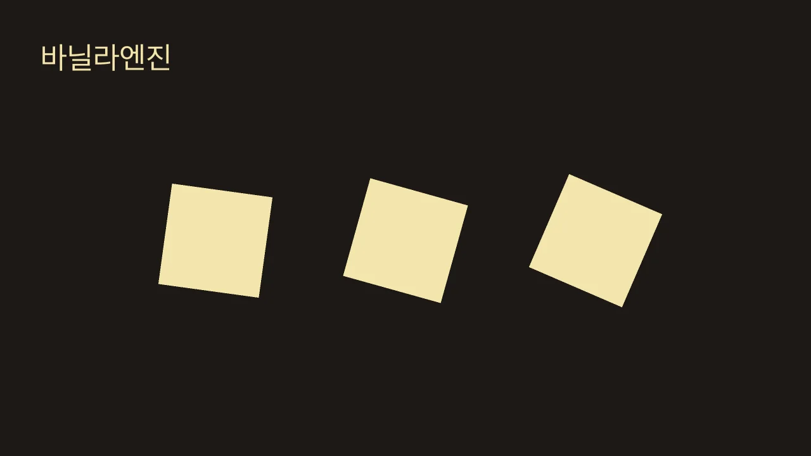
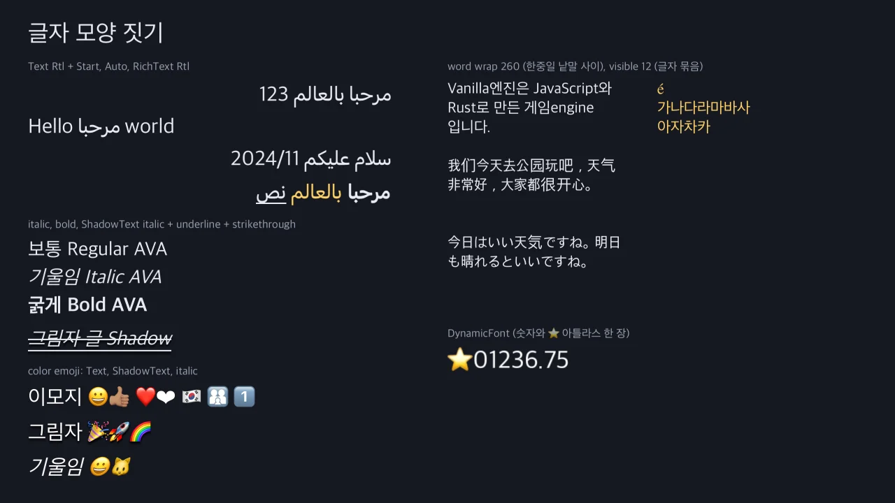
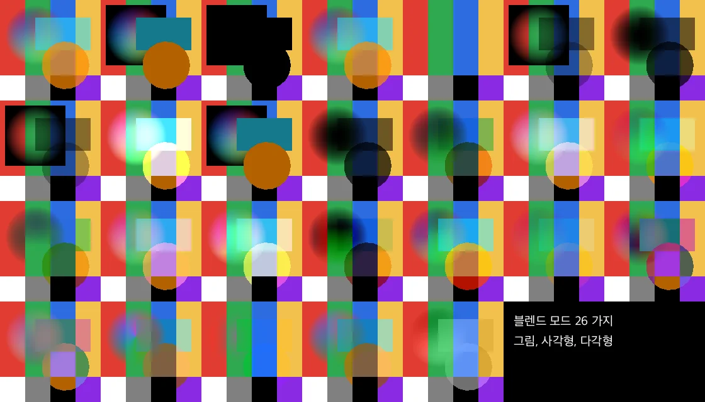
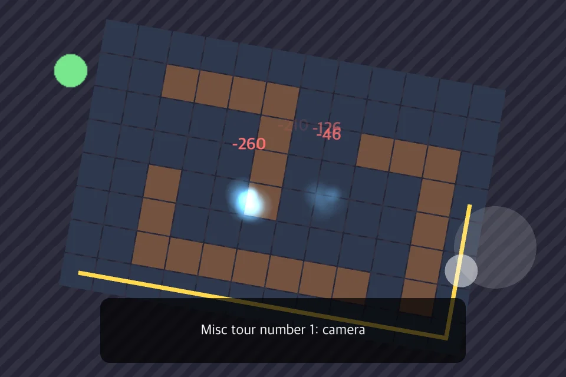

# Drawing

There are two ways to draw. If you attach drawing components (`Paint`, `Sprite`, `Text`, `RichText` and the decoration components) to nodes, the engine draws them along with the node tree. Inside a scene's `pre_draw`, `draw` and `post_draw`, or a component's `draw`, you draw directly with `Graphic`. This chapter covers both ways, blend modes and `Camera2D`, which shows the screen through a camera.

## Drawing directly with Graphic

`Graphic` is a renderer that builds a Canvas2D style model (top left origin, pixel units, state stack) on top of OpenGL 3.3 (desktop) and WebGL2 (web). The scene's drawing functions receive it as `&mut Graphic`. The transform, global alpha and blend mode are reset at the start of every frame, so to draw in view coordinates call `scene_base.draw_scene_background(engine, graphic)` in `pre_draw`. (It fills the background and applies the view coordinate system; see the "Engine and Scene Lifecycle" chapter)

| Group | Functions |
| --- | --- |
| Color | `set_fill_color(color)`, `set_stroke_color(color)`. A `Color` or a `"#rgb"`, `"#rgba"`, `"#rrggbb"`, `"#rrggbbaa"`, `"rgb(...)"` or `"rgba(...)"` string |
| State | `push_state()`, `pop_state()` (save and restore the transform, global alpha, blend, colors, tint, font and text alignment), `translate(x, y)`, `rotate(radian)`, `scale(x, y)`, `set_global_alpha(value)`, `multiply_global_alpha(value)` |
| Filled shapes | `draw_rect(rect)`, `draw_round_rect(rect, round_size)`, `draw_circle(center, radius)`, `draw_ring(center, inner_radius, outer_radius, start_radian, end_radian)`, `draw_convex_polygon(positions, color)` |
| Lines | `draw_line(positions, size)`, `draw_line_loop(positions, size)`, `draw_stroke_rect(rect, line_width)`, `draw_stroke_round_rect(rect, round_size, line_width)`, `draw_stroke_circle(center, radius, line_width)`, `draw_arc(center, radius, start_radian, end_radian, line_width)`, `draw_line_segments(position_values, size)` |
| Images | `draw_image(image, position, size)`, `draw_image_with_image_rect(image, position, size, image_rect)`, `draw_image_with_nine_slice(image, position, size, nine_slice)` |
| Text | `set_font_string(font_string)`, `set_text_align(text_align)`, `set_text_baseline(text_baseline)`, `draw_fill_text(text, x, y)`, `draw_stroke_text(text, x, y, line_width)`, `measure_text(text)` |

Filled shapes and `draw_fill_text` use the fill color; lines and `draw_stroke_text` use the stroke color. Only `draw_convex_polygon` takes its color as an argument. Angles are in radians: 0 points right and increasing values go clockwise on screen. Image arguments are `&Rc<Image>`.

```rust,no_run
use vanilla::{math, Color, Engine, EngineConfiguration, Graphic, Rect, Scene, SceneBase, TextAlign, TextBaseline, Vector2};

struct ShapeScene {
	scene_base: SceneBase,
}

impl Scene for ShapeScene {
	fn get_scene_base(&self) -> &SceneBase {
		&self.scene_base
	}

	fn get_scene_base_mut(&mut self) -> &mut SceneBase {
		&mut self.scene_base
	}

	fn pre_draw(&mut self, engine: &mut Engine, graphic: &mut Graphic) {
		self.scene_base.draw_scene_background(engine, graphic);
	}

	fn draw(&mut self, _engine: &mut Engine, graphic: &mut Graphic) {
		self.scene_base.draw(graphic);
		graphic.set_fill_color("#2a3550");
		graphic.draw_round_rect(Rect::create(40.0, 40.0, 360.0, 220.0), 24.0);

		graphic.set_fill_color(Color::create(1.0, 0.8, 0.2, 1.0));
		graphic.draw_circle(Vector2::create(560.0, 150.0), 80.0);
		graphic.draw_ring(Vector2::create(800.0, 150.0), 50.0, 80.0, -math::PI / 2.0, math::PI);

		graphic.set_stroke_color("#66ddff");
		graphic.draw_line(&[Vector2::create(40.0, 320.0), Vector2::create(240.0, 420.0), Vector2::create(440.0, 320.0)], 6.0);
		graphic.draw_stroke_rect(Rect::create(520.0, 300.0, 160.0, 120.0), 3.0);

		let triangle = [Vector2::create(800.0, 300.0), Vector2::create(900.0, 460.0), Vector2::create(700.0, 460.0)];
		graphic.draw_convex_polygon(&triangle, Color::create(0.6, 0.4, 1.0, 1.0));

		graphic.push_state();
		graphic.translate(1040.0, 380.0);
		graphic.rotate(math::PI / 8.0);
		graphic.set_global_alpha(0.6);
		graphic.set_fill_color("#ff6688");
		graphic.draw_rect(Rect::create(-80.0, -50.0, 160.0, 100.0));
		graphic.pop_state();

		graphic.set_fill_color("#ffffff");
		graphic.set_font_string("32px sans-serif");
		graphic.set_text_align(TextAlign::Left);
		graphic.set_text_baseline(TextBaseline::Top);
		graphic.draw_fill_text("Hello, Graphic", 40.0, 520.0);
	}
}

fn main() {
	let mut engine_configuration = EngineConfiguration::new();
	engine_configuration.reference_resolution_size = Vector2::create(1280.0, 720.0);
	engine_configuration.auto_resize_on_window_resize = true;
	let engine = Engine::new(engine_configuration);
	let shape_scene = ShapeScene {
		scene_base: SceneBase::new(),
	};
	if let Err(error) = engine.run(Box::new(shape_scene)) {
		eprintln!("{}", error);
	}
}
```

The scene's default `draw` draws the node tree. If you override `draw`, call `self.scene_base.draw(graphic)` as above so the nodes are drawn too.

Inside a component's `draw(transform, graphic)` you use the same functions. There, the origin is the top left of the node's content area and the node's position, rotation, scale and opacity are already applied. (the "Nodes and Components" chapter)

## Drawing components



| Component | What it draws |
| --- | --- |
| `Paint` | A single color rectangle the size of the content (`set_color`, `set_round_size`, white by default) |
| `Sprite` | An image. Without an image it fills like `Paint` (transparent by default) |
| `Text` | Text in one font, one size and one color (multiple lines allowed) |
| `RichText` | Text whose style changes per segment through markup |

Components draw inside the node's content size. If a node has no content size (0, 0), nothing shows up. In the original, `Sprite` derives from `Paint` and `RichText` from `Text`, but the Rust version contains them instead, so they are separate types. (`RichText::get_text_component_mut()` gives you the contained `Text`)

## Sprite

```rust,no_run
use std::path::PathBuf;
use vanilla::{Color, Engine, EngineConfiguration, Graphic, ImageAsset, Rect, Scene, SceneBase, Sprite, SpriteDrawMode, Vector2};

struct SpriteScene {
	scene_base: SceneBase,
	image_asset: ImageAsset,
}

impl Scene for SpriteScene {
	fn get_scene_base(&self) -> &SceneBase {
		&self.scene_base
	}

	fn get_scene_base_mut(&mut self) -> &mut SceneBase {
		&mut self.scene_base
	}

	fn create(&mut self, engine: &mut Engine) {
		self.image_asset.load(engine, "atlas/icons.png");
		self.scene_base.track_asset(&self.image_asset);
	}

	fn initialize(&mut self, _engine: &mut Engine) {
		let image = match self.image_asset.get_image() {
			Some(image) => {
				image
			}
			None => {
				return;
			}
		};
		let root_id = self.scene_base.get_root_id();
		let node_tree = self.scene_base.get_node_tree_mut();

		let whole_id = node_tree.create_child(root_id, "whole");
		node_tree[whole_id].set_content_size(Vector2::create(256.0, 256.0));
		node_tree[whole_id].set_local_position(Vector2::create(220.0, 360.0));
		node_tree[whole_id].add_component(Sprite::create_with_image(image.clone()));

		let frame_id = node_tree.create_child(root_id, "frame");
		node_tree[frame_id].set_content_size(Vector2::create(192.0, 192.0));
		node_tree[frame_id].set_local_position(Vector2::create(560.0, 360.0));
		let frame_sprite = node_tree[frame_id].add_component(Sprite::create_with_image(image.clone()));
		frame_sprite.set_image_rect(Rect::create(63.0, 2.0, 48.0, 48.0));

		let tint_id = node_tree.create_child(root_id, "tint");
		node_tree[tint_id].set_content_size(Vector2::create(160.0, 144.0));
		node_tree[tint_id].set_local_position(Vector2::create(800.0, 360.0));
		let tint_sprite = node_tree[tint_id].add_component(Sprite::create_with_image(image.clone()));
		tint_sprite.set_image_rect(Rect::create(39.0, 55.0, 40.0, 36.0));
		tint_sprite.set_color(Color::create(1.0, 0.2, 0.2, 0.5));

		let tiled_id = node_tree.create_child(root_id, "tiled");
		node_tree[tiled_id].set_content_size(Vector2::create(180.0, 400.0));
		node_tree[tiled_id].set_local_position(Vector2::create(1080.0, 360.0));
		let tiled_sprite = node_tree[tiled_id].add_component(Sprite::create_with_image(image));
		tiled_sprite.set_image_rect(Rect::create(84.0, 55.0, 30.0, 30.0));
		tiled_sprite.set_sprite_draw_mode(SpriteDrawMode::Tiled);
	}

	fn pre_draw(&mut self, engine: &mut Engine, graphic: &mut Graphic) {
		self.scene_base.draw_scene_background(engine, graphic);
	}
}

fn main() {
	let mut engine_configuration = EngineConfiguration::new();
	engine_configuration.reference_resolution_size = Vector2::create(1280.0, 720.0);
	engine_configuration.auto_resize_on_window_resize = true;
	engine_configuration.asset_directory_paths = vec![PathBuf::from("examples/assets")];
	let engine = Engine::new(engine_configuration);
	let sprite_scene = SpriteScene {
		scene_base: SceneBase::new(),
		image_asset: ImageAsset::new(),
	};
	if let Err(error) = engine.run(Box::new(sprite_scene)) {
		eprintln!("{}", error);
	}
}
```

`examples/assets/atlas/icons.png` is a 128 x 128 icon sheet included in the repository. Request the image in `create` and hand it over with `track_asset`; then take it out with `get_image()` in `initialize`, which is called after loading finishes. (the "Assets" chapter)

- `Sprite::create_with_image(image)` and `set_image(Some(image))` take an `Rc<Image>`. The image is stretched to the node's content size. With `set_image(None)` it fills a color rectangle.
- `set_image_rect(rect)` draws only one piece of the image. (in pixels, from the image's top left) `Rect::zero()` means the whole image. `set_frame(Some(&frame))` applies a `Frame` (an image and a region) at once. (`SpriteAtlas` is in the "Assets" chapter)
- `set_sprite_draw_mode(mode)`: `SpriteDrawMode::Simple` (default, stretch), `SpriteDrawMode::Sliced` (nine slice), `SpriteDrawMode::Tiled` (repeats the piece at its own size to fill, clipping what overflows).
- `Sliced` takes the border thickness from `set_nine_slice(rect)`. The rectangle's `x` is the left, `y` the top, `width` the right and `height` the bottom thickness. `Sliced` uses the whole image and ignores the image rect. If the content size is smaller than the sum of the borders, nothing is drawn.
- When the alpha of `set_color(color)` is above 0, that color is laid over only the image's shape (its opaque parts) at the alpha ratio.
- `set_horizontal_flip` and `set_vertical_flip` flip around the left edge (top edge) of the content area, so the image is drawn outside the content area to the left (top). To flip in place, give the node a negative local scale. (`set_local_scale_xy(-1.0, 1.0)`, which flips around the pivot)

```rust
use vanilla::{BlendMode, Image, Rect, Sprite, SpriteDrawMode, Vector2};

let image = Image::create_from_pixels(48, 48, vec![255u8; 48 * 48 * 4]);
let mut sprite = Sprite::create_with_image(image);
assert!(sprite.get_image_rect().is_zero());
assert_eq!(sprite.get_sprite_draw_mode(), SpriteDrawMode::Simple);
assert_eq!(sprite.get_sprite_blend_mode(), BlendMode::Normal);

sprite.set_sprite_draw_mode(SpriteDrawMode::Sliced);
sprite.set_nine_slice(Rect::create(16.0, 16.0, 16.0, 16.0));
assert_eq!(sprite.get_nine_slice().size.x, 16.0);

sprite.set_horizontal_flip(true);
assert_eq!(sprite.get_flip(), Vector2::create(-1.0, 1.0));

let mut plain = Sprite::new();
plain.set_color("#44aa66");
plain.set_round_size(8.0);
assert!(plain.get_image().is_none());
```

## Text



```rust,no_run
use vanilla::{Color, Engine, EngineConfiguration, Graphic, Paint, RichText, Scene, SceneBase, Text, TextAlign, TextBaseline, Vector2};

struct TextScene {
	scene_base: SceneBase,
}

impl Scene for TextScene {
	fn get_scene_base(&self) -> &SceneBase {
		&self.scene_base
	}

	fn get_scene_base_mut(&mut self) -> &mut SceneBase {
		&mut self.scene_base
	}

	fn initialize(&mut self, _engine: &mut Engine) {
		let root_id = self.scene_base.get_root_id();
		let node_tree = self.scene_base.get_node_tree_mut();

		let title_id = node_tree.create_child(root_id, "title");
		node_tree[title_id].set_content_size(Vector2::create(800.0, 80.0));
		node_tree[title_id].set_local_position(Vector2::create(640.0, 100.0));
		let title = node_tree[title_id].add_component(Text::create_with_text("vanilla-engine", 64.0));
		title.set_bold(true);
		title.set_text_color("#ffe08a");
		title.set_stroke_color("#402000");
		title.set_stroke_width(4.0);

		let body_id = node_tree.create_child(root_id, "body");
		node_tree[body_id].set_content_size(Vector2::create(520.0, 200.0));
		node_tree[body_id].set_local_position(Vector2::create(400.0, 330.0));
		node_tree[body_id].add_component(Paint::create_with_color(Color::create(0.0, 0.0, 0.0, 0.4)));
		let body = node_tree[body_id].add_component(Text::create_with_text("Text wraps inside the node width when a word wrap width is set or the text has a line break.", 26.0));
		body.set_text_align(TextAlign::Left);
		body.set_text_baseline(TextBaseline::Top);
		body.set_word_wrap_width(500.0);
		body.set_line_spacing(1.4);

		let rich_id = node_tree.create_child(root_id, "rich");
		node_tree[rich_id].set_content_size(Vector2::create(600.0, 60.0));
		node_tree[rich_id].set_local_position(Vector2::create(960.0, 330.0));
		let rich = node_tree[rich_id].add_component(RichText::new());
		rich.set_font_size(30.0);
		rich.set_text("<b>Bold</b>, <color=#ff6666>red</color>, <size=40>big</size> and <u>underline</u>");

		let button_id = node_tree.create_child(root_id, "button");
		node_tree[button_id].set_content_size(Vector2::create(200.0, 60.0));
		node_tree[button_id].set_local_position(Vector2::create(960.0, 480.0));
		let button_paint = node_tree[button_id].add_component(Paint::create_with_color("#3366cc"));
		button_paint.set_round_size(12.0);
		let button_text = node_tree[button_id].add_component(Text::create_with_text("A very long button caption", 28.0));
		button_text.set_fit_width(180.0, 0.55);
	}

	fn pre_draw(&mut self, engine: &mut Engine, graphic: &mut Graphic) {
		self.scene_base.draw_scene_background(engine, graphic);
	}
}

fn main() {
	let mut engine_configuration = EngineConfiguration::new();
	engine_configuration.reference_resolution_size = Vector2::create(1280.0, 720.0);
	engine_configuration.auto_resize_on_window_resize = true;
	let engine = Engine::new(engine_configuration);
	let text_scene = TextScene {
		scene_base: SceneBase::new(),
	};
	if let Err(error) = engine.run(Box::new(text_scene)) {
		eprintln!("{}", error);
	}
}
```

`Text` defaults to size 32, white, centered (`TextAlign::Center`), middle baseline (`TextBaseline::Middle`), stroke width 0, line spacing 1.25, word wrapping and the font name `"default"`. The font name `"default"` is the engine's default font (the system font unless you provide one).

```rust
use vanilla::{Color, Text, TextAlign, TextBaseline, TextWrapMode};

let mut text = Text::new();
assert_eq!(text.get_font_size(), 32.0);
assert_eq!(text.get_text_color(), Color::white());
assert_eq!(text.get_text_align(), TextAlign::Center);
assert_eq!(text.get_text_baseline(), TextBaseline::Middle);
assert_eq!(text.get_stroke_width(), 0.0);
assert_eq!(text.get_line_spacing(), 1.25);
assert_eq!(text.get_wrap_mode(), TextWrapMode::Word);
assert_eq!(text.get_font_family(), "default");
assert_eq!(text.get_visible_character_count(), -1);

text.set_visible_character_count(-5);
assert_eq!(text.get_visible_character_count(), -1);
```

- Text is placed inside the node's content area. Horizontally it sits at the left edge when the alignment is `Left`, the right edge when `Right`, and the center otherwise (`Start` and `End` resolve to left or right depending on the text direction). Vertically it sits at the top when the baseline is `Top`, at the bottom for `Bottom`, `Alphabetic` and `Ideographic`, and in the middle otherwise.
- Text is drawn on multiple lines when `set_word_wrap_width(width)` is above 0 or the text contains `"\n"`. Multi-line text without a width wraps at the node width. `set_wrap_mode(TextWrapMode::Character)` breaks at characters regardless of words. (default `TextWrapMode::Word`)
- `set_fit_width(width, minimum_ratio)` shrinks single line text from its set size down to the minimum ratio when it overflows that width. (the default minimum ratio is 0.55) Use it for button labels whose length differs per language. Rust has no default arguments, so you pass the minimum ratio too.
- `set_visible_character_count(count)` shows only that many grapheme clusters from the start. (-1 shows everything; for typewriter effects)
- `set_font_family(name)` takes a registered font name. It takes the place of the original `setFont(font)`. Loading and registering fonts is covered in the "Assets" chapter.

## RichText

`RichText::set_text` reads markup and splits it into segments. Styles a segment does not set follow the settings of the contained `Text`.

| Tag | Meaning |
| --- | --- |
| `<b>...</b>`, `<i>...</i>` | Bold, italic |
| `<u>...</u>`, `<s>...</s>` | Underline, strikethrough |
| `<color=#RRGGBB>...</color>`, `<color=#RRGGBBAA>...</color>` | Color |
| `<color=red>...</color>` | Named color (22 names such as red, green, blue, white, black, yellow, cyan, magenta, gray, orange and purple) |
| `<size=N>...</size>` | Font size |

Unknown tags show up as plain text. Text with no known tag at all is drawn by the contained `Text` without segments. To build segments in code without markup, use `append_segment(text, attributes)`. The `RichTextAttributes` fields are `text_color`, `font_size`, `font_family`, `stroke_color`, `stroke_width` (all `Option`; `None` means the `Text` value) plus `is_bold`, `is_italic`, `is_underline` and `is_strikethrough`.

```rust
use vanilla::{Color, RichText, RichTextAttributes, Vector2, WorldNode};

let mut node = WorldNode::new("hp");
node.set_content_size(Vector2::create(600.0, 60.0));
let rich_text = node.add_component(RichText::new());
rich_text.append_segment("HP ", RichTextAttributes {
	is_bold: true,
	..RichTextAttributes::new()
});
rich_text.append_segment("120", RichTextAttributes {
	text_color: Some(Color::create(0.4, 1.0, 0.4, 1.0)),
	font_size: Some(40.0),
	..RichTextAttributes::new()
});
rich_text.append_segment(" / 150", RichTextAttributes {
	text_color: Some(Color::create(0.7, 0.7, 0.7, 1.0)),
	..RichTextAttributes::new()
});
assert_eq!(rich_text.get_segments().len(), 3);
assert_eq!(rich_text.get_segments()[1].attributes.font_size, Some(40.0));

let mut markup = RichText::new();
markup.set_text("<b>Bold</b>, <color=#ff6666>red</color>, <size=40>big</size> and <u>underline</u>");
assert_eq!(markup.get_segments().len(), 7);
assert_eq!(markup.get_segments()[0].text, "Bold");
assert!(markup.get_segments()[0].attributes.is_bold);

markup.set_text("plain text");
assert!(!markup.has_segments());
```

A `RichText` with segments draws them on one line from the left. Alignment and baseline are computed from the total segment width and the largest font size. When the text direction is right to left, segments are placed from the right.

## Blend modes

Blend modes are the `BlendMode` enum, which covers all 26 Canvas2D composite operations. Components use `Sprite::set_sprite_blend_mode(mode)` (`SpriteBlendMode` is another name for `BlendMode`), and direct drawing uses `graphic.set_blend_mode(mode)`. The default is `BlendMode::Normal` ("source-over").



- Fixed function blending: `Normal`, `SourceIn`, `SourceOut`, `SourceAtop`, `DestinationOver`, `DestinationIn`, `DestinationOut`, `DestinationAtop`, `Lighter`, `Copy`, `Xor`, `Multiply`, `Screen`
- Shader blending: `Overlay`, `Darken`, `Lighten`, `ColorDodge`, `ColorBurn`, `HardLight`, `SoftLight`, `Difference`, `Exclusion`, `Hue`, `Saturation`, `Color`, `Luminosity`

The 13 shader blended modes copy the area under each draw from the current screen and mix it with the W3C Compositing and Blending formulas. In these modes draws are not batched, and each draw costs one extra area copy. `Multiply` uses shader blending only when drawing to a render target.

`BlendMode::from_name(name)` turns an original name string (such as `"lighter"` or `"color-dodge"`) into the enum. It returns `None` for unknown names. `get_name()` goes the other way.

```rust
use vanilla::BlendMode;

assert_eq!(BlendMode::from_name("lighter"), Some(BlendMode::Lighter));
assert_eq!(BlendMode::from_name("source-over"), Some(BlendMode::Normal));
assert_eq!(BlendMode::from_name("unknown"), None);
assert_eq!(BlendMode::Difference.get_name(), "difference");
```

```rust,no_run
use vanilla::{BlendMode, Color, Engine, EngineConfiguration, Graphic, Scene, SceneBase, Vector2};

struct BlendScene {
	scene_base: SceneBase,
}

impl Scene for BlendScene {
	fn get_scene_base(&self) -> &SceneBase {
		&self.scene_base
	}

	fn get_scene_base_mut(&mut self) -> &mut SceneBase {
		&mut self.scene_base
	}

	fn pre_draw(&mut self, engine: &mut Engine, graphic: &mut Graphic) {
		self.scene_base.draw_scene_background(engine, graphic);
	}

	fn draw(&mut self, _engine: &mut Engine, graphic: &mut Graphic) {
		self.scene_base.draw(graphic);
		let blend_modes = [BlendMode::Normal, BlendMode::Lighter, BlendMode::Multiply, BlendMode::Screen, BlendMode::Difference];
		for (index, blend_mode) in blend_modes.iter().enumerate() {
			let center_x = 160.0 + index as f32 * 240.0;
			graphic.set_fill_color(Color::create(0.9, 0.3, 0.2, 1.0));
			graphic.draw_circle(Vector2::create(center_x - 40.0, 360.0), 90.0);
			graphic.push_state();
			graphic.set_blend_mode(*blend_mode);
			graphic.set_fill_color(Color::create(0.2, 0.5, 0.9, 1.0));
			graphic.draw_circle(Vector2::create(center_x + 40.0, 360.0), 90.0);
			graphic.pop_state();
		}
	}
}

fn main() {
	let mut engine_configuration = EngineConfiguration::new();
	engine_configuration.reference_resolution_size = Vector2::create(1280.0, 720.0);
	engine_configuration.auto_resize_on_window_resize = true;
	let engine = Engine::new(engine_configuration);
	let blend_scene = BlendScene {
		scene_base: SceneBase::new(),
	};
	if let Err(error) = engine.run(Box::new(blend_scene)) {
		eprintln!("{}", error);
	}
}
```

Wrapping with `push_state` and `pop_state` restores the blend mode too. Unlike Canvas2D, `SourceIn`, `SourceOut`, `DestinationIn`, `DestinationAtop` and `Copy` change only the inside of the drawn shape. `Sprite` applies its blend mode only while drawing its image and resets it to `Normal` afterwards. (It is not used when there is no image)

## Decoration components

| Component | What it does | Main functions (defaults) |
| --- | --- | --- |
| `Mask` | Clips the drawing of children to the node's content area. It clips rotated nodes correctly, and clipped children do not receive touches | `set_round_size` (0) |
| `Outline` | Draws only a border. A rounded rectangle or a circle (the line stays inside the content area) | `set_color` (white), `set_line_width` (1), `set_round_size` (0), `set_circle` (false) |
| `ShadowText` | Bakes single line text with a shadow into one image and draws it. When the node fades, text and shadow fade as one image. Shrinks to fit when it overflows | `set_text`, `set_text_style(font_size, is_bold, text_color)` (16, false, white), `set_shadow(color, offset, blur)` (black, 0, 0), `set_fit_minimum_ratio` (0.6) |
| `SoftShade` | A soft shade that darkens the area behind text | `set_shade(shape, color, opacity, fade_width)` (`SoftShadeShape::Band`, black, 0.5, 0) |
| `ShadowImage` | An image with a shadow. As large as possible inside the node, keeping its ratio, centered | `set_image(image, image_rect)`, `set_image_color`, `set_shadow(color, offset, blur)` |

`SoftShadeShape::Band` is a band that is darkest along the middle line and fades upward and downward; `SoftShadeShape::Bottom` is a vertical gradient that is darkest at the bottom edge. The original `setShadow(color, opacity, offset, blur)` takes the opacity as the color's alpha in the Rust version, making it `set_shadow(color, offset, blur)`.

```rust,no_run
use vanilla::{Color, Engine, EngineConfiguration, Graphic, Mask, Outline, Paint, Rect, Scene, SceneBase, ShadowText, SoftShade, SoftShadeShape, Vector2};

struct DecorationScene {
	scene_base: SceneBase,
}

impl Scene for DecorationScene {
	fn get_scene_base(&self) -> &SceneBase {
		&self.scene_base
	}

	fn get_scene_base_mut(&mut self) -> &mut SceneBase {
		&mut self.scene_base
	}

	fn initialize(&mut self, _engine: &mut Engine) {
		let root_id = self.scene_base.get_root_id();
		let node_tree = self.scene_base.get_node_tree_mut();

		let panel_id = node_tree.create_child(root_id, "panel");
		node_tree[panel_id].set_content_size(Vector2::create(480.0, 300.0));
		node_tree[panel_id].set_local_position(Vector2::create(400.0, 360.0));
		node_tree[panel_id].add_component(Paint::create_with_color("#1d2333")).set_round_size(20.0);
		node_tree[panel_id].add_component(Mask::new()).set_round_size(20.0);

		let circle_id = node_tree.create_child(panel_id, "circle");
		node_tree[circle_id].set_content_size(Vector2::create(320.0, 320.0));
		node_tree[circle_id].set_local_position(Vector2::create(460.0, 280.0));
		node_tree[circle_id].add_component(Paint::create_with_color(Color::create(1.0, 0.6, 0.2, 1.0))).set_round_size(160.0);

		let frame_id = node_tree.create_child(panel_id, "frame");
		node_tree[frame_id].set_content_size(Vector2::create(480.0, 300.0));
		node_tree[frame_id].set_local_position(Vector2::create(240.0, 150.0));
		let outline = node_tree[frame_id].add_component(Outline::new());
		outline.set_color("#8899cc");
		outline.set_line_width(3.0);
		outline.set_round_size(20.0);

		let shade_id = node_tree.create_child(root_id, "shade");
		node_tree[shade_id].set_content_size(Vector2::create(560.0, 120.0));
		node_tree[shade_id].set_local_position(Vector2::create(960.0, 360.0));
		node_tree[shade_id].add_component(SoftShade::new()).set_shade(SoftShadeShape::Band, Color::black(), 0.7, 80.0);

		let caption_id = node_tree.create_child(root_id, "caption");
		node_tree[caption_id].set_content_size(Vector2::create(520.0, 80.0));
		node_tree[caption_id].set_local_position(Vector2::create(960.0, 360.0));
		let shadow_text = node_tree[caption_id].add_component(ShadowText::create_with_text("Shadow Text", 48.0));
		shadow_text.set_text_style(48.0, true, Color::white());
		shadow_text.set_shadow(Color::create(0.0, 0.0, 0.0, 0.8), 4.0, 6.0);
	}

	fn pre_draw(&mut self, engine: &mut Engine, graphic: &mut Graphic) {
		self.scene_base.draw_scene_background(engine, graphic);
		graphic.set_fill_color("#5a6b7a");
		graphic.draw_rect(Rect::create(700.0, 0.0, 580.0, 720.0));
	}
}

fn main() {
	let mut engine_configuration = EngineConfiguration::new();
	engine_configuration.reference_resolution_size = Vector2::create(1280.0, 720.0);
	engine_configuration.auto_resize_on_window_resize = true;
	let engine = Engine::new(engine_configuration);
	let decoration_scene = DecorationScene {
		scene_base: SceneBase::new(),
	};
	if let Err(error) = engine.run(Box::new(decoration_scene)) {
		eprintln!("{}", error);
	}
}
```

`Mask` draws nothing during the component drawing step. After the node has drawn all its own components, it starts clipping right before drawing the children and stops right after. So `Paint` on the same node is not clipped; only the children are. A node draws all its own components before its children, so to show a border (`Outline`) above the children, attach it to the last child node as in the example above.

## Camera2D

`Camera2D` is not a component but a value the scene holds and uses. It has the world position it looks at (shown at the center of the screen), a zoom (default 1, clamped to the `set_zoom_range` range, which defaults to 0.1 to 8) and a rotation (degrees, around the center of the screen), and it applies that transform to whatever you draw between `begin(graphic)` and `end(graphic)`.



| Function | Description |
| --- | --- |
| `set_view_size(size)` | Screen size. Give it the view size every frame or on resize (default 960 x 640) |
| `set_position`, `set_zoom`, `set_rotation` | Set directly |
| `set_world_bounds(Some(rect))` | Keeps the visible area from leaving this rectangle (`None` means no limit) |
| `set_zoom_range(minimum_zoom, maximum_zoom)` | Zoom range |
| `follow(&target_positions, rate, time_delta)` | Follows the target (the center when there are several) evenly regardless of frame rate |
| `pan_by_screen(delta_x, delta_y)`, `fling(velocity_x, velocity_y)` | Drag in screen pixels, inertia on release |
| `zoom_at(anchor_screen, zoom_factor)` | Zooms while keeping the world point under a screen point fixed |
| `tween_to(position, zoom, duration)` | Moves smoothly to a position and zoom (the original's default length of 0.4 seconds is `Camera2D::DEFAULT_TWEEN_DURATION`) |
| `tick(time_delta)` | Updates inertia, tweening and the bounds limit |
| `screen_to_world(position)`, `world_to_screen(position)` | Coordinate conversion |

```rust
use vanilla::{Camera2D, Rect, Vector2};

let mut camera = Camera2D::new();
camera.set_view_size(Vector2::create(800.0, 600.0));
camera.set_position(Vector2::create(400.0, 300.0));
assert_eq!(camera.world_to_screen(Vector2::create(400.0, 300.0)), Vector2::create(400.0, 300.0));

camera.set_zoom(2.0);
assert_eq!(camera.screen_to_world(Vector2::create(600.0, 300.0)), Vector2::create(500.0, 300.0));

camera.set_zoom(100.0);
assert_eq!(camera.get_zoom(), 8.0);

camera.set_zoom(1.0);
camera.set_world_bounds(Some(Rect::create(0.0, 0.0, 1000.0, 1000.0)));
camera.set_position(Vector2::create(0.0, 0.0));
assert_eq!(camera.get_position(), Vector2::create(400.0, 300.0));

camera.tween_to(Vector2::create(600.0, 500.0), 1.0, Camera2D::DEFAULT_TWEEN_DURATION);
for _ in 0..30 {
	camera.tick(1.0 / 60.0);
}
assert!(!camera.is_tweening());
```

```rust,no_run
use vanilla::{Camera2D, Color, Engine, EngineConfiguration, Graphic, Rect, Scene, SceneBase, Vector2};

struct CameraScene {
	scene_base: SceneBase,
	camera: Camera2D,
	elapsed_seconds: f32,
}

impl CameraScene {
	fn read_target_position(&self) -> Vector2 {
		Vector2::create(400.0 + self.elapsed_seconds * 200.0, 400.0 + self.elapsed_seconds * 100.0)
	}
}

impl Scene for CameraScene {
	fn get_scene_base(&self) -> &SceneBase {
		&self.scene_base
	}

	fn get_scene_base_mut(&mut self) -> &mut SceneBase {
		&mut self.scene_base
	}

	fn initialize(&mut self, _engine: &mut Engine) {
		self.camera.set_world_bounds(Some(Rect::create(0.0, 0.0, 2400.0, 1600.0)));
		self.camera.set_position(Vector2::create(400.0, 400.0));
		self.camera.set_zoom(1.5);
	}

	fn tick(&mut self, engine: &mut Engine, time_delta: f32) {
		self.scene_base.tick(engine, time_delta);
		self.elapsed_seconds += time_delta;
		let view_size = engine.get_view_manager().get_view_size();
		self.camera.set_view_size(view_size);
		let target_position = self.read_target_position();
		self.camera.follow(&[target_position], 4.0, time_delta);
		self.camera.set_rotation(self.elapsed_seconds.sin() * 10.0);
		self.camera.tick(time_delta);
	}

	fn pre_draw(&mut self, engine: &mut Engine, graphic: &mut Graphic) {
		self.scene_base.draw_scene_background(engine, graphic);
	}

	fn draw(&mut self, _engine: &mut Engine, graphic: &mut Graphic) {
		self.camera.begin(graphic);
		for row in 0..16 {
			for column in 0..24 {
				let is_dark = (row + column) % 2 == 0;
				if is_dark {
					graphic.set_fill_color("#283040");
				}
				else {
					graphic.set_fill_color("#3a4660");
				}
				graphic.draw_rect(Rect::create(column as f32 * 100.0, row as f32 * 100.0, 100.0, 100.0));
			}
		}
		graphic.set_fill_color(Color::create(1.0, 0.8, 0.2, 1.0));
		graphic.draw_circle(self.read_target_position(), 30.0);
		self.camera.end(graphic);
		self.scene_base.draw(graphic);
	}
}

fn main() {
	let mut engine_configuration = EngineConfiguration::new();
	engine_configuration.reference_resolution_size = Vector2::create(1280.0, 720.0);
	engine_configuration.auto_resize_on_window_resize = true;
	let engine = Engine::new(engine_configuration);
	let camera_scene = CameraScene {
		scene_base: SceneBase::new(),
		camera: Camera2D::new(),
		elapsed_seconds: 0.0,
	};
	if let Err(error) = engine.run(Box::new(camera_scene)) {
		eprintln!("{}", error);
	}
}
```

The example above draws the node tree with `self.scene_base.draw(graphic)` after ending the camera, so nodes stay fixed on screen regardless of the camera. (HUD) To show the node tree through the camera too, call `self.scene_base.draw(graphic)` between `begin` and `end`. If you override the scene's `tick`, call `self.scene_base.tick(engine, time_delta)` as above so nodes, touches and tweens are updated.

## Drawing settings

The original gets `Graphic` from `engine.getGraphic()`, but in the Rust version `Graphic` is not inside `Engine`; it is passed only to the scene's drawing functions (`pre_draw`, `draw`, `post_draw`, `draw_on_load`). The settings below are not reset every frame, so setting them once there is enough.

- `set_image_smoothing_enabled(false)`: stretches images with the nearest pixel. Pixel art games use this. (on by default)
- `set_image_mipmap_enabled(true)`: reduces shimmering when large images are drawn much smaller. (off by default)
- `set_batching_enabled`, `set_culling_enabled`: batching and off-screen culling. Both are on by default. Culling skips drawing a node's components while it is off screen only when every enabled component of the node reports its drawn rectangle. Children are judged separately.

## Things to watch out for

- Images are drawn after they have loaded. Request loading in the scene's `create`, hand it over with `track_asset`, then take the image out with `get_image()` in `initialize` and build the nodes. On the web loading is asynchronous, so the image is not there yet right after `create`.
- `Sprite` accepts only `Rc<Image>`. There is no equivalent of the original's `HTMLImageElement` or canvas. To build an image from pixels, use `Image::create_from_pixels(width, height, pixels)`.
- Color strings must start with `"#..."` or `"rgb..."`. Strings in any other form become white. (`Paint`, `Text` and `Graphic` all take `impl Into<Color>` and follow the same rule)
- Draw modes and blend modes are given as the `SpriteDrawMode` and `BlendMode` enums, not as strings as in the original. Convert names that arrive as strings, such as from JSON, with `BlendMode::from_name`.
- Shader blended modes cost an area copy per draw and are not batched, so heavy use slows things down.
- Text is baked into a texture per string and style and kept in a cache. (limit of 512 entries; the least recently used are dropped first) Glyphs are baked in white and the color is multiplied in when drawing, so a color change alone does not rebake, but text that changes often, such as a number that changes every frame, is rebaked on every change.
- On desktop the engine shapes and bakes text itself; on the web it bakes with the browser's Canvas2D like the original. Even with the same font, glyph shapes can differ slightly at the pixel level.

## Related types

Graphic, BlendMode, TextAlign, TextBaseline, Color, Colors, Rect, Image, Paint, Sprite, SpriteDrawMode, SpriteBlendMode, Text, TextWrapMode, RichText, RichTextAttributes, RichTextSegment, Mask, Outline, ShadowText, SoftShade, SoftShadeShape, ShadowImage, Camera2D, ImageAsset, Frame
