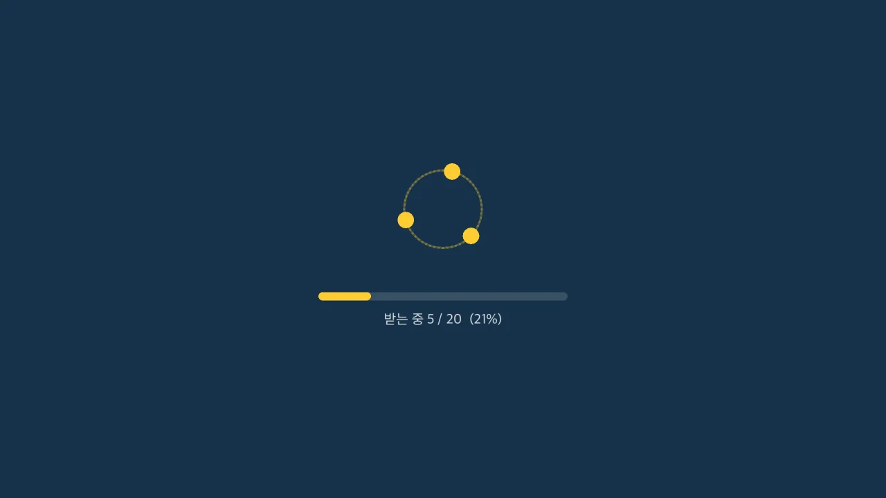

# Assets

This chapter covers loading images, text, JSON, binary data, fonts, and sounds for use in the engine. It goes through the asset structs that load one asset each (`ImageAsset`, `TextAsset`, `JsonAsset`, and so on), `AssetLoader`, which loads many assets together and reports progress and a failure list, `LoadingProgress`, which moves a loading bar smoothly, and `SpriteAtlas`, which picks packed images by name.

## Loading in the scene's create

Assets are held by the scene as members. There is no central resource manager. Request a load with `load(engine, path)` in the scene's `load` and hand the asset to the scene with `scene_base.track_asset`; once everything tracked has finished, the engine calls `initialize`. Build the nodes that use the assets in `initialize`.

```rust,no_run
use vanilla::{Engine, EngineConfiguration, Graphic, ImageAsset, Scene, SceneBase, Sprite, Vector2};

struct AssetScene {
	scene_base: SceneBase,
	icon_asset: ImageAsset,
}

impl Scene for AssetScene {
	fn get_scene_base(&self) -> &SceneBase {
		&self.scene_base
	}

	fn get_scene_base_mut(&mut self) -> &mut SceneBase {
		&mut self.scene_base
	}

	fn load(&mut self, engine: &Engine) {
		self.icon_asset.load(engine, "examples/assets/atlas/icons.png");
		self.scene_base.track_asset(&self.icon_asset);
	}

	fn initialize(&mut self, _engine: &Engine) {
		let icon_image = match self.icon_asset.get_image() {
			Some(icon_image) => {
				icon_image
			}
			None => {
				return;
			}
		};
		let root_id = self.scene_base.get_root_id();
		let node_tree = self.scene_base.get_node_tree_mut();
		let icon_id = node_tree.create_child(root_id, "icon");
		let icon_node = &mut node_tree[icon_id];
		icon_node.set_local_position(Vector2::create(640.0, 360.0));
		icon_node.set_content_size(Vector2::create(256.0, 256.0));
		icon_node.add_component(Sprite::create_with_image(icon_image));
	}

	fn pre_draw(&mut self, graphic: &mut Graphic) {
		self.scene_base.draw_scene_background(graphic);
	}
}

fn main() {
	let mut engine_configuration = EngineConfiguration::new();
	engine_configuration.reference_resolution_size = Vector2::create(1280.0, 720.0);
	engine_configuration.auto_resize_on_window_resize = true;
	let engine = Engine::new(engine_configuration);
	let asset_scene = AssetScene {
		scene_base: SceneBase::new(),
		icon_asset: ImageAsset::new(),
	};
	if let Err(error) = engine.run(Box::new(asset_scene)) {
		eprintln!("{}", error);
		std::process::exit(1);
	}
}
```

- On desktop, `load` reads the file right where it is called. On the web, the load finishes some frames later, after `fetch` completes. That is why code that reads the loaded data goes in `initialize`, not in `load`.
- Until everything tracked has finished, the engine calls `draw_on_load` every frame instead of the scene's `tick` and `draw`. When everything has finished, it waits 0.3 seconds more and then calls `initialize`. With nothing tracked, it is called 0.3 seconds after `load`.
- An asset that failed to load also counts as finished. The scene does not get stuck, and reading a failed asset gives `None`.
- Calling `load` again on an asset that already has a request does not read again; it returns the first handle. This holds for failed assets too. To load again, call `unload` first or create a new asset.
- There are four tracking functions: `track_asset(&asset)`, `track_load_handle(&load_handle)`, `track_audio_asset(&Rc<AudioAsset>)`, and `track_task(&task_handle)`. `get_tracked_asset_progress()` is the finished fraction of what was tracked (0 to 1, failures included, 1 when nothing is tracked).

## Loading with await

The original `async load(engine) { await asset.load(path); }` becomes a scene task spawned in `load` and handed to the scene with `track_task`. The task runs right where it is spawned up to its first `await`, and it borrows the scene and the engine only inside the closure of `scene_context.with`. The load handle (`AssetLoadHandle`) returned by `load` does not borrow the asset, so it is awaited outside the closure with `.await`.

```rust,no_run
use vanilla::{wait, Engine, EngineConfiguration, JsonAsset, Scene, SceneBase};

struct StageScene {
	scene_base: SceneBase,
	stage_asset: JsonAsset,
	is_stage_ready: bool,
}

impl Scene for StageScene {
	fn get_scene_base(&self) -> &SceneBase {
		&self.scene_base
	}

	fn get_scene_base_mut(&mut self) -> &mut SceneBase {
		&mut self.scene_base
	}

	fn load(&mut self, engine: &Engine) {
		let load_task = engine.spawn_scene_task(self, |mut scene_context| async move {
			let load_result = scene_context.with(|scene, engine| scene.stage_asset.load(engine, "examples/assets/scenedocument.scene.json")).await;
			if let Err(error_message) = load_result {
				eprintln!("{}", error_message);
			}
			wait::seconds(0.5).await;
			scene_context.with(|scene, _engine| {
				scene.is_stage_ready = true;
			});
		});
		self.scene_base.track_task(&load_task);
	}

	fn initialize(&mut self, _engine: &Engine) {
		if let Some(stage_data) = self.stage_asset.get_data() {
			println!("{} {}", stage_data["version"], self.is_stage_ready);
		}
	}
}

fn main() {
	let engine = Engine::new(EngineConfiguration::new());
	let stage_scene = StageScene {
		scene_base: SceneBase::new(),
		stage_asset: JsonAsset::new(),
		is_stage_ready: false,
	};
	if let Err(error) = engine.run(Box::new(stage_scene)) {
		eprintln!("{}", error);
		std::process::exit(1);
	}
}
```

- Awaiting a load handle gives `Result<Rc<Vec<u8>>, String>`: the loaded bytes or the reason for the failure. (Where the original rejects)
- An `ImageAsset` handle finishes only after the image is decoded, like the original `img.onload`, and finishes as a failure if it cannot be decoded. A `JsonAsset` handle finishes as soon as the download finishes, like the original, and JSON that cannot be parsed gives `None` from `get_data()`.
- For an asset whose `load` was already called, awaiting the future from `wait_for_load()` later does the same. (`Asset` trait)
- See the "async/await" chapter for more on async/await.

## Asset paths

- On desktop, files are looked up in the candidate folders of `EngineConfiguration.asset_directory_paths`, from the front. If the file is in none of them, the path under the first candidate is read and the load fails; if the list is empty (the default), the path is used as is, relative to the folder the game was started from. `engine.resolve_asset_path(path)` returns the chosen path.
- On the web, `asset_base_url + path` is fetched. If `asset_base_url` is empty (the default), it is a URL relative to the page.
- `"data:"` URLs load as they are on both. On desktop the engine decodes them on the spot (percent escapes and `;base64`); on the web they go to the browser's `fetch` without the base URL.
- The game code is the same; only the settings above differ per platform.

```rust
use std::path::PathBuf;
use vanilla::{Engine, EngineConfiguration, TextAsset};

let mut engine_configuration = EngineConfiguration::new();
engine_configuration.asset_directory_paths = vec![PathBuf::from("examples/assets")];
engine_configuration.asset_base_url = String::from("assets/");
let engine = Engine::new(engine_configuration);

let mut text_asset = TextAsset::new();
let load_handle = text_asset.load(&engine, "data:,hello%20vanilla");
assert!(load_handle.is_loaded());
assert_eq!(text_asset.get_text(), Some("hello vanilla"));

let mut missing_asset = TextAsset::new();
let missing_handle = missing_asset.load(&engine, "missing.txt");
assert!(missing_handle.is_failed());
assert!(missing_handle.get_error_message().is_some());
assert_eq!(missing_asset.get_text(), None);
```

## Asset types

| Struct | Loads | Read after loading |
| --- | --- | --- |
| `ImageAsset` | Images (png, jpeg, webp, first frame of gif, bmp, ico, svg, avif) | `get_image()` (`Option<Rc<Image>>`), `get_image_size()` (pixels, 0 when missing) |
| `TextAsset` | Text files | `get_text()` (decoded as UTF-8) |
| `JsonAsset` | JSON files | `get_data()` (`serde_json::Value`), `get_text()` |
| `BlobAsset` | Binary data | `get_blob()` (`Rc<Vec<u8>>`) |
| `BunchAsset` | Binary data (only the asset type is `Bunch`) | `get_blob()` |
| `FontAsset` | Fonts (ttf, otf, woff, woff2) | `get_family()`, `get_descriptors()`, `is_bold()` |
| `AudioAsset` | Sounds (wav, mp3, Opus and Vorbis in ogg and webm, flac, AAC in m4a and aac) | `get_audio_buffer()`, `get_duration()` (seconds) |
| `VisualAsset` | Nothing (it only records the path, like the original) | `set_visual`, `get_visual` |

- Every asset except `AudioAsset` implements the `Asset` trait. It has `is_loaded()`, `get_asset_path()` (empty before a request), `wait_for_load()`, and `get_asset_base()`; the asset type is read with `get_asset_base().get_asset_type()`. Each asset has its own `unload()`.
- Loaded bytes are decoded the first time they are read, so `get_image()` and `get_text()` take `&mut self`. If an image cannot be decoded, the reason is printed to standard error and decoding is not tried again.
- `JsonAsset` treats JSON that cannot be parsed as not loaded. (`is_loaded()` is false, `get_data()` is `None`, `get_text()` remains)
- `TextAsset` and `JsonAsset` add `cache: "no-cache"` to the web `fetch` when `set_no_cache(true)` is given before `load`. This keeps the browser from using an old data table after a deployment. Desktop ignores it.
- The engine does not re-export the `serde_json::Value` used by `get_data()` and `SpriteAtlas::load_data`, so add `serde_json` to the game's `Cargo.toml`.

```rust
use vanilla::{Asset, AssetType, BlobAsset, Engine, EngineConfiguration, JsonAsset, TextAsset};

let engine = Engine::new(EngineConfiguration::new());

let mut json_asset = JsonAsset::new();
json_asset.set_no_cache(true);
json_asset.load_from_bytes("stage.json", br#"{ "name": "forest", "enemies": [3, 5] }"#.to_vec());
assert!(json_asset.is_loaded());
let stage_data = json_asset.get_data().expect("json data");
assert_eq!(stage_data["name"], "forest");
assert_eq!(stage_data["enemies"][1], 5);

let mut text_asset = TextAsset::new();
text_asset.load(&engine, "data:,line%20one");
assert_eq!(text_asset.get_text(), Some("line one"));
assert_eq!(text_asset.get_asset_path(), "data:,line%20one");

let mut blob_asset = BlobAsset::new();
blob_asset.load(&engine, "data:application/octet-stream;base64,AAEC");
assert_eq!(blob_asset.get_blob().expect("bytes").as_slice(), &[0, 1, 2]);
assert_eq!(blob_asset.get_asset_base().get_asset_type(), AssetType::Blob);
blob_asset.unload();
assert!(!blob_asset.is_loaded());
```

## Fonts

`FontAsset` loads with `load_font(engine, family, path)`, not with `load`. When the bytes arrive, the engine adds the font to the glyph cache's font list under that name at the start of the next frame; from then on the name works in `Text.set_font_family(family)` and in font strings (`"32px family"`). The `load_font` functions take `&Engine`, so call them in `load`.

| Method | Description |
| --- | --- |
| `load_font(engine, family, path)` | Adds a weight 400 face |
| `load_font_with_bold(engine, family, path, is_bold)` | A weight 700 face when `true` |
| `load_font_with_descriptors(engine, family, path, descriptors)` | Adds the face as described by `FontFaceDescriptors` (weight range, italic, character range) |
| `load_font_from_bytes(engine, family, bytes)` | From bytes you already have |

When several files with different weights or styles are added under one name, the glyph cache picks among them the way CSS does. `FontFaceDescriptors::create_from_css(weight, style, unicode_range)` builds descriptors from the original descriptor strings (`"700"`, `"italic"`, `"U+AC00-D7A3"`). The font files in the example below are not in the repository; replace them with paths to files the game has.

```rust,no_run
use vanilla::{Engine, EngineConfiguration, FontAsset, FontFaceDescriptors, Graphic, Scene, SceneBase, Text, Vector2};

struct FontScene {
	scene_base: SceneBase,
	regular_font_asset: FontAsset,
	bold_font_asset: FontAsset,
}

impl Scene for FontScene {
	fn get_scene_base(&self) -> &SceneBase {
		&self.scene_base
	}

	fn get_scene_base_mut(&mut self) -> &mut SceneBase {
		&mut self.scene_base
	}

	fn load(&mut self, engine: &Engine) {
		self.regular_font_asset.load_font(engine, "GameFont", "fonts/GameFont-Regular.ttf");
		let bold_descriptors = FontFaceDescriptors::create_from_css("700", "normal", "");
		self.bold_font_asset.load_font_with_descriptors(engine, "GameFont", "fonts/GameFont-Bold.ttf", bold_descriptors);
		self.scene_base.track_asset(&self.regular_font_asset);
		self.scene_base.track_asset(&self.bold_font_asset);
	}

	fn initialize(&mut self, _engine: &Engine) {
		let root_id = self.scene_base.get_root_id();
		let node_tree = self.scene_base.get_node_tree_mut();
		let title_id = node_tree.create_child(root_id, "title");
		let title_node = &mut node_tree[title_id];
		title_node.set_local_position(Vector2::create(640.0, 360.0));
		title_node.set_content_size(Vector2::create(800.0, 80.0));
		let title_text = title_node.add_component(Text::create_with_text("Hello, Vanilla Engine", 48.0));
		title_text.set_font_family("GameFont");
		title_text.set_bold(true);
	}

	fn pre_draw(&mut self, graphic: &mut Graphic) {
		self.scene_base.draw_scene_background(graphic);
	}
}

fn main() {
	let engine = Engine::new(EngineConfiguration::new());
	let font_scene = FontScene {
		scene_base: SceneBase::new(),
		regular_font_asset: FontAsset::new(),
		bold_font_asset: FontAsset::new(),
	};
	if let Err(error) = engine.run(Box::new(font_scene)) {
		eprintln!("{}", error);
		std::process::exit(1);
	}
}
```

- The `load_font` functions return a `FontLoadHandle`. Awaiting it finishes once the font is in the font list (or with the reason, if loading or adding failed). `track_asset` waits only for the bytes, but the font is added at the start of the very next frame, so it is already there in `initialize` 0.3 seconds later.
- Calling `load_font` again on a `FontAsset` that already has a request returns that handle. `unload(engine)` removes the face from the font list, like the original.
- The default fonts the engine starts with (`default_font_paths`, `default_font_bytes`, `default_font_url`) and fonts for several languages are covered in the "Language Packs" chapter.

## Sounds

Unlike the other assets, `AudioAsset` has no `Asset` trait, and it is used as `Rc<AudioAsset>` so several players can share it. To load from an asset path, call `engine.load_audio_asset(path)` and track it with `track_audio_asset`.

```rust,no_run
use std::rc::Rc;
use vanilla::{AudioAsset, Engine, EngineConfiguration, Scene, SceneBase};

struct SoundScene {
	scene_base: SceneBase,
	hit_sound: Option<Rc<AudioAsset>>,
}

impl Scene for SoundScene {
	fn get_scene_base(&self) -> &SceneBase {
		&self.scene_base
	}

	fn get_scene_base_mut(&mut self) -> &mut SceneBase {
		&mut self.scene_base
	}

	fn load(&mut self, engine: &Engine) {
		match engine.load_audio_asset("tests/assets/audio/wav_s16_stereo.wav") {
			Ok(audio_asset) => {
				self.scene_base.track_audio_asset(&audio_asset);
				self.hit_sound = Some(audio_asset);
			}
			Err(error_message) => {
				eprintln!("{}", error_message);
			}
		}
	}

	fn initialize(&mut self, _engine: &Engine) {
		if let Some(hit_sound) = &self.hit_sound {
			println!("{}", hit_sound.get_duration());
		}
	}
}

fn main() {
	let engine = Engine::new(EngineConfiguration::new());
	let sound_scene = SoundScene {
		scene_base: SceneBase::new(),
		hit_sound: None,
	};
	if let Err(error) = engine.run(Box::new(sound_scene)) {
		eprintln!("{}", error);
		std::process::exit(1);
	}
}
```

- On desktop, `load_audio_asset` reads and decodes the file right there before returning, and gives `Err(reason)` on failure. Sounds are decoded to the same length and samples as Chrome's `decodeAudioData` in the original, resampled to 44100. The format is detected from the content, not the extension.
- On the web, the fetch and decode are started and the asset is returned at once. When they finish, `is_loaded()` becomes true; on failure the reason is kept in `get_load_error()`. Only failures known on the spot are `Err`.
- You can also call `load_from_asset(engine, path)`, `load(file_path)`, or `load_from_bytes(bytes)` on an `Rc<AudioAsset>` directly. All of them return an awaitable `AudioLoadHandle`, and they do nothing if the asset is already loaded.
- Playing loaded sounds is covered in the "Sound" chapter.

```rust
use std::rc::Rc;
use vanilla::AudioAsset;

let audio_asset = Rc::new(AudioAsset::new());
let audio_load_handle = audio_asset.load_from_bytes(vec![0, 1, 2, 3]);
assert!(audio_load_handle.is_finished());
assert!(audio_asset.get_load_error().is_some());
assert!(!audio_asset.is_loaded());
assert_eq!(audio_asset.get_duration(), 0.0);
```

## Loading together with AssetLoader

`AssetLoader` loads everything in its list together, up to a set number at a time.

- `add_image(path)`, `add_json(path)`, `add_text(path)`, and `add_blob(path)` create an empty asset, put it in the list, and return it. Read from that asset once loading is done. `add_audio(path)` returns an `Rc<AudioAsset>`, and `add_font(engine, family, path, descriptors)` returns the load handle of the font bytes. (The original returns a `FontAsset`)
- The original `addTask` becomes `add_load_handle(&load_handle)`. A handle you requested yourself or will finish yourself (made with `AssetLoadHandle::create_pending(name)`) is counted in the progress. It counts as in flight from the moment it is added and takes one concurrency slot until it finishes.
- `set_concurrency(count)` sets how many load at once. The default is 6, and values below 1 become 1.
- `load(engine)` starts loading. On desktop everything finishes here. On the web, call `update(engine)` every frame after that so the next items are requested as earlier ones finish. Awaiting the handle returned by `load` inside an engine task calls `update` while waiting and finishes with the failure list (`Vec<AssetLoadFailure>`).
- Failures also count as finished, so loading never gets stuck. Each failure prints its reason to standard error and is kept in `get_failed_list()` as `AssetLoadFailure { path, error_message }`. Images are test decoded when downloaded and broken ones fail, JSON that cannot be parsed fails, and sounds that cannot be decoded fail.
- Progress is the finished count (failures included) divided by the total. Read it with `get_progress()` (0 to 1, 1 when the list is empty), `get_finished_count()`, `get_loaded_count()` (excluding failures), `get_total_count()`, `get_in_flight_count()`, and `is_finished()`.
- `set_progress_handler(Some(Box::new(|progress, finished_count, total_count| { ... })))` is called whenever progress changes, and `set_complete_handler(Some(Box::new(|failed_list| { ... })))` when everything is done.
- `AssetLoader` is a cheap clone that shares its list. A clone points to the same list.

```rust
use std::cell::Cell;
use std::rc::Rc;
use vanilla::{Asset, AssetLoader, Engine, EngineConfiguration};

let engine = Engine::new(EngineConfiguration::new());
let asset_loader = AssetLoader::new();
asset_loader.set_concurrency(4);
let mut text_asset = asset_loader.add_text("data:,hello");
let json_asset = asset_loader.add_json("data:application/json,{\"level\":3}");
let blob_asset = asset_loader.add_blob("data:,abc");
let missing_asset = asset_loader.add_image("missing.png");
let last_progress = Rc::new(Cell::new(0.0));
let progress_reader = last_progress.clone();
asset_loader.set_progress_handler(Some(Box::new(move |progress: f64, _finished_count: usize, _total_count: usize| {
	progress_reader.set(progress);
})));
asset_loader.load(&engine);
assert!(asset_loader.is_finished());
assert_eq!(asset_loader.get_total_count(), 4);
assert_eq!(asset_loader.get_loaded_count(), 3);
assert_eq!(last_progress.get(), 1.0);
let failed_list = asset_loader.get_failed_list();
assert_eq!(failed_list.len(), 1);
assert_eq!(failed_list[0].path, "missing.png");
assert_eq!(text_asset.get_text(), Some("hello"));
assert_eq!(json_asset.get_data().expect("json data")["level"], 3);
assert_eq!(blob_asset.get_blob().expect("bytes").len(), 3);
assert!(!missing_asset.is_loaded());
```

## Loading bar

To have the scene wait, track `asset_loader.get_completion_handle()` with `track_load_handle`. This handle finishes when everything is loaded, so the engine holds back `initialize` until then. Meanwhile, call `update` and draw a loading bar in `draw_on_load`.



`LoadingProgress` makes the shown amount (`get_shown_progress`) follow the reported amount (`set_progress`, clamped to 0 to 1 and never decreasing) smoothly. Call `update(time_delta)` every frame; the follow speed is set with `set_follow_rate` (the fraction of the remaining distance per second, default 6). Even when progress jumps because many loads finish at once, the bar glides.

```rust,no_run
use vanilla::{AssetLoader, Colors, Engine, EngineConfiguration, Graphic, ImageAsset, JsonAsset, LoadingProgress, Rect, Scene, SceneBase};

struct LoadingScene {
	scene_base: SceneBase,
	asset_loader: AssetLoader,
	loading_progress: LoadingProgress,
	icon_asset: Option<ImageAsset>,
	atlas_json_asset: Option<JsonAsset>,
}

impl Scene for LoadingScene {
	fn get_scene_base(&self) -> &SceneBase {
		&self.scene_base
	}

	fn get_scene_base_mut(&mut self) -> &mut SceneBase {
		&mut self.scene_base
	}

	fn load(&mut self, engine: &Engine) {
		self.asset_loader.set_concurrency(4);
		self.icon_asset = Some(self.asset_loader.add_image("examples/assets/atlas/icons.png"));
		self.atlas_json_asset = Some(self.asset_loader.add_json("examples/assets/atlas/icons.json"));
		let completion_handle = self.asset_loader.get_completion_handle();
		self.scene_base.track_load_handle(&completion_handle);
		self.asset_loader.load(engine);
	}

	fn draw_on_load(&mut self, graphic: &mut Graphic) {
		let engine = Engine::get_engine().unwrap();
		self.asset_loader.update(engine);
		self.loading_progress.set_progress(self.asset_loader.get_progress());
		let time_delta = engine.get_time_manager().get_unscale_delta_time();
		self.loading_progress.update(time_delta);
		let shown_progress = self.loading_progress.get_shown_progress();

		self.scene_base.draw_scene_background(graphic);
		let view_size = engine.get_view_manager().get_view_size();
		let bar_width = view_size.x * 0.6;
		let bar_left = (view_size.x - bar_width) * 0.5;
		let bar_top = view_size.y * 0.8;
		graphic.set_fill_color("#404040");
		graphic.draw_rect(Rect::create(bar_left, bar_top, bar_width, 12.0));
		graphic.set_fill_color(Colors::WHITE);
		graphic.draw_rect(Rect::create(bar_left, bar_top, bar_width * shown_progress, 12.0));
	}

	fn initialize(&mut self, _engine: &Engine) {
		for failure in self.asset_loader.get_failed_list() {
			eprintln!("{} {}", failure.path, failure.error_message);
		}
		if let Some(icon_asset) = self.icon_asset.as_mut() {
			println!("{}", icon_asset.get_image_size().x);
		}
		if let Some(atlas_json_asset) = &self.atlas_json_asset {
			println!("{}", atlas_json_asset.get_data().is_some());
		}
	}
}

fn main() {
	let engine = Engine::new(EngineConfiguration::new());
	let loading_scene = LoadingScene {
		scene_base: SceneBase::new(),
		asset_loader: AssetLoader::new(),
		loading_progress: LoadingProgress::new(),
		icon_asset: None,
		atlas_json_asset: None,
	};
	if let Err(error) = engine.run(Box::new(loading_scene)) {
		eprintln!("{}", error);
		std::process::exit(1);
	}
}
```

A scene using `GameSceneBase` does the same with one line, `track_asset_loader(&asset_loader)`. The default loading screen's `draw_on_load` calls `update` every frame and passes the progress to the bar.

## Loading from bytes you already have

If you already hold the bytes, for example taken out of an archive, they load right away without a download. The new bytes replace an earlier request. (`FontAsset` and `AudioAsset` do nothing if a load was already started)

| Struct | Method | Returns |
| --- | --- | --- |
| `ImageAsset` | `load_from_bytes(asset_path, bytes)` | Load handle (finishes as a failure if it cannot be decoded) |
| `TextAsset`, `JsonAsset`, `BlobAsset`, `BunchAsset` | `load_from_bytes(asset_path, bytes)` | Nothing |
| `FontAsset` | `load_font_from_bytes(engine, family, bytes)`, `load_font_from_bytes_with_descriptors(engine, family, bytes, descriptors)` | `FontLoadHandle` |
| `AudioAsset` | `load_from_bytes(bytes)` (no path argument, called on `Rc<AudioAsset>`) | `AudioLoadHandle` |

`asset_path` is the name used in messages and by `get_asset_path()`. The bytes are passed as a `Vec<u8>` and owned by the asset. A custom asset struct can be tracked with `track_asset` if it holds an `AssetBase` field and fills in only `get_asset_base` and `get_asset_base_mut` of the `Asset` trait.

```rust
use vanilla::{Asset, AssetBase, AssetType, ImageAsset};

struct NoteAsset {
	asset_base: AssetBase,
}

impl Asset for NoteAsset {
	fn get_asset_base(&self) -> &AssetBase {
		&self.asset_base
	}

	fn get_asset_base_mut(&mut self) -> &mut AssetBase {
		&mut self.asset_base
	}
}

let mut note_asset = NoteAsset {
	asset_base: AssetBase::new(AssetType::Text),
};
note_asset.get_asset_base_mut().load_from_bytes("note.txt", b"hello".to_vec());
assert!(note_asset.is_loaded());
assert_eq!(note_asset.get_asset_path(), "note.txt");

let mut image_asset = ImageAsset::new();
let load_handle = image_asset.load_from_bytes("broken.png", vec![0, 1, 2, 3]);
assert!(load_handle.is_loaded());
assert!(image_asset.get_image().is_none());
assert_eq!(image_asset.get_image_size().x, 0.0);
```

## SpriteAtlas

Several images are packed into a few page images and picked by name. The engine batches sprites that use the same page image into one draw, so there are fewer draw calls.

It reads the same two JSON formats as the original. One is the format produced by `tools/atlas.cjs` in the original vanilla.js repository (https://github.com/ddukbaek2/vanilla.js); this repository does not include that tool. `examples/assets/atlas/icons.json` in the repository uses this format.

```json
{
	"images": {
		"coin.png": { "x": 84, "y": 55, "width": 30, "height": 30, "page": 0 }
	},
	"meta": {
		"imageFileName": "icons.png",
		"pages": [{ "imageFileName": "icons.png", "width": 128, "height": 128 }]
	}
}
```

- Without `page`, the page is 0; without `meta.pages`, there is one page, `meta.imageFileName`.
- The other format is a list of page paths and a table of `[page, x, y, width, height]`. (`{ "pagePaths": [...], "frames": { "name": [...] } }`)
- A page image path without a slash (/) gets the JSON file's folder (`base_directory` for `load_data`) put in front; a path with one is read as written. A leading `"./"` is removed and the rest is read as an asset path.
- Images are found by file name and also by the name without its extension. (`"coin.png"` is also found as `"coin"`)

A JSON file is read with `load(engine, json_path)`. On desktop, the JSON and the page images are all read right there. On the web, the page images can only be requested after the JSON arrives, so await the handle returned by `load` inside an engine task. (It calls `update` every frame while waiting)

```rust,no_run
use vanilla::{Engine, EngineConfiguration, Scene, SceneBase, Sprite, SpriteAtlas, Vector2};

struct AtlasScene {
	scene_base: SceneBase,
	sprite_atlas: SpriteAtlas,
}

impl Scene for AtlasScene {
	fn get_scene_base(&self) -> &SceneBase {
		&self.scene_base
	}

	fn get_scene_base_mut(&mut self) -> &mut SceneBase {
		&mut self.scene_base
	}

	fn load(&mut self, engine: &Engine) {
		let load_task = engine.spawn_scene_task(self, |mut scene_context| async move {
			scene_context.with(|scene, engine| scene.sprite_atlas.load(engine, "examples/assets/atlas/icons.json")).await;
		});
		self.scene_base.track_task(&load_task);
	}

	fn initialize(&mut self, _engine: &Engine) {
		let root_id = self.scene_base.get_root_id();
		let node_tree = self.scene_base.get_node_tree_mut();
		let frame_names = ["star", "heart", "leaf", "gem", "coin"];
		for (frame_index, frame_name) in frame_names.iter().enumerate() {
			let icon_id = node_tree.create_child(root_id, frame_name);
			let icon_node = &mut node_tree[icon_id];
			icon_node.set_local_position(Vector2::create(240.0 + frame_index as f64 * 200.0, 360.0));
			icon_node.set_content_size(Vector2::create(96.0, 96.0));
			let sprite = icon_node.add_component(Sprite::new());
			self.sprite_atlas.apply_frame(sprite, frame_name);
		}
	}
}

fn main() {
	let engine = Engine::new(EngineConfiguration::new());
	let atlas_scene = AtlasScene {
		scene_base: SceneBase::new(),
		sprite_atlas: SpriteAtlas::new(),
	};
	if let Err(error) = engine.run(Box::new(atlas_scene)) {
		eprintln!("{}", error);
		std::process::exit(1);
	}
}
```

A table in code is read with `load_data(engine, &atlas_data, base_directory)`. The example below puts a 64 x 32 SVG in the page slot as a `"data:"` URL and splits it into two 32 x 32 pieces.

```rust
use std::cell::RefCell;
use std::rc::Rc;
use vanilla::{Engine, EngineConfiguration, Rect, Sprite, SpriteAtlas};

let engine = Engine::new(EngineConfiguration::new());
let atlas_data = serde_json::json!({
	"pagePaths": ["data:image/svg+xml,<svg xmlns='http://www.w3.org/2000/svg' width='64' height='32'/>"],
	"frames": {
		"left": [0, 0, 0, 32, 32],
		"right": [0, 32, 0, 32, 32]
	}
});
let mut sprite_atlas = SpriteAtlas::new();
sprite_atlas.load_data(&engine, &atlas_data, "");
assert!(sprite_atlas.is_loaded());
assert_eq!(sprite_atlas.get_page_count(), 1);
let right_frame = sprite_atlas.read_frame("right").expect("right frame");
assert_eq!(right_frame.get_image_rect(), Rect::create(32.0, 0.0, 32.0, 32.0));
assert_eq!(right_frame.get_image().get_width(), 64);

let mut sprite = Sprite::new();
assert!(sprite_atlas.apply_frame(&mut sprite, "left"));
assert!(!sprite_atlas.apply_frame(&mut sprite, "missing"));
assert!(sprite.get_image().is_none());

let shared_atlas = Rc::new(RefCell::new(sprite_atlas));
SpriteAtlas::add_search_atlas(&shared_atlas);
assert!(SpriteAtlas::apply_search_frame(&mut sprite, "right"));
assert_eq!(sprite.get_image_rect(), Rect::create(32.0, 0.0, 32.0, 32.0));
SpriteAtlas::clear_search_atlases();
assert!(SpriteAtlas::find_frame("right").is_none());
```

- `read_frame(name)` returns `Option<&Frame>` (an image and an area in it). There are also `has_frame(name)`, `get_frame_names()`, `get_page_images()`, `get_page_count()`, and `is_loaded()`.
- `apply_frame(&mut sprite, name)` sets the piece on a sprite. For an unknown name it clears the sprite's image and returns `false`.
- The search list holds atlases as `Rc<RefCell<SpriteAtlas>>`. After adding them with `SpriteAtlas::add_search_atlas`, `SpriteAtlas::find_frame(name)` (a copy of the piece, `Option<Frame>`) and `SpriteAtlas::apply_search_frame(&mut sprite, name)` search in the order they were added (earlier wins). Remove them with `remove_search_atlas` and `clear_search_atlases`. There is one list per thread. To avoid the global list, use `SpriteAtlas::find_frame_in_order(&[&atlas], name)` and `SpriteAtlas::apply_frame_in_order(&[&atlas], &mut sprite, name)`.
- Without await, call `load` in `load`, hand the JSON to the scene with `track_json_asset(&mut scene_base)`, and call `update(engine)` in `draw_on_load` or `tick` until `is_loaded()` is true. The page images are requested by `update` after the JSON arrives.
- While loading again, the previously loaded pieces stay in use, like the original.

## Things to watch

- The original `load` throws on failure. The Rust version has no exceptions: the load handle finishes as a failure (`is_failed()`, `get_error_message()`), and awaiting it gives `Err(reason)`. The scene counts failed assets as finished.
- An image handle reports `is_loaded()` as true once all bytes arrive. Whether the image is broken shows in `get_image()` returning `None`. (If the handle was awaited or loaded through `AssetLoader`, it finishes as a failure at that point)
- Calling `load` twice on the same asset returns the first request's handle the second time. To load a different path, call `unload` first or switch with `load_from_bytes`.
- `AudioAsset` is not an `Asset`, so track it with `track_audio_asset` instead of `track_asset`. `SpriteAtlas` is not an asset either; wait for it with `track_json_asset` or by tracking a task (`track_task`).
- If `SpriteAtlas` cannot read the JSON or does not know its format, it reports to standard error and finishes without pieces. Awaiting its handle also finishes, so check `is_loaded()`.
- Unlike the original, `AssetLoader`'s `add_font` returns a load handle, not a `FontAsset`.
- `draw_on_load` is called only until what was tracked has finished. Set up the drawing coordinates yourself there. (`draw_scene_background` or `engine.get_view_manager().apply_view_rect(graphic)`)

## Related types

Asset, AssetBase, AssetType, AssetLoadHandle, AssetLoadFuture, ImageAsset, TextAsset, JsonAsset, BlobAsset, BunchAsset, FontAsset, FontLoadHandle, FontFaceDescriptors, AudioAsset, AudioLoadHandle, VisualAsset, AssetLoader, AssetLoaderLoadHandle, AssetLoadFailure, LoadingProgress, SpriteAtlas, SpriteAtlasLoadHandle, Frame, Image, Sprite, SceneBase, EngineConfiguration
