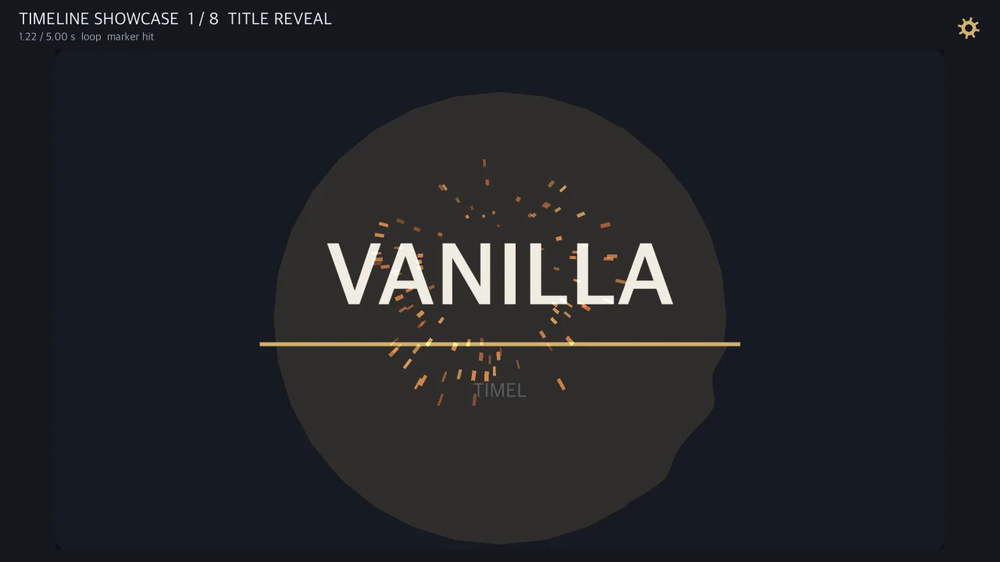

# Tweens and Timelines

This chapter covers ways to change values over time: `Tween`, which moves values or node properties from a start value to a target value; `Animation` and `SpriteAnimator`, which flip through frame images; `Timeline`, which plays documents saved by the Timeline Editor; `Animator`, a bundle of states; and `Action`, which runs steps in order. Nodes themselves are covered in the "Nodes and Components" chapter, bone animation of 3D models in the "3D" chapter, and the editor in the "Authoring Tools and Files Shared by Both Engines" chapter.

## Tween

`Tween` moves named values from start values to target values. A value bundle is a `TweenValues`, and a single value is `TweenValue::Number(f64)` or `TweenValue::Vector2(Vector2)`. Only values whose name appears in both the start and target bundles, with the same kind, change.

- Build a bundle with `TweenValues::new().with(name, value)`. Pass an `f64` or a `Vector2` directly as the value. `set`, `get`, `get_number`, `get_vector2` and `get_count` are also available.
- Create a tween with `Tween::new(start_values)` and chain `to(target_values, duration)` (seconds, initially 1), `delay(seconds)` (initially 0) and `easing(function)` (initially `easing_function::linear`). These methods take the tween and return the modified tween, so they chain on one line.
- `set_update(|values, node_tree| {})` receives the current value bundle and the node tree on every update after the delay, and `set_complete(|node_tree| {})` is called once on the update where progress reaches 1.
- You can drive it yourself with `start()`, `stop()`, `tick(&mut node_tree, time_delta)` and `is_finished()`. If `duration` is 0 or less, the first update counts as the end. `stop` does not call the complete callback.

```rust
use std::cell::Cell;
use std::rc::Rc;
use vanilla::{easing_function, NodeTree, Tween, TweenValues};

let mut node_tree = NodeTree::new();
let last_x = Rc::new(Cell::new(0.0f64));
let last_x_in_update = last_x.clone();
let complete_count = Rc::new(Cell::new(0));
let complete_count_in_callback = complete_count.clone();
let mut tween = Tween::new(TweenValues::new().with("x", 0.0).with("alpha", 1.0))
	.to(TweenValues::new().with("x", 100.0).with("alpha", 0.0), 0.5)
	.easing(easing_function::quadratic::ease_out)
	.set_update(move |values, _node_tree| {
		last_x_in_update.set(values.get_number("x").unwrap());
	})
	.set_complete(move |_node_tree| {
		complete_count_in_callback.set(complete_count_in_callback.get() + 1);
	});
tween.start();
for _ in 0..4 {
	tween.tick(&mut node_tree, 0.125);
}
assert!(tween.is_finished());
assert_eq!(last_x.get(), 100.0);
assert_eq!(complete_count.get(), 1);
```

### Easing

The `easing_function` module has `linear` and the modules `quadratic`, `cubic`, `quartic`, `quintic`, `sinusoidal`, `exponential`, `circular`, `elastic`, `back` and `bounce`. Every one except `linear` has the functions `ease_in`, `ease_out` and `ease_in_out` (as in `easing_function::back::ease_out`, original `easeIn`, `easeOut`, `easeInOut`). Any function or closure that takes progress (0 to 1) and returns modified progress can be passed to `easing`. `back` and `elastic` overshoot outside 0 to 1.

```rust
use vanilla::easing_function;

assert_eq!(easing_function::linear(0.25), 0.25);
assert_eq!(easing_function::quadratic::ease_in(0.5), 0.25);
assert_eq!(easing_function::quadratic::ease_out(0.5), 0.75);
assert_eq!(easing_function::cubic::ease_in_out(0.5), 0.5);
let four_steps = |progress: f64| (progress * 4.0).floor() / 4.0;
assert_eq!(four_steps(0.6), 0.5);
```

### Node property tweens

When you set a target node with `set_target(node_id)`, values whose name is a `TweenProperty` name are written straight to that node on every update. The update callback is called after the node is written.

| `TweenProperty` | Value name | Value | Written with |
| --- | --- | --- | --- |
| `LocalPosition` | `"localPosition"` | `Vector2` | `set_local_position` |
| `LocalScale` | `"localScale"` | `Vector2` | `set_local_scale` |
| `LocalRotation` | `"localRotation"` | number (degrees) | `set_local_rotation` |
| `LocalOpacity` | `"localOpacity"` | number (0 to 1) | `set_local_opacity` |
| `ContentSize` | `"contentSize"` | `Vector2` (pixels) | `set_content_size` |

Giving a number to a `Vector2` property writes it to both axes (`0.0` for `"localScale"` is `(0, 0)`). Giving a `Vector2` to a number property writes nothing. Value names are camelCase strings as in the original, and `TweenProperty::get_name()` and `TweenProperty::find_by_name(name)` convert between the two.

`Tween::create_node_tween(node_id, tween_property, start_value, end_value, duration)` builds a tween that moves one property in a single line. To write just one value to a node, use `tween_property.apply_to_node(&mut node, value)` (the original `applyTweenProperty`).

```rust
use vanilla::{NodeTree, Tween, TweenProperty, TweenValue, TweenValues, Vector2};

let mut node_tree = NodeTree::new();
let root_id = node_tree.get_root_id();
let box_id = node_tree.create_child(root_id, "Box");

let mut move_tween = Tween::new(TweenValues::new().with("localPosition", Vector2::create(160.0, 360.0)).with("localOpacity", 0.0))
	.to(TweenValues::new().with("localPosition", Vector2::create(1120.0, 360.0)).with("localOpacity", 1.0), 1.5)
	.delay(0.5)
	.set_target(box_id);
move_tween.start();
move_tween.tick(&mut node_tree, 0.5);
move_tween.tick(&mut node_tree, 0.75);
assert_eq!(node_tree[box_id].get_local_position(), Vector2::create(640.0, 360.0));
assert_eq!(node_tree[box_id].get_local_opacity(), 0.5);

let mut pulse_tween = Tween::create_node_tween(box_id, TweenProperty::LocalScale, 1.0, 1.4, 0.4);
pulse_tween.start();
pulse_tween.tick(&mut node_tree, 0.4);
assert_eq!(node_tree[box_id].get_local_scale(), Vector2::create(1.4, 1.4));

TweenProperty::LocalRotation.apply_to_node(&mut node_tree[box_id], TweenValue::Number(45.0));
assert_eq!(node_tree[box_id].get_local_rotation(), 45.0);
assert_eq!(TweenProperty::find_by_name("localScale"), Some(TweenProperty::LocalScale));
```

If the target node is destroyed (`destroy_node`) or detached from the node tree it was in when the tween first ran (its topmost node changes), the tween ends quietly without the complete callback.

### Handing tweens to a scene

In a scene, hand a tween over with `scene_base.start_tween(tween)`. The scene takes the tween and starts it, `SceneBase::tick` updates tweens after the node update and touch handling, and finished tweens are removed from the list. The original holds on to the tween object to refer to it, but in the Rust version the scene takes ownership, so you refer to it with the `TweenId` returned by `start_tween`.

- `stop_tween(tween_id)` (stops without the complete callback and removes it), `stop_all_tweens()`, `get_tween(tween_id)` and `get_tween_mut(tween_id)` (`None` once finished and removed), `get_tween_count()` (includes tweens still in their delay).
- When two tweens move the same property, the one started first runs later and wins (same as the original).
- The complete callback receives only the node tree, not the scene. To chain the next tween, check in the scene's `tick` whether `get_tween(tween_id)` has become `None` and hand over a new one, as below.

```rust,no_run
use vanilla::{easing_function, Color, Engine, EngineConfiguration, NodeId, Paint, Scene, SceneBase, Tween, TweenId, TweenProperty, TweenValues, Vector2};

struct TweenScene {
	scene_base: SceneBase,
	box_id: Option<NodeId>,
	move_tween_id: Option<TweenId>,
	pulse_tween_id: Option<TweenId>,
	is_pulse_growing: bool,
}

impl TweenScene {
	fn is_tween_running(&self, tween_id: Option<TweenId>) -> bool {
		match tween_id {
			Some(tween_id) => {
				self.scene_base.get_tween(tween_id).is_some()
			}
			None => {
				false
			}
		}
	}

	fn start_next_pulse(&mut self) {
		if self.is_tween_running(self.move_tween_id) || self.is_tween_running(self.pulse_tween_id) {
			return;
		}
		if let Some(box_id) = self.box_id {
			let (start_scale, end_scale) = if self.is_pulse_growing {
				(1.0, 1.4)
			}
			else {
				(1.4, 1.0)
			};
			let pulse_tween = Tween::create_node_tween(box_id, TweenProperty::LocalScale, start_scale, end_scale, 0.4).easing(easing_function::sinusoidal::ease_in_out);
			self.pulse_tween_id = Some(self.scene_base.start_tween(pulse_tween));
			self.is_pulse_growing = !self.is_pulse_growing;
		}
	}
}

impl Scene for TweenScene {
	fn get_scene_base(&self) -> &SceneBase {
		&self.scene_base
	}

	fn get_scene_base_mut(&mut self) -> &mut SceneBase {
		&mut self.scene_base
	}

	fn create(&mut self, _engine: &Engine) {
		let root_id = self.scene_base.get_root_id();
		let node_tree = self.scene_base.get_node_tree_mut();
		let box_id = node_tree.create_child(root_id, "Box");
		let box_node = &mut node_tree[box_id];
		box_node.set_content_size(Vector2::create(80.0, 80.0));
		box_node.set_local_position(Vector2::create(160.0, 360.0));
		let paint = box_node.add_component(Paint::create_with_color(Color::create(0.35, 0.8, 1.0, 1.0)));
		paint.set_round_size(12.0);
		self.box_id = Some(box_id);
	}

	fn initialize(&mut self, _engine: &Engine) {
		if let Some(box_id) = self.box_id {
			let move_tween = Tween::new(TweenValues::new().with("localPosition", Vector2::create(160.0, 360.0)).with("localOpacity", 0.0))
				.to(TweenValues::new().with("localPosition", Vector2::create(1120.0, 360.0)).with("localOpacity", 1.0), 1.5)
				.delay(0.2)
				.easing(easing_function::cubic::ease_in_out)
				.set_target(box_id);
			self.move_tween_id = Some(self.scene_base.start_tween(move_tween));
		}
	}

	fn tick(&mut self, engine: &Engine, time_delta: f64) {
		self.scene_base.tick(engine, time_delta);
		self.start_next_pulse();
	}
}

fn main() {
	let mut engine_configuration = EngineConfiguration::new();
	engine_configuration.reference_resolution_size = Vector2::create(1280.0, 720.0);
	let engine = Engine::new(engine_configuration);
	let tween_scene = TweenScene {
		scene_base: SceneBase::new(),
		box_id: None,
		move_tween_id: None,
		pulse_tween_id: None,
		is_pulse_growing: true,
	};
	if let Err(error) = engine.run(Box::new(tween_scene)) {
		eprintln!("{}", error);
	}
}
```

If you override `Scene::tick`, call `self.scene_base.tick(engine, time_delta)` yourself as above, or nodes and tweens will not update.

## Animation and Frame

A `Frame` is one image (`Rc<Image>`) and a region inside it (`Rect`, in pixels). Create one with `Frame::new(image, Some(rect))`; passing `None` for the region means the whole image. The region is not clipped to the image size. `Sprite::set_frame(Some(&frame))` sets the image and the region together (`None` removes the image).

`Animation` is a processor that flips through a list of frames at a set speed. It is not a component attached to a node, so you call `tick` yourself and read the current frame to draw it.

- Add frames with `set_frames(Vec<Frame>)`, `set_frames_from_rects(image, &rects)` (one sprite sheet and its cell regions) or `set_frames_from_images(&images)` (separate images). Adding frames goes back to the first frame and stops. The last two do nothing when given an empty list.
- `set_animation_speed(frames_per_second)` is the number of frames advanced per second (initially 10, nothing advances at 0 or less). `set_loop(is_loop)` (initially `true`), `set_on_complete(|| {})` (called when the last frame is reached while not looping).
- `play()`, `pause()` (stops on the current frame), `resume()`, `stop()` (back to the first frame), `goto_and_play(index)`, `goto_and_stop(index)`. Indices are `usize` and are clamped to the frame count.
- `get_current_frame()` (`Option<&Frame>`), `get_current_image()`, `get_current_rect()`, `get_current_frame_index()`, `get_total_frame_count()`, `is_playing()`.
- A single `tick` can advance several frames by the accumulated time, and time short of one frame carries over to the next `tick`.

```rust
use vanilla::{Animation, Frame, Image, Rect, Sprite};

let sheet = Image::create_from_pixels(64, 16, vec![255u8; 64 * 16 * 4]);
let whole_frame = Frame::new(sheet.clone(), None);
assert_eq!(whole_frame.get_image_rect(), Rect::create(0.0, 0.0, 64.0, 16.0));

let rects: Vec<Rect> = (0..4).map(|frame_index| Rect::create(16.0 * frame_index as f64, 0.0, 16.0, 16.0)).collect();
let mut animation = Animation::new();
animation.set_frames_from_rects(sheet, &rects);
animation.set_animation_speed(8.0);
animation.set_loop(false);
animation.play();
animation.tick(0.25);
assert_eq!(animation.get_current_frame_index(), 2);

let mut sprite = Sprite::new();
sprite.set_frame(animation.get_current_frame());
assert_eq!(sprite.get_image_rect(), Rect::create(32.0, 0.0, 16.0, 16.0));

animation.tick(1.0);
assert_eq!(animation.get_current_frame_index(), 3);
assert!(!animation.is_playing());
```

Below is a scene that cuts four icon cells from the repository's `examples/assets/atlas/icons.png` and flips through them. The image is requested in `create` and handed to the scene, and the frames are added in `initialize`, which is called once loading is done.

```rust,no_run
use vanilla::{Animation, Engine, EngineConfiguration, ImageAsset, NodeId, Rect, Scene, SceneBase, Sprite, Vector2};

struct AnimationScene {
	scene_base: SceneBase,
	image_asset: ImageAsset,
	animation: Animation,
	icon_id: Option<NodeId>,
}

impl Scene for AnimationScene {
	fn get_scene_base(&self) -> &SceneBase {
		&self.scene_base
	}

	fn get_scene_base_mut(&mut self) -> &mut SceneBase {
		&mut self.scene_base
	}

	fn create(&mut self, engine: &Engine) {
		self.image_asset.load(engine, "examples/assets/atlas/icons.png");
		self.scene_base.track_asset(&self.image_asset);
	}

	fn initialize(&mut self, _engine: &Engine) {
		let image = match self.image_asset.get_image() {
			Some(image) => {
				image
			}
			None => {
				return;
			}
		};
		let rects = [Rect::create(2.0, 2.0, 56.0, 40.0), Rect::create(63.0, 2.0, 48.0, 48.0), Rect::create(39.0, 55.0, 40.0, 36.0), Rect::create(84.0, 55.0, 30.0, 30.0)];
		self.animation.set_frames_from_rects(image, &rects);
		self.animation.set_animation_speed(4.0);
		self.animation.set_loop(true);
		self.animation.play();

		let root_id = self.scene_base.get_root_id();
		let node_tree = self.scene_base.get_node_tree_mut();
		let icon_id = node_tree.create_child(root_id, "Icon");
		let icon_node = &mut node_tree[icon_id];
		icon_node.set_content_size(Vector2::create(96.0, 96.0));
		icon_node.set_local_position(Vector2::create(640.0, 360.0));
		icon_node.add_component(Sprite::new());
		self.icon_id = Some(icon_id);
	}

	fn tick(&mut self, engine: &Engine, time_delta: f64) {
		self.scene_base.tick(engine, time_delta);
		self.animation.tick(time_delta);
		if let Some(icon_id) = self.icon_id {
			let node_tree = self.scene_base.get_node_tree_mut();
			if let Some(sprite) = node_tree[icon_id].get_component_mut::<Sprite>() {
				sprite.set_frame(self.animation.get_current_frame());
			}
		}
	}
}

fn main() {
	let mut engine_configuration = EngineConfiguration::new();
	engine_configuration.reference_resolution_size = Vector2::create(1280.0, 720.0);
	let engine = Engine::new(engine_configuration);
	let animation_scene = AnimationScene {
		scene_base: SceneBase::new(),
		image_asset: ImageAsset::new(),
		animation: Animation::new(),
		icon_id: None,
	};
	if let Err(error) = engine.run(Box::new(animation_scene)) {
		eprintln!("{}", error);
	}
}
```

## SpriteAnimator

`SpriteAnimator` is a component that registers named clips (frame sequences) and switches between them like `play("run", ...)`. On every node update it puts the current frame into the `Sprite` on the same node, so attach a `Sprite` to the node first.

- `add_clip(clip_name, image, &frame_rects, frame_per_second, is_loop)` registers a clip. Rust has no default arguments, so you always pass everything. The original defaults are `SpriteAnimator::DEFAULT_FRAME_PER_SECOND` (10) and `true`. A clip with the same name is replaced.
- `add_clip_from_atlas(clip_name, image, &atlas_json, &frame_ids, frame_per_second, is_loop)` extracts frames from a TexturePacker style table (`{ "frames": { name: { "frame": { "x", "y", "w", "h" } } } }`). The table is a `serde_json::Value`, and missing cell names are skipped.
- `SpriteAnimator::play(&mut node, clip_name, options)` switches clips with the node's animator and puts the first frame into the `Sprite` right away (same as the original `play`; returns `false` if the node has no animator). `options` is `SpriteAnimatorPlayOptions { on_complete, restart_if_same }`, and `SpriteAnimatorPlayOptions::default()` means no callback and no restart. If the same clip is already playing, it does not restart (it does with `restart_if_same: true`) and only replaces the complete callback. Returns `true` if it started from the beginning.
- The complete callback is a one-shot function that receives the animator (`FnOnce(&mut SpriteAnimator)`). `SpriteAnimatorPlayOptions::create_with_on_complete(|animator| {})` makes options with only the callback set.
- When only the animator is at hand (inside the complete callback), use `play_clip(clip_name, options)`. After the complete callback the frame goes in during the same update, so it changes right away.
- Also available: `stop()` (back to the first frame, no complete callback), `get_clip_name()` (`Option<&str>`), `is_playing()`, `get_current_frame_index()`, `has_clip(clip_name)`, `apply_current_frame(&mut sprite)`.

```rust,no_run
use vanilla::{Engine, EngineConfiguration, ImageAsset, NodeId, Rect, Scene, SceneBase, Sprite, SpriteAnimator, SpriteAnimatorPlayOptions, Vector2};

struct AnimatorScene {
	scene_base: SceneBase,
	image_asset: ImageAsset,
	hero_id: Option<NodeId>,
}

impl Scene for AnimatorScene {
	fn get_scene_base(&self) -> &SceneBase {
		&self.scene_base
	}

	fn get_scene_base_mut(&mut self) -> &mut SceneBase {
		&mut self.scene_base
	}

	fn create(&mut self, engine: &Engine) {
		self.image_asset.load(engine, "examples/assets/atlas/icons.png");
		self.scene_base.track_asset(&self.image_asset);
	}

	fn initialize(&mut self, _engine: &Engine) {
		let image = match self.image_asset.get_image() {
			Some(image) => {
				image
			}
			None => {
				return;
			}
		};
		let idle_rects = [Rect::create(2.0, 2.0, 56.0, 40.0), Rect::create(63.0, 2.0, 48.0, 48.0)];
		let attack_rects = [Rect::create(39.0, 55.0, 40.0, 36.0), Rect::create(84.0, 55.0, 30.0, 30.0), Rect::create(2.0, 47.0, 32.0, 56.0)];

		let root_id = self.scene_base.get_root_id();
		let node_tree = self.scene_base.get_node_tree_mut();
		let hero_id = node_tree.create_child(root_id, "Hero");
		let hero_node = &mut node_tree[hero_id];
		hero_node.set_content_size(Vector2::create(96.0, 96.0));
		hero_node.set_local_position(Vector2::create(640.0, 360.0));
		hero_node.add_component(Sprite::new());
		let sprite_animator = hero_node.add_component(SpriteAnimator::new());
		sprite_animator.add_clip("idle", image.clone(), &idle_rects, 4.0, true);
		sprite_animator.add_clip("attack", image, &attack_rects, 12.0, false);
		SpriteAnimator::play(hero_node, "idle", SpriteAnimatorPlayOptions::default());
		self.hero_id = Some(hero_id);
	}

	fn touch_press(&mut self, _engine: &Engine, _view_input_position: Vector2) {
		if let Some(hero_id) = self.hero_id {
			let options = SpriteAnimatorPlayOptions {
				on_complete: Some(Box::new(|sprite_animator: &mut SpriteAnimator| {
					sprite_animator.play_clip("idle", SpriteAnimatorPlayOptions::default());
				})),
				restart_if_same: true,
			};
			let hero_node = &mut self.scene_base.get_node_tree_mut()[hero_id];
			SpriteAnimator::play(hero_node, "attack", options);
		}
	}
}

fn main() {
	let mut engine_configuration = EngineConfiguration::new();
	engine_configuration.reference_resolution_size = Vector2::create(1280.0, 720.0);
	let engine = Engine::new(engine_configuration);
	let animator_scene = AnimatorScene {
		scene_base: SceneBase::new(),
		image_asset: ImageAsset::new(),
		hero_id: None,
	};
	if let Err(error) = engine.run(Box::new(animator_scene)) {
		eprintln!("{}", error);
	}
}
```

## Timeline

`Timeline` plays documents (`*.timeline.json`) saved by the Timeline Editor. A document is JSON made of a list of stage nodes, tracks (target name, property, keys) and markers, and its keys are camelCase as in the original.



```json
{
	"name": "Title Reveal",
	"duration": 5,
	"frameRate": 30,
	"loop": true,
	"stage": {
		"width": 960,
		"height": 540,
		"backgroundColor": "#101114ff",
		"nodes": [
			{ "name": "Logo", "type": "text", "parent": null, "x": 480, "y": 270, "text": "LOGO", "fontSize": 64 }
		]
	},
	"tracks": [
		{ "target": "Logo", "property": "opacity", "keys": [
			{ "time": 0, "value": 0, "easing": "cubic.out" },
			{ "time": 1, "value": 1, "easing": "linear" }
		] },
		{ "target": "Logo", "property": "event", "keys": [{ "time": 1, "value": "shine", "easing": "step" }] }
	],
	"markers": [{ "time": 0.5, "name": "hit" }]
}
```

### Creating and building the stage

- `Timeline::load_from_text(text)` creates one from JSON text and returns an `Err` with the reason if it cannot be read. `Timeline::create_from_json_asset(&mut json_asset)` creates one from a loaded `JsonAsset` (`None` if not loaded yet). `Timeline::new(Some(value))` uses a `serde_json::Value` document as is. To use it, add `serde_json` to your game's `Cargo.toml`.
- `Timeline::new(None)` and `Timeline::default()` are an empty document named `"Timeline"`: 3 seconds, 30 frames, looping, a 960 x 540 stage (background `"#101114ff"`). Missing `stage`, `stage.nodes`, `tracks` and `markers` in a document are filled in.
- `Timeline::load_from_url(engine, url)` asks the engine for the bytes of an asset path or `"data:"` URL and returns a Future that yields `Result<Timeline, String>` when awaited. Await it inside an engine task (see the "async/await" chapter). It is an `Err` if fetching or JSON parsing fails.
- `build_stage(&mut node_tree, parent_id, image_resolver)` creates the document's stage nodes, attaches them under `parent_id`, and returns a `HashMap<String, NodeId>` from names to nodes. The created nodes are also registered as track targets. Node types are `group` (empty node), `paint` (`Paint`), `sprite` (`ShaderSprite`, grid cut frames and effects), `text` (`Text`), `particle` (`ParticleSystem`) and `sound` (`TimelineSound`). `image_resolver` is a reference to a function that takes an image name from the document and returns `Option<Rc<Image>>`; with `None`, only `"data:"` URL images are decoded. If two nodes share a name, both are attached and the later one stays in the table.
- If you built the stage yourself, `bind(&node_tree, root_id)` finds nodes whose names match track target names in `root_id` itself and its descendants, and attaches them. Names already registered are skipped, and names not found are not registered.
- A target is a `TimelineTarget`. A node is `TimelineTarget::Node(node_id)`, and anything that is not a node is `TimelineTarget::External(Rc<RefCell<dyn TimelinePropertyTarget>>)`. Attach them one by one with `set_target(name, target)`, or pass a function that turns names into targets with `set_target_resolver(Some(Box::new(|name| ...)))`.
- To use sound nodes, instead of the original `Timeline.setAudioManager`, call `timeline.load_sounds(&mut node_tree, engine)` once after building the stage. It loads an audio asset and creates a player for each sound node, and returns the list of loaded assets (the scene may hand them over with `track_audio_asset`).

### Playback

- `play()`, `pause()`, `stop(&mut node_tree)` (back to the start, also stops sounds and particles), `seek(&mut node_tree, time)` (applies the values at that time, clamped to 0 through the duration, without firing events).
- Call `tick(&mut node_tree, time_delta)` yourself every frame. It advances time, applies values, and reports event keys and markers it passed. When looping it wraps around past the end; otherwise it stops at the end.
- `set_speed(speed)` (1 is real time; negative runs backward, stops at 0 and fires no events), `get_speed()`, `set_loop(is_loop)`, `is_loop()`, `get_time()`, `get_duration()`, `get_frame_rate()` (the document's `frameRate`, not used for playback), `is_playing()`.
- Handlers are set as `Option<Box<dyn FnMut(...)>>`. `set_event_handler` (target name, event name, key, timeline, node tree), `set_marker_handler` (marker name, marker, timeline, node tree), `set_complete_handler` (timeline, node tree; called on reaching the end when not looping). Passing `None` removes it. The handler is taken out while it runs, so inside a handler you may call `pause`, `seek` and `set_*_handler` on the timeline it receives.

Below, a document built in code is attached to an existing node. It moves the node named `Box` left and right while changing its color, fires a marker at 0.5 seconds and an event at 1 second.

```rust
use std::cell::RefCell;
use std::rc::Rc;
use vanilla::{Color, NodeTree, Paint, Timeline, TimelineKey, TimelineMarker, Vector2};

const BOX_TIMELINE: &str = r##"{
	"name": "Box",
	"duration": 2,
	"frameRate": 30,
	"loop": true,
	"tracks": [
		{ "target": "Box", "property": "x", "keys": [
			{ "time": 0, "value": 120, "easing": "cubic.inOut" },
			{ "time": 1, "value": 520, "easing": "cubic.inOut" },
			{ "time": 2, "value": 120, "easing": "linear" }
		] },
		{ "target": "Box", "property": "color", "keys": [
			{ "time": 0, "value": "#3b82f6ff", "easing": "linear" },
			{ "time": 1, "value": "#f97316ff", "easing": "linear" },
			{ "time": 2, "value": "#3b82f6ff", "easing": "linear" }
		] },
		{ "target": "Box", "property": "event", "keys": [{ "time": 1, "value": "bounce", "easing": "step" }] }
	],
	"markers": [{ "time": 0.5, "name": "half" }]
}"##;

let mut node_tree = NodeTree::new();
let root_id = node_tree.get_root_id();
let box_id = node_tree.create_child(root_id, "Box");
node_tree[box_id].set_content_size(Vector2::create(64.0, 64.0));
node_tree[box_id].set_local_position(Vector2::create(120.0, 180.0));
node_tree[box_id].add_component(Paint::create_with_color(Color::white()));

let signal_list: Rc<RefCell<Vec<String>>> = Rc::new(RefCell::new(Vec::new()));
let mut timeline = Timeline::load_from_text(BOX_TIMELINE).expect("timeline");
timeline.bind(&node_tree, root_id);
let event_list = signal_list.clone();
timeline.set_event_handler(Some(Box::new(move |target_name: &str, event_name: &str, _key: &TimelineKey, _timeline: &mut Timeline, _node_tree: &mut NodeTree| {
	event_list.borrow_mut().push(format!("event {} {}", target_name, event_name));
})));
let marker_list = signal_list.clone();
timeline.set_marker_handler(Some(Box::new(move |marker_name: &str, _marker: &TimelineMarker, _timeline: &mut Timeline, _node_tree: &mut NodeTree| {
	marker_list.borrow_mut().push(format!("marker {}", marker_name));
})));
timeline.play();
timeline.tick(&mut node_tree, 0.5);
assert_eq!(node_tree[box_id].get_local_position(), Vector2::create(320.0, 180.0));
timeline.tick(&mut node_tree, 0.5);
assert_eq!(node_tree[box_id].get_local_position().x, 520.0);
assert_eq!(node_tree[box_id].get_component::<Paint>().unwrap().get_color(), Color::create_from_hex("#f97316ff"));
assert_eq!(*signal_list.borrow(), vec![String::from("marker half"), String::from("event Box bounce")]);
```

In a scene, build the stage in `initialize` and play it in `tick`. Below, the document is embedded as text, and the `sprite` node's image name `"icons.png"` is resolved to the repository's `examples/assets/atlas/icons.png`.

```rust,no_run
use std::rc::Rc;
use vanilla::{Engine, EngineConfiguration, Image, ImageAsset, NodeTree, Scene, SceneBase, Timeline, TimelineKey, TimelineMarker, Vector2};

const INTRO_TIMELINE: &str = r##"{
	"name": "Intro",
	"duration": 3,
	"loop": true,
	"stage": {
		"width": 960,
		"height": 540,
		"backgroundColor": "#101114ff",
		"nodes": [
			{ "name": "Logo", "type": "text", "x": 480, "y": 200, "text": "VANILLA", "fontSize": 64 },
			{ "name": "Icons", "type": "sprite", "x": 480, "y": 360, "width": 128, "height": 128, "image": "icons.png" }
		]
	},
	"tracks": [
		{ "target": "Logo", "property": "opacity", "keys": [
			{ "time": 0, "value": 0, "easing": "cubic.out" },
			{ "time": 1, "value": 1, "easing": "linear" }
		] },
		{ "target": "Icons", "property": "rotation", "keys": [
			{ "time": 0, "value": 0, "easing": "back.out" },
			{ "time": 2, "value": 360, "easing": "linear" }
		] },
		{ "target": "Logo", "property": "event", "keys": [{ "time": 1, "value": "shine", "easing": "step" }] }
	],
	"markers": [{ "time": 0.5, "name": "hit" }]
}"##;

struct TimelineScene {
	scene_base: SceneBase,
	image_asset: ImageAsset,
	timeline: Timeline,
}

impl Scene for TimelineScene {
	fn get_scene_base(&self) -> &SceneBase {
		&self.scene_base
	}

	fn get_scene_base_mut(&mut self) -> &mut SceneBase {
		&mut self.scene_base
	}

	fn create(&mut self, engine: &Engine) {
		self.image_asset.load(engine, "examples/assets/atlas/icons.png");
		self.scene_base.track_asset(&self.image_asset);
	}

	fn initialize(&mut self, _engine: &Engine) {
		let icons_image = self.image_asset.get_image();
		let image_resolver = |image_name: &str| -> Option<Rc<Image>> {
			if image_name == "icons.png" {
				icons_image.clone()
			}
			else {
				None
			}
		};
		self.timeline = Timeline::load_from_text(INTRO_TIMELINE).unwrap_or_default();
		let root_id = self.scene_base.get_root_id();
		self.timeline.build_stage(self.scene_base.get_node_tree_mut(), root_id, Some(&image_resolver));
		self.timeline.set_marker_handler(Some(Box::new(|marker_name: &str, _marker: &TimelineMarker, _timeline: &mut Timeline, _node_tree: &mut NodeTree| {
			println!("marker {}", marker_name);
		})));
		self.timeline.set_event_handler(Some(Box::new(|target_name: &str, event_name: &str, _key: &TimelineKey, _timeline: &mut Timeline, _node_tree: &mut NodeTree| {
			println!("event {} {}", target_name, event_name);
		})));
		self.timeline.play();
	}

	fn tick(&mut self, engine: &Engine, time_delta: f64) {
		self.scene_base.tick(engine, time_delta);
		self.timeline.tick(self.scene_base.get_node_tree_mut(), time_delta);
	}
}

fn main() {
	let mut engine_configuration = EngineConfiguration::new();
	engine_configuration.reference_resolution_size = Vector2::create(960.0, 540.0);
	let engine = Engine::new(engine_configuration);
	let timeline_scene = TimelineScene {
		scene_base: SceneBase::new(),
		image_asset: ImageAsset::new(),
		timeline: Timeline::default(),
	};
	if let Err(error) = engine.run(Box::new(timeline_scene)) {
		eprintln!("{}", error);
	}
}
```

### Tracks and keys

- A key's `easing` applies to the segment from that key to the next one. The names are in `TIMELINE_EASING_NAMES` (33 of them): `"linear"`, `"step"`, `"bezier"` (the key's `"curve": [x1, y1, x2, y2]`, control points as in CSS `cubic-bezier`, `[0.42, 0, 0.58, 1]` if missing), and `<kind>.<in|out|inOut>` such as `"cubic.out"`. Names in the document are `inOut` as in the original; only the Rust function name is `in_out`. Empty and unknown names count as `linear`.
- `resolve_timeline_easing(name, curve)` returns a `TimelineEasing` value instead of a function, called with `evaluate(progress)`. `create_bezier_easing(x1, y1, x2, y2)` returns the same bezier curve as a closure.
- Node properties are in the `TIMELINE_PROPERTY_DEFINITIONS` array and are looked up with `find_timeline_property_definition(name)`: `x`, `y`, `width`, `height`, `scaleX`, `scaleY`, `rotation`, `opacity`, `visible`, `color`, `text`, `number`, `fontSize`, `visibleCharacters`, `frame`, `effect`, `event`. Numbers are interpolated with easing, colors (`"#rrggbbaa"`) are interpolated per channel, and strings and booleans change in steps. Text properties apply to both `Text` nodes and `RichText` nodes.
- Node targets only receive properties in this list. `External` targets receive the track's property name and value as is through `set_timeline_property(name, value)` (the original passes properties missing from the list to the target's `setTimelineProperty`). `ScreenEffect` implements this trait (see the "Particles" chapter). The values set on `External` targets in the last evaluation can be read with `get_external_properties()`.
- A track whose property is `event` reports the key's value as an event name. If the target is a particle node it handles `"play"`, `"stop"`, `"clear"` and `"emit:N"` (emit N particles, 30 if omitted) itself; if it is a sound node it handles `"play"`, `"loop"` and `"stop"` itself; then it calls the event handler too.
- A `ParticleSystem` attached to a target node advances only in timeline time. Particles without an event track are treated as started at 0 seconds, and on `seek` or wrap around they are cleared and re-simulated up to that time, so rewinding always produces the same result.

Below, values are passed to a target that is not a node. The resolver turns the name `"screen"` into an `External` target.

```rust
use std::cell::RefCell;
use std::rc::Rc;
use vanilla::{resolve_timeline_easing, NodeTree, Timeline, TimelinePropertyTarget, TimelineTarget, TimelineValue};

struct Vignette {
	strength: f64,
}

impl TimelinePropertyTarget for Vignette {
	fn set_timeline_property(&mut self, property_name: &str, value: &TimelineValue) {
		if property_name == "strength" {
			self.strength = value.as_number();
		}
	}
}

let vignette = Rc::new(RefCell::new(Vignette { strength: 0.0 }));
let vignette_target: Rc<RefCell<dyn TimelinePropertyTarget>> = vignette.clone();
let mut timeline = Timeline::load_from_text(r#"{
	"duration": 2,
	"tracks": [{ "target": "screen", "property": "strength", "keys": [
		{ "time": 0, "value": 0, "easing": "bezier", "curve": [0.42, 0, 0.58, 1] },
		{ "time": 2, "value": 1 }
	] }]
}"#).expect("timeline");
timeline.set_target_resolver(Some(Box::new(move |target_name: &str| {
	if target_name == "screen" {
		Some(TimelineTarget::External(vignette_target.clone()))
	}
	else {
		None
	}
})));
let mut node_tree = NodeTree::new();
timeline.seek(&mut node_tree, 1.0);
assert!((vignette.borrow().strength - 0.5).abs() < 0.001);
assert_eq!(timeline.get_external_properties().len(), 1);

assert_eq!(resolve_timeline_easing("cubic.inOut", None).evaluate(0.5), 0.5);
assert_eq!(resolve_timeline_easing("step", None).evaluate(0.9), 0.0);
assert_eq!(resolve_timeline_easing("unknown", None).evaluate(0.3), 0.3);
```

## Animator

`Animator`, `AnimationState`, `AnimationTransition` and `AnimationClip` form a state machine that attaches a frame clip to each state, moves between states by parameter conditions, and blends two states. (the same API and arithmetic as the original, the same structure as Unity's Animator state machine)

- `animator.add_state(state)` and `add_transition(transition)` add to the lists and return an index (`usize`). `get_states()` and `get_transitions()` return slices (`&[..]`). It starts in the first state added.
- `AnimationState` holds a clip (`set_clip(Some(clip))`), a speed (`set_speed`), and looping (`set_loop`, `None` follows the clip).
- `AnimationTransition` links two states with `set_from(Some(state_index))` and `set_to(Some(state_index))`. With `set_from(None)` it can be taken from any state (Any State). Add conditions with `add_condition(name, AnimationConditionMode, threshold)`; with `set_exit_time(Some(normalized_time))` it is taken only when that time is passed, and the two states blend for `set_duration(seconds)`.
- Parameters are set with `set_float`, `set_integer`, `set_bool` and `set_trigger`. A trigger used in a condition is reset when the transition is taken.
- `animator.tick(time_delta)` advances the state time, checks Any State transitions first and then the rest in the order added, and takes the first one that matches. No new transition is checked while blending.
- Read the chosen frame with `get_current_frame()`, and while blending with `get_next_frame()` and `get_transition_weight()`.
- This `AnimationClip` shares its name with the 3D `AnimationClip`, so it is used as `vanilla::resource::animationclip::AnimationClip`. It holds a list of frame regions (`Rect`), a duration (seconds) and a loop flag. `AnimationClip::from_atlas(&atlas_json, &frame_ids, fps, is_loop)` takes regions from an atlas table (TexturePacker form or array form) and sets the duration to the frame count divided by frames per second.

```rust
use serde_json::json;
use vanilla::resource::animationclip::AnimationClip;
use vanilla::{AnimationConditionMode, AnimationState, AnimationTransition, Animator, Rect};

let mut walk_clip = AnimationClip::new();
walk_clip.set_frames(vec![Rect::create(0.0, 0.0, 32.0, 32.0), Rect::create(32.0, 0.0, 32.0, 32.0)]);
walk_clip.set_duration(1.0);
walk_clip.set_loop(true);
let run_clip = AnimationClip::from_atlas(&json!({ "frames": { "run0": { "frame": { "x": 0, "y": 32, "w": 32, "h": 32 } }, "run1": { "frame": { "x": 32, "y": 32, "w": 32, "h": 32 } } } }), &["run0", "run1"], 4.0, true);

let mut animator = Animator::new();
let mut walk_state = AnimationState::new();
walk_state.set_clip(Some(walk_clip));
let mut run_state = AnimationState::new();
run_state.set_clip(Some(run_clip));
let walk_index = animator.add_state(walk_state);
let run_index = animator.add_state(run_state);
let mut to_run = AnimationTransition::new();
to_run.set_from(Some(walk_index));
to_run.set_to(Some(run_index));
to_run.set_duration(0.25);
to_run.add_condition("speed", AnimationConditionMode::Greater, 3.0);
animator.add_transition(to_run);
let mut to_walk = AnimationTransition::new();
to_walk.set_from(Some(run_index));
to_walk.set_to(Some(walk_index));
to_walk.add_condition("speed", AnimationConditionMode::Less, 1.0);
animator.add_transition(to_walk);

animator.set_float("speed", 5.0);
animator.tick(0.125);
assert!(animator.is_in_transition());
assert_eq!(animator.get_next_state_index(), Some(run_index));
animator.tick(0.25);
assert_eq!(animator.get_current_state_index(), Some(run_index));
assert!(!animator.is_in_transition());
assert_eq!(animator.get_current_frame().map(|frame| frame.position.y), Some(32.0));
```

`Animator` only picks frame regions and does not draw, so the game puts the chosen region on a `Sprite`. For the simple case of only switching clips by character state, you can also combine `FiniteStateMachine` and `SpriteAnimator`. State handlers in the Rust version cannot borrow the node tree, so update the machine in the scene's `tick` and then call `SpriteAnimator::play` with the current state name. `play` does not restart a clip that is already playing, so calling it every frame is fine. To change state inside a handler, ask through the `change_state` of the handle obtained from `get_state_change_requester()`.

```rust,no_run
use vanilla::{Engine, EngineConfiguration, FiniteStateMachine, ImageAsset, NodeId, Rect, Scene, SceneBase, Sprite, SpriteAnimator, SpriteAnimatorPlayOptions, StateHandlers, Vector2};

struct StateScene {
	scene_base: SceneBase,
	image_asset: ImageAsset,
	hero_id: Option<NodeId>,
	state_machine: FiniteStateMachine<&'static str>,
}

impl Scene for StateScene {
	fn get_scene_base(&self) -> &SceneBase {
		&self.scene_base
	}

	fn get_scene_base_mut(&mut self) -> &mut SceneBase {
		&mut self.scene_base
	}

	fn create(&mut self, engine: &Engine) {
		self.image_asset.load(engine, "examples/assets/atlas/icons.png");
		self.scene_base.track_asset(&self.image_asset);
	}

	fn initialize(&mut self, _engine: &Engine) {
		let image = match self.image_asset.get_image() {
			Some(image) => {
				image
			}
			None => {
				return;
			}
		};
		let root_id = self.scene_base.get_root_id();
		let node_tree = self.scene_base.get_node_tree_mut();
		let hero_id = node_tree.create_child(root_id, "Hero");
		let hero_node = &mut node_tree[hero_id];
		hero_node.set_content_size(Vector2::create(96.0, 96.0));
		hero_node.set_local_position(Vector2::create(640.0, 360.0));
		hero_node.add_component(Sprite::new());
		let sprite_animator = hero_node.add_component(SpriteAnimator::new());
		sprite_animator.add_clip("idle", image.clone(), &[Rect::create(2.0, 2.0, 56.0, 40.0), Rect::create(63.0, 2.0, 48.0, 48.0)], 4.0, true);
		sprite_animator.add_clip("run", image, &[Rect::create(39.0, 55.0, 40.0, 36.0), Rect::create(84.0, 55.0, 30.0, 30.0), Rect::create(2.0, 47.0, 32.0, 56.0)], 10.0, true);
		self.hero_id = Some(hero_id);

		let idle_requester = self.state_machine.get_state_change_requester();
		self.state_machine.add_state("idle", StateHandlers {
			tick: Some(Box::new(move |_time_delta: f64, state_seconds: f64| {
				if state_seconds >= 2.0 {
					idle_requester.change_state("run", false);
				}
			})),
			..StateHandlers::default()
		});
		let run_requester = self.state_machine.get_state_change_requester();
		self.state_machine.add_state("run", StateHandlers {
			tick: Some(Box::new(move |_time_delta: f64, state_seconds: f64| {
				if state_seconds >= 1.0 {
					run_requester.change_state("idle", false);
				}
			})),
			..StateHandlers::default()
		});
		self.state_machine.change_state("idle", false);
	}

	fn tick(&mut self, engine: &Engine, time_delta: f64) {
		self.scene_base.tick(engine, time_delta);
		self.state_machine.tick(time_delta);
		if let (Some(hero_id), Some(state_name)) = (self.hero_id, self.state_machine.get_state_name()) {
			let hero_node = &mut self.scene_base.get_node_tree_mut()[hero_id];
			SpriteAnimator::play(hero_node, state_name, SpriteAnimatorPlayOptions::default());
		}
	}
}

fn main() {
	let mut engine_configuration = EngineConfiguration::new();
	engine_configuration.reference_resolution_size = Vector2::create(1280.0, 720.0);
	let engine = Engine::new(engine_configuration);
	let state_scene = StateScene {
		scene_base: SceneBase::new(),
		image_asset: ImageAsset::new(),
		hero_id: None,
		state_machine: FiniteStateMachine::new(),
	};
	if let Err(error) = engine.run(Box::new(state_scene)) {
		eprintln!("{}", error);
	}
}
```

## Action

`Action` is a staging script that stacks steps and runs them in order (the original `animation/action.js`). The target type `T` defaults to `WorldNode`; to work with game state or several nodes, use that as `T`. To hold a node as the target, run it with `start(&mut node_tree, Some(node_id))` and `step(&mut node_tree, time_delta)` (the original `start(target)`, `step(timeDelta)`); to pass the target every time without holding it, both engines use `start_with(&mut target)` and `step_with(&mut target, time_delta)` (the original `startWith`, `stepWith`).

- `wait(duration, ActionCallbacks::new().started(..).updated(|progress, target| ..).completed(..))`: waits for the given time (seconds), passing progress (0 to 1). At 0 or less it ends on the first `step` with progress 1.
- `condition(|target| bool, ActionConditionCallbacks::new())`: waits until the condition becomes true.
- `call(|target| ..)`: called as soon as it is reached, then moves to the next step in the same frame.
- `repeat(times, inner_action)`, `forever(inner_action)`, `repeat_while(|target| bool, inner_action)` (original `repeatWhile`): repeat the inner action. Steps after `forever` are never reached, so call `stop()` to end it.
- `is_running()`, `is_done()`. `step` advances only one step at a time, and `call` steps after a finished step run in the same frame.

```rust
use vanilla::{Action, ActionCallbacks, Vector2, WorldNode};

let mut node = WorldNode::new("Banner");
let mut action: Action<WorldNode> = Action::new()
	.wait(1.0, ActionCallbacks::new().updated(|progress, node: &mut WorldNode| node.set_local_opacity(progress)))
	.call(|node: &mut WorldNode| node.set_local_scale(Vector2::create(1.2, 1.2)))
	.repeat(2, Action::new().wait(0.5, ActionCallbacks::new().completed(|node: &mut WorldNode| node.set_local_rotation(node.get_local_rotation() + 90.0))));
action.start_with(&mut node);
action.step_with(&mut node, 0.5);
assert_eq!(node.get_local_opacity(), 0.5);
action.step_with(&mut node, 0.5);
assert_eq!(node.get_local_opacity(), 1.0);
assert_eq!(node.get_local_scale(), Vector2::create(1.2, 1.2));
for _ in 0..4 {
	action.step_with(&mut node, 0.5);
}
assert_eq!(node.get_local_rotation(), 180.0);
assert!(action.is_done());
```

## Things to watch out for

- `Animation`, `Timeline`, `FiniteStateMachine` and `Action` do not advance time by themselves. Call `tick(time_delta)` or `step` from the scene's `tick`. Tweens handed over with `scene_base.start_tween` are updated by `SceneBase::tick`, so if you override `Scene::tick` and leave out `self.scene_base.tick(engine, time_delta)`, tweens stop.
- Tween and timeline callbacks do not receive node objects as in the original; they receive `&mut NodeTree`. Look up `node_tree[node_id]` with a `NodeId` you captured. To change values outside the callback, capture an `Rc<Cell>` or `Rc<RefCell>`.
- Wrap timeline handlers in `Box::new`, put them in `Some`, and write out the closure argument types as in the examples above.
- `SpriteAnimator` looks up the `Sprite` on the same node. Without a `Sprite`, the image does not change. `SpriteAnimator::play`, which takes the node, puts the first frame in right away, and `play_clip`, which takes only the animator, puts it in at the next frame update.
- `Timeline::seek` does not fire events or markers. Events fire only when `tick` passes over their time.
- `Timeline::load_from_url` returns an `Err` before JSON parsing when fetching fails. The original reads the response as JSON without checking its status and fails with a parse error.

## Related types

Tween, TweenValues, TweenValue, TweenProperty, TweenId, easing_function, SceneBase, Frame, Animation, Sprite, SpriteAnimator, SpriteAnimatorPlayOptions, Timeline, TimelineTarget, TimelinePropertyTarget, TimelineValue, TimelineKey, TimelineMarker, TimelineEasing, TimelinePropertyDefinition, TimelineExternalProperty, TimelineNodeDescription, TimelineSound, TimelineSpriteFrameGrid, ShaderSprite, ParticleSystem, ScreenEffect, Animator, AnimationState, AnimationTransition, AnimationClip, FiniteStateMachine, StateHandlers, StateChangeRequester, Action, ActionCallbacks, ActionConditionCallbacks, Scene
