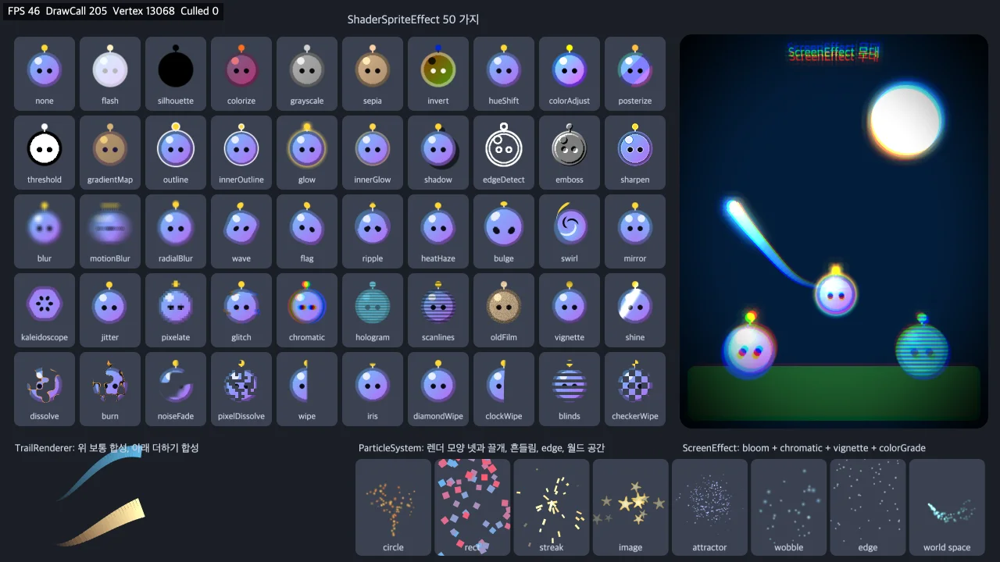
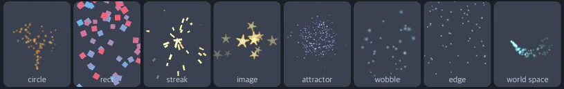
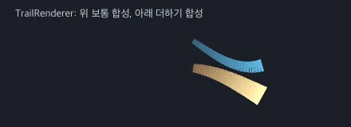
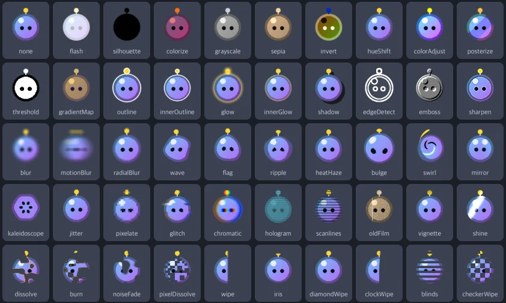
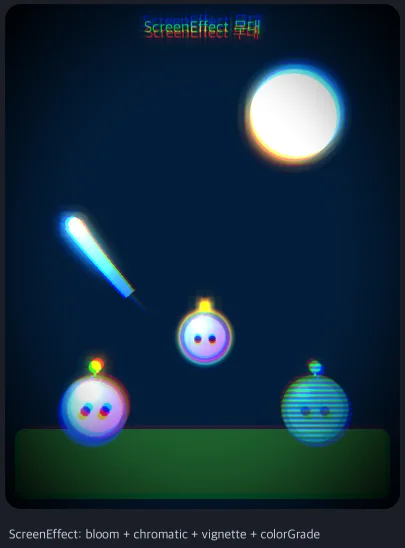

# Particles

This chapter covers particles such as flames, snow and explosions, along with other 2D effects. It goes through `ParticleSystem` and `TrailRenderer`, which attach to nodes; `ShaderSprite`, a sprite with shader effects; `ScreenEffect`, which applies post-processing to the whole screen; and the heat haze `HeatHazeEffect`. Nodes and components are covered in the "Nodes and Components" chapter, draw order and blending in the "Drawing" chapter, 3D effects (`ToonVfx`) in the "3D" chapter, and the Particle Editor itself in the "Authoring Tools and Files Shared by Both Engines" chapter.



## ParticleSystem

`ParticleSystem` is a component that ports the commonly used parts of Unity's ParticleSystem to 2D. Once attached to a node it starts emitting right away (playing, looping, 20 per second by default), moves particles on every node update, and draws them batched as vertex colored quads. Coordinates are component coordinates (the top left of the node's content size area is the origin); for a node whose content size is 0, the node's position is the origin.



```rust,no_run
use vanilla::{Color, Engine, EngineConfiguration, ParticleEmitterShape, ParticleSystem, Scene, SceneBase, Vector2};

struct FireScene {
	scene_base: SceneBase,
}

impl Scene for FireScene {
	fn get_scene_base(&self) -> &SceneBase {
		&self.scene_base
	}

	fn get_scene_base_mut(&mut self) -> &mut SceneBase {
		&mut self.scene_base
	}

	fn load(&mut self, _engine: &Engine) {
		let root_id = self.scene_base.get_root_id();
		let node_tree = self.scene_base.get_node_tree_mut();
		let fire_id = node_tree.create_child(root_id, "Fire");
		node_tree[fire_id].set_local_position(Vector2::create(640.0, 520.0));
		let particle_system = node_tree[fire_id].add_component(ParticleSystem::new());
		particle_system.set_emitter_shape(ParticleEmitterShape::Cone);
		particle_system.set_shape_radius(20.0);
		particle_system.set_cone_angle(0.35);
		particle_system.set_emission_rate(60.0);
		particle_system.set_start_lifetime(0.6, 1.2);
		particle_system.set_start_speed(80.0, 180.0);
		particle_system.set_start_size(6.0, 14.0);
		particle_system.set_start_color(Color::create(1.0, 0.75, 0.3, 1.0), Color::create(1.0, 0.5, 0.12, 1.0));
		particle_system.set_color_over_lifetime(vec![
			(0.0, Color::create(1.0, 1.0, 0.85, 1.0)),
			(0.5, Color::create(1.0, 0.6, 0.2, 0.9)),
			(1.0, Color::create(0.65, 0.1, 0.02, 0.0)),
		]);
		particle_system.set_size_over_lifetime(1.0, 0.3);
		particle_system.set_gravity(0.0, -110.0);
		particle_system.set_damping(1.0);
		particle_system.set_additive(true);
		particle_system.set_max_particle_count(800);
	}
}

fn main() {
	let mut engine_configuration = EngineConfiguration::new();
	engine_configuration.reference_resolution_size = Vector2::create(1280.0, 720.0);
	let engine = Engine::new(engine_configuration);
	let fire_scene = FireScene {
		scene_base: SceneBase::new(),
	};
	if let Err(error) = engine.run(Box::new(fire_scene)) {
		eprintln!("{}", error);
	}
}
```

### Emission

- `set_emission_rate(count)`: particles emitted per second (default 20; at 0 or less nothing is emitted continuously).
- `set_looping(is_looping)` (default `true`) and `set_duration(seconds)` (default 1): when not looping, it emits only for `duration`.
- `set_burst_list(vec![(time, count)])`: emits a batch at given times (seconds) from the start of playback. When looping, it repeats every `duration`.
- `emit(count, origin_offset)`: emits several particles right away, even when not playing. `origin_offset` is an origin correction in component coordinates (`Option<Vector2>`, `None` means the origin).
- `ParticleSystem::emit_in_tree(&mut node_tree, node_id, count, origin_offset)`: emits with the node's first `ParticleSystem`, reading the node's current position. Returns `false` if the node does not exist or has no `ParticleSystem` (see "World space" below).
- `play()` resets the emission time and bursts and starts emitting. `stop(is_clearing)` stops emitting, and live particles keep moving until their lifetime ends unless `is_clearing` is true.
- `is_playing()`, `is_finished()` (true when no particles are alive and nothing more will be emitted; false until stopped when looping), `get_particle_count()`, `set_max_particle_count(count)` (default 512; no new particles are created while that many exist).

```rust
use vanilla::{ParticleSystem, Vector2};

let mut particle_system = ParticleSystem::new();
particle_system.set_manual_tick(true);
particle_system.set_emission_rate(10.0);
particle_system.simulate(0.5);
assert_eq!(particle_system.get_particle_count(), 5);

particle_system.stop(false);
particle_system.emit(3, Some(Vector2::create(0.0, -20.0)));
assert_eq!(particle_system.get_particle_count(), 8);
particle_system.stop(true);
assert_eq!(particle_system.get_particle_count(), 0);

let mut burst_system = ParticleSystem::new();
burst_system.set_looping(false);
burst_system.set_emission_rate(0.0);
burst_system.set_burst_list(vec![(0.0, 24)]);
burst_system.simulate(0.016);
assert_eq!(burst_system.get_particle_count(), 24);
burst_system.simulate(1.5);
assert_eq!(burst_system.get_particle_count(), 0);
assert!(burst_system.is_finished());
```

### Emitter shapes (ParticleEmitterShape)

| Value | Spawn position | Direction |
| --- | --- | --- |
| `Point` (default) | origin | random |
| `Circle` | within the `set_shape_radius` radius | outward from the center |
| `Cone` | within the radius | within the `set_cone_angle` half angle (radians, default 0.5) of up (-y) |
| `Box` | within the `set_box_size(width, height)` rectangle (centered on the origin) | up (-y) |
| `Edge` | on a horizontal segment of length `set_edge_width` (centered on the origin) | down (+y) |

All sizes are in component coordinates (pixels) and default to 0. The original takes shapes as strings, but the Rust version uses an enum; only descriptions (`apply_description`) read the original strings (such as `"cone"`).

### Per-particle values

- Start ranges: `set_start_lifetime(min, max)` (seconds, default 1), `set_start_speed(min, max)` (pixels/second, default 60), `set_start_size(min, max)` (diameter in pixels, default 6), `set_start_rotation(min, max)` (radians, default 0; only `Rect` and `Image` rendering rotate), `set_start_color(color_a, color_b)` (random between the two colors, default white), `set_angular_velocity(min, max)` (radians/second, default 0). Unlike the original there are no default arguments, so pass both values. To fix a single value, pass the same value twice.
- Changes over lifetime: `set_color_over_lifetime(vec![(time, color)])` (`time` from 0 to 1 in ascending order, multiplied with the start color, linearly interpolated between keys, an empty list keeps the start color), `set_size_over_lifetime(start_scale, end_scale)` (default 1, 1).
- Forces: `set_gravity(x, y)` (pixels/second², default 0, 0; screen coordinates, so upward is negative), `set_damping(damping)` (multiplies the velocity by `max(1 - damping x time_delta, 0)` on every update, default 0), `set_attractor(x, y, strength, swirl)` (pulls toward a point in component coordinates, pushes away when `strength` is negative, `swirl` turns along the tangent; release it with `clear_attractor()`).
- `set_wobble(amplitude, frequency)` (original default frequency 4) sways particles sideways only when drawing and does not affect their movement.

### Drawing

- `set_render_shape(shape)`: `ParticleRenderShape::Circle` (soft circle, default), `Rect` (rotating plate), `Streak` (a band stretched along the direction of travel, length factor `set_streak_scale`, default 0.06), `Image` (the image set with `set_image(Some(image))`, a white rectangle when there is no image).
- `set_additive(true)` is additive blending (`BlendMode::Lighter`), and `set_blend_mode(blend_mode)` sets another blend (default `BlendMode::Normal`).
- As in the original, `Image` rendering does not use the color curve or the RGB of the start color; it only fades by start alpha x (1 - lifetime ratio). The original draws `image` particles one by one, but the Rust version draws them in one batch with the image texture.

### World space

With `set_world_space(true)`, each particle gets the node's local position at birth added and fixed. When the node moves, particles already emitted do not follow and stay behind like a trail of smoke (the default `false` moves them along with the node).

A Rust component cannot read its own node outside the node update and drawing, so the node position to add is read during the node update. To emit at the spot right after moving the node, emit with `ParticleSystem::emit_in_tree`, or set the position with `set_node_position(position)` and then `emit`.

Below, a moving node emits in world space, and pressing emits a single burst with an attractor at that spot.

```rust,no_run
use vanilla::{Color, Engine, EngineConfiguration, NodeId, ParticleEmitterShape, ParticleRenderShape, ParticleSystem, Scene, SceneBase, Vector2};

struct BurstScene {
	scene_base: SceneBase,
	emitter_id: Option<NodeId>,
	burst_id: Option<NodeId>,
	elapsed_seconds: f64,
}

impl Scene for BurstScene {
	fn get_scene_base(&self) -> &SceneBase {
		&self.scene_base
	}

	fn get_scene_base_mut(&mut self) -> &mut SceneBase {
		&mut self.scene_base
	}

	fn load(&mut self, _engine: &Engine) {
		let root_id = self.scene_base.get_root_id();
		let node_tree = self.scene_base.get_node_tree_mut();

		let emitter_id = node_tree.create_child(root_id, "Smoke");
		node_tree[emitter_id].set_local_position(Vector2::create(640.0, 360.0));
		let smoke = node_tree[emitter_id].add_component(ParticleSystem::new());
		smoke.set_emission_rate(40.0);
		smoke.set_start_speed(10.0, 30.0);
		smoke.set_start_lifetime(1.0, 2.0);
		smoke.set_start_color(Color::create(0.8, 0.85, 1.0, 0.6), Color::create(0.8, 0.85, 1.0, 0.6));
		smoke.set_size_over_lifetime(1.0, 3.0);
		smoke.set_world_space(true);
		self.emitter_id = Some(emitter_id);

		let burst_id = node_tree.create_child(root_id, "Burst");
		node_tree[burst_id].set_local_position(Vector2::create(640.0, 360.0));
		let burst_system = node_tree[burst_id].add_component(ParticleSystem::new());
		burst_system.set_emission_rate(0.0);
		burst_system.set_looping(false);
		burst_system.set_emitter_shape(ParticleEmitterShape::Circle);
		burst_system.set_shape_radius(8.0);
		burst_system.set_start_speed(200.0, 420.0);
		burst_system.set_start_lifetime(0.5, 1.0);
		burst_system.set_start_color(Color::create(1.0, 0.9, 0.4, 1.0), Color::create(1.0, 0.4, 0.2, 1.0));
		burst_system.set_render_shape(ParticleRenderShape::Streak);
		burst_system.set_attractor(0.0, 0.0, -200.0, 300.0);
		burst_system.set_damping(2.0);
		burst_system.set_additive(true);
		self.burst_id = Some(burst_id);
	}

	fn tick(&mut self, time_delta: f64) {
		self.scene_base.tick(time_delta);
		self.elapsed_seconds += time_delta;
		if let Some(emitter_id) = self.emitter_id {
			let position_x = 640.0 + self.elapsed_seconds.cos() * 300.0;
			let position_y = 360.0 + (self.elapsed_seconds * 2.0).sin() * 120.0;
			self.scene_base.get_node_tree_mut()[emitter_id].set_local_position(Vector2::create(position_x, position_y));
		}
	}

	fn touch_press(&mut self, view_input_position: Vector2) {
		if let Some(burst_id) = self.burst_id {
			let node_tree = self.scene_base.get_node_tree_mut();
			node_tree[burst_id].set_local_position(view_input_position);
			ParticleSystem::emit_in_tree(node_tree, burst_id, 80, None);
		}
	}
}

fn main() {
	let mut engine_configuration = EngineConfiguration::new();
	engine_configuration.reference_resolution_size = Vector2::create(1280.0, 720.0);
	let engine = Engine::new(engine_configuration);
	let burst_scene = BurstScene {
		scene_base: SceneBase::new(),
		emitter_id: None,
		burst_id: None,
		elapsed_seconds: 0.0,
	};
	if let Err(error) = engine.run(Box::new(burst_scene)) {
		eprintln!("{}", error);
	}
}
```

### Reading Particle Editor presets

The Particle Editor saves a `.vfx.json` of the form `{ "systems": [{ "name", ...description }] }`. `apply_description(&description)` reads one description as is (a `serde_json::Value`). Every field is optional and only the given ones change. Colors are `[r, g, b, a]` arrays and ranges are `[min, max]` arrays; leaving out `max` in a range makes it equal to `min`. Shape and blend names it does not know are ignored.

| Field | Method |
| --- | --- |
| `looping`, `duration`, `maxParticleCount`, `emissionRate` | `set_looping`, `set_duration`, `set_max_particle_count`, `set_emission_rate` |
| `bursts` (`[{ "time", "count" }]`) | `set_burst_list` |
| `shape`, `shapeRadius`, `coneAngle`, `boxSize`, `edgeWidth` | emitter shape |
| `lifetime`, `speed`, `size`, `rotation`, `angularVelocity` | start ranges |
| `startColorA`, `startColorB` (same as A if omitted), `colorOverLifetime` (`[{ "time", "color" }]`), `sizeOverLifetime` | color and size |
| `gravity`, `damping`, `attractor` (`{ "x", "y", "strength", "swirl" }` or `null`), `wobble` (`[amplitude, frequency]`) | forces |
| `renderShape`, `blendMode`, `streakScale`, `worldSpace` | drawing |

Below, preset text is read and one node is created per system. In a scene, do the same in `load` on `self.scene_base.get_node_tree_mut()`, and read the file with `JsonAsset` (see the "Assets" chapter). Here a manual update advances one second to check the result.

```rust
use vanilla::{NodeTree, ParticleSystem, Vector2};

const SNOW_VFX: &str = r#"{
	"systems": [
		{
			"name": "Snow",
			"emissionRate": 70,
			"shape": "edge",
			"edgeWidth": 1200,
			"lifetime": [5, 8],
			"speed": [30, 70],
			"size": [2.5, 6],
			"gravity": [0, 12],
			"damping": 0.1,
			"wobble": [14, 1.4],
			"renderShape": "circle",
			"blendMode": "source-over",
			"startColorA": [1, 1, 1, 0.95],
			"startColorB": [0.8, 0.88, 1, 0.55],
			"colorOverLifetime": [
				{ "time": 0, "color": [1, 1, 1, 0] },
				{ "time": 0.06, "color": [1, 1, 1, 1] },
				{ "time": 1, "color": [1, 1, 1, 0] }
			]
		}
	]
}"#;

let vfx_asset: serde_json::Value = serde_json::from_str(SNOW_VFX).expect("vfx");
let mut node_tree = NodeTree::new();
let root_id = node_tree.get_root_id();
let mut node_id_list = Vec::new();
for description in vfx_asset["systems"].as_array().unwrap() {
	let name = description["name"].as_str().unwrap_or("");
	let node_id = node_tree.create_child(root_id, name);
	node_tree[node_id].set_local_position(Vector2::create(640.0, 0.0));
	let particle_system = node_tree[node_id].add_component(ParticleSystem::new());
	particle_system.apply_description(description);
	particle_system.set_manual_tick(true);
	particle_system.simulate(1.0);
	assert_eq!(particle_system.get_particle_count(), 70);
	node_id_list.push(node_id);
}
assert_eq!(node_tree[node_id_list[0]].get_name(), "Snow");
```

### Controlling time yourself

With `set_manual_tick(true)`, time does not advance during the node update (it only records the node position) and advances only when you call `simulate(time_delta)`. `simulate` integrates the given time in one step. With `set_random_seed(seed)`, spawn randomness follows that seed and returns to it on every `stop(true)`, so rewinding produces the same result (`get_random_seed()` returns the seed given, or `None` if none was given). `Timeline` handles its target particle nodes this way (see the "Tweens and Timelines" chapter). `get_particle_position_list()` returns the positions of live particles (in component coordinates, without wobble).

```rust
use vanilla::ParticleSystem;

let mut first_system = ParticleSystem::new();
let mut second_system = ParticleSystem::new();
for particle_system in [&mut first_system, &mut second_system] {
	particle_system.set_manual_tick(true);
	particle_system.set_emission_rate(0.0);
	particle_system.set_random_seed(42);
	particle_system.set_start_speed(40.0, 120.0);
	particle_system.emit(8, None);
	particle_system.simulate(0.25);
}
assert_eq!(first_system.get_particle_position_list(), second_system.get_particle_position_list());

first_system.stop(true);
first_system.emit(8, None);
first_system.simulate(0.25);
assert_eq!(first_system.get_particle_position_list(), second_system.get_particle_position_list());
assert_eq!(first_system.get_random_seed(), Some(42));
```

## TrailRenderer

Records the spots a node passes through as points and draws them as a band whose width and color fade out (a 2D counterpart of Unity's TrailRenderer). On every node update it records the node's local position (in parent coordinates), and points past their lifetime are removed.



- `set_time(seconds)`: how long a point stays, that is, the band's length (default 0.5).
- `set_width(start_width, end_width)`: the width from the newest point to the end (default 10, 0).
- `set_colors(start_color, end_color)`: default `(1, 1, 1, 0.9)` to `(1, 1, 1, 0)`. When drawing, RGB is rounded to integers from 0 to 255 as in the original.
- `set_min_vertex_distance(distance)`: a point is added only after moving this far (parent coordinates, default 3).
- `set_additive(is_additive)`, `set_emitting(is_emitting)` (when off, no new points are made), `clear()`, `get_point_count()` (the band is drawn only with two or more points).

```rust,no_run
use vanilla::{Color, Engine, EngineConfiguration, NodeId, Paint, Scene, SceneBase, TrailRenderer, Vector2};

struct TrailScene {
	scene_base: SceneBase,
	comet_id: Option<NodeId>,
	elapsed_seconds: f64,
}

impl Scene for TrailScene {
	fn get_scene_base(&self) -> &SceneBase {
		&self.scene_base
	}

	fn get_scene_base_mut(&mut self) -> &mut SceneBase {
		&mut self.scene_base
	}

	fn load(&mut self, _engine: &Engine) {
		let root_id = self.scene_base.get_root_id();
		let node_tree = self.scene_base.get_node_tree_mut();
		let comet_id = node_tree.create_child(root_id, "Comet");
		let comet_node = &mut node_tree[comet_id];
		comet_node.set_content_size(Vector2::create(16.0, 16.0));
		comet_node.set_local_position(Vector2::create(640.0, 360.0));
		let trail = comet_node.add_component(TrailRenderer::new());
		trail.set_time(0.5);
		trail.set_width(14.0, 0.0);
		trail.set_colors(Color::create(0.4, 0.8, 1.0, 0.9), Color::create(0.4, 0.8, 1.0, 0.0));
		trail.set_additive(true);
		let paint = comet_node.add_component(Paint::create_with_color(Color::white()));
		paint.set_round_size(8.0);
		self.comet_id = Some(comet_id);
	}

	fn tick(&mut self, time_delta: f64) {
		self.scene_base.tick(time_delta);
		self.elapsed_seconds += time_delta;
		if let Some(comet_id) = self.comet_id {
			let angle = self.elapsed_seconds * 2.0;
			let position = Vector2::create(640.0 + angle.cos() * 260.0, 360.0 + angle.sin() * 160.0);
			self.scene_base.get_node_tree_mut()[comet_id].set_local_position(position);
		}
	}
}

fn main() {
	let mut engine_configuration = EngineConfiguration::new();
	engine_configuration.reference_resolution_size = Vector2::create(1280.0, 720.0);
	let engine = Engine::new(engine_configuration);
	let trail_scene = TrailScene {
		scene_base: SceneBase::new(),
		comet_id: None,
		elapsed_seconds: 0.0,
	};
	if let Err(error) = engine.run(Box::new(trail_scene)) {
		eprintln!("{}", error);
	}
}
```

## ShaderSprite

A sprite that applies fragment shader effects. `ShaderSpriteEffect` has 49 effects besides `None` (flash `Flash`, outline `Outline`, shine `Shine`, dissolve `Dissolve`, hologram `Hologram`, wave `Wave`, mosaic `Pixelate`, glitch `Glitch`, wipe `Wipe` and so on). Each effect has default parameters and a color, and the `ShaderSpriteEffect` comments in the source describe what progress, color and parameters mean for each effect. Original names (camelCase such as `"dissolve"` and `"heatHaze"`) convert with `get_name()` and `ShaderSpriteEffect::from_name(name)`, and `ShaderSpriteEffect::get_effect_list()` returns all 50 including `None`.



- The original inherits from `Sprite`, but the Rust version wraps a `Sprite` and calls `Sprite` functions (`set_image`, `set_image_rect`, `set_color` and so on) directly through `Deref`. It reports the wrapped `Sprite` with `Component::get_base_component`, so on a node it is found with `get_component::<ShaderSprite>()` and, like the original, with `get_component::<Sprite>()`. `get_sprite()` and `get_sprite_mut()` also give the wrapped `Sprite`.
- Create one with `ShaderSprite::new()` or `ShaderSprite::create_with_image(image)`.
- `set_effect(effect)` switches the effect and resets to that effect's default parameters and color (progress and effect time stay). Change parameters or color after it. With `None` or no image, it draws the same as `Sprite`.
- `set_effect_progress(progress)` (clamped to 0 to 1) is the progress pushed in by a tween or timeline. The effect time (`set_effect_time`) advances by itself on node updates.
- `set_effect_color(color)`, `set_effect_parameters(x, y, z, w)` (pass the trailing arguments that default to 0 in the original yourself), `set_effect_seed(seed)` (when you want the same noise pattern; by default a random 0 to 100 at creation), static `ShaderSprite::get_default_parameters(effect)`, `ShaderSprite::get_default_color(effect)`.
- If building the shader program fails, the original throws, but the Rust version reports it once and draws as a plain `Sprite` without the effect.

```rust
use vanilla::{Color, Image, Rect, ShaderSprite, ShaderSpriteEffect};

let image = Image::create_from_pixels(64, 32, vec![255u8; 64 * 32 * 4]);
let mut shader_sprite = ShaderSprite::create_with_image(image);
shader_sprite.set_image_rect(Rect::create(0.0, 0.0, 32.0, 32.0));
shader_sprite.set_effect(ShaderSpriteEffect::Outline);
assert_eq!(shader_sprite.get_effect_parameters(), ShaderSprite::get_default_parameters(ShaderSpriteEffect::Outline));
shader_sprite.set_effect_parameters(3.0, 0.0, 0.0, 0.0);
shader_sprite.set_effect_color(Color::create(1.0, 0.8, 0.2, 1.0));
shader_sprite.set_effect_progress(1.5);
assert_eq!(shader_sprite.get_effect_progress(), 1.0);
assert_eq!(shader_sprite.get_sprite().get_image_rect(), Rect::create(0.0, 0.0, 32.0, 32.0));
assert_eq!(ShaderSpriteEffect::from_name("dissolve"), Some(ShaderSpriteEffect::Dissolve));
assert_eq!(ShaderSpriteEffect::Dissolve.get_name(), "dissolve");
assert_eq!(ShaderSpriteEffect::get_effect_list().len(), 50);
```

Below, a dissolve is applied to the star cell of the repository's `examples/assets/atlas/icons.png`, and a tween moves the progress back and forth. The tween's update callback receives the node tree, so it finds the `ShaderSprite` through the captured `NodeId`.

```rust,no_run
use vanilla::{easing_function, Color, Engine, EngineConfiguration, ImageAsset, NodeId, Rect, Scene, SceneBase, ShaderSprite, ShaderSpriteEffect, Tween, TweenId, TweenValues, Vector2};

struct DissolveScene {
	scene_base: SceneBase,
	image_asset: ImageAsset,
	sprite_id: Option<NodeId>,
	dissolve_tween_id: Option<TweenId>,
	is_dissolving: bool,
}

impl DissolveScene {
	fn start_dissolve(&mut self, sprite_id: NodeId) {
		let (start_progress, end_progress) = if self.is_dissolving {
			(0.0, 1.0)
		}
		else {
			(1.0, 0.0)
		};
		let tween = Tween::new(TweenValues::new().with("progress", start_progress))
			.to(TweenValues::new().with("progress", end_progress), 1.5)
			.easing(easing_function::sinusoidal::ease_in_out)
			.set_update(move |values, node_tree| {
				let progress = values.get_number("progress").unwrap_or(0.0);
				if let Some(shader_sprite) = node_tree[sprite_id].get_component_mut::<ShaderSprite>() {
					shader_sprite.set_effect_progress(progress);
				}
			});
		self.dissolve_tween_id = Some(self.scene_base.start_tween(tween));
		self.is_dissolving = !self.is_dissolving;
	}
}

impl Scene for DissolveScene {
	fn get_scene_base(&self) -> &SceneBase {
		&self.scene_base
	}

	fn get_scene_base_mut(&mut self) -> &mut SceneBase {
		&mut self.scene_base
	}

	fn load(&mut self, engine: &Engine) {
		self.image_asset.load(engine, "examples/assets/atlas/icons.png");
		self.scene_base.track_asset(&self.image_asset);
	}

	fn initialize(&mut self, _engine: &Engine) {
		let image = match self.image_asset.get_image() {
			Some(image) => {
				image
			}
			None => {
				return;
			}
		};
		let root_id = self.scene_base.get_root_id();
		let node_tree = self.scene_base.get_node_tree_mut();
		let sprite_id = node_tree.create_child(root_id, "Star");
		let sprite_node = &mut node_tree[sprite_id];
		sprite_node.set_content_size(Vector2::create(300.0, 300.0));
		sprite_node.set_local_position(Vector2::create(640.0, 360.0));
		let shader_sprite = sprite_node.add_component(ShaderSprite::create_with_image(image));
		shader_sprite.set_image_rect(Rect::create(63.0, 2.0, 48.0, 48.0));
		shader_sprite.set_effect(ShaderSpriteEffect::Dissolve);
		shader_sprite.set_effect_color(Color::create(1.0, 0.5, 0.1, 1.0));
		self.sprite_id = Some(sprite_id);
		self.start_dissolve(sprite_id);
	}

	fn tick(&mut self, time_delta: f64) {
		self.scene_base.tick(time_delta);
		if let (Some(sprite_id), Some(dissolve_tween_id)) = (self.sprite_id, self.dissolve_tween_id) {
			if self.scene_base.get_tween(dissolve_tween_id).is_none() {
				self.start_dissolve(sprite_id);
			}
		}
	}
}

fn main() {
	let mut engine_configuration = EngineConfiguration::new();
	engine_configuration.reference_resolution_size = Vector2::create(1280.0, 720.0);
	let engine = Engine::new(engine_configuration);
	let dissolve_scene = DissolveScene {
		scene_base: SceneBase::new(),
		image_asset: ImageAsset::new(),
		sprite_id: None,
		dissolve_tween_id: None,
		is_dissolving: true,
	};
	if let Err(error) = engine.run(Box::new(dissolve_scene)) {
		eprintln!("{}", error);
	}
}
```

## ScreenEffect

A post-processing chain applied to the whole scene. The scene draws to the screen as usual, and `end` grabs the screen (or a given region), applies the enabled effects in order, and puts the result back in the same place. `ScreenEffectType` has 58 effects (vignette `Vignette`, shockwave `Shockwave`, bloom `Bloom`, color grading `ColorGrade`, chromatic aberration `Chromatic`, grain `Grain`, fog `Fog`, fade `Fade` and so on). Original names convert with `get_name()` and `ScreenEffectType::from_name(name)`.



- Create one with `ScreenEffect::new()`. The original takes a `Graphic` in its constructor, but the Rust version takes nothing and creates its GL resources on the first `end`. Call `begin(graphic)` at the start of the scene's `pre_draw`, `end(graphic)` at the end of `post_draw`, and `tick(time_delta)` in `tick`.
- `set_enabled(effect_type, is_enabled)`, `set_strength(effect_type, strength)` (0 is the same as off, default 1), `set_parameters(effect_type, x, y, z, w)`, `set_parameter(effect_type, name, value)` (names come from `SCREEN_EFFECT_PARAMETER_NAMES` or `effect_type.get_parameter_names()`; unknown names are ignored), `set_color(effect_type, color)`, `disable_all()`, `reset_all()`, `has_active_effect()`.
- `set_region(x, y, width, height, corner_radius)` applies effects only to a region in canvas pixels (top left origin). Outside the rounded corners the original screen is kept. `clear_region()` goes back to the whole screen.
- The order effects are applied in is fixed (shape distortion, blur, glitch, color, patterns, transitions; `ScreenEffect::get_effect_order()`, the same as the enum declaration order).
- It implements `TimelinePropertyTarget`, so it can be an `External` target of a `Timeline`. In `set_timeline_property(name, value)`, `"vignette"` is the strength (0 turns it off), `"shockwave.radius"` is a parameter, `"fade.color"` is a color, and `"fade.enabled"` turns it on.
- It uses GL resources, so call `destroy()` when you are done. Like the original it holds the GL context that created the resources (a weak handle), so it takes no argument, and it also releases them by itself when the effect is dropped (when the scene is unloaded or the node is destroyed). Effect settings remain, and the next `end` creates the resources again.
- If building a pass shader fails, the original throws, but the Rust version reports it once and skips that pass.

```rust
use vanilla::{Color, ScreenEffect, ScreenEffectType, TimelineValue};

let mut screen_effect = ScreenEffect::new();
assert!(!screen_effect.has_active_effect());
screen_effect.set_enabled(ScreenEffectType::Vignette, true);
screen_effect.set_color(ScreenEffectType::Vignette, Color::create(0.0, 0.0, 0.0, 1.0));
assert!(screen_effect.has_active_effect());

assert_eq!(ScreenEffectType::Shockwave.get_parameter_names(), &["centerX", "centerY", "radius", "width"]);
screen_effect.set_parameter(ScreenEffectType::Shockwave, "radius", 0.4);
assert_eq!(screen_effect.get_parameters(ScreenEffectType::Shockwave), [0.5, 0.5, 0.4, 0.1]);

screen_effect.set_timeline_property("vignette", &TimelineValue::Number(0.0));
assert!(!screen_effect.has_active_effect());

screen_effect.set_region(100.0, 80.0, 640.0, 360.0, 24.0);
assert!(screen_effect.get_region().is_some());
screen_effect.clear_region();
assert!(screen_effect.get_region().is_none());
assert_eq!(ScreenEffect::get_effect_order().len(), 58);
```

Below, a vignette stays on and a shockwave spreads from the spot you press.

```rust,no_run
use vanilla::{Color, Engine, EngineConfiguration, Graphic, Paint, Scene, SceneBase, ScreenEffect, ScreenEffectType, Vector2};

struct ScreenEffectScene {
	scene_base: SceneBase,
	screen_effect: ScreenEffect,
	shockwave_seconds: Option<f64>,
}

impl Scene for ScreenEffectScene {
	fn get_scene_base(&self) -> &SceneBase {
		&self.scene_base
	}

	fn get_scene_base_mut(&mut self) -> &mut SceneBase {
		&mut self.scene_base
	}

	fn load(&mut self, _engine: &Engine) {
		self.screen_effect.set_enabled(ScreenEffectType::Vignette, true);
		self.screen_effect.set_color(ScreenEffectType::Vignette, Color::create(0.0, 0.0, 0.0, 1.0));

		let root_id = self.scene_base.get_root_id();
		let node_tree = self.scene_base.get_node_tree_mut();
		for index in 0..5 {
			let box_id = node_tree.create_child(root_id, "Box");
			let box_node = &mut node_tree[box_id];
			box_node.set_content_size(Vector2::create(160.0, 160.0));
			box_node.set_local_position(Vector2::create(240.0 + index as f64 * 200.0, 360.0));
			let paint = box_node.add_component(Paint::create_with_color(Color::create(0.2 + index as f64 * 0.15, 0.5, 1.0 - index as f64 * 0.15, 1.0)));
			paint.set_round_size(24.0);
		}
	}

	fn tick(&mut self, time_delta: f64) {
		self.scene_base.tick(time_delta);
		self.screen_effect.tick(time_delta);
		if let Some(shockwave_seconds) = self.shockwave_seconds {
			let next_seconds = shockwave_seconds + time_delta;
			let radius = next_seconds * 1.5;
			self.screen_effect.set_parameter(ScreenEffectType::Shockwave, "radius", radius);
			if radius > 1.5 {
				self.screen_effect.set_enabled(ScreenEffectType::Shockwave, false);
				self.shockwave_seconds = None;
			}
			else {
				self.shockwave_seconds = Some(next_seconds);
			}
		}
	}

	fn pre_draw(&mut self, graphic: &mut Graphic) {
		self.screen_effect.begin(graphic);
		self.scene_base.draw_scene_background(graphic);
	}

	fn post_draw(&mut self, graphic: &mut Graphic) {
		self.screen_effect.end(graphic);
	}

	fn touch_press(&mut self, view_input_position: Vector2) {
		let engine = Engine::get_engine().unwrap();
		let view_size = engine.get_view_manager().get_view_size();
		self.screen_effect.set_enabled(ScreenEffectType::Shockwave, true);
		self.screen_effect.set_parameter(ScreenEffectType::Shockwave, "centerX", view_input_position.x / view_size.x);
		self.screen_effect.set_parameter(ScreenEffectType::Shockwave, "centerY", view_input_position.y / view_size.y);
		self.shockwave_seconds = Some(0.0);
	}
}

fn main() {
	let mut engine_configuration = EngineConfiguration::new();
	engine_configuration.reference_resolution_size = Vector2::create(1280.0, 720.0);
	let engine = Engine::new(engine_configuration);
	let screen_effect_scene = ScreenEffectScene {
		scene_base: SceneBase::new(),
		screen_effect: ScreenEffect::new(),
		shockwave_seconds: None,
	};
	if let Err(error) = engine.run(Box::new(screen_effect_scene)) {
		eprintln!("{}", error);
	}
}
```

## HeatHazeEffect

Grabs what was drawn on the screen before its node, over the node's area, and redraws it with each row wavering left and right. The area uses the node's content size and pivot; if the content size is empty when attached, it is set to 300 x 300.

- Because it grabs what was drawn before, the effect is only visible on the node drawn last in the scene. Children of that node are drawn on top of the effect.
- `set_amplitude(pixels)` (sway width, default 3), `set_frequency(value)` (frequency multiplied by row position, default 0.05), `set_speed(value)` (speed multiplied by time, default 2). The sway of one row can be checked with `calculate_row_offset(local_y)`.
- If the area goes outside the screen, the screen's edge pixels are stretched. The grabbed texture is a GL resource, so call `destroy()` when you are done. (like `ScreenEffect` it takes no argument, and the component also releases it by itself when dropped)

```rust,no_run
use vanilla::{Color, Engine, EngineConfiguration, HeatHazeEffect, Paint, Scene, SceneBase, Vector2};

struct HeatHazeScene {
	scene_base: SceneBase,
}

impl Scene for HeatHazeScene {
	fn get_scene_base(&self) -> &SceneBase {
		&self.scene_base
	}

	fn get_scene_base_mut(&mut self) -> &mut SceneBase {
		&mut self.scene_base
	}

	fn load(&mut self, _engine: &Engine) {
		let root_id = self.scene_base.get_root_id();
		let node_tree = self.scene_base.get_node_tree_mut();
		for index in 0..6 {
			let stripe_id = node_tree.create_child(root_id, "Stripe");
			let stripe_node = &mut node_tree[stripe_id];
			stripe_node.set_content_size(Vector2::create(40.0, 400.0));
			stripe_node.set_local_position(Vector2::create(390.0 + index as f64 * 100.0, 360.0));
			stripe_node.add_component(Paint::create_with_color(Color::create(1.0, 0.6 + index as f64 * 0.06, 0.2, 1.0)));
		}

		let haze_id = node_tree.create_child(root_id, "HeatHaze");
		let haze_node = &mut node_tree[haze_id];
		haze_node.set_content_size(Vector2::create(600.0, 300.0));
		haze_node.set_local_position(Vector2::create(640.0, 360.0));
		let heat_haze_effect = haze_node.add_component(HeatHazeEffect::new());
		heat_haze_effect.set_amplitude(4.0);
		heat_haze_effect.set_frequency(0.08);
		heat_haze_effect.set_speed(3.0);
	}
}

fn main() {
	let mut engine_configuration = EngineConfiguration::new();
	engine_configuration.reference_resolution_size = Vector2::create(1280.0, 720.0);
	let engine = Engine::new(engine_configuration);
	let heat_haze_scene = HeatHazeScene {
		scene_base: SceneBase::new(),
	};
	if let Err(error) = engine.run(Box::new(heat_haze_scene)) {
		eprintln!("{}", error);
	}
}
```

## Things to watch out for

- `ParticleSystem` starts looping emission as soon as it is attached. For one-shot effects, set `set_emission_rate(0.0)` and use `emit` or bursts.
- Rotation and cone angles are in radians (node rotation is in degrees).
- Screen coordinates have +y pointing down, so gravity that pulls upward is negative.
- In a world space system, `emit` uses the node position recorded at the last node update. To emit right after moving the node, use `ParticleSystem::emit_in_tree`.
- Like the original, `get_component::<Sprite>()` also finds a `ShaderSprite`. To use the effect functions, find it with `get_component::<ShaderSprite>()`.
- `HeatHazeEffect` and `ScreenEffect` grab what has already been drawn. The draw order (which node comes last, where `begin` and `end` are called) decides the result. Both release their GL resources on `destroy()` or when they are dropped.

## Related types

ParticleSystem, ParticleEmitterShape, ParticleRenderShape, BlendMode, TrailRenderer, ShaderSprite, ShaderSpriteEffect, ScreenEffect, ScreenEffectType, ScreenEffectRegion, SCREEN_EFFECT_PARAMETER_NAMES, HeatHazeEffect, Sprite, Tween, Timeline, TimelinePropertyTarget
