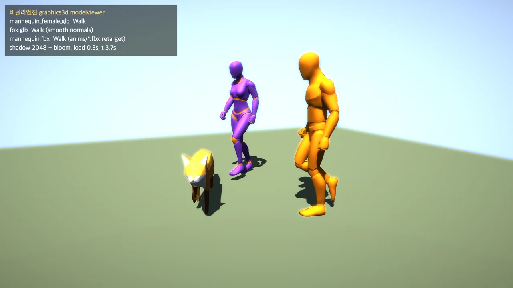
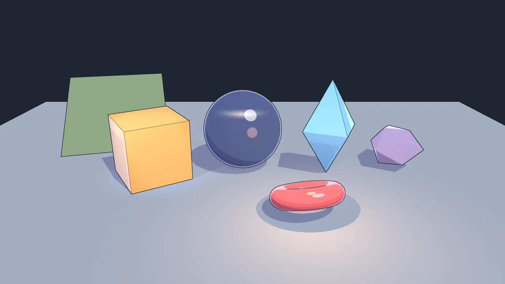
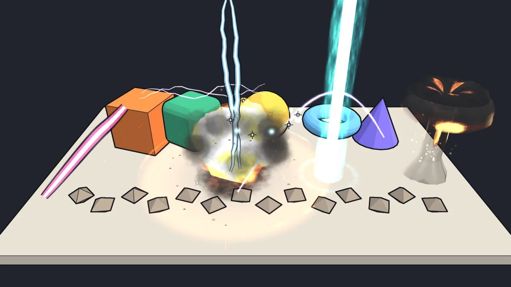
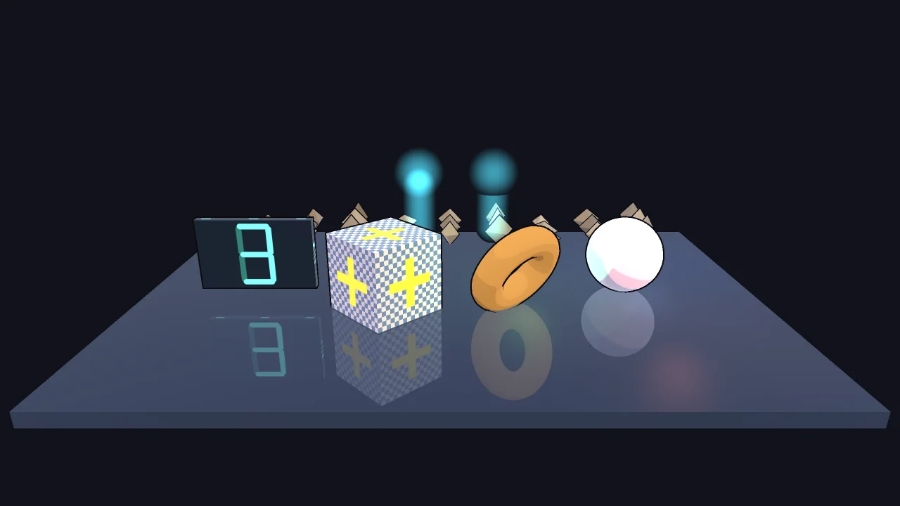

# 3D

This chapter covers how to load glTF (GLB) and FBX models, play their animations, and draw them in 3D between the engine's 2D drawing. It walks through `SkinnedModel`, which holds a model, `SkinnedModelRenderer`, which draws it, `Camera3D`, which handles view and projection, the `Material` type, `ShadowMap` for shadows, `RenderTarget` for off-screen drawing, `BloomEffect` and `FullscreenPass` for post-processing, and ends with a short introduction to toon 3D.



The Rust version ports the original's 3D (`src/graphics3d`) to the `vanilla::graphics3d` module. Type names are also available at the top of the crate, as in `vanilla::SkinnedModel`.

## How 3D is organized

The 3D side is not a scene graph of nodes and components. A loader builds a `SkinnedModel` instance with its meshes, bones, skins, materials and animations all connected, and the game holds the model matrix and camera matrices itself and passes them to the renderer to draw. A model only has data and a pose; drawing and environment state (sun, fog, shadows) belong to the renderer.

| Type | What it does |
| --- | --- |
| `SkinnedModel` | A model instance read from GLB (binary glTF) or binary FBX. Pose computation, animation crossfades, morph weights |
| `SkinnedModelLoadHandle` | The load handle for a model requested by asset path. Once loaded, `create_model` builds the model |
| `SkinnedModelRenderer` | Draws models with a skinning PBR shader. Holds sun direction, fog and shadow receiving state (one per scene) |
| `Camera3D` | Perspective or orthographic projection and the viewpoint. View and projection matrices, conversion between world points and screen positions |
| `Material` | metallic-roughness PBR values and textures |
| `ShadowMap` | The depth texture and light matrix for directional light shadows |
| `RenderTarget` | An off-screen framebuffer (color, depth, multisampling, floating point color) |
| `FullscreenPass` | A single triangle covering the whole screen plus a fragment shader |
| `BloomEffect`, `MultiLevelBloomEffect` | Bloom that extracts bright areas and blurs them |

In the original every object holds a `webGL2RenderingContext`, but 3D objects in the Rust version do not hold a context; every function that uses GL takes `gl: &GlContext`. The `Graphic` holds the context, so you get it with `graphic.get_gl()` or as the argument of `run_external_pass`. As a result, GL objects (renderers, models, render targets and so on) are first built in draw functions that receive a `Graphic` (`pre_draw`, `draw`, `post_draw`). A scene's `load` and `initialize` do not receive a `Graphic`. To change GL state such as the depth test directly, add `glow` at the same version as the engine (currently 0.18) to your game's `Cargo.toml`. What `get_gl` and `run_external_pass` give is a `GlContext`. Its state functions (`enable`, `viewport`, `bind_texture` and the like) go through the engine's GL state cache, so the engine knows the changed state even when engine drawing continues right after. `GlContext` has every method of glow's `HasContext` with the same name and signature, so you call them without `use glow::HasContext;`. Game helper functions also take `gl: &GlContext`. The inner `glow::Context` cannot be taken out, so a `GlContext` cannot be passed to a function taking `&glow::Context` (a compile error), and there is no way to skip the state cache. Pass the `GlContext` as is to engine functions.

## Fitting 3D into the engine's screen

The engine's `Graphic` (2D) and the 3D types share the same GL context. To draw 3D between 2D drawing, wrap it in `graphic.run_external_pass(is_depth_cleared, |gl| { ... })`.

- It first draws the pending 2D batch, clears the depth buffer if `is_depth_cleared` is true, and then passes the GL context to the closure. It returns whatever the closure returns.
- Inside the closure you may change the program, vertex array, viewport, blending, depth and face culling freely. When it finishes (even on panic), `restore_render_state` restores the viewport, 2D program and vertex array, enables blending, and disables the depth test and face culling (it turns the stencil test back on while clipping).
- The framebuffer binding is not restored. If you drew to a render target, bind the default framebuffer (`None`) again at the end of the closure.
- You can also draw the whole 3D scene first in the scene's `pre_draw`: flush the 2D with `graphic.flush_batch()`, draw the 3D, call `graphic.restore_render_state()`, and continue with 2D (the repository's `examples/modelviewer.rs`).

The example below loads `fox.glb`, plays the walk animation, draws the 3D first in the scene's `draw`, and then draws 2D nodes (text) on top with `self.scene_base.draw(graphic)`. The model file is not in this repository, so take `examples/ancientmountain/assets/fox.glb` from the original vanilla.js repository (https://github.com/ddukbaek2/vanilla.js) and put it in the asset folder. This block uses `glow` directly to enable the depth test. Add `glow = "0.18"`, the same version the engine uses, to your game crate's Cargo.toml.

```rust,no_run
use std::f64::consts::PI;
use vanilla::{Camera3D, Colors, Engine, EngineConfiguration, GlContext, Graphic, Matrix4, Scene, SceneBase, SkinnedModel, SkinnedModelLoadHandle, SkinnedModelRenderer, Text, Vector2, Vector3};

struct FoxResources {
	skinned_model_renderer: SkinnedModelRenderer,
	fox_model: SkinnedModel,
}

struct FoxScene {
	scene_base: SceneBase,
	fox_load_handle: Option<SkinnedModelLoadHandle>,
	resources: Option<FoxResources>,
	camera: Camera3D,
	angle: f64,
}

impl FoxScene {
	fn create_resources(&mut self, gl: &GlContext) -> Option<FoxResources> {
		let fox_load_handle = self.fox_load_handle.take()?;
		let mut skinned_model_renderer = match SkinnedModelRenderer::new(gl, None, None) {
			Ok(skinned_model_renderer) => {
				skinned_model_renderer
			}
			Err(error) => {
				eprintln!("{}", error);
				return None;
			}
		};
		skinned_model_renderer.set_sun_direction(0.45, 0.76, 0.47);
		skinned_model_renderer.set_fog_range(300.0, 800.0);
		let mut fox_model = match fox_load_handle.create_model(gl, &skinned_model_renderer)? {
			Ok(fox_model) => {
				fox_model
			}
			Err(error) => {
				eprintln!("{}", error);
				return None;
			}
		};
		fox_model.play_animation("Walk", 0.0);
		fox_model.update(0.0);
		Some(FoxResources {
			skinned_model_renderer,
			fox_model,
		})
	}

	fn draw_fox(&mut self, gl: &GlContext, width: i32, height: i32) {
		if self.resources.is_none() {
			self.resources = self.create_resources(gl);
		}
		let resources = match self.resources.as_mut() {
			Some(resources) => {
				resources
			}
			None => {
				return;
			}
		};
		unsafe {
			gl.viewport(0, 0, width, height);
			gl.enable(glow::DEPTH_TEST);
			gl.enable(glow::CULL_FACE);
			gl.disable(glow::BLEND);
		}
		self.camera.set_aspect_ratio(width as f64 / height.max(1) as f64);
		let view_projection_matrix = self.camera.get_view_projection_matrix();
		let eye_position = self.camera.get_eye_position();
		let model_matrix = Matrix4::create_rotation_y(self.angle);
		resources.skinned_model_renderer.draw(gl, &mut resources.fox_model, view_projection_matrix.get_elements(), model_matrix.get_elements(), eye_position.x, eye_position.y, eye_position.z);
	}
}

impl Scene for FoxScene {
	fn get_scene_base(&self) -> &SceneBase {
		&self.scene_base
	}

	fn get_scene_base_mut(&mut self) -> &mut SceneBase {
		&mut self.scene_base
	}

	fn load(&mut self, engine: &Engine) {
		let fox_load_handle = SkinnedModel::load_from_url(engine, "fox.glb");
		self.scene_base.track_load_handle(fox_load_handle.get_load_handle());
		self.fox_load_handle = Some(fox_load_handle);

		self.camera.set_perspective(PI / 3.0, 1.0, 2000.0);
		self.camera.look_at(Vector3::create(0.0, 80.0, 220.0), Vector3::create(0.0, 45.0, 0.0), Vector3::up());

		let root_id = self.scene_base.get_root_id();
		let node_tree = self.scene_base.get_node_tree_mut();
		let label_id = node_tree.create_child(root_id, "Label");
		let label_node = &mut node_tree[label_id];
		label_node.set_content_size(Vector2::create(400.0, 60.0));
		label_node.set_local_position(Vector2::create(640.0, 80.0));
		let text = label_node.add_component(Text::create_with_text("fox.glb", 40.0));
		text.set_text_color(Colors::WHITE);
	}

	fn tick(&mut self, time_delta: f64) {
		self.scene_base.tick(time_delta);
		self.angle += time_delta * 0.5;
		if let Some(resources) = self.resources.as_mut() {
			resources.fox_model.update(time_delta);
		}
	}

	fn draw(&mut self, graphic: &mut Graphic) {
		let width = graphic.get_drawing_buffer_width();
		let height = graphic.get_drawing_buffer_height();
		graphic.run_external_pass(true, |gl| {
			self.draw_fox(gl, width, height);
		});
		self.scene_base.draw(graphic);
	}
}

fn main() {
	let mut engine_configuration = EngineConfiguration::new();
	engine_configuration.reference_resolution_size = Vector2::create(1280.0, 720.0);
	engine_configuration.auto_resize_on_window_resize = true;
	let engine = Engine::new(engine_configuration);
	let fox_scene = FoxScene {
		scene_base: SceneBase::new(),
		fox_load_handle: None,
		resources: None,
		camera: Camera3D::new(),
		angle: 0.0,
	};
	if let Err(error) = engine.run(Box::new(fox_scene)) {
		eprintln!("{}", error);
	}
}
```

- `SkinnedModelRenderer::new(gl, fragment_shader_source, vertex_shader_source)` is created once per scene (`None` for the shader sources means the default PBR). It returns `Err` if the shaders fail to compile. Models build their materials with this renderer's shader while loading, so create it before the models.
- `SkinnedModel::load_from_url(engine, path)` asks for the GLB bytes through the engine's asset loading (asset folder candidates on desktop, a fetch from `asset_base_url` on the web) and returns a load handle (`SkinnedModelLoadHandle`). If you hand it to the scene with `scene_base.track_load_handle(handle.get_load_handle())`, `initialize` is called once it is loaded. The handle's `create_model(gl, &renderer)` returns `None` while still loading and `Some(Err)` if loading or parsing failed.
- The original `await SkinnedModel.loadFromUrl(...)` corresponds to `SkinnedModel::load_from_url_async(engine, path, &renderer).await` inside an engine task (see the "async/await" chapter). Bytes you already have are read on the spot by `SkinnedModel::load_from_bytes(gl, &bytes, &renderer)`. It is an `Err` if the data is not GLB (wrong header), and if there are clips the first one is left playing.
- `update(delta_time)` advances time, samples the pose and computes the joint matrices. It does not use GL, so call it from the scene's `tick`. Even a static model without animation needs one call before drawing to compute its rest pose matrices.
- The matrices of `draw(gl, &mut model, view_projection_elements, model_matrix_elements, camera_x, camera_y, camera_z)` are 16 column-major values (`&[f32; 16]`). `Matrix4::get_elements()` returns that form. The camera position is used for specular light and fog distance. The model is taken as `&mut` because changed morph targets are uploaded before drawing.
- The renderer does not touch the depth test, face culling, blending or framebuffer. The caller sets them before drawing.
- The renderer's initial values are sun direction (0, 1, 0), fog color (0.8, 0.85, 0.92), fog distance 55 to 250 and shadow strength 0. Change them with `set_sun_direction(x, y, z)`, `set_fog_color(red, green, blue)` and `set_fog_range(start_distance, end_distance)`. Fog distance is in world units, so increase it for large models as in the example above (the fox is about 79 units tall).
- Build model matrices with things like `Matrix4::create_translation`, `create_rotation_y` and `create_scale`. `multiply`, `translate`, `rotate_y` and `scale` multiply on the right and accumulate (`this = this x other`).

## Camera3D

`Camera3D` holds a perspective or orthographic projection and the viewpoint, and recomputes its matrices only on the first read after a value changes. Coordinates are right-handed with y up, and the camera looks toward -Z. The initial state is perspective, a vertical field of view of 0.8 radians, an aspect ratio of 1, a distance range of 0.1 to 1000, and an eye at (0, 0, 10) looking at the origin.

```rust
use std::f64::consts::PI;
use vanilla::{Camera3D, Rect, Vector2, Vector3};

let mut camera = Camera3D::new();
camera.set_perspective(PI / 3.0, 0.1, 500.0);
camera.set_aspect_ratio(1280.0 / 720.0);
camera.look_at(Vector3::create(0.0, 10.0, 20.0), Vector3::create(0.0, 0.0, 0.0), Vector3::up());

let view_rect = Rect::create(0.0, 0.0, 1280.0, 720.0);
let center_point = camera.project_to_view(0.0, 0.0, 0.0, view_rect);
assert!(center_point.is_in_front);
assert!((center_point.x - 640.0).abs() < 0.01);
assert!((center_point.y - 360.0).abs() < 0.01);
let behind_point = camera.project_to_view(0.0, 10.0, 40.0, view_rect);
assert!(!behind_point.is_in_front);

let ground_point = camera.unproject_to_plane(Vector2::create(640.0, 360.0), 0.0, view_rect).expect("ground");
assert!(ground_point.x.abs() < 0.01);
assert!(ground_point.z.abs() < 0.01);
assert!(camera.unproject_to_plane(Vector2::create(640.0, 0.0), 0.0, view_rect).is_none());

camera.set_orthographic(30.0, 0.1, 500.0);
assert!(camera.is_orthographic());
assert!((camera.read_view_depth(0.0, 0.0, 0.0) - 500.0f64.sqrt()).abs() < 0.01);
```

- `set_perspective(field_of_view_radian, near_distance, far_distance)`, `set_orthographic(orthographic_height, near_distance, far_distance)` (width is height x aspect ratio), `set_aspect_ratio(aspect_ratio)` (set whenever the drawing rectangle changes), `look_at(eye_position, target_position, up_direction)`. Unlike the original the up direction has no default, so you usually pass `Vector3::up()`.
- `get_view_matrix()`, `get_projection_matrix()`, `get_view_projection_matrix()` and `get_inverse_view_projection_matrix()` return copies (`Matrix4`) of the stored matrices.
- `project_to_view(x, y, z, view_rect)` maps a world point to a position inside `view_rect` (origin at the top left, growing downward) and returns `ProjectedPoint { x, y, depth, is_in_front }`. Behind the eye plane, `is_in_front` is false and x and y are 0. Use it to place labels or buttons over 3D points. The original's `result` argument does not exist; the value is returned.
- `unproject_to_plane(view_position, plane_height, view_rect)` returns the world point (`Vector3`) where the ray from a screen position meets the horizontal plane `y = plane_height`, or `None` if it does not. Use it to find where the ground was pressed.
- `read_view_depth(x, y, z)` is the depth measured along the camera's view direction (negative behind the eye plane). Use it to sort transparent things so the farthest draw first.
- `set_matrices(&view_matrix, &projection_matrix)` lets you use matrices computed by the game as is. Calling `set_perspective`, `set_orthographic` or `look_at` discards them and returns to the computed path (`has_raw_matrices()`, `clear_raw_matrices()`).

## Animation

See the clip names in a model file with `get_animation_name_list()`. `fox.glb` contains `Survey`, `Walk` and `Run`.

A model created with `SkinnedModel::create_without_shader_program()` can parse glTF content (`interpret_content`) and compute poses without GL. Below, a clip `Rise` that raises one node by 4 over one second is built in code and played. A mesh without a skin is read as a synthetic skin whose joint is the node itself, so the node's height shows up in the translation slot (index 13) of the joint matrix.

```rust
use serde_json::json;
use vanilla::{Quaternion, SkinnedModel};

let mut float_list: Vec<f32> = vec![0.0, 0.0, 0.0, 1.0, 0.0, 0.0, 0.0, 1.0, 0.0];
float_list.extend_from_slice(&[0.0, 1.0]);
float_list.extend_from_slice(&[0.0, 0.0, 0.0, 0.0, 4.0, 0.0]);
let binary_buffer: Vec<u8> = float_list.iter().flat_map(|value| value.to_le_bytes()).collect();
let json = json!({
	"scenes": [{ "nodes": [0] }],
	"nodes": [{ "name": "Head", "mesh": 0 }],
	"meshes": [{ "primitives": [{ "attributes": { "POSITION": 0 } }] }],
	"accessors": [
		{ "bufferView": 0, "componentType": 5126, "count": 3, "type": "VEC3" },
		{ "bufferView": 1, "componentType": 5126, "count": 2, "type": "SCALAR" },
		{ "bufferView": 2, "componentType": 5126, "count": 2, "type": "VEC3" }
	],
	"bufferViews": [
		{ "buffer": 0, "byteOffset": 0, "byteLength": 36 },
		{ "buffer": 0, "byteOffset": 36, "byteLength": 8 },
		{ "buffer": 0, "byteOffset": 44, "byteLength": 24 }
	],
	"animations": [{
		"name": "Rise",
		"channels": [{ "sampler": 0, "target": { "node": 0, "path": "translation" } }],
		"samplers": [{ "input": 1, "output": 2, "interpolation": "LINEAR" }]
	}]
});

let mut skinned_model = SkinnedModel::create_without_shader_program();
skinned_model.interpret_content(&json, &binary_buffer).unwrap();
assert_eq!(skinned_model.get_animation_name_list(), vec![String::from("Rise")]);
skinned_model.play_animation("Rise", 0.0);
skinned_model.update(0.5);
assert_eq!(skinned_model.get_skin_list()[0].joint_matrix_array[13], 2.0);

skinned_model.set_time_scale(0.5);
skinned_model.update(0.5);
assert_eq!(skinned_model.get_skin_list()[0].joint_matrix_array[13], 3.0);

skinned_model.set_joint_rotation_offset("Head", Quaternion::create_from_euler(0.0, 0.0, 0.3));
skinned_model.update(0.0);
skinned_model.clear_joint_rotation_offsets();
```

- `play_animation(animation_name, fade_duration)` blends from the current clip into the new one over `fade_duration` seconds. With 0 it switches right away on the next `update`. Rust has no default for the original's 0.25, so always pass it. It does nothing if the name matches the clip currently playing or does not exist.
- Clips always loop (sampled at the clip time modulo the clip length). There is no one-shot mode or end notification, so if needed the game measures the clip length and moves on to the next clip. See clip lengths with `get_animation_list()`.
- `set_time_scale(time_scale)` is the playback speed (initially 1; 0 stops; it does not apply to crossfade time).
- `set_joint_rotation_offset(joint_name_part, offset_rotation)` multiplies an extra `Quaternion` into the local rotation of every node whose name contains `joint_name_part`. It is applied after the animation is sampled, so use it for procedural poses such as turning a head. `clear_joint_rotation_offsets()` removes them all. (The fox's head bone is named `b_Head_05`.)
- Morph targets (glTF `weights` and their animation) are handled with `set_morph_weight(target_name, weight)` and `get_morph_weight(target_name)`. You can also add targets in code with `add_morph_target(drawable_index, target_name, position_deltas, normal_deltas)`. Each drawable can have up to `MORPH_TARGET_MAXIMUM` (96) targets.
- The default skinning shader's joint matrix array has 96 slots.
- `destroy(gl)` deletes the model's GL resources (vertex arrays, buffers, morph textures, and textures of the materials this model built while loading). Materials still held elsewhere through an `Rc` are kept.

## Adding FBX models and animations

Request a binary FBX with `SkinnedModel::load_from_fbx_url(engine, path)` (for bytes you have, `load_from_fbx_bytes(gl, &bytes, &renderer)`). Only meshes with a skin become drawables. For FBX files with each animation clip exported separately, `add_animations_from_fbx_url(engine, path, clip_name, ignore_translation)` adds clips to a model with the same skeleton. It matches bone names and reconnects them to the current model's nodes, and if `ignore_translation` is true it drops the translation channels (when the game decides the position but the clip has root motion baked in). Call it after the model is built.

- `add_animations_from_fbx_url` returns an `AnimationLoadHandle` you can await. Even without awaiting, the clips are added in load order on the next `update` or `play_animation` after loading finishes. On desktop the file is read on the spot and added right away; on the web it is added only after loading finishes, so a `play_animation` called before that is ignored because the name does not exist yet.
- Bytes you already have are added on the spot by `add_animations_from_fbx_bytes(&bytes, clip_name, ignore_translation)`, which returns `Err` if parsing fails.

The two functions below request a character FBX and, once it is loaded (in a place that receives both a `Graphic` and an `Engine`, such as `pre_draw`), build the model and add three animation FBX files. Put the files from `examples/ancientmountain/assets/` in the original vanilla.js repository into the asset folder.

```rust,no_run
use vanilla::{Engine, Graphic, SkinnedModel, SkinnedModelLoadHandle, SkinnedModelRenderer};

fn request_character(engine: &Engine) -> SkinnedModelLoadHandle {
	SkinnedModel::load_from_fbx_url(engine, "mannequin.fbx")
}

fn create_character(engine: &Engine, graphic: &mut Graphic, skinned_model_renderer: &SkinnedModelRenderer, load_handle: &SkinnedModelLoadHandle) -> Option<Result<SkinnedModel, String>> {
	let model_result = load_handle.create_model(graphic.get_gl(), skinned_model_renderer)?;
	Some(model_result.map(|mut character_model| {
		character_model.add_animations_from_fbx_url(engine, "anims/idle.fbx", "Idle", false);
		character_model.add_animations_from_fbx_url(engine, "anims/walk.fbx", "Walk", false);
		character_model.add_animations_from_fbx_url(engine, "anims/climb.fbx", "Climb", true);
		character_model.play_animation("Idle", 0.0);
		character_model.update(0.0);
		character_model
	}))
}
```

The example mannequin (Quaternius, CC0) is in meters, so it is used at its own size. A model exported in centimeters is shrunk by multiplying its model matrix by 0.01.

## Material

When a model is loaded, `Material` objects are built automatically from the file's materials. To switch to other textures or colors, build a material and put it into a drawable with `set_material(drawable_index, Rc<Material>)` (`Err` if the drawable does not exist).

- `Material::create_default_description()` returns a `MaterialDescription` with white, metallic 0, roughness 1, emission 0 and eight empty (`None`) image slots (`base_color_image`, `normal_image`, `metallic_roughness_image`, `glossiness_image`, `occlusion_image`, `emissive_image`, `specular_image`, `opacity_image`). Empty image slots become 1x1 solid color textures.
- Image descriptions (`ImageDescription`) are made with `Material::create_image_description(bytes, mime_type, options)` (from bytes you have; nothing is decoded here, decoding happens when the texture is built) or `Material::load_image_description(engine, path, options)` (a load handle `ImageDescriptionLoadHandle`; once loaded, `get_image_description()`, and it can also be awaited). `options` is `ImageDescriptionOptions { flip_y, is_color_data, anisotropy }`, and `None` means everything off and 0. If `is_color_data` is true, the image is treated as color stored in sRGB and the texture is uploaded as `SRGB8_ALPHA8` so it is read back linearized. `anisotropy` is the anisotropic filtering level. Images in png, jpeg, webp, gif, bmp and ico are decoded.
- `Material::create_from_description(gl, shader_program, &description)` takes the shader of the renderer that will use the material (`renderer.get_shader_program()`, an `Rc<ShaderProgram>`). It is an `Err` if an image cannot be decoded.
- Texture unit 0 is the base color, 1 is reserved for the shadow map (not used by materials), and 2 to 8 are normal, metallic roughness, glossiness, occlusion, emission, specular and opacity. Extra textures in your shader are set from unit 9 with `set_texture(uniform_name, texture_unit, Some(texture))`.
- If there is an opacity image, alpha cutout is used (discarding the transparent parts of hair cards). If you attach one later, enable it with `set_use_alpha_cutout(true)`.
- Call `material.destroy(gl)` on materials you built yourself when you are done (it deletes only the default slot textures and leaves textures added with `set_texture`).

```rust
use vanilla::{ImageDescriptionOptions, Material};

let mut description = Material::create_default_description();
assert_eq!(description.base_color_factor, [1.0, 1.0, 1.0]);
assert_eq!(description.metallic_factor, 0.0);
assert_eq!(description.roughness_factor, 1.0);
assert!(description.normal_image.is_none());

description.base_color_factor = [1.0, 0.85, 0.7];
description.roughness_factor = 0.6;
let image_bytes: Vec<u8> = vec![0u8; 16];
let options = ImageDescriptionOptions { is_color_data: true, anisotropy: 4.0, ..ImageDescriptionOptions::default() };
description.base_color_image = Some(Material::create_image_description(image_bytes, Some(String::from("image/png")), Some(options)));
let base_color_image = description.base_color_image.as_ref().unwrap();
assert!(base_color_image.is_color_data);
assert!(!base_color_image.flip_y);
assert_eq!(base_color_image.anisotropy, 4.0);
```

The bytes above only fill the slot; in practice you pass image bytes from a file or a `BlobAsset`. Building a material from the description and putting it into a model needs GL, so call it from a draw function.

```rust,no_run
use std::rc::Rc;
use vanilla::{Graphic, Material, MaterialDescription, SkinnedModel, SkinnedModelRenderer};

fn apply_material(graphic: &mut Graphic, skinned_model_renderer: &SkinnedModelRenderer, skinned_model: &mut SkinnedModel, description: &MaterialDescription) -> Result<Rc<Material>, String> {
	let material = Rc::new(Material::create_from_description(graphic.get_gl(), skinned_model_renderer.get_shader_program(), description)?);
	skinned_model.set_material(0, material.clone())?;
	println!("{} drawables, roughness {}", skinned_model.get_drawable_list().len(), material.get_roughness_factor());
	Ok(material)
}
```

## Shadows and post-processing

Shadows are drawn by first rendering a pass that draws only depth from the light's position (the depth pass), then reading that depth texture in the main pass. Post-processing such as bloom draws the main pass into a `RenderTarget` instead of the screen, then processes that texture and composites it onto the screen. The two functions below draw a depth pass, a main pass into a multisampled render target, bloom and compositing in order. Call them inside `graphic.run_external_pass(true, |gl| { ... })` in the scene's `draw` (calling `create_post_process_resources` once the first time), then draw 2D. Like the first example, this uses `glow` directly.

```rust,no_run
use vanilla::{BloomEffect, Camera3D, FullscreenPass, GlContext, Matrix4, RenderTarget, RenderTargetOptions, ShadowMap, SkinnedModel, SkinnedModelRenderer, Vector3};

const COMPOSITE_FRAGMENTSHADER_SOURCE: &str = "#version 300 es
precision highp float;
in vec2 fragmentTextureCoordinate;
uniform sampler2D sceneTexture;
uniform sampler2D bloomTexture;
uniform float bloomStrength;
out vec4 outputColor;
void main() {
	vec3 sceneColor = texture(sceneTexture, fragmentTextureCoordinate).rgb;
	vec3 bloomColor = texture(bloomTexture, fragmentTextureCoordinate).rgb;
	outputColor = vec4(sceneColor + bloomColor * bloomStrength, 1.0);
}
";

struct PostProcessResources {
	shadow_map: ShadowMap,
	scene_render_target: RenderTarget,
	bloom_effect: BloomEffect,
	composite_pass: FullscreenPass,
}

fn create_post_process_resources(gl: &GlContext) -> Result<PostProcessResources, String> {
	let shadow_map = ShadowMap::new(gl, 1024)?;
	let render_target_options = RenderTargetOptions {
		sample_count: 4,
		..RenderTargetOptions::default()
	};
	let scene_render_target = RenderTarget::new(gl, 2, 2, true, Some(render_target_options))?;
	let mut bloom_effect = BloomEffect::new(gl)?;
	bloom_effect.set_threshold(0.6, 0.9);
	bloom_effect.set_iteration_count(3);
	let composite_pass = FullscreenPass::new(gl, COMPOSITE_FRAGMENTSHADER_SOURCE)?;
	Ok(PostProcessResources {
		shadow_map,
		scene_render_target,
		bloom_effect,
		composite_pass,
	})
}

fn render_with_post_process(gl: &GlContext, resources: &mut PostProcessResources, skinned_model_renderer: &mut SkinnedModelRenderer, skinned_model: &mut SkinnedModel, model_matrix: &Matrix4, camera: &mut Camera3D, width: i32, height: i32) -> Result<(), String> {
	resources.shadow_map.update_light_matrix(Vector3::create(0.0, 40.0, 0.0), Vector3::create(-0.45, -0.76, -0.47), 150.0, 1.0, 600.0);
	let light_view_projection_elements = *resources.shadow_map.get_light_view_projection_matrix().get_elements();
	resources.shadow_map.begin_render(gl);
	unsafe {
		gl.disable(glow::BLEND);
	}
	skinned_model_renderer.draw_depth(gl, skinned_model, &light_view_projection_elements, model_matrix.get_elements());
	let texel_size = 1.0 / resources.shadow_map.get_resolution() as f64;
	skinned_model_renderer.set_shadow_map(Some(resources.shadow_map.get_depth_texture()), Some(&light_view_projection_elements), texel_size);
	skinned_model_renderer.set_shadow_strength(0.8);

	resources.scene_render_target.resize(gl, width, height)?;
	resources.scene_render_target.bind(gl);
	unsafe {
		gl.clear_color(0.16, 0.2, 0.26, 1.0);
		gl.depth_mask(true);
		gl.clear(glow::COLOR_BUFFER_BIT | glow::DEPTH_BUFFER_BIT);
		gl.enable(glow::DEPTH_TEST);
		gl.enable(glow::CULL_FACE);
	}
	camera.set_aspect_ratio(width as f64 / height.max(1) as f64);
	let view_projection_matrix = camera.get_view_projection_matrix();
	let eye_position = camera.get_eye_position();
	skinned_model_renderer.draw(gl, skinned_model, view_projection_matrix.get_elements(), model_matrix.get_elements(), eye_position.x, eye_position.y, eye_position.z);
	resources.scene_render_target.resolve(gl);

	let scene_color_texture = resources.scene_render_target.get_color_texture(0);
	resources.bloom_effect.resize(gl, width, height)?;
	resources.bloom_effect.render(gl, scene_color_texture);

	let composite_pass = &resources.composite_pass;
	unsafe {
		gl.bind_framebuffer(glow::FRAMEBUFFER, None);
		gl.viewport(0, 0, width, height);
	}
	composite_pass.use_program(gl);
	unsafe {
		gl.uniform_1_i32(composite_pass.get_uniform_location(gl, "sceneTexture").as_ref(), 0);
		gl.uniform_1_i32(composite_pass.get_uniform_location(gl, "bloomTexture").as_ref(), 1);
		gl.uniform_1_f32(composite_pass.get_uniform_location(gl, "bloomStrength").as_ref(), 0.8);
		gl.active_texture(glow::TEXTURE1);
		gl.bind_texture(glow::TEXTURE_2D, resources.bloom_effect.get_result_texture());
		gl.active_texture(glow::TEXTURE0);
		gl.bind_texture(glow::TEXTURE_2D, scene_color_texture);
	}
	composite_pass.draw(gl);
	unsafe {
		gl.active_texture(glow::TEXTURE1);
		gl.bind_texture(glow::TEXTURE_2D, None);
		gl.active_texture(glow::TEXTURE0);
	}
	Ok(())
}
```

### ShadowMap

- `ShadowMap::new(gl, resolution)` builds a depth texture (24-bit, comparison sampling) with `resolution` pixels on a side and a depth-only framebuffer. The original's default of 2048 is `vanilla::graphics3d::shadowmap::DEFAULT_SHADOWMAP_RESOLUTION`.
- `update_light_matrix(focus_position, light_direction, extent, near_distance, far_distance)` computes an orthographic light matrix covering `extent` (half width from the center) around `focus_position`. `light_direction` is the direction the light travels, so its sign is opposite to the renderer's `set_sun_direction` (where the sun is). It snaps to texel units so shadow edges do not shimmer when moving. When the absolute y component of the light direction exceeds 0.99 (nearly straight up or down), it uses the z axis as up instead.
- `begin_render(gl)` binds that framebuffer, sets the viewport, enables depth testing and depth writes, and clears depth. Then call `renderer.draw_depth(gl, &mut model, &light_view_projection_elements, model_matrix_elements)` for each model that casts a shadow.
- Before the main pass, set `renderer.set_shadow_map(Some(depth_texture), Some(&light_view_projection_elements), texel_size)` and `set_shadow_strength(strength)` (0 means no shadows are received).
- `destroy(gl)` deletes the framebuffer and depth texture.

This example has no floor, so only the shadow the model casts on itself is visible. For other meshes such as a floor to receive shadows, draw them with the same renderer too, or have their shader read the same depth texture and light matrix (the repository's `examples/modelviewer.rs` draws a ground GLB built in code with the same renderer).

### RenderTarget

- The `options` of `RenderTarget::new(gl, width, height, use_depth, options)` is an `Option<RenderTargetOptions>`, and the defaults of `RenderTargetOptions { color_attachment_count, use_float_color, use_depth_texture, sample_count, depth_bits }` are one color attachment, RGBA8, a 16-bit depth renderbuffer and no multisampling (`None` is the same). It is an `Err` if the GL objects cannot be built.
- `bind(gl)` binds the framebuffer and sets the viewport to its size. `resize(gl, width, height)` does nothing if the size is the same and rebuilds the resources otherwise.
- If `sample_count` is 2 or more, drawing goes to a multisampled renderbuffer and `resolve(gl)` resolves it into the color texture (and depth texture). Call `resolve` before reading the textures. If the count exceeds what the device supports, it is reduced to the largest supported value below; if multisampling is not supported, it is built without it (`get_sample_count()`). Without multisampling, `resolve` does nothing.
- `use_float_color` is RGBA16F color (HDR), and a `color_attachment_count` of 2 or more means multiple color attachments (MRT). `depth_bits` is the bit count of the depth renderbuffer (24 means 24, anything else 16). Get the textures (`Option`) with `get_color_texture(attachment_index)` and `get_depth_texture()`.

```rust
use vanilla::RenderTargetOptions;

let default_options = RenderTargetOptions::default();
assert_eq!(default_options.color_attachment_count, 1);
assert!(!default_options.use_float_color);
assert!(!default_options.use_depth_texture);
assert_eq!(default_options.sample_count, 0);
assert_eq!(default_options.depth_bits, 16);

let hdr_options = RenderTargetOptions {
	use_float_color: true,
	sample_count: 4,
	depth_bits: 24,
	..RenderTargetOptions::default()
};
assert_eq!(hdr_options.color_attachment_count, 1);
```

### BloomEffect and FullscreenPass

- `BloomEffect::new(gl)` extracts bright areas at half resolution and repeats horizontal and vertical Gaussian blurs. Use `resize(gl, scene_width, scene_height)`, `render(gl, scene_color_texture)` and `get_result_texture()` in that order, and add the result texture in the composite pass.
- `set_threshold(threshold_start, threshold_end)` (initially 0.5, 0.95) are the values, based on the brightest of the three channels, at which extraction starts and becomes full. `set_iteration_count(iteration_count)` (initially 2) is how many times a pair of blurs repeats. Buffers start as RGBA8, so values above 1 are clipped; with `set_use_float_color(gl, true)` they are built as RGBA16F and blur HDR values as is.
- `render` disables the depth test and blending, leaves texture unit 0 active, and changes the framebuffer binding. To draw to the screen afterward, bind the default framebuffer again and set the viewport.
- `MultiLevelBloomEffect::new(gl, level_count, use_float_color)` is a multi-level bloom that blurs while halving the size and adds while scaling back up (the original defaults are 5 and `true`). It uses `set_threshold(threshold, knee)`, and the call order is the same as `BloomEffect`.
- `FullscreenPass::new(gl, fragment_shader_source)` draws a single triangle covering the whole screen. The fragment shader is GLSL ES 3.00 (on desktop only the header is changed to `#version 330 core` before compiling) and receives `in vec2 fragmentTextureCoordinate` (0 to 1) and `in vec2 fragmentCoordinate` (-1 to 1). Call `use_program(gl)`, `get_uniform_location(gl, uniform_name)`, set uniforms, then `draw(gl)`, and delete it with `destroy(gl)`. It is an `Err` if it cannot be built.
- All of these types return `Err` when they cannot build GL objects on creation or resize (the original carries on).

## Other 3D types

- `HumanSkinRenderer`: a renderer that builds skin, eye and hair shading on top of the skinning path of `SkinnedModelRenderer`. It draws split into multiple buffers (MRT), and the caller does the compositing.
- `SubsurfaceScatteringEffect`: screen space subsurface scattering. It blurs the irradiance texture with depth awareness to soften skin.
- `AmbientOcclusionEffect`: screen space ambient occlusion. It computes occlusion from depth and normal buffers.
- Passing fragment (and vertex) shader sources to `SkinnedModelRenderer::new` builds different shading on the same skinning and morph path. A replacement vertex shader keeps the same attribute and output conventions as the default, and morph targets are used by inserting the `MORPH_GLSL` snippet.
- `draw_wireframe(gl, &mut model, view_projection_elements, model_matrix_elements, red, green, blue, alpha)` draws edge lines. The caller sets blending and depth state.

The first three are the skin rendering path of `HumanSkinRenderer`. See the code above for how to use them.

## Toon 3D

Toon 3D is a separate 3D package drawn with cel shading (`vanilla::graphics3d::toon`). It is experimental in the original too and its API may change, so this chapter only lists what exists and shows the shortest usage. See the repository's `examples/toonshowcase.rs`, `toonview.rs`, `toonfx.rs`, `toonpost.rs`, `toonmaterial.rs` and `toonstyle.rs` for detailed usage.







- `MeshBuilder` and the primitive functions (`create_box_geometry`, `create_rounded_box_geometry`, `create_sphere_geometry`, `create_cylinder_geometry`, `create_capsule_geometry`, `create_torus_geometry`, `create_lathe_geometry`, `create_octahedron_geometry`, `create_faceted_chunk_geometry`): place shapes centered on the origin (`ToonGeometry`) with the position, rotation and scale of `create_part_matrix`, collecting them into one vertex array set (`ToonMeshArrays`). Each part gets `ToonPartOptions` (glow, unlit, whether it has an outline and its width). `MeshBuilder::combine` joins several array sets.
- `read_glb_arrays` and its companions (`read_glb_node_arrays`, `read_glb_node_infos`, `read_animation_swing`, `write_skin_pose`, `ToonSkeleton`, `ToonAnimation`): read toon vertex arrays, skeletons and motion from GLB and compute poses.
- `ToonRenderer`: the cel shading renderer. `create_mesh(gl, &arrays)` (`Option<ToonMesh>`), then every frame `begin_frame_with_camera(gl, &camera)` with `draw_mesh` and `draw_mesh_instanced`, and `end_frame(gl)` at the end. `begin_frame` records the previous drawing state and enables depth testing and face culling, and `end_frame` restores the recorded state. It has shell outlines, GPU instancing, off-screen culling and shadows.
- `ToonLightSet`, `ToonMaterial`: light sets (sun, ambient, rim, specular, point lights, bands) and material shader snippets.
- `ToonDrawQueue`: a queue that holds the models (`add_mesh`, `add_mesh_instanced`) and stage callbacks (`add_pass`) for a frame and draws them in the order opaque, outlines, transparent (`draw(gl, renderer, camera)`, shadows with `draw_shadows`).
- `ToonScreenOutline`, `ToonVfx`, `ToonPostProcess`: screen space outlines, 3D effects (particles, fireballs, shockwaves, trails, beams, lightning and so on), and post-processing (MSAA, multi-level bloom, color grading).
- `ToonView3D`: a component that draws toon 3D inside a node's rectangle. It uses `run_external_pass` internally. The renderer is built on the first draw, and on devices that cannot build the shaders the 2D drawing of `set_fallback_draw_callback` is used instead. To share one renderer among several nodes, pass it with `set_renderer(Some(Rc<RefCell<ToonRenderer>>))`.

Building vertex arrays works without GL.

```rust
use std::f64::consts::PI;
use vanilla::{create_box_geometry, create_part_matrix, create_sphere_geometry, MeshBuilder, ToonPartOptions, VERTEX_FLOAT_COUNT};

let box_geometry = create_box_geometry(1.0, 1.0, 1.0);
assert_eq!(box_geometry.positions.len(), 24 * 3);
assert_eq!(box_geometry.indices.len(), 36);

let mut mesh_builder = MeshBuilder::new();
mesh_builder.add_part(&box_geometry, &create_part_matrix(None, [0.0, 0.5, 0.0], None, None), "#ff8844", ToonPartOptions::default());
let sphere_options = ToonPartOptions {
	has_outline: false,
	..ToonPartOptions::default()
};
mesh_builder.add_part(&create_sphere_geometry(0.5, 24, 16, PI), &create_part_matrix(None, [0.0, 1.5, 0.0], None, None), "#ffd257", sphere_options);
let arrays = mesh_builder.read_arrays();
assert_eq!(arrays.vertex_data.len() % VERTEX_FLOAT_COUNT, 0);
assert_eq!(arrays.index_data.len(), mesh_builder.get_index_count());
assert!(!arrays.outline_index_data.is_empty());
```

Below, a single spinning box is drawn inside a node's rectangle. The draw function receives (renderer, camera, screen rectangle, GL, output) (the output `ToonViewOutput` is the framebuffer bound now and the GL viewport inside it, passed as is to `ToonPostProcess::end`), and the model is built once on the first draw. The camera's aspect ratio is matched to the node rectangle on every draw, and 2D markers over 3D points are computed with the same camera's (`get_camera()`) `project_to_view`.

```rust,no_run
use std::cell::Cell;
use std::rc::Rc;
use vanilla::{create_box_geometry, create_part_matrix, Color, Engine, EngineConfiguration, Matrix4, MeshBuilder, Paint, Scene, SceneBase, ToonDrawOptions, ToonDrawQueue, ToonMesh, ToonPartOptions, ToonView3D, Vector2, Vector3};

struct ToonScene {
	scene_base: SceneBase,
	elapsed_seconds: Rc<Cell<f64>>,
}

impl Scene for ToonScene {
	fn get_scene_base(&self) -> &SceneBase {
		&self.scene_base
	}

	fn get_scene_base_mut(&mut self) -> &mut SceneBase {
		&mut self.scene_base
	}

	fn load(&mut self, _engine: &Engine) {
		let root_id = self.scene_base.get_root_id();
		let node_tree = self.scene_base.get_node_tree_mut();
		let panel_id = node_tree.create_child(root_id, "ToonPanel");
		let panel_node = &mut node_tree[panel_id];
		panel_node.set_content_size(Vector2::create(640.0, 480.0));
		panel_node.set_local_position(Vector2::create(640.0, 360.0));
		panel_node.add_component(Paint::create_with_color(Color::create_from_hex("#2d3a4f")));

		let toon_view = panel_node.add_component(ToonView3D::new());
		let elapsed_seconds = self.elapsed_seconds.clone();
		let mut box_mesh: Option<ToonMesh> = None;
		toon_view.set_draw_callback(Some(Box::new(move |renderer, camera, _screen_rect, gl, _output| {
			if box_mesh.is_none() {
				let mut mesh_builder = MeshBuilder::new();
				mesh_builder.add_part(&create_box_geometry(1.0, 1.0, 1.0), &create_part_matrix(None, [0.0, 0.5, 0.0], None, None), "#ff8844", ToonPartOptions::default());
				box_mesh = renderer.create_mesh(gl, &mesh_builder.read_arrays());
			}
			if let Some(box_mesh) = box_mesh.as_ref() {
				let model_matrix = Matrix4::create_rotation_y(elapsed_seconds.get());
				let mut queue = ToonDrawQueue::new();
				queue.add_mesh(box_mesh, &model_matrix, ToonDrawOptions::default());
				queue.draw(gl, renderer, camera);
			}
		})));
		let camera = toon_view.get_camera_mut();
		camera.set_perspective(0.75, 0.1, 100.0);
		camera.look_at(Vector3::create(0.0, 2.5, 4.0), Vector3::create(0.0, 0.5, 0.0), Vector3::up());
	}

	fn tick(&mut self, time_delta: f64) {
		self.scene_base.tick(time_delta);
		self.elapsed_seconds.set(self.elapsed_seconds.get() + time_delta);
	}
}

fn main() {
	let mut engine_configuration = EngineConfiguration::new();
	engine_configuration.reference_resolution_size = Vector2::create(1280.0, 720.0);
	let engine = Engine::new(engine_configuration);
	let toon_scene = ToonScene {
		scene_base: SceneBase::new(),
		elapsed_seconds: Rc::new(Cell::new(0.0)),
	};
	if let Err(error) = engine.run(Box::new(toon_scene)) {
		eprintln!("{}", error);
	}
}
```

## Things to watch for

- 3D types do not hold a GL context; every function takes `gl`. Build GL objects first in draw functions that receive a `Graphic`, and pass the same context to `destroy(gl)` when done.
- `run_external_pass` does not restore the framebuffer binding. If you drew to a render target, bind the default framebuffer at the end.
- `SkinnedModelRenderer` does not set the depth test, face culling or blending. Turn them on and off before drawing 3D (your game needs `glow` for this). For toon, `begin_frame` and `end_frame` of `ToonRenderer` take care of it.
- A model only moves if `update` is called every frame, and a static model needs one call before drawing.
- Clips always loop. For one-shot actions, the game measures time and moves on.
- The light direction of `ShadowMap::update_light_matrix` has the opposite sign of the renderer's sun direction.
- Call `destroy(gl)` on materials set with `set_material` and on the `ShadowMap`, `RenderTarget`, `BloomEffect` and `FullscreenPass` you built when you are done.

## Related types

SkinnedModel, SkinnedModelLoadHandle, AnimationLoadHandle, SkinnedModelRenderer, Camera3D, ProjectedPoint, Material, MaterialDescription, ImageDescription, ImageDescriptionOptions, ShadowMap, RenderTarget, RenderTargetOptions, FullscreenPass, BloomEffect, MultiLevelBloomEffect, HumanSkinRenderer, SubsurfaceScatteringEffect, AmbientOcclusionEffect, Matrix4, Vector3, Quaternion, Graphic, MeshBuilder, ToonRenderer, ToonMesh, ToonDrawQueue, ToonView3D, ToonLightSet, ToonMaterial, ToonScreenOutline, ToonVfx, ToonPostProcess
