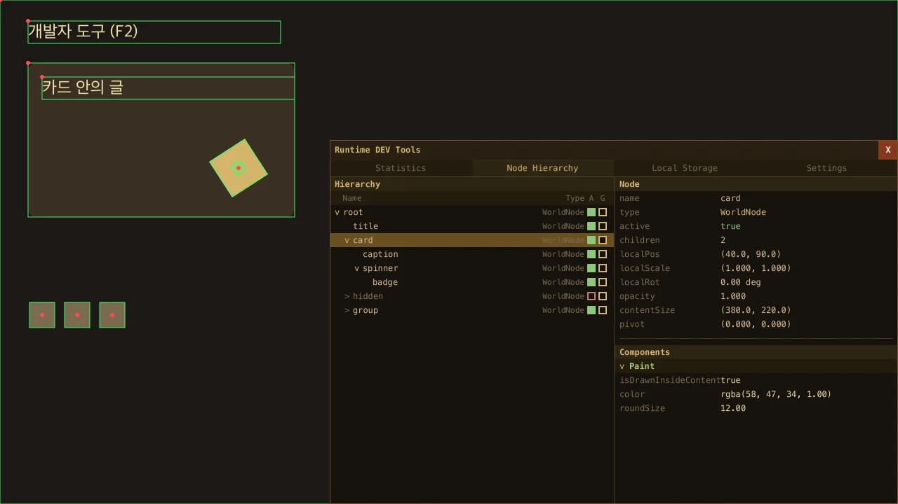
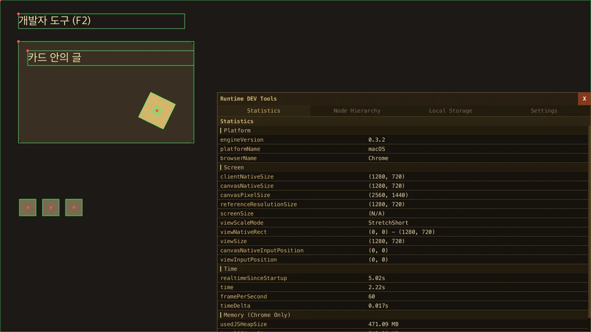

# Developer Tools

This chapter covers features for showing information on screen, inspecting nodes, and measuring device performance during development. It walks through the developer tools panel (`DevTools`) that F2 opens and closes, the engine statistics overlay (`use_statistics`), gizmos, draw statistics, frame capture for verification, `FrameProbe` and `GraphicsQualityGovernor` for spotting slow devices, and `BuildInfo` for reading the shipped version.

## The F2 developer tools panel

When `EngineConfiguration.use_dev_tools` is on (initial value `true`), `GameSceneBase` creates the developer tools panel when it initializes. `UIScene` holds a `GameSceneBase` too, so it behaves the same. Pressing F2 in the game opens the panel docked to the bottom right of the window, and pressing it again closes it. The panel is drawn in the window's inner logical coordinates (canvas native) regardless of the view scale mode, so it always has the same size.





```rust,no_run
use vanilla::{Color, Engine, EngineConfiguration, GameScene, GameSceneBase, Paint, Pivot, Text, TextAlign, Vector2};

struct DebugScene {
	game_scene_base: GameSceneBase,
}

impl GameScene for DebugScene {
	fn get_game_scene_base(&self) -> &GameSceneBase {
		&self.game_scene_base
	}

	fn get_game_scene_base_mut(&mut self) -> &mut GameSceneBase {
		&mut self.game_scene_base
	}

	fn initialize(&mut self, _engine: &mut Engine) {
		let scene_base = self.game_scene_base.get_scene_base_mut();
		let root_id = scene_base.get_root_id();
		let node_tree = scene_base.get_node_tree_mut();

		let panel_id = node_tree.create_child(root_id, "Panel");
		let panel_node = &mut node_tree[panel_id];
		panel_node.set_pivot(Pivot::TOP_LEFT);
		panel_node.set_local_position(Vector2::create(40.0, 40.0));
		panel_node.set_content_size(Vector2::create(400.0, 200.0));
		let paint = panel_node.add_component(Paint::create_with_color(Color::create(0.15, 0.17, 0.22, 1.0)));
		paint.set_round_size(16.0);

		let title_id = node_tree.create_child(panel_id, "Title");
		let title_node = &mut node_tree[title_id];
		title_node.set_pivot(Pivot::TOP_LEFT);
		title_node.set_local_position(Vector2::create(24.0, 24.0));
		title_node.set_content_size(Vector2::create(352.0, 40.0));
		let text = title_node.add_component(Text::create_with_text("Press F2", 28.0));
		text.set_text_align(TextAlign::Left);
	}
}

vanilla::game_scene!(DebugScene);

fn main() {
	let mut engine_configuration = EngineConfiguration::new();
	engine_configuration.reference_resolution_size = Vector2::create(1280.0, 720.0);
	engine_configuration.auto_resize_on_window_resize = true;
	engine_configuration.use_dev_tools = true;
	let engine = Engine::new(engine_configuration);
	let mut game_scene_base = GameSceneBase::new();
	game_scene_base.set_loading_min_duration_ms(0.0);
	let debug_scene = DebugScene {
		game_scene_base,
	};
	if let Err(error) = engine.run(Box::new(debug_scene)) {
		eprintln!("{}", error);
	}
}
```

The panel starts at 810 x 520 (at least 300 x 200), with a left column 405 wide. Drag the title bar to move it, drag edges and corners to resize it, and drag the center divider to change the left and right proportions. The close button (X) at the right of the title bar also closes it. While the panel is open and the pointer is over it, `GameSceneBase` does not pass touches and wheel input to UI nodes or play input. When a scene handles input itself, skip it while `is_dev_tools_capturing_input(engine)` is true. Get the created panel with `get_dev_tools()` and `get_dev_tools_mut()` (`None` before `initialize` or when `use_dev_tools` is off).

The panel has four tabs. The tab shown first is Node Hierarchy.

| Tab | What it shows |
| --- | --- |
| Statistics | Platform (engine version, platform, browser), Screen (window, canvas, reference resolution, view scale mode, view area, input position), Time (time since start, engine time, FPS, frame interval), Memory (Chrome's JS heap on the web, the system allocator's heap on the desktop) |
| Node Hierarchy | On the left the node tree from the root (name, type, active A, and gizmo G columns), on the right the selected node's name, type, active state, child count, position, scale, rotation, opacity, content size, pivot, and for each attached component the values read through `get` and `is` |
| Local Storage | The keys and values in `LocalStorage`. + Add adds one, Clear removes all, and the × on a row removes that one. Selecting a row shows Edit Key, Edit Value, Duplicate, and Remove buttons |
| Settings | Toggles for Dim Background, Show All Gizmos, Show Height Aspect Guide, Show Width Aspect Guide, and Show FPS |

- Clicking a tree row's A column toggles that node's active state, and the G column toggles its gizmo. Clicking a component header in the inspector collapses or expands that component's values.
- Nodes in the Rust version are all `WorldNode`, so the type column always reads `WorldNode`.
- Where the original walks objects at run time, the inspector's component values come from a list the `#[vanilla::reflect]` macro builds at compile time. `Reflect` is a supertrait of `Component`, so a component without the macro does not compile, and like the original the values of every component appear. (See the "Reflection Macro" chapter.)
- Adding, editing, and removing in the Local Storage tab ask through `Engine::prompt` and `Engine::confirm`, which stand in for the original `prompt` and `confirm`. The web shows the browser's dialogs, and the desktop shows an equivalent dialog drawn by the engine. Clear is `LocalStorage::clear()`, so it removes every value in that storage.
- Dim Background in Settings darkens the screen outside the panel. Show All Gizmos (on at first) draws every node's gizmo while the panel is open. The two aspect guides draw a rectangle in the middle of the screen only when the view scale mode is a stretch mode (`StretchWidth`, `StretchHeight`, `StretchShort`, and their `Expand` variants). Show FPS only stores its value, as in the original, and the panel draws nothing for it (read it with `is_frame_per_second_visible()`).
- Settings values are saved as JSON under the `hierarchy.settings` key in `LocalStorage`, in the same form as the original, so they persist to the next launch.

Where users must not see it, as in release builds, turn it off with `engine_configuration.use_dev_tools = false`. With it off, the panel is not created and F2 is ignored.

### Attaching it to a Scene directly

A scene that implements `Scene` directly does not get a panel automatically. Unlike the original, the panel is a value the scene holds (`DevTools`), so the scene creates it and calls it from `tick` and `post_draw`. With no global engine as in the original, `tick`, `draw`, and `is_pointer_inside_panel` take the engine, and nodes are referred to by `NodeId`.

```rust,no_run
use vanilla::{DevTools, Engine, EngineConfiguration, Graphic, Scene, SceneBase};

struct MainScene {
	scene_base: SceneBase,
	dev_tools: DevTools,
}

impl Scene for MainScene {
	fn get_scene_base(&self) -> &SceneBase {
		&self.scene_base
	}

	fn get_scene_base_mut(&mut self) -> &mut SceneBase {
		&mut self.scene_base
	}

	fn create(&mut self, _engine: &mut Engine) {
		self.dev_tools.set_root_nodes(vec![self.scene_base.get_root_id()]);
	}

	fn tick(&mut self, engine: &mut Engine, time_delta: f32) {
		let is_capturing_input = self.dev_tools.is_visible() && self.dev_tools.is_pointer_inside_panel(engine);
		self.scene_base.get_node_tree_mut().tick(engine, time_delta);
		if !is_capturing_input {
			self.scene_base.tick_touch(engine);
		}
		self.scene_base.tick_tweens(time_delta);
		let unscaled_time_delta = engine.get_time_manager().get_unscale_delta_time();
		self.dev_tools.tick(engine, self.scene_base.get_node_tree_mut(), unscaled_time_delta);
	}

	fn pre_draw(&mut self, engine: &mut Engine, graphic: &mut Graphic) {
		self.scene_base.draw_scene_background(engine, graphic);
	}

	fn post_draw(&mut self, engine: &mut Engine, graphic: &mut Graphic) {
		self.dev_tools.draw(engine, self.scene_base.get_node_tree(), graphic);
	}
}

fn main() {
	let engine = Engine::new(EngineConfiguration::new());
	let main_scene = MainScene {
		scene_base: SceneBase::new(),
		dev_tools: DevTools::new(),
	};
	if let Err(error) = engine.run(Box::new(main_scene)) {
		eprintln!("{}", error);
	}
}
```

The panel can also be driven from code. `set_visible(engine, is_visible)` is the same as F2, `set_active_tab(tab_index)` picks a tab (0 Statistics, 1 Node Hierarchy, 2 Local Storage, 3 Settings), and `inspect_node(engine, node_tree, node_id)` opens the panel, expands the node's ancestors, and selects it. Removed nodes drop out of the tree and inspector, and if the selected node is removed the selection is cleared.

```rust
use vanilla::{DevTools, Engine, EngineConfiguration, NodeTree};

let mut engine = Engine::new(EngineConfiguration::new());
engine.get_view_manager_mut().calculate_view_rect(1280, 720, 1.0);
let mut node_tree = NodeTree::new();
let root_id = node_tree.get_root_id();
let group_id = node_tree.create_child(root_id, "Group");
let hero_id = node_tree.create_child(group_id, "Hero");

let mut dev_tools = DevTools::new();
dev_tools.set_root_nodes(vec![root_id]);
dev_tools.inspect_node(&engine, &node_tree, hero_id);
assert!(dev_tools.is_visible());
assert_eq!(dev_tools.get_active_tab(), 1);
assert_eq!(dev_tools.get_selected_node(), Some(hero_id));
assert!(dev_tools.is_node_expanded(group_id));

dev_tools.set_active_tab(3);
dev_tools.set_visible(&engine, false);
assert_eq!(dev_tools.get_active_tab(), 3);
assert!(!dev_tools.is_visible());
```

## The engine statistics overlay

When `EngineConfiguration.use_statistics` is on (initial value `false`), the engine draws an overlay at the top left of the screen every frame after drawing all scenes. It works with any kind of scene and is drawn in the window's inner logical coordinates.

```rust
use vanilla::{Engine, EngineConfiguration, Vector2};

let mut engine_configuration = EngineConfiguration::new();
engine_configuration.reference_resolution_size = Vector2::create(1280.0, 720.0);
engine_configuration.use_statistics = true;
let engine = Engine::new(engine_configuration);
assert!(engine.get_engine_configuration().use_statistics);
```

The Rust overlay is shorter than the original. On a translucent black strip it writes one line in the form `FPS 60  DrawCall 12  Vertex 480  Culled 0` (FPS, plus last frame's draw call count, vertex count, and number of nodes skipped for being off screen) in the default font at 14 pixels. The other values, such as the engine version, screen sizes, and input position, are in the Statistics tab of the developer tools panel.

## Gizmos

Gizmos are markers you only look at during development (areas, anchor points, sight ranges, and so on). Scenes, nodes, and components each have `set_gizmo_visible(is_gizmo_visible)`, `is_gizmo_visible()`, and an overridable `draw_gizmos`. All are off at first.

- Scene: when `scene_base.set_gizmo_visible(true)` is set, the engine calls `Scene::draw_gizmos(engine, graphic)` after that scene's `pre_draw`, `draw`, and `post_draw`. The default implementation draws nothing, so override it to draw.
- Node: when `set_gizmo_visible(true)` is set, the node's gizmo is drawn in the node's coordinate system when the node is drawn. It draws the content area border as a 1 pixel green line and a red dot (radius 3) at the pivot, and calls `draw_gizmos` on components whose gizmo is on. (The original uses a green dot with radius 4.)
- Component: `Component::draw_gizmos(transform, graphic)` is called only from inside the node's gizmo drawing. To see a component's gizmo, turn on both the component and the node. `transform` is that node's `NodeTransform`.
- `graphic.set_force_gizmos_visible(true)` draws every node's gizmo regardless of each node's setting. Show All Gizmos in the developer tools panel uses this.

```rust,no_run
use vanilla::{Color, Component, ComponentBase, Engine, EngineConfiguration, Graphic, NodeTransform, Paint, Scene, SceneBase, Vector2};

struct SightGizmo {
	component_base: ComponentBase,
	radius: f32,
}

#[vanilla::reflect]
impl SightGizmo {}

#[vanilla::reflect]
impl Component for SightGizmo {
	fn get_component_base(&self) -> &ComponentBase {
		&self.component_base
	}

	fn get_component_base_mut(&mut self) -> &mut ComponentBase {
		&mut self.component_base
	}

	fn get_component_type(&self) -> &'static str {
		"SightGizmo"
	}

	fn draw_gizmos(&mut self, transform: &NodeTransform, graphic: &mut Graphic) {
		let content_size = transform.get_content_size();
		let center = Vector2::create(content_size.x * 0.5, content_size.y * 0.5);
		graphic.set_stroke_color("#ffcc00");
		graphic.draw_stroke_circle(center, self.radius, 2.0);
	}
}

struct GizmoScene {
	scene_base: SceneBase,
}

impl Scene for GizmoScene {
	fn get_scene_base(&self) -> &SceneBase {
		&self.scene_base
	}

	fn get_scene_base_mut(&mut self) -> &mut SceneBase {
		&mut self.scene_base
	}

	fn initialize(&mut self, _engine: &mut Engine) {
		let root_id = self.scene_base.get_root_id();
		let node_tree = self.scene_base.get_node_tree_mut();
		let enemy_id = node_tree.create_child(root_id, "Enemy");
		let enemy_node = &mut node_tree[enemy_id];
		enemy_node.set_content_size(Vector2::create(80.0, 80.0));
		enemy_node.set_local_position(Vector2::create(640.0, 360.0));
		enemy_node.add_component(Paint::create_with_color(Color::create(0.8, 0.3, 0.3, 1.0)));
		let sight_gizmo = enemy_node.add_component(SightGizmo {
			component_base: ComponentBase::new(),
			radius: 120.0,
		});
		sight_gizmo.set_gizmo_visible(true);
		enemy_node.set_gizmo_visible(true);
		self.scene_base.set_gizmo_visible(true);
	}

	fn pre_draw(&mut self, engine: &mut Engine, graphic: &mut Graphic) {
		self.scene_base.draw_scene_background(engine, graphic);
	}

	fn draw_gizmos(&mut self, engine: &mut Engine, graphic: &mut Graphic) {
		let view_manager = engine.get_view_manager();
		view_manager.apply_view_rect(graphic);
		let view_size = view_manager.get_view_size();
		graphic.set_stroke_color("#00ffff");
		graphic.draw_line(&[Vector2::create(view_size.x * 0.5, 0.0), Vector2::create(view_size.x * 0.5, view_size.y)], 1.0);
		graphic.draw_line(&[Vector2::create(0.0, view_size.y * 0.5), Vector2::create(view_size.x, view_size.y * 0.5)], 1.0);
	}
}

fn main() {
	let mut engine_configuration = EngineConfiguration::new();
	engine_configuration.reference_resolution_size = Vector2::create(1280.0, 720.0);
	let engine = Engine::new(engine_configuration);
	let gizmo_scene = GizmoScene {
		scene_base: SceneBase::new(),
	};
	if let Err(error) = engine.run(Box::new(gizmo_scene)) {
		eprintln!("{}", error);
	}
}
```

When a scene's `draw_gizmos` is called, the coordinate system is whatever the earlier drawing left behind. To draw in view coordinates, call `view_manager.apply_view_rect(graphic)` first as in the example. Node and component gizmos are drawn in the node's coordinate system (the top left of the content area is 0, 0).

## Reading draw statistics

The values in the overlay can also be read from code. Before drawing scenes, the engine sets aside last frame's values and starts counting the current frame. In the Rust version `Graphic` is only passed to the drawing functions (`pre_draw`, `draw`, `post_draw`), so read draw statistics there.

- `graphic.get_last_frame_draw_call_count()`, `get_last_frame_vertex_count()`, `get_last_frame_triangle_count()`: last frame's draw calls, vertices, and triangles. Only the 2D path is counted. The 3D renderer and screen effect passes are not.
- `graphic.get_last_frame_culled_node_count()`: the number of nodes whose components were skipped last frame for being off screen.
- `time_manager.get_frame_per_second()`: the number of frames counted over the last second (0 during the first second).

```rust,no_run
use vanilla::{Color, Engine, EngineConfiguration, Graphic, Paint, Scene, SceneBase, Vector2};

struct ProfileScene {
	scene_base: SceneBase,
	elapsed_seconds: f32,
}

impl Scene for ProfileScene {
	fn get_scene_base(&self) -> &SceneBase {
		&self.scene_base
	}

	fn get_scene_base_mut(&mut self) -> &mut SceneBase {
		&mut self.scene_base
	}

	fn initialize(&mut self, _engine: &mut Engine) {
		let root_id = self.scene_base.get_root_id();
		let node_tree = self.scene_base.get_node_tree_mut();
		for index in 0..100 {
			let box_id = node_tree.create_child(root_id, "Box");
			let box_node = &mut node_tree[box_id];
			box_node.set_content_size(Vector2::create(20.0, 20.0));
			box_node.set_local_position(Vector2::create((index % 10) as f32 * 120.0 + 60.0, (index / 10) as f32 * 70.0 + 40.0));
			box_node.add_component(Paint::create_with_color(Color::create(0.9, 0.6, 0.2, 1.0)));
		}
	}

	fn tick(&mut self, engine: &mut Engine, time_delta: f32) {
		self.scene_base.tick(engine, time_delta);
		self.elapsed_seconds += time_delta;
	}

	fn pre_draw(&mut self, engine: &mut Engine, graphic: &mut Graphic) {
		self.scene_base.draw_scene_background(engine, graphic);
	}

	fn post_draw(&mut self, engine: &mut Engine, graphic: &mut Graphic) {
		if self.elapsed_seconds < 0.5 {
			return;
		}
		self.elapsed_seconds = 0.0;
		let frame_per_second = engine.get_time_manager().get_frame_per_second();
		let draw_call_count = graphic.get_last_frame_draw_call_count();
		let triangle_count = graphic.get_last_frame_triangle_count();
		let culled_node_count = graphic.get_last_frame_culled_node_count();
		println!("{} {} {} {}", frame_per_second, draw_call_count, triangle_count, culled_node_count);
	}
}

fn main() {
	let mut engine_configuration = EngineConfiguration::new();
	engine_configuration.reference_resolution_size = Vector2::create(1280.0, 720.0);
	let engine = Engine::new(engine_configuration);
	let profile_scene = ProfileScene {
		scene_base: SceneBase::new(),
		elapsed_seconds: 0.0,
	};
	if let Err(error) = engine.run(Box::new(profile_scene)) {
		eprintln!("{}", error);
	}
}
```

## Frame capture for verification

`engine.request_frame_capture(frame_number, capture_handler)` passes the screen as PNG bytes to `capture_handler` after that frame has been drawn. (The original passes a PNG data URL through a Promise.) If the number has already passed, it captures the current frame (or the next one when called between frames). Frame numbers start at 1 for the first frame and go up by 1 each time a frame finishes (`get_frame_number()`). To await inside an engine task, use the `Promise<Vec<u8>>` returned by `request_frame_capture_async(frame_number)`.

```rust,no_run
use vanilla::{Color, Engine, EngineConfiguration, Graphic, Paint, Scene, SceneBase, Vector2};

struct CaptureScene {
	scene_base: SceneBase,
}

impl Scene for CaptureScene {
	fn get_scene_base(&self) -> &SceneBase {
		&self.scene_base
	}

	fn get_scene_base_mut(&mut self) -> &mut SceneBase {
		&mut self.scene_base
	}

	fn initialize(&mut self, engine: &mut Engine) {
		let root_id = self.scene_base.get_root_id();
		let node_tree = self.scene_base.get_node_tree_mut();
		let box_id = node_tree.create_child(root_id, "Box");
		let box_node = &mut node_tree[box_id];
		box_node.set_content_size(Vector2::create(200.0, 200.0));
		box_node.set_local_position(Vector2::create(640.0, 360.0));
		box_node.add_component(Paint::create_with_color(Color::create(0.4, 0.8, 0.5, 1.0)));

		engine.request_frame_capture(30, Box::new(|png_bytes: &[u8]| {
			std::fs::write("capture_30.png", png_bytes).unwrap();
		}));
	}

	fn pre_draw(&mut self, engine: &mut Engine, graphic: &mut Graphic) {
		self.scene_base.draw_scene_background(engine, graphic);
	}
}

fn main() {
	let mut engine_configuration = EngineConfiguration::new();
	engine_configuration.reference_resolution_size = Vector2::create(1280.0, 720.0);
	let engine = Engine::new(engine_configuration);
	let capture_scene = CaptureScene {
		scene_base: SceneBase::new(),
	};
	if let Err(error) = engine.run(Box::new(capture_scene)) {
		eprintln!("{}", error);
	}
}
```

You can also turn it on without changing code: with environment variables on the desktop, and with the page URL's query on the web, as in the original. They are read when the engine is created.

```bash
VANILLA_CAPTURE_PATH=shots/shot_{frame}.png VANILLA_CAPTURE_FRAMES=120,240 VANILLA_CAPTURE_EXIT=1 cargo run --example quickstart
```

```text
index.html?capture=120,240&captureName=shot_{frame}.png&captureExit=1
```

| Desktop | Web | Meaning |
| --- | --- | --- |
| `VANILLA_CAPTURE_PATH` | `captureName` | The file path to save (the download file name on the web). `{frame}` is replaced with the frame number. The desktop captures only when this variable is set, and the web default is `capture_{frame}.png` |
| `VANILLA_CAPTURE_FRAMES` | `capture` | Frame numbers to capture, separated by commas. If none parse, it is 120 |
| `VANILLA_CAPTURE_EXIT=1` | `captureExit=1` | Quits after the last capture. (The web tries to close the window, as in the original) |
| `VANILLA_CAPTURE_SHOW_WINDOW=1` | None | Shows the window while capturing. The desktop hides the window in capture mode |

Use it for headless screen comparison checks. Capture mode with a hidden window runs to the end without showing anything on screen.

## Spotting slow devices

`FrameProbe` measures frame intervals during the first few seconds after start and decides whether the device is slow. It is a calculator that does not pull in the engine, so the caller passes the frame interval and the maximum FPS.

- After the warmup seconds (2 at first) from the start of measuring, it looks at every frame interval for the probe seconds (4 at first). The first few seconds stutter while models and images load. Change them with `set_seconds(warmup_seconds, probe_seconds)`.
- The target interval is one tick of the maximum FPS (when the maximum FPS is 0 or less, the value of `set_unlimited_target_frame_per_second`, 60 at first). Frames longer than 1.4 times the target interval count as slow frames, and the device is slow when slow frames make up a share of 0.25 or more. Change them with `set_slow_frame_threshold(slow_frame_ratio, slow_frame_share)`. (Why 1.4 times: on a 90 Hz screen with a maximum of 60, the engine draws every other refresh at about 22 ms intervals, which is not the device being slow.)
- Calling `measure_frame(frame_seconds, maximum_frame_per_second)` every frame returns `true` on the frame that finishes measuring. Then read `is_finished()` and `is_slow()`. `read_slow_frame_share()` is the share of slow frames so far. Intervals of 0 or less, or NaN, are ignored.
- Once a device is judged slow it is not measured again. If the window gets hidden before measuring finishes, `restart()` measures again from the beginning. If it was not slow, `measure_again()` lets you measure once more during a heavy scene.

```rust
use vanilla::FrameProbe;

let mut frame_probe = FrameProbe::new();
frame_probe.set_seconds(0.5, 1.0);
let mut frame_index = 0;
let mut is_done = false;
while !is_done {
	let frame_seconds = if frame_index % 3 == 0 {
		1.0 / 20.0
	}
	else {
		1.0 / 60.0
	};
	is_done = frame_probe.measure_frame(frame_seconds, 60.0);
	frame_index += 1;
}
assert!(frame_probe.is_finished());
assert!(frame_probe.is_slow());
assert!(frame_probe.read_slow_frame_share() >= 0.25);
```

In a scene, pass `engine.get_time_manager().get_unscale_delta_time()` and `engine.get_maximum_frame_per_second()` from `tick`.

## Choosing graphics quality

`GraphicsQualityGovernor` decides from settings and a `FrameProbe` whether to use the lite path (`is_lite()`), and sets a render pixel ratio limit for each path. What to cut on the lite path (shadows, outlines, effects, draw counts) is up to the game, which reads `is_lite()`.

- The order that decides the lite path: override (`set_lite_override`, `apply_search_text`, `apply_page_query`), then the quality setting (`set_quality`, where `GraphicsQuality::Low` is always lite and `High` never is), then automatic (`GraphicsQuality::Auto`, the initial value). In automatic mode the lite path is used when `set_auto_lite_default(true)` is set (to go lite before measuring, as on touch devices) or when `FrameProbe` measured a slow device.
- `apply_search_text(search_text, lite_key)` overrides to the lite path if the query text contains `lite_key`, or always to the normal path if its value is `"0"` or `"false"`. It reads like the original `URLSearchParams`. Rust has no default arguments, so you always pass `lite_key` (the original default is `"light"`).
- `apply_page_query(lite_key)` reads the page URL's query on the web. The desktop has no URL, so it reads the environment variable named `VANILLA_` followed by that name in upper snake case (`VANILLA_LIGHT` for `light`).
- Calling `update(frame_seconds, maximum_frame_per_second)` every frame measures frames only in automatic mode and returns `true` on the frame where the lite path changed.
- Give each path a render pixel ratio limit (0 means unlimited) with `set_render_pixel_ratio_limits(normal, lite)`, and `apply_render_pixel_ratio(view_manager)` applies it through `ViewManager::set_max_render_pixel_ratio`. If the value is the same, it does not apply it again and returns `false`.
- Take the inner `FrameProbe` with `get_frame_probe_mut()` to change the warmup seconds or the thresholds.

```rust
use vanilla::{GraphicsQuality, GraphicsQualityGovernor, Vector2, ViewManager, ViewScaleMode};

let mut governor = GraphicsQualityGovernor::new();
governor.set_quality(GraphicsQuality::Auto);
governor.apply_search_text("?light=0", "light");
assert_eq!(governor.get_lite_override(), Some(false));
governor.set_lite_override(None);

governor.set_render_pixel_ratio_limits(0.0, 1.5);
governor.get_frame_probe_mut().set_seconds(0.0, 1.0);
let mut changed_count = 0;
for _ in 0..40 {
	if governor.update(0.05, 60.0) {
		changed_count += 1;
	}
}
assert!(governor.is_lite());
assert_eq!(changed_count, 1);

let mut view_manager = ViewManager::new(Vector2::create(1280.0, 720.0), ViewScaleMode::StretchShort);
assert!(governor.apply_render_pixel_ratio(&mut view_manager));
assert_eq!(view_manager.get_max_render_pixel_ratio(), 1.5);
assert!(!governor.apply_render_pixel_ratio(&mut view_manager));
```

In a scene, call `apply_render_pixel_ratio(engine.get_view_manager_mut())` once in `initialize`, and again in `tick` on frames where `update` returns `true`.

## Build information

`BuildInfo` reads the version written by the release build once at app start so you can show it somewhere such as a corner of the settings screen. `load(engine)` reads in this order and never fails with an error.

1. The `content` of the `build-version` meta in the document head. If present, it is that text with surrounding whitespace trimmed. On the web it is the page's `<meta>`, as in the original, and on the desktop it is a meta of the document the engine keeps, so release builds put it in `EngineConfiguration.document_meta_list`. Change the name with `set_meta_name`.
2. If missing, it reads `version.json` (initial path `"version.json"`, changed with `set_version_json_path`, not fetched when empty). The web fetches it relative to the page without cache (`cache: "no-cache"`) so an old version does not linger after a new one is uploaded, and the desktop reads it on the spot from the asset folder.
3. If neither exists, it is the version set with `set_package_version` (usually `env!("CARGO_PKG_VERSION")`), or empty text if none was set.

```text
<meta name="build-version" content="2026-11-26 07:30 (a1b2c3d)">
```

```json
{ "version": "1.2.0", "date": "2026-11-26", "time": "07:30", "hash": "a1b2c3d" }
```

When read from `version.json`, the text takes the form `"date time (hash)"`. Without a hash it is `version`, and without that it is empty text (`BuildInfo::compose_text`). If your game writes versions differently, combine the value from `read_version_data()` yourself.

```rust
use vanilla::{BuildInfo, Engine, EngineConfiguration};

let mut engine_configuration = EngineConfiguration::new();
engine_configuration.document_meta_list = vec![(String::from("build-version"), String::from("2026-11-26 07:30 (a1b2c3d)"))];
let engine = Engine::new(engine_configuration);

let mut build_info = BuildInfo::new();
build_info.set_package_version("0.4.0-dev");
build_info.load(&engine);
assert!(build_info.is_loaded());
assert_eq!(build_info.read_text(), "2026-11-26 07:30 (a1b2c3d)");
assert!(build_info.read_version_data().is_none());

let composed_text = BuildInfo::compose_text(&serde_json::json!({ "version": "1.2.0", "date": "2026-11-26", "time": "07:30", "hash": "a1b2c3d" }));
assert_eq!(composed_text, "2026-11-26 07:30 (a1b2c3d)");
```

- In place of the original `await load()`, await the `BuildInfoLoadHandle` returned by `load(engine)` inside an engine task (`wait_for_load().await` does the same). If it was read from the meta, it finishes immediately.
- Without await, check with `is_loaded()` whether reading has finished (a failure also counts as finished), and to make a scene wait, hand the handle from `get_load_handle()` to `track_load_handle`.
- `read_text()` returns the text that was read (meta, version.json, then the set version), and `read_version_data()` the object read from `version.json` (`None` if read from the meta or if reading failed). The original constructor's path argument is split into `new()` and `set_version_json_path`.

## Things to watch for

- The developer tools panel is created by scenes that hold a `GameSceneBase` (`GameScene`, `UIScene`). A scene that implements `Scene` directly holds a `DevTools` itself and calls it from `tick` and `post_draw`.
- In release builds, turn off `use_dev_tools` and do not turn on `use_statistics`.
- Pressing Clear in the panel's Local Storage tab removes every value in that storage.
- To see a game component's values in the inspector, add `#[vanilla::reflect]`.
- A component's gizmo is drawn only when its node's gizmo is drawn.
- Draw statistics count only the 2D path. Draw calls from 3D passes are not included. `Graphic` is only passed to the drawing functions, so read the statistics there.
- Once `FrameProbe` judges a device slow, it does not measure again.

## Related types

DevTools, EngineConfiguration, Engine, GameScene, GameSceneBase, UIScene, UISceneBase, Scene, SceneBase, Component, WorldNode, NodeTransform, Graphic, TimeManager, ViewManager, LocalStorage, FrameProbe, GraphicsQualityGovernor, GraphicsQuality, BuildInfo, BuildInfoLoadHandle
