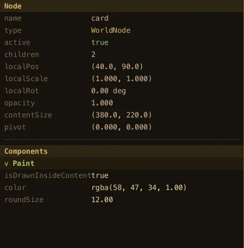

# Reflection Macro #[reflect]

The original vanilla.js is JavaScript, so it scans an object's `get`, `is`, and `set` functions at run time. It does this when the UI document (`UIDocument`) saves and loads a component that has no registered save and load functions (`saveByReflection`, `loadByReflection`), and when the developer tools inspector shows a component's values (`getComponentProperties`). Rust has no way to read a list of functions at run time, so in Vanilla Engine the procedural macro `#[vanilla::reflect]` generates the same list and the code that calls it at compile time. This is the same approach as Unreal's UHT and Qt's moc.

This chapter covers how to attach the macro to a component, the rules that pick getters and setters, the types of reflected values, the options for functions and blocks, `base` for the place of an original superclass, where reflection is used (the UI document and the developer tools), and how leaving it out is stopped. This chapter exists only in the Rust edition.

## Attaching It to a Component

Put `#[vanilla::reflect]` on both the component's `impl` block and its `impl Component` block. The engine re-exports the macro, so the game's `Cargo.toml` only needs the engine.

```rust
use vanilla::core::reflection::{collect_reflected_getters, collect_reflected_properties, read_reflected_property, write_reflected_property};
use vanilla::{Component, ComponentBase, ReflectValue};

struct Spin {
	component_base: ComponentBase,
	degrees_per_second: f32,
}

#[vanilla::reflect]
impl Spin {
	pub fn new() -> Spin {
		Spin {
			component_base: ComponentBase::new(),
			degrees_per_second: 90.0,
		}
	}

	pub fn set_degrees_per_second(&mut self, degrees_per_second: f32) {
		self.degrees_per_second = degrees_per_second;
	}

	pub fn get_degrees_per_second(&self) -> f32 {
		self.degrees_per_second
	}
}

#[vanilla::reflect]
impl Component for Spin {
	fn get_component_base(&self) -> &ComponentBase {
		&self.component_base
	}

	fn get_component_base_mut(&mut self) -> &mut ComponentBase {
		&mut self.component_base
	}

	fn get_component_type(&self) -> &'static str {
		"Spin"
	}
}

let mut spin = Spin::new();
let property_names: Vec<&str> = collect_reflected_properties(&spin).iter().map(|property| property.name).collect();
assert_eq!(property_names, ["DegreesPerSecond", "GizmoVisible", "Enable", "ComponentType"]);
let getter_names: Vec<&str> = collect_reflected_getters(&spin).iter().map(|getter| getter.name).collect();
assert_eq!(getter_names, ["getDegreesPerSecond"]);
assert_eq!(read_reflected_property(&spin, "DegreesPerSecond"), Some(ReflectValue::Number(90.0)));
assert!(write_reflected_property(&mut spin, "DegreesPerSecond", &ReflectValue::Number(45.0)));
assert_eq!(spin.get_degrees_per_second(), 45.0);
```

- The macro on the `impl` block collects that block's getters and setters and generates a `Reflect` implementation. The macro on the `impl Component` block collects the getters redefined in that block for the inspector.
- `Reflect` is a supertrait of `Component`, so leaving out either block gives a compile error that points at the block that needs it. A type without getters takes the macro on an empty block, `#[vanilla::reflect] impl Type {}`. Reflection can only be attached to types that implement `Component`.
- Keep the functions you want reflected in the one `impl` block that has the macro. Functions in other `impl` blocks without the macro are not seen. Putting the macro on two `impl` blocks of the same type produces two `Reflect` implementations and does not compile.
- Trait `impl` blocks other than `Component` cannot take the macro.
- The common properties of the original `Component` base class, `GizmoVisible`, `Enable`, and `ComponentType`, are appended to the end of the property list. `ComponentType` has no setter in Rust (the type decides the kind), so it is only written.

## Rules for Picking Getters and Setters

The macro follows the same rules the original uses when it scans the prototype.

| Kind | Rule |
| --- | --- |
| Getter | A `pub fn get_*` or `pub fn is_*` that takes only `&self` and returns something (a function returning `()` or `!` is not a getter) |
| Getter that takes the tree | A getter that takes `&self` and `&NodeTree`. The original holds the neighboring component directly; the Rust edition fetches it from the tree. Only the inspector calls it, and it is not a saved property |
| `&mut self` getter | It is a getter (the original functions make no such distinction). Functions whose name ends in `_mut` or that return `&mut` are Rust accessors and are excluded |
| Setter | A `pub fn set_*` that takes `&mut self` and one value. When it takes an `impl Trait` such as `impl Into<Color>`, the value is converted to the type returned by the paired getter |
| Setter that takes the tree | A setter that takes `&mut self`, `&mut NodeTree`, and a value. The side holding the tree (UI document loading) calls it |
| Saved property | A getter that has a setter with the same key. The key is the original name: the prefix removed and each word capitalized (`get_line_width` is `LineWidth`, and the original function name is `getLineWidth`) |

- Functions that are not `pub` (including `pub(crate)`) are not seen, just as the original's `#` private functions do not show up on the prototype.
- `unsafe`, `async`, and `extern` functions, and functions with type or const generics, cannot be called and are excluded. Lifetime generics are fine.
- A setter that takes more arguments than the value (such as `set_image(image, rect)`) is listed in the property list when it has a paired getter, but reflection does not write through it.
- The order is definition order, and when two have the same key, the first one wins.

```rust
use vanilla::core::reflection::{collect_reflected_getters, collect_reflected_properties, read_reflected_property, write_reflected_property};
use vanilla::{Color, Component, ComponentBase, ReflectValue, Vector2};

struct Badge {
	component_base: ComponentBase,
	label: String,
	tint: Color,
	offset: Vector2,
	is_blinking: bool,
	points: Vec<Vector2>,
}

#[vanilla::reflect]
impl Badge {
	pub fn new() -> Badge {
		Badge {
			component_base: ComponentBase::new(),
			label: String::from("new"),
			tint: Color::white(),
			offset: Vector2::zero(),
			is_blinking: false,
			points: vec![Vector2::zero(), Vector2::create(1.0, 1.0)],
		}
	}

	pub fn set_label(&mut self, label: &str) {
		self.label = String::from(label);
	}

	pub fn get_label(&self) -> &str {
		&self.label
	}

	pub fn set_tint(&mut self, tint: impl Into<Color>) {
		self.tint = tint.into();
	}

	pub fn get_tint(&self) -> Color {
		self.tint
	}

	pub fn set_offset(&mut self, offset: Vector2) {
		self.offset = offset;
	}

	pub fn get_offset(&self) -> Vector2 {
		self.offset
	}

	pub fn set_blinking(&mut self, is_blinking: bool) {
		self.is_blinking = is_blinking;
	}

	pub fn is_blinking(&self) -> bool {
		self.is_blinking
	}

	pub fn get_point_count(&self) -> usize {
		self.points.len()
	}

	pub fn get_points(&self) -> &[Vector2] {
		&self.points
	}
}

#[vanilla::reflect]
impl Component for Badge {
	fn get_component_base(&self) -> &ComponentBase {
		&self.component_base
	}

	fn get_component_base_mut(&mut self) -> &mut ComponentBase {
		&mut self.component_base
	}

	fn get_component_type(&self) -> &'static str {
		"Badge"
	}
}

let mut badge = Badge::new();
let property_names: Vec<&str> = collect_reflected_properties(&badge).iter().map(|property| property.name).collect();
assert_eq!(property_names, ["Label", "Tint", "Offset", "Blinking", "GizmoVisible", "Enable", "ComponentType"]);

let getter_list = collect_reflected_getters(&badge);
let getter_names: Vec<&str> = getter_list.iter().map(|getter| getter.name).collect();
assert_eq!(getter_names, ["getLabel", "getTint", "getOffset", "isBlinking", "getPointCount", "getPoints"]);
assert_eq!(getter_list[4].value, ReflectValue::Number(2.0));
assert_eq!(getter_list[5].value, ReflectValue::Object(String::from("Array")));

let red = ReflectValue::List(vec![ReflectValue::Number(1.0), ReflectValue::Number(0.0), ReflectValue::Number(0.0), ReflectValue::Number(1.0)]);
assert!(write_reflected_property(&mut badge, "Tint", &red));
assert_eq!(badge.get_tint(), Color::create(1.0, 0.0, 0.0, 1.0));
assert!(write_reflected_property(&mut badge, "Label", &ReflectValue::String(String::from("boss"))));
assert_eq!(badge.get_label(), "boss");
assert!(!write_reflected_property(&mut badge, "Label", &ReflectValue::Number(3.0)));
assert_eq!(read_reflected_property(&badge, "Blinking"), Some(ReflectValue::Boolean(false)));
```

- `is_blinking` and `set_blinking` share the key `Blinking`, so they are a pair.
- `get_point_count` and `get_points` have no setter, so they are not saved properties and only appear in the inspector.
- `set_tint` takes `impl Into<Color>`, so the value is read as the type of the paired getter `get_tint` (`Color`). A list of four numbers is also read as a `Color`.
- Writing a value that does not match the setter's type makes `write_reflected_property` return `false` and leaves the value unchanged.

## Types of Reflected Values

The value a getter returns is converted to a `ReflectValue`. Getters of types that cannot be converted do not cause a compile error either (the choice is made with autoref specialization); like the original, they are left out of saving and show as `[type name]` in the inspector.

| Rust type | Reflected value | Saved in the UI document |
| --- | --- | --- |
| `bool` | `Boolean` | Boolean |
| `f32`, `f64`, integer types (`i8` to `i64`, `u8` to `u64`, `isize`, `usize`) | `Number` (`f32` is read as its shortest decimal, so 0.22 stays 0.22) | Number |
| `str`, `String` | `String` | String |
| `Vector2` | `Vector2` | Array of two numbers |
| `Color` | `Color` | Array of four numbers |
| `NodeId` | `Node` | `{ "$nodeRef": path }` (linked after the whole tree is built) |
| `Rect` | `Rect` | Not saved (inspector only) |
| `Option<T>` | `None` is `Null`, `Some` is the inner value | `Null` is not saved |
| The engine's original string enums (`TextAlign`, `TextBaseline`, `TextDirection`, `TextWrapMode`, `SpriteDrawMode`, `BlendMode`, `ScrollMode`, `ProgressDirection`, `ScrollBarAxis`, `SoftShadeShape`, `ButtonMotionStyle`, `ToastPhase`, `ParticleEmitterShape`, `ParticleRenderShape`, `ShaderSpriteEffect`) | `String` with the same text as the original | String |
| `ButtonState` | The number of the original `Enum` (Normal 1 to Disabled 5) | Number |
| `Vec`, arrays, slices | `Object("Array")` | Not saved |
| Any other type (`Rc<Image>`, callbacks, and so on) | `Object(short type name)` (wrappers such as `Rc` and `RefCell` are stripped) | Not saved |

On the setter side, only types that implement `FromReflectValue` are read: `bool`, `f32`, `f64`, integer types, `String`, `&str`, `Vector2` (also from a list of two numbers), `Color` (also from a list of four numbers), `NodeId`, `Option<T>` (`Null` is `None`), and the engine's original string enums. Setters that take any other type are skipped when reading (there is no compile error).

To save a game enum, implement `ToReflectValue` and `FromReflectValue` yourself. The macro the engine uses for the original string enums is internal to the engine.

```rust
use vanilla::core::reflection::{read_reflected_property, write_reflected_property};
use vanilla::{Component, ComponentBase, FromReflectValue, ReflectValue, ToReflectValue};

#[derive(Clone, Copy, Debug, PartialEq)]
enum Team {
	Red,
	Blue,
}

impl ToReflectValue for Team {
	fn to_reflect_value(&self) -> ReflectValue {
		match self {
			Team::Red => {
				ReflectValue::String(String::from("red"))
			}
			Team::Blue => {
				ReflectValue::String(String::from("blue"))
			}
		}
	}
}

impl<'a> FromReflectValue<'a> for Team {
	fn from_reflect_value(value: &'a ReflectValue) -> Option<Team> {
		match value {
			ReflectValue::String(name) => {
				match name.as_str() {
					"red" => {
						Some(Team::Red)
					}
					"blue" => {
						Some(Team::Blue)
					}
					_ => {
						None
					}
				}
			}
			_ => {
				None
			}
		}
	}
}

struct TeamFlag {
	component_base: ComponentBase,
	team: Team,
}

#[vanilla::reflect]
impl TeamFlag {
	pub fn set_team(&mut self, team: Team) {
		self.team = team;
	}

	pub fn get_team(&self) -> Team {
		self.team
	}
}

#[vanilla::reflect]
impl Component for TeamFlag {
	fn get_component_base(&self) -> &ComponentBase {
		&self.component_base
	}

	fn get_component_base_mut(&mut self) -> &mut ComponentBase {
		&mut self.component_base
	}

	fn get_component_type(&self) -> &'static str {
		"TeamFlag"
	}
}

let mut team_flag = TeamFlag {
	component_base: ComponentBase::new(),
	team: Team::Red,
};
assert_eq!(read_reflected_property(&team_flag, "Team"), Some(ReflectValue::String(String::from("red"))));
assert!(write_reflected_property(&mut team_flag, "Team", &ReflectValue::String(String::from("blue"))));
assert_eq!(team_flag.get_team(), Team::Blue);
assert!(!write_reflected_property(&mut team_flag, "Team", &ReflectValue::String(String::from("green"))));
```

## Options for Functions and Blocks

| Option | Where | What it does |
| --- | --- | --- |
| `#[reflect(skip)]` | Function | Excludes it from reflection. Also used in an `impl Component` block to hide overrides the original class does not have (such as `is_tick_needed`) |
| `#[reflect(transient)]` | Getter | Shown in the inspector but left out of the saved property list |
| `#[reflect(unsaved)]` | Getter | Kept in the property list but left out of reflection saving and loading (`ReflectedProperty.is_saved` is `false`). This is for properties whose original value is an object, which `saveByReflection` does not write |
| `#[reflect(name = "UIScale")]` | Getter, setter | Sets the key name. Use it for original names that cannot be recovered from snake_case, such as acronyms. Pairs are matched by key, so give the getter and the setter the same name |
| `#[reflect(after = "getFittedFontSize")]` | Getter in an `impl Component` block | Places it right after that original getter in the inspector list (the order of the original class body). Without it, the getters of that block come first. Using it in an `impl` block is an error |
| `#[vanilla::reflect(base = field)]` | `impl` block | Chains the reflection of the embedded component after this type's, like an original superclass (next section). Using it on an `impl Component` block is an error |
| `#[vanilla::reflect(crate = path)]` | `impl` block | The path the generated code uses for the engine. The default is `::vanilla`; set it only when the engine dependency is renamed in `Cargo.toml` |

```rust
use vanilla::core::reflection::{collect_reflected_getters, collect_reflected_properties};
use vanilla::{Component, ComponentBase};

struct Gauge {
	component_base: ComponentBase,
	ui_scale: f32,
	fill_ratio: f32,
	font_face: String,
}

#[vanilla::reflect]
impl Gauge {
	pub fn new() -> Gauge {
		Gauge {
			component_base: ComponentBase::new(),
			ui_scale: 1.0,
			fill_ratio: 0.5,
			font_face: String::from("GameUI"),
		}
	}

	#[reflect(name = "UIScale")]
	pub fn set_ui_scale(&mut self, ui_scale: f32) {
		self.ui_scale = ui_scale;
	}

	#[reflect(name = "UIScale")]
	pub fn get_ui_scale(&self) -> f32 {
		self.ui_scale
	}

	pub fn set_fill_ratio(&mut self, fill_ratio: f32) {
		self.fill_ratio = fill_ratio;
	}

	#[reflect(transient)]
	pub fn get_fill_ratio(&self) -> f32 {
		self.fill_ratio
	}

	pub fn set_font_face(&mut self, font_face: &str) {
		self.font_face = String::from(font_face);
	}

	#[reflect(unsaved)]
	pub fn get_font_face(&self) -> &str {
		&self.font_face
	}

	#[reflect(skip)]
	pub fn get_debug_text(&self) -> String {
		format!("{} {}", self.ui_scale, self.fill_ratio)
	}
}

#[vanilla::reflect]
impl Component for Gauge {
	fn get_component_base(&self) -> &ComponentBase {
		&self.component_base
	}

	fn get_component_base_mut(&mut self) -> &mut ComponentBase {
		&mut self.component_base
	}

	fn get_component_type(&self) -> &'static str {
		"Gauge"
	}

	#[reflect(skip)]
	fn is_tick_needed(&self) -> bool {
		false
	}

	fn is_drawn_inside_content(&self) -> bool {
		true
	}
}

let gauge = Gauge::new();
let property_list = collect_reflected_properties(&gauge);
let property_names: Vec<&str> = property_list.iter().map(|property| property.name).collect();
assert_eq!(property_names, ["UIScale", "FontFace", "GizmoVisible", "Enable", "ComponentType"]);
assert!(property_list[0].is_saved);
assert!(!property_list[1].is_saved);

let getter_names: Vec<&str> = collect_reflected_getters(&gauge).iter().map(|getter| getter.name).collect();
assert_eq!(getter_names, ["isDrawnInsideContent", "getUIScale", "getFillRatio", "getFontFace"]);
assert_eq!(gauge.get_debug_text(), "1 0.5");
```

- Getters redefined in the `impl Component` block (`is_drawn_inside_content`) come first in the list, just as the original inspector shows them as functions of the subclass. `get_component_base` and `get_component_type` belong to the original `Component` base class and are not shown.

## Chaining an Original Superclass (base)

In the original, the getters of a superclass come along through the prototype chain. Rust has no class inheritance, so the superclass part is embedded as a field, and `#[vanilla::reflect(base = field)]` on the `impl` block chains that field's reflection after this type's. The engine's `UIButton` (embeds `UIControl`), `UIControl` (embeds `UIView`), and `RichText` (embeds `Text`) do this.

```rust
use vanilla::core::reflection::{collect_reflected_getters, collect_reflected_properties, read_reflected_property, write_reflected_property};
use vanilla::{Component, ComponentBase, Reflect, ReflectValue};

struct Unit {
	component_base: ComponentBase,
	speed: f32,
}

#[vanilla::reflect]
impl Unit {
	pub fn new() -> Unit {
		Unit {
			component_base: ComponentBase::new(),
			speed: 100.0,
		}
	}

	pub fn set_speed(&mut self, speed: f32) {
		self.speed = speed;
	}

	pub fn get_speed(&self) -> f32 {
		self.speed
	}
}

#[vanilla::reflect]
impl Component for Unit {
	fn get_component_base(&self) -> &ComponentBase {
		&self.component_base
	}

	fn get_component_base_mut(&mut self) -> &mut ComponentBase {
		&mut self.component_base
	}

	fn get_component_type(&self) -> &'static str {
		"Unit"
	}
}

struct Hero {
	unit: Unit,
	title: String,
}

#[vanilla::reflect(base = unit)]
impl Hero {
	pub fn new() -> Hero {
		Hero {
			unit: Unit::new(),
			title: String::from("knight"),
		}
	}

	pub fn set_title(&mut self, title: &str) {
		self.title = String::from(title);
	}

	pub fn get_title(&self) -> &str {
		&self.title
	}
}

#[vanilla::reflect]
impl Component for Hero {
	fn get_component_base(&self) -> &ComponentBase {
		self.unit.get_component_base()
	}

	fn get_component_base_mut(&mut self) -> &mut ComponentBase {
		self.unit.get_component_base_mut()
	}

	fn get_component_type(&self) -> &'static str {
		"Hero"
	}
}

let mut hero = Hero::new();
assert_eq!(hero.get_reflected_type_name(), "Hero");
let property_names: Vec<&str> = collect_reflected_properties(&hero).iter().map(|property| property.name).collect();
assert_eq!(property_names, ["Title", "Speed", "GizmoVisible", "Enable", "ComponentType"]);
let getter_names: Vec<&str> = collect_reflected_getters(&hero).iter().map(|getter| getter.name).collect();
assert_eq!(getter_names, ["getTitle", "getSpeed"]);
assert_eq!(read_reflected_property(&hero, "Speed"), Some(ReflectValue::Number(100.0)));
assert!(write_reflected_property(&mut hero, "Speed", &ReflectValue::Number(150.0)));
assert_eq!(hero.unit.get_speed(), 150.0);
```

- The type of the embedded field must also be a component with the macro on both blocks.
- Properties and getters of the embedded value are appended after this type's, only for keys not already present. The resulting list and order match the original inheritance.
- Reading and writing look up the lowest type first, each on its own, like the original `component[getterName]` and `component[setterName]`. So the getter can come from the embedded value while only the setter is redefined in this type.
- If a function this type redefines for convenience belongs to the superclass in the original, exclude it with `#[reflect(skip)]` to keep the original order.

## Where Reflection Is Used

### UI Document (UIDocument)

A component registered with `register_component_type(name, create_function)` is saved and loaded through reflection, like the original `registerComponentType`. Keys, order, and values match the original `saveByReflection`, so both engines read the same `.scene.json` the same way.

```rust
use vanilla::{Component, ComponentBase, NodeTree, UIDocument};

struct Spin {
	component_base: ComponentBase,
	degrees_per_second: f32,
}

#[vanilla::reflect]
impl Spin {
	pub fn new() -> Spin {
		Spin {
			component_base: ComponentBase::new(),
			degrees_per_second: 0.0,
		}
	}

	pub fn set_degrees_per_second(&mut self, degrees_per_second: f32) {
		self.degrees_per_second = degrees_per_second;
	}

	pub fn get_degrees_per_second(&self) -> f32 {
		self.degrees_per_second
	}
}

#[vanilla::reflect]
impl Component for Spin {
	fn get_component_base(&self) -> &ComponentBase {
		&self.component_base
	}

	fn get_component_base_mut(&mut self) -> &mut ComponentBase {
		&mut self.component_base
	}

	fn get_component_type(&self) -> &'static str {
		"Spin"
	}
}

struct Marker {
	component_base: ComponentBase,
}

#[vanilla::reflect]
impl Marker {}

#[vanilla::reflect]
impl Component for Marker {
	fn get_component_base(&self) -> &ComponentBase {
		&self.component_base
	}

	fn get_component_base_mut(&mut self) -> &mut ComponentBase {
		&mut self.component_base
	}

	fn get_component_type(&self) -> &'static str {
		"Marker"
	}
}

let mut document = UIDocument::new();
document.register_component_type("Spin", Spin::new);
let mut node_tree = NodeTree::new();
let root_id = node_tree.create_node("root");
node_tree[root_id].add_component(Spin::new()).set_degrees_per_second(45.0);
node_tree[root_id].add_component(Marker {
	component_base: ComponentBase::new(),
});

let json_text = document.to_json_text(&node_tree, root_id, false);
assert!(json_text.contains("\"DegreesPerSecond\":45"));
assert!(json_text.contains("\"type\":\"Spin\""));
assert!(json_text.contains("\"type\":\"Marker\""));

let loaded_id = document.from_json_text(&mut node_tree, &json_text).expect("document");
let loaded_spin = node_tree[loaded_id].get_component::<Spin>().expect("spin");
assert_eq!(loaded_spin.get_degrees_per_second(), 45.0);
```

- An unregistered component that has reflection is still written through reflection, like the original, with the type name as its `type`. When loading, only registered kinds are created; the rest are skipped with a warning.
- A component without getters (`Marker` above) is reflected too, so like the original it is written with the common properties and `type` (the type name). A component without reflection does not compile, so no component is left out.
- Like the original `REFLECTED_PROPERTY_EXCLUDE_NAMES`, properties whose key is `Parent`, `Node`, `Owner`, `Scene`, `Content`, `Children`, `AllComponents`, `Component`, `Components`, `Root`, `Graphic`, `Camera`, or `Target` are not saved. A game component's `get_target` and `set_target` are not saved either, so use another name.
- `to_json_text` takes only `&NodeTree` and cannot read `&mut self` getters. If such a getter is a saved property, write with `to_json_text_mut` or `serialize_node_mut`, which take `&mut NodeTree`.
- Setters that take the tree and a value are called on the spot while loading, with the component taken out of the tree for a moment (the same order as the original).
- To write the save and load functions by hand, register with `register_component_type_with_handler(name, create_function, save, load)` instead of reflection. Even then, reflected properties that point at nodes are added separately, like the original `saveNodeReferences`.

### Developer Tools Inspector (DevTools)

Like the original `getComponentProperties`, the inspector calls every getter of each component on the selected node and shows the results.



- Names follow the original `formatMethodName`: `getDegreesPerSecond` becomes `degreesPerSecond`, and names starting with `is` stay as they are, such as `isBlinking`.
- Values follow the original `formatPropertyValue`: numbers with two decimal places, `Vector2` as `(x, y)`, `Rect` as `(x, y, width, height)` with one decimal place, `Color` as `rgba(...)`, `Null` as `null`, nodes as `[WorldNode]`, arrays as `[Array]`, and anything else as `[type name]`.
- Getters that take the tree are called with the tree while drawing, and for components with `&mut self` getters the inspector shows the values that `tick` read while holding the tree.
- Every component is reflected, so like the original the inspector shows the getters of every component. A component without getters shows a "no properties" line.

The `Spin` in the example `examples/devtoolsshowcase.rs` has the macro, so the inspector shows `degreesPerSecond`.

### Reading and Writing Directly

Game code can use the same lists through the functions in `vanilla::core::reflection` (for editors, save tools, and the like).

| Function | What it does |
| --- | --- |
| `collect_reflected_properties(component)` | The saved property list (`ReflectedProperty { name, getter_name, setter_name, is_saved }`, including the common properties) |
| `read_reflected_property(component, key)`, `read_reflected_property_mut` | Reads a property value. `_mut` also covers `&mut self` getters |
| `write_reflected_property(component, key, value)`, `write_reflected_property_in_tree` | Writes a property value. `_in_tree` also covers setters that take the tree (with the component taken out by `NodeTree::with_component_at_mut`) |
| `collect_reflected_getters(component)`, `collect_reflected_getters_in_tree`, `collect_reflected_getters_mut` | Getter names and values for the inspector (a list of `ReflectedGetter { name, value }`) |
| `has_mutable_getters(component)` | Whether there are `&mut self` getters |

## It Cannot Be Left Out

In the original every object is reflected. The Rust edition matches: `Reflect` is a supertrait of `Component`, so a component without the macro does not compile. Engine components are built the same way.

| What is missing | Result |
| --- | --- |
| The `impl` block | The compile error "has no reflection implementation" tells you to add it to the `impl Type` block. A type without getters takes it on an empty block, `#[vanilla::reflect] impl Type {}` |
| The `impl Component` block | A compile error tells you to add it to the `impl Component for Type` block |

So the UI document writes unregistered components by reflection like the original, and the developer tools inspector shows the getters of every component. The engine calls reflection by upcasting `&dyn Component` to `&dyn Reflect` (trait upcasting).

## Related Types

- `vanilla::reflect` (procedural macro, the `vanilla-engine-macros` crate re-exported by the engine)
- `Reflect`, `ReflectComponentGetters`, `ReflectValue`, `ReflectedProperty`, `ReflectedGetter`
- `ToReflectValue`, `FromReflectValue`
- In `vanilla::core::reflection`: `collect_reflected_properties`, `read_reflected_property`, `read_reflected_property_mut`, `write_reflected_property`, `write_reflected_property_in_tree`, `collect_reflected_getters`, `collect_reflected_getters_in_tree`, `collect_reflected_getters_mut`, `has_mutable_getters`, `COMPONENT_REFLECTED_PROPERTIES`
- `Component` (supertrait `Reflect`)
- `UIDocument` (`register_component_type`, `register_component_type_with_handler`, `save_by_reflection`, `load_by_reflection`, `get_reflected_properties`, `to_json_text_mut`)
- `DevTools` (`set_ui_document`, `get_ui_document_mut`)
