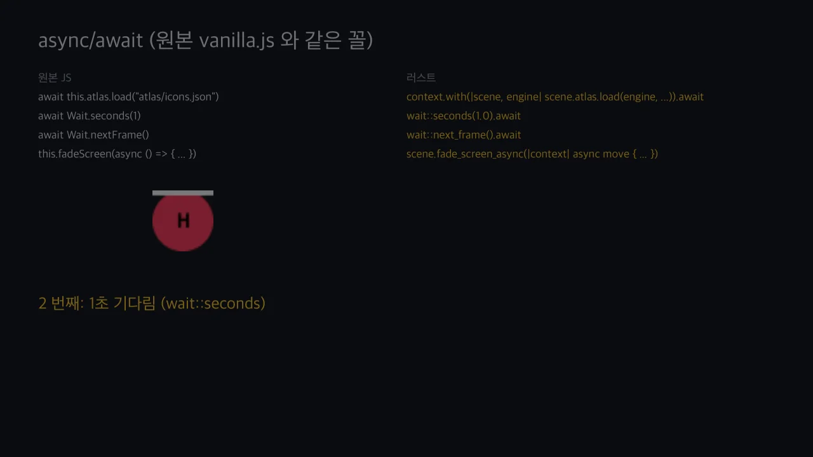

# async/await

In the original vanilla.js, the browser runs Promises, and an `async` function pauses at `await` and continues when the Promise resolves. `async load`, `await asset.load(path)`, `await Wait.seconds(1)`, and `fadeScreen(async () => ...)` all sit on top of this. In Vanilla Engine the engine carries a single-threaded executor, and the same shape of code is written with Rust's `async`/`await`. No external runtime is used, desktop and web run the same code, and futures do not have to be `Send` (they may hold an `Rc`).

This chapter covers how to spawn tasks, `with` for touching the scene and the engine inside a task, the things you can wait for, handing scene loading and unloading to tasks, waiting for callbacks with `Promise`, the screen fade, the order in which tasks run, and what differs from the original. This chapter exists only in the Rust edition.

## Spawning a Task

Pass `engine.spawn_task` a function that takes an `EngineContext` and returns a future, usually in the form `|mut engine_context| async move { ... }`. Like calling an original `async` function, the task runs right where it is spawned up to its first `await`, and the rest runs in the frame's polling turn each time it is woken.

```rust
use std::cell::Cell;
use std::rc::Rc;
use vanilla::{Engine, EngineConfiguration, Promise};

let engine = Engine::new(EngineConfiguration::new());
let (start_promise, start_resolver) = Promise::<u32>::create();
let received_value = Rc::new(Cell::new(0));
let task_received_value = received_value.clone();
let task_handle = engine.spawn_task(move |mut engine_context| async move {
	engine_context.with(|engine| {
		engine.set_maximum_frame_per_second(30.0);
	});
	let value = start_promise.await;
	task_received_value.set(value);
});
assert_eq!(engine.get_maximum_frame_per_second(), 30.0);
assert!(!task_handle.is_finished());

start_resolver.resolve(7);
assert_eq!(received_value.get(), 0);
```

- The `with` before the first `await` has already run before `spawn_task` returns. The task stays alive, waiting for the unresolved Promise.
- `resolve` only wakes the task and puts it in the queue. The task continues in the next polling turn (at the start of the next frame when the engine is running) and receives the value.
- With the returned `TaskHandle` you can ask whether it has finished (`is_finished`), `await` it from another task, or hand it to a scene.

| Function | Takes | First runs |
| --- | --- | --- |
| `engine.spawn_task(task_function)` | `&Engine`; the task function receives an `EngineContext` | Where it is spawned, up to the first `await` |
| `engine.spawn_scene_task(scene, task_function)` | `&Engine` and `&mut scene`; the task function receives a `SceneContext<SceneType>` | Where it is spawned, up to the first `await` |
| `engine.spawn_deferred_task(task_function)` | Places that only have `&Engine` (such as a component context) | In the next polling turn |
| `engine.spawn_deferred_scene_task(scene, task_function)` | Places that only have `&Engine` and `&scene` | In the next polling turn |

## Touching the Scene and Engine Inside a Task (with)

A Rust future cannot hold a `&mut` across an `await`. So a task borrows the scene and the engine only inside the context's `with` closure. This is where the original used `this` and the engine directly on the line after an `await`.

```rust
use vanilla::{Engine, EngineConfiguration, Scene, SceneBase, SceneContext, TextAsset};

struct TitleScene {
	scene_base: SceneBase,
	greeting_asset: TextAsset,
	greeting: String,
}

impl Scene for TitleScene {
	fn get_scene_base(&self) -> &SceneBase {
		&self.scene_base
	}

	fn get_scene_base_mut(&mut self) -> &mut SceneBase {
		&mut self.scene_base
	}
}

let engine = Engine::new(EngineConfiguration::new());
let mut title_scene = TitleScene {
	scene_base: SceneBase::new(),
	greeting_asset: TextAsset::new(),
	greeting: String::new(),
};
let task_handle = engine.spawn_scene_task(&mut title_scene, |mut scene_context: SceneContext<TitleScene>| async move {
	let load_handle = scene_context.with(|scene, engine| scene.greeting_asset.load(engine, "data:text/plain,hello"));
	if load_handle.await.is_ok() {
		scene_context.with(|scene, _engine| {
			let greeting = String::from(scene.greeting_asset.get_text().unwrap_or(""));
			scene.greeting = greeting;
		});
	}
});
assert!(task_handle.is_finished());
assert_eq!(title_scene.greeting, "hello");
```

- `SceneContext<S>::with` gives the scene as its own type (`&mut S`) and the engine as `&Engine`. `EngineContext::with` gives only the engine.
- The `with` closure is synchronous, so you cannot `await` inside it. References the closure receives cannot be put into its return value (their lifetime is new for each closure), so they cannot leak out.
- That is why the `load` functions that returned a Promise in the original return handles that do not borrow the asset or the scene. Call `load` inside the closure and `await` the returned handle outside it. The original `await this.atlas.load(path)` becomes the single line `scene_context.with(|scene, engine| scene.atlas.load(engine, path)).await`.
- On desktop, assets are read on the spot, so the handle is already finished. That is also why the example above runs to the end in the first poll at the spawn site. On the web, frames keep running while the data arrives, and the task continues when it does. The game code is the same.
- For work that needs GL, use `with_graphic` to borrow the graphic too. (Taking it with `engine.get_graphic()` inside `with` also works) The first section at the spawn site gets the graphic too. Before the graphic is attached, or while the engine has lent the graphic to a drawing function because the task was spawned inside it, it does not call the closure and returns `None`.
- A context cannot be cloned and `with` takes `&mut self`, so code that calls `with` inside `with` does not compile. Smuggling a context out and calling it outside its task, or from another scene's task, panics with a message that explains why.
- `scene_context.get_scene_id()` is the handle of the scene that spawned the task.

## Things You Can Wait For

| What you wait for | Where it comes from | Result of `await` |
| --- | --- | --- |
| `AssetLoadHandle` | `load(engine, path)` of `ImageAsset`, `TextAsset`, `JsonAsset`, `BlobAsset`, `BunchAsset`, `VisualAsset::load(path)`, `engine.request_asset_bytes(path)` | `Result<Rc<Vec<u8>>, String>` (images wait until decoded, `Err` if decoding fails) |
| `FontLoadHandle` | `FontAsset::load_font(engine, family, path)` and its variants, `engine.register_font_face_when_loaded` | `Result<(), String>` (until added to the font list) |
| `AudioLoadHandle` | `AudioAsset`'s `load`, `load_from_asset`, `load_from_bytes` | `Result<(), String>` (until decoded) |
| `AssetLoaderLoadHandle` | `AssetLoader::load(engine)` | `Vec<AssetLoadFailure>` (the failure list) |
| `SpriteAtlasLoadHandle` | `SpriteAtlas::load(engine, path)`, `load_data` | `()` (until the JSON and page images arrive and frames are built) |
| `SoundLoadHandle`, `BuildInfoLoadHandle` | `SoundSystem::load_sounds(engine)`, `BuildInfo::load(engine)` | `()` |
| `LanguageLoadHandle`, `UiFontLoadHandle`, `UiFontTextLoadHandle` | `languagepack::load_language_list`, `load_language`, `uifont::load_ui_font`, `load_ui_font_text` (they take the engine as `&mut`, so call them inside `with`) | `()` |
| `WaitSeconds`, `NextFrame` | `wait::seconds(seconds)`, `wait::next_frame()` | `()` |
| `Promise<T>` | `Promise::create()`, `Promise::resolved(value)`, the engine's `_async` functions | `T` |
| `TaskHandle` | The `spawn_task` functions | `()` (when that task finishes) |
| Scene loading and unloading | `engine.load_scene_async(scene)`, `unload_scene_async(scene)`, `unload_all_scenes_async()` | `SceneId`, `()`, `()` |
| Dialogs, clipboard, frame capture | `engine.alert_async`, `confirm_async`, `prompt_async`, `read_clipboard_text_async`, `request_frame_capture_async(frame_number)` | `()`, `bool`, `Option<String>`, `Option<String>`, `Vec<u8>` (PNG) |
| 3D and timelines | `FbxLoader::load_from_url`, `Material::load_image_description`, `SkinnedModel::load_from_url_async`, `load_from_fbx_url_async`, `add_animations_from_fbx_url`, `Timeline::load_from_url` | `Result<..., String>` for each |

- An asset you have already called `load` on can also be waited for with `wait_for_load()` (the `Asset` trait, `SpriteAtlas`, `AssetLoader`, `SoundSystem`, `BuildInfo`, `AudioAsset`).
- `wait::seconds` is wall-clock time, like the original `setTimeout`. It is not multiplied by the time scale (`time_scale`) and is measured from the moment it is called. Even 0 seconds skips one polling turn before finishing. `wait::next_frame` finishes in the next polling turn.
- Failed assets count as finished too. Handles that return a `Result` finish with `Err(reason)`.

## Making Scene Loading Wait

An original scene moves on to `initialize` only after `async load(engine)` finishes.

```javascript
class StageScene extends Scene {
	async load(engine) {
		await super.load(engine);
		await this.stageAsset.load("stage.json");
		await Wait.seconds(0.5);
	}

	initialize(engine) {
		super.initialize(engine);
		console.log(this.stageAsset.data);
	}
}
```

In the Rust edition, spawn the loading task in `load` and hand it to the scene with `scene_base.track_task`. Until the handed tasks finish, the engine only calls `draw_on_load`; after they finish, it waits 0.3 seconds more, like the original, and calls `initialize`.

```rust,no_run
use std::path::PathBuf;
use vanilla::{wait, Engine, EngineConfiguration, JsonAsset, Scene, SceneBase, Vector2};

struct StageScene {
	scene_base: SceneBase,
	stage_asset: JsonAsset,
}

impl Scene for StageScene {
	fn get_scene_base(&self) -> &SceneBase {
		&self.scene_base
	}

	fn get_scene_base_mut(&mut self) -> &mut SceneBase {
		&mut self.scene_base
	}

	fn load(&mut self, engine: &Engine) {
		let load_task_handle = engine.spawn_scene_task(self, |mut scene_context| async move {
			let load_result = scene_context.with(|scene, engine| scene.stage_asset.load(engine, "scenedocument.scene.json")).await;
			if let Err(reason) = load_result {
				eprintln!("{}", reason);
			}
			wait::seconds(0.5).await;
		});
		self.scene_base.track_task(&load_task_handle);
	}

	fn initialize(&mut self, _engine: &Engine) {
		if let Some(stage_data) = self.stage_asset.get_data() {
			println!("{}", stage_data["version"]);
		}
	}
}

fn main() {
	let mut engine_configuration = EngineConfiguration::new();
	engine_configuration.reference_resolution_size = Vector2::create(1280.0, 720.0);
	engine_configuration.asset_directory_paths = vec![PathBuf::from("examples/assets")];
	let engine = Engine::new(engine_configuration);
	let stage_scene = StageScene {
		scene_base: SceneBase::new(),
		stage_asset: JsonAsset::new(),
	};
	if let Err(error) = engine.run(Box::new(stage_scene)) {
		eprintln!("{}", error);
	}
}
```

- The synchronous form that hands over the handle (`scene_base.track_asset(&self.stage_asset)` after `load`) still works. Use the `await` form when you want to write the follow-up work in order inside the same function.
- `GameScene` calls `load_assets(engine)` after requesting the base's loading image. Spawn the task there the same way and hand it to the scene with `get_game_scene_base_mut().get_scene_base_mut().track_task(&task)` (example `examples/asyncawait.rs`, where the original had `async loadAssets`).
- A task handed over with `track_task` in `unload` must finish before unloading finishes, like the original `await scene.unload()`. Meanwhile the scene stays in the list and keeps receiving `tick` and `draw`.
- To load a scene from another task and wait until it is ready, use `engine_context.with(|engine| engine.load_scene_async(scene)).await`. It resolves with the scene's handle once `initialize` has finished. If the scene is unloaded before it finishes loading, it never resolves. `unload_scene_async` resolves only after the tasks handed over in `unload` finish.

```rust,no_run
use vanilla::{Engine, Scene, SceneId};

fn change_scene(engine: &Engine, current_scene_id: SceneId, next_scene: Box<dyn Scene>) {
	engine.spawn_task(move |mut engine_context| async move {
		let next_scene_id = engine_context.with(|engine| engine.load_scene_async(next_scene)).await;
		engine_context.with(|engine| engine.unload_scene_async(current_scene_id)).await;
		println!("{:?}", next_scene_id);
	});
}
```

## Waiting with Promise

The original `new Promise((resolve, reject) => ...)` becomes `Promise::create()`. It returns a pair: the `Promise` to wait for and the `PromiseResolver` that resolves it. Work that can fail uses `Promise<Result<T, E>>` and is resolved with `resolve(Ok(value))` or `reject(reason)` (`Result` instead of exceptions).

```rust
use std::cell::RefCell;
use std::rc::Rc;
use vanilla::{Engine, EngineConfiguration, Promise};

let engine = Engine::new(EngineConfiguration::new());
let (score_promise, score_resolver) = Promise::<Result<u32, String>>::create();
score_resolver.reject(String::from("timeout"));

let score_result = Rc::new(RefCell::new(None));
let task_score_result = score_result.clone();
let task_handle = engine.spawn_task(move |_engine_context| async move {
	let bonus = Promise::resolved(10).await;
	let score = score_promise.await.map(|score| score + bonus);
	*task_score_result.borrow_mut() = Some(score);
});
assert!(task_handle.is_finished());
assert_eq!(*score_result.borrow(), Some(Err(String::from("timeout"))));
```

- `resolve` takes the resolver by value, so it can resolve only once. If the resolver is dropped without resolving, the Promise never finishes, like the original.
- `Promise::resolved(value)` finishes with that value on its first poll, like the original `Promise.resolve(value)`.

To make an API that reports completion through a callback awaitable, resolve the resolver in the callback.

```rust,no_run
use vanilla::{Engine, Promise};

fn read_clipboard_promise(engine: &Engine) -> Promise<String> {
	let (clipboard_promise, clipboard_resolver) = Promise::create();
	engine.read_clipboard_text_with_callback(move |clipboard_text| {
		clipboard_resolver.resolve(clipboard_text);
	});
	clipboard_promise
}
```

## Screen Fade (fade_screen_async)

The original `this.fadeScreen(async () => { ... })` is `GameScene`'s `fade_screen_async`. On the `tick` where the screen is fully dark, `game_scene!` (or `ui_scene!`) spawns the given function as a scene task and runs it on the spot up to its first `await`; when the future finishes, the screen brightens again. If a fade is already running, it returns `false` and does nothing.



```rust,no_run
use vanilla::{wait, Engine, GameScene, GameSceneBase};

struct StoryScene {
	game_scene_base: GameSceneBase,
	chapter: u32,
}

impl GameScene for StoryScene {
	fn get_game_scene_base(&self) -> &GameSceneBase {
		&self.game_scene_base
	}

	fn get_game_scene_base_mut(&mut self) -> &mut GameSceneBase {
		&mut self.game_scene_base
	}

	fn initialize(&mut self, _engine: &Engine) {
		self.fade_screen_async(|mut scene_context| async move {
			scene_context.with(|scene, _engine| {
				scene.chapter += 1;
			});
			wait::seconds(0.4).await;
		});
	}
}

vanilla::game_scene!(StoryScene);
```

- To wait for the fade to finish from another task, resolve a `Promise` at the end of the future you pass in (example `examples/asyncawait.rs`).
- A scene that implements `Scene` directly takes the starter out with `take_screen_fade_dark_starter` after the base `tick` and starts it itself.

## The Order in Which Tasks Run

- Each frame, after updating time and input, the engine polls the woken tasks before the scenes' `tick`. Like the original microtask queue, tasks are queued in the order they were woken and polled from the front until the queue is empty.
- When a task resolves a Promise or finishes, the tasks waiting on it continue in the same polling turn, in the order they were released.
- Futures that wake themselves while watching engine state (asset handles, `wait::seconds`, `wait::next_frame`) go into the next frame's queue. This matches the original, where such Promises resolve in a later task after the browser's work is done.
- If a Promise is resolved outside the polling turn, such as in a scene's `tick` or a touch, the waiting task continues in the next frame's polling turn.
- While a desktop dialog (`alert`, `confirm`, `prompt`) is open, scenes and tasks pause together.

## Differences from the Original and Cautions

- Instead of using `this` right on the line after `await`, touch it inside `with`. The reason is the same as for pointing at nodes with `NodeId`. The engine can also be taken with `Engine::get_engine()` outside `with` (the same engine).
- The original `reject` and `try`/`catch` become `Result`. Awaiting a handle that can fail ends in a `Result`, so tell the cases apart with `match` or `if let`.
- When a scene is unloaded, its tasks keep running, like the original Promise chains. The engine keeps the scene value alive until all of them finish (it leaves the list and receives no `tick` or `draw`), and `with` keeps giving that scene. When they all finish, `destroy` is called and the scene is dropped. A `loop` task that never ends keeps running after its scene is unloaded, so give it an exit condition.
- A scene unloaded while loading still receives `initialize` when loading finishes, like the original `loadScene`.
- A task spawned with `spawn_scene_task` on a scene before `load_scene` runs only its first section at the spawn site and is then dropped. The `TaskHandle` of a dropped task also counts as finished.
- The engine does not start an external runtime. Instead of futures that need another runtime to run, use the engine's handles, `wait`, and `Promise`.
- The synchronous form that hands over handles and the callback APIs (`read_clipboard_text_with_callback`, `fade_screen`, and so on) are still there.

## Related Types

- `EngineContext`, `SceneContext`, `TaskHandle`, `Promise`, `PromiseResolver`
- `Engine`'s `spawn_task`, `spawn_scene_task`, `spawn_deferred_task`, `spawn_deferred_scene_task`, `load_scene_async`, `unload_scene_async`, `unload_all_scenes_async`, `alert_async`, `confirm_async`, `prompt_async`, `read_clipboard_text_async`, `request_frame_capture_async`
- `SceneBase`'s `track_task`, `track_asset`, `track_load_handle`, `track_audio_asset`
- `wait::seconds`, `wait::next_frame`, `WaitSeconds`, `NextFrame`
- `AssetLoadHandle`, `AssetLoadFuture`, `FontLoadHandle`, `FontLoadFuture`, `AudioLoadHandle`, `AudioLoadFuture`, `AssetLoaderLoadHandle`, `AssetLoaderLoadFuture`, `SpriteAtlasLoadHandle`, `SpriteAtlasLoadFuture`, `SoundLoadHandle`, `SoundLoadFuture`, `BuildInfoLoadHandle`, `BuildInfoLoadFuture`, `LanguageLoadHandle`, `LanguageLoadFuture`, `UiFontLoadHandle`, `UiFontLoadFuture`, `UiFontTextLoadHandle`, `UiFontTextLoadFuture`
- `GameScene::fade_screen_async`, `GameSceneBase::fade_screen_async`, `GameSceneBase::take_screen_fade_dark_starter`, `ScreenFadeDarkStarter`
