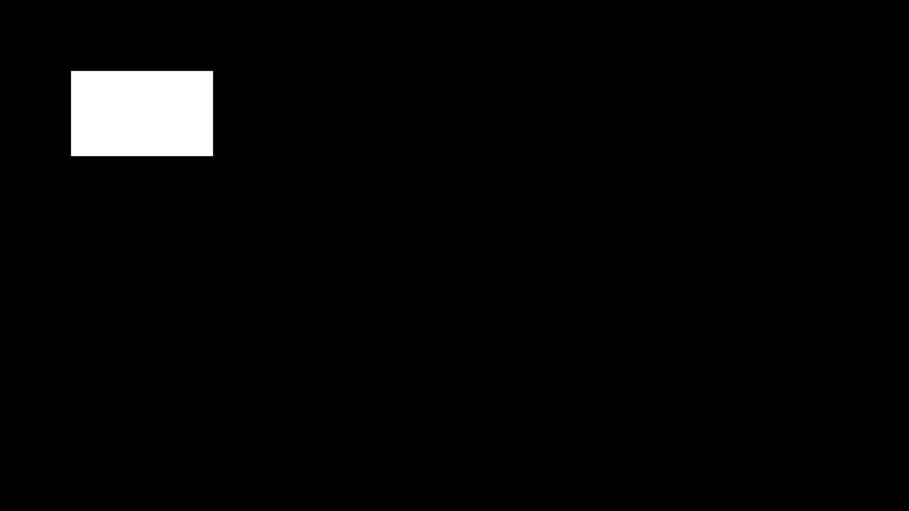

# Getting Started

Add the engine as a dependency, open a scene that draws one white rectangle in a desktop window, then build the same code for the web. A list of the repository's examples follows at the end.

## Dependency

`Cargo.toml`:

```toml
[dependencies]
vanilla-engine = { git = "https://github.com/ddukbaek2/vanilla-engine" }
```

The crate name is `vanilla-engine`, and in code it is shortened to `vanilla`. (The `[lib]` name in the engine's `Cargo.toml` is `vanilla`, the same pattern as Godot using `godot` and Bevy using `bevy`)

## First Scene

`src/main.rs`:

```rust,no_run
use vanilla::{Colors, Engine, EngineConfiguration, Graphic, Rect, Scene, SceneBase, Vector2};

struct MainScene {
	scene_base: SceneBase,
}

impl Scene for MainScene {
	fn get_scene_base(&self) -> &SceneBase {
		&self.scene_base
	}

	fn get_scene_base_mut(&mut self) -> &mut SceneBase {
		&mut self.scene_base
	}

	fn pre_draw(&mut self, graphic: &mut Graphic) {
		self.scene_base.draw_scene_background(graphic);
	}

	fn draw(&mut self, graphic: &mut Graphic) {
		graphic.set_fill_color(Colors::WHITE);
		graphic.draw_rect(Rect::create(100.0, 100.0, 200.0, 120.0));
	}
}

fn main() {
	let mut engine_configuration = EngineConfiguration::new();
	engine_configuration.title = String::from("My Game");
	engine_configuration.auto_resize_on_window_resize = true;
	engine_configuration.reference_resolution_size = Vector2::create(1280.0, 720.0);
	let engine = Engine::new(engine_configuration);
	let main_scene = MainScene {
		scene_base: SceneBase::new(),
	};
	if let Err(error) = engine.run(Box::new(main_scene)) {
		eprintln!("{}", error);
		std::process::exit(1);
	}
}
```

```bash
cargo run
```



Inside the engine repository the same code is in `examples/quickstart.rs`. (`cargo run --example quickstart`, only the window title differs)

- A scene implements the `Scene` trait. The only required functions are `get_scene_base` and `get_scene_base_mut`, which hand out the shared scene state (`SceneBase`); override only the other hooks you need (`load`, `initialize`, `tick`, `pre_draw`, `draw` and so on). Hook names and arguments are the same as the original (`load(engine)`, `tick(time_delta)`, `draw(graphic)`; in hooks that do not receive the engine, use `Engine::get_engine()`).
- `SceneBase::draw_scene_background`, called in `pre_draw`, fills the whole window with the scene background color (black at first) and switches the following drawing to view coordinates. So `Rect::create(100.0, 100.0, 200.0, 120.0)` in `draw` is a position inside the 1280 x 720 reference resolution.
- The default `draw` draws the scene's node tree. This example has no nodes, so the overridden `draw` only draws the rectangle. A scene that uses nodes also calls `self.scene_base.draw(graphic)` in its overridden `draw`.
- `reference_resolution_size` is the reference resolution the game draws in. Whatever the window size, the view scale mode (`ViewScaleMode::StretchShort` at first) stretches and shrinks this size to fit the window.
- With `auto_resize_on_window_resize` on, the canvas follows the window when the window is resized.
- The desktop window opens at the reference resolution size when `EngineConfiguration::window_size` is 0 (the default).
- On desktop `Engine::run` does not return until the window is closed or `Engine::exit_application` is called; on the web it registers the frame callback and returns right away. If it cannot create the window or GL context, it returns `Err` with the reason.

## Building for the Web

You need the `wasm32-unknown-unknown` target and the [wasm-bindgen](https://github.com/rustwasm/wasm-bindgen) command-line tool. Building the example above in the engine repository looks like this.

```bash
rustup target add wasm32-unknown-unknown
cargo build --profile wasm-release --example quickstart --target wasm32-unknown-unknown
wasm-bindgen --target web --no-typescript --remove-name-section --remove-producers-section --out-dir web target/wasm32-unknown-unknown/wasm-release/examples/quickstart.wasm
```

`web/index.html`:

```html
<!doctype html>
<html>
<head><meta charset="utf-8"><style>html, body { margin: 0; overflow: hidden; background: #000; }</style></head>
<body>
<script type="module">
import init from "./quickstart.js";
init();
</script>
</body>
</html>
```

- The `wasm-release` profile is defined in the engine's `Cargo.toml`. In your own game crate, put the same profile in the game's `Cargo.toml`. (See the "Project Setup" chapter)
- The canvas is looked up by `EngineConfiguration::canvas_id` (`mainCanvas` at first); if the page has none, the engine creates one with that id and appends it to the end of `body`.
- Browsers block module scripts and asset fetches on a page opened from `file://`. Open it through a local web server. (For example `python3 -m http.server --directory web 8000`, then `http://localhost:8000`)

## Examples

All sources are in `examples/` of the engine repository.

```bash
cargo run --example uigallery
cargo run --release --example modelviewer
```

| Example | Contents |
| --- | --- |
| `quickstart` | Same code as this chapter's first scene |
| `nodebasics` | Nodes, `Paint`, `Text`, a custom component |
| `uigallery`, `uigallery2` | Every UI widget |
| `inputgallery` | Input fields, Korean IME composition, selection, rich text, gamepad vibration test |
| `effectgallery` | 49 shader sprite effects, screen effects, trails, particles |
| `particleeffects` | Eighteen particle effects |
| `spriteeffects` | Sprite shaders, screen effects and staging |
| `uisample` | Load a uiasset with UIDocument |
| `uishowcase` | A dashboard app (six uiassets, themes, popups, responsive layout) |
| `misctour` | Camera, path finding, dialogue system, screen shake, floating text |
| `timelineshowcase` | Timeline document playback |
| `modelviewer` | Skinned 3D (glTF, FBX), shadows, bloom |
| `engineextras` | Outlines, progress ring, soft shade, mouse cursor, camera gestures, mouse buttons and finger input |
| `devtoolsshowcase` | Developer tools (F2): hierarchy, inspector, statistics, local storage, settings |
| `toonshowcase` | Toon 3D: basic shapes and outlines, skeletal animation of a GLB model, cel shading, instancing and off-screen culling, shadows, HDR bloom |
| `toonview` | Toon inside a node rectangle (`ToonView3D`), 2D placed on 3D points with `Camera3D` |
| `toonfx` | Toon screen-space outlines and GPU effects |
| `toonpost` | Three variants of toon HDR finishing |
| `toonmaterial` | Toon material shader snippets, textures and decals, point lights, planar mirror, persistent instance buffers |
| `toonstyle` | Comparing toon shading and outlines |
| `audiotone` | Sound playback, sound effect pool, beeps |
| `gamepadlist` | List of connected gamepads |
| `uiscenelayout` | `UIScene` and `UINode` auto layout |
| `windowshowcase` | Window stacking and confirm windows, screen fade, only presses the UI did not take go to play input |
| `loadingshowcase` | Loading together with `AssetLoader`, a customized loading screen, build version, `FixedStepper` |
| `asyncawait` | async/await like the original: a loading task, `wait::seconds`, `wait::next_frame`, `fade_screen_async`, `Promise` |
| `textnodeextras` | Fitting text to a box, text with animated scale, translucent rings, arcs and segments, sprite atlas, shadow text |
| `panelayout` | Split panes (`Pane`) |
| `blendmodes` | All 26 blend modes |
| `textshaping` | Right-to-left text, synthetic italic and bold, CJK word wrapping, `DynamicFont` |
| `scenedocument` | Reads a scene file in the vanilla.js visual editor format (`.scene.json`) into a node tree, exports it again and compares |

- `modelviewer`, `toonshowcase`, `timelineshowcase`, `loadingshowcase` and `scenedocument` use example assets from vanilla.js. Clone the vanilla.js repository next to the engine repository. (The `vanilla.js` and `vanilla-engine` folders side by side)
- The examples write asset paths relative to the repository root, so run them from the repository root.
- Run heavy 3D examples with `--release`. (Cargo's dev build does not optimize)

## Related Types

Engine, EngineConfiguration, Scene, SceneBase, Graphic, Rect, Colors, Vector2, ViewScaleMode
