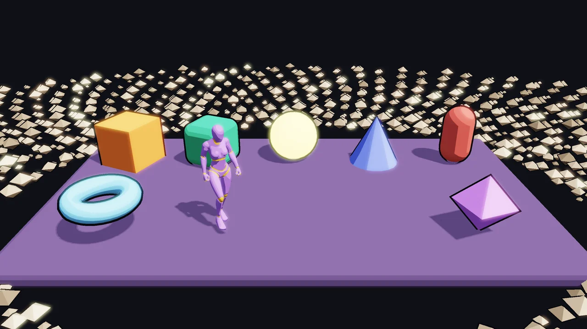

# Vanilla Engine

**A 2D/3D game engine where the same Rust game code runs in a desktop window and in a web browser**

## Introduction

Vanilla Engine (vanilla-engine) is a Rust port of the web game engine [vanilla.js](https://github.com/ddukbaek2/vanilla.js). It keeps the original public API and scene structure, with names changed to Rust conventions. (The original `setFillColor` is `set_fill_color`, `Colors.white` is `Colors::WHITE`) The crate name is `vanilla-engine`, and in code it is used as `vanilla`.

- The same game code builds a desktop executable (Windows, macOS, OpenGL 3.3 core) and a browser wasm module (WebGL2). Differences in windows, GL, input, asset loading, sound, clipboard, Korean input (IME) and system fonts are handled by the engine's platform layer
- Nodes are held by the scene's `NodeTree`, and game code points to them with `NodeId` handles. The handle of a destroyed node becomes `None`, so no dangling references occur, and nodes are created and destroyed without `Rc<RefCell>`
- It is not an ECS; like the original, components are attached to nodes. Names and flow match the original, which makes porting JavaScript games easy
- Batching and off-screen culling are on by default. Blend modes cover all 26 Canvas2D compositing modes
- The engine contains a single-threaded executor, so the original's async/await is written with the same flow. Desktop and web run the same code without an external runtime such as tokio
- The runtime reflection the original does is generated at compile time by the procedural macro `#[vanilla::reflect]`. UI document saving and the developer tools inspector use it
- The two engines keep no feature differences. What truly cannot match because of the language or platform, and the forms chosen to fit Rust, are collected in the "Architecture" chapter

## Key Features

| Area | Contents |
| --- | --- |
| Core | `Engine` (max FPS, page events, screen capture for verification), `EngineConfiguration`, `Scene` / `SceneBase`, `NodeTree` / `WorldNode` / `NodeId`, `Component` / `ComponentBase`, `TimeManager`, `InputManager`, `InputActions`, `GamepadManager`, `ViewManager` (reference resolution, safe area, render scale cap), `TouchRecognizer`, `PointerCursor` |
| Rendering | `Graphic` (sprites, text, shapes, stencil clipping, 26 blend modes), `Paint`, `Sprite`, `Text`, `RichText`, `Mask`, `Outline`, `SoftShade`, `ShadowText`, `ShadowImage`, `Camera2D`, `ShaderProgram`, `ShaderWarmer` |
| UI | `UIButton`, `UIToggleButton`, `UISlider`, `UIScrollView`, `UISnapScrollView`, `UIScrollBar`, `UIInputField`, `UIProgressView`, `UIProgressRing`, `UIListView`, `UIDropdown`, `UIContextMenu`, `UIDialog`, `UIToast`, `UISpinner`, `UILineChart`, `UIBarChart`, window stacking (`UIWindowLayer`, `UIWindow`, `UIConfirmWindow`), `ButtonMotion`, `ToastMotion`, `UIHitArea`, `UIScale`, `UIDocument`, constraint-based layout (`LayoutSolver`, `UINode`, `UIScene`) |
| Effects | `ParticleSystem`, `TrailRenderer`, `ShaderSprite` (49 effects), `ScreenEffect` (58 types), `HeatHazeEffect`, `Shaker`, `FloatingText` |
| Animation | `Timeline` (31 easings plus step and Bezier), `Animator`, `Action`, `Tween`, `SpriteAnimator` |
| 3D | `SkinnedModel` (glTF, GLB, FBX, skinning, morph targets), `SkinnedModelRenderer`, `HumanSkinRenderer`, `ShadowMap`, `BloomEffect`, `MultiLevelBloomEffect`, `AmbientOcclusionEffect`, `SubsurfaceScatteringEffect`, `Camera3D`, `Material`, `RenderTarget`, `FullscreenPass` |
| Toon 3D | `ToonRenderer`, `ToonLightSet`, `ToonMaterial`, `MeshBuilder`, GLB reading (`read_glb_arrays` and others), `ToonDrawQueue`, `ToonScreenOutline`, `ToonVfx`, `ToonPostProcess`, `ToonView3D` |
| Game helpers | `FiniteStateMachine`, `PathFinder`, `Grid`, `Collision2D`, `Steering2D`, `PlatformerBody`, `ObjectPool`, `SeededRandom`, `FixedStepper`, `Localization`, `languagepack`, `uifont`, `DynamicFont`, `format`, `PersistedStore`, `LocalStorage`, `DialogueRunner`, `Typewriter`, `CameraGestures`, `FocusNavigator`, `VirtualPad`, `FrameProbe`, `GraphicsQualityGovernor`, `BuildInfo` |
| Assets | `ImageAsset`, `TextAsset`, `JsonAsset`, `BlobAsset`, `BunchAsset`, `FontAsset`, `AudioAsset`, `VisualAsset`, `AssetLoader`, `LoadingProgress`, `SpriteAtlas` |
| Audio | `AudioPlayer`, `AudioBus`, `SoundSystem`, `SoundEffectPool`, `BeepPlayer` |
| Web | `WebSocketClient`, `Pane` |
| Rust port only | async/await (`Engine::spawn_task`, `Engine::spawn_scene_task`, `Promise`, `TaskHandle`, `wait`), the reflection macro (`#[vanilla::reflect]`), stand-ins for browser features on desktop (`Canvas2D`, `Engine::alert`, `Engine::confirm`, `Engine::prompt`, `Document`) |

## Platforms

| Target | Window and rendering | Verified on |
| --- | --- | --- |
| Desktop | winit window and a glutin OpenGL 3.3 core context (depth 24, stencil 8) | Run and verified on Windows 11 and macOS (Apple silicon). Linux has only been compiled for |
| Web | `wasm32-unknown-unknown`, canvas and WebGL2, `requestAnimationFrame` | Run and verified in Chrome |

It has not yet been run on real mobile devices.

## Repository Layout

| Location | Contents |
| --- | --- |
| `src/lib.rs` | Re-exports the public names at the crate root (where the original has `import.js`) |
| `src/base/` | Base types that do not know the engine (math, color, random, timers, version, `wait`) |
| `src/core/` | The engine core (engine, scene, node tree, `Graphic`, components, input, sound, async executor) |
| `src/resource/` | Assets, `AssetLoader`, `SpriteAtlas` |
| `src/effect/` | Particles, trails, `ShaderSprite`, `ScreenEffect`, `HeatHazeEffect` |
| `src/ui/` | UI components, window stacking, auto layout, `UIDocument` |
| `src/game/` | `GameScene` (common scene for games) |
| `src/misc/` | Game helpers and developer tools |
| `src/animation/` | `Timeline`, `Animator`, `Action` |
| `src/graphics3d/` | 3D and toon 3D |
| `src/web/` | `WebSocketClient`, `Pane` |
| `src/platform/` | Desktop and web windows, GL, input, frame loop, asset loading, sound |
| `macros/` | The reflection procedural macro (re-exported by the engine as `vanilla::reflect`) |
| `examples/` | Examples (`cargo run --example name`) |
| `tests/` | Tests and test assets |
| `tools/apidoc/` | API documentation data extraction and guide code checks |
| `docs/` | API documentation data, guides, update notes |
| `ARCHITECTURE.md` | Architecture design document |
| `UPDATE.md` | Update history |

## Development Environment

- Windows 11 Pro, macOS (Apple silicon)
- Rust 1.100.0

## Links

- Repository: <https://github.com/ddukbaek2/vanilla-engine>
- Original engine: <https://github.com/ddukbaek2/vanilla.js>
- Engine page: <https://vanillapunch.com/tools/#vanilla-engine>
- Documentation: <https://vanillapunch.com/docs/vanilla-engine/>
- Update news: <https://vanillapunch.com/news/?kind=patch>
- Contact: <https://vanillapunch.com/support/>

## License

[MIT](https://github.com/ddukbaek2/vanilla-engine/blob/release/LICENSE) © vanillapunch
