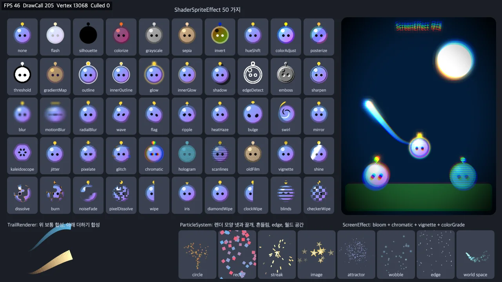
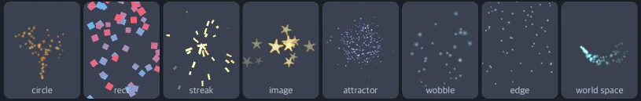
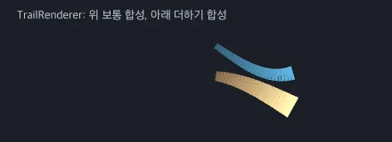
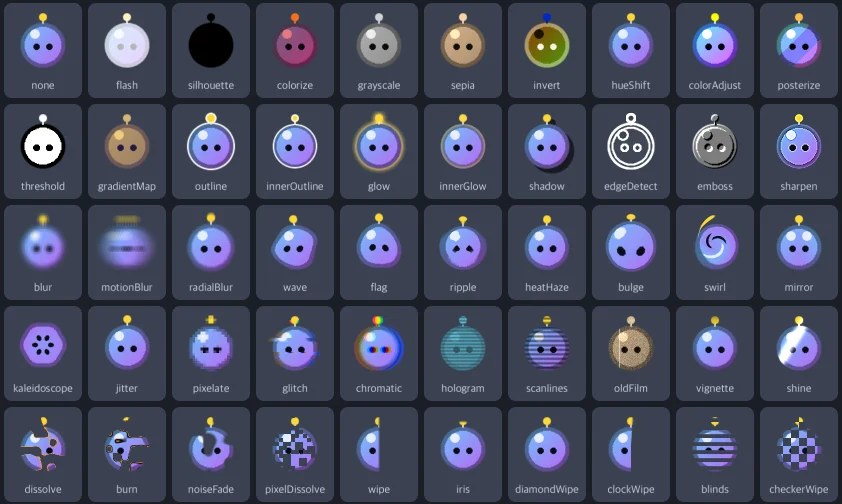
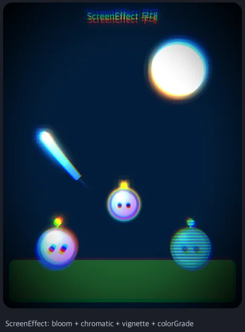

# 파티클

불꽃, 눈, 폭발 같은 파티클과 그 밖의 2D 효과를 다룹니다. 노드에 붙이는 `ParticleSystem` 과 `TrailRenderer`, 셰이더 효과를 거는 스프라이트 `ShaderSprite`, 화면 전체에 후처리를 거는 `ScreenEffect`, 아지랑이 `HeatHazeEffect` 차례입니다. 노드와 컴포넌트는 "노드와 컴포넌트" 장, 그리기 차례와 블렌드는 "그리기" 장, 3D 의 효과(`ToonVfx`)는 "3D" 장, 파티클 편집기 자체는 "저작 도구와 두 엔진이 같이 쓰는 파일" 장에서 다룹니다.



## ParticleSystem

`ParticleSystem` 은 유니티 ParticleSystem 의 자주 쓰는 부분을 2D 로 옮긴 컴포넌트입니다. 노드에 붙이면 바로 방출을 시작하고(기본 재생, 반복, 초당 20 개), 노드 갱신마다 입자를 움직여 정점 색 쿼드로 묶어 그립니다. 좌표는 컴포넌트 좌표(노드 내용 크기 영역의 왼쪽 위가 원점)이고, 내용 크기가 0 인 노드면 노드 자리가 원점입니다.



```rust,no_run
use vanilla::{Color, Engine, EngineConfiguration, ParticleEmitterShape, ParticleSystem, Scene, SceneBase, Vector2};

struct FireScene {
	scene_base: SceneBase,
}

impl Scene for FireScene {
	fn get_scene_base(&self) -> &SceneBase {
		&self.scene_base
	}

	fn get_scene_base_mut(&mut self) -> &mut SceneBase {
		&mut self.scene_base
	}

	fn create(&mut self, _engine: &Engine) {
		let root_id = self.scene_base.get_root_id();
		let node_tree = self.scene_base.get_node_tree_mut();
		let fire_id = node_tree.create_child(root_id, "Fire");
		node_tree[fire_id].set_local_position(Vector2::create(640.0, 520.0));
		let particle_system = node_tree[fire_id].add_component(ParticleSystem::new());
		particle_system.set_emitter_shape(ParticleEmitterShape::Cone);
		particle_system.set_shape_radius(20.0);
		particle_system.set_cone_angle(0.35);
		particle_system.set_emission_rate(60.0);
		particle_system.set_start_lifetime(0.6, 1.2);
		particle_system.set_start_speed(80.0, 180.0);
		particle_system.set_start_size(6.0, 14.0);
		particle_system.set_start_color(Color::create(1.0, 0.75, 0.3, 1.0), Color::create(1.0, 0.5, 0.12, 1.0));
		particle_system.set_color_over_lifetime(vec![
			(0.0, Color::create(1.0, 1.0, 0.85, 1.0)),
			(0.5, Color::create(1.0, 0.6, 0.2, 0.9)),
			(1.0, Color::create(0.65, 0.1, 0.02, 0.0)),
		]);
		particle_system.set_size_over_lifetime(1.0, 0.3);
		particle_system.set_gravity(0.0, -110.0);
		particle_system.set_damping(1.0);
		particle_system.set_additive(true);
		particle_system.set_max_particle_count(800);
	}
}

fn main() {
	let mut engine_configuration = EngineConfiguration::new();
	engine_configuration.reference_resolution_size = Vector2::create(1280.0, 720.0);
	let engine = Engine::new(engine_configuration);
	let fire_scene = FireScene {
		scene_base: SceneBase::new(),
	};
	if let Err(error) = engine.run(Box::new(fire_scene)) {
		eprintln!("{}", error);
	}
}
```

### 방출

- `set_emission_rate(count)`: 초당 방출 수(기본 20, 0 이하면 꾸준히 내지 않음).
- `set_looping(is_looping)`(기본 `true`)와 `set_duration(seconds)`(기본 1): 반복하지 않으면 `duration` 동안만 방출합니다.
- `set_burst_list(vec![(time, count)])`: 재생 시작부터 정한 때(초)에 한꺼번에 뿜습니다. 반복이면 `duration` 마다 되풀이합니다.
- `emit(count, origin_offset)`: 그 자리에서 바로 여러 개를 뿜습니다. 재생 중이 아니어도 뿜습니다. `origin_offset` 은 컴포넌트 좌표의 원점 보정(`Option<Vector2>`, `None` 이면 원점)입니다.
- `ParticleSystem::emit_in_tree(&mut node_tree, node_id, count, origin_offset)`: 노드의 첫 `ParticleSystem` 으로, 그 노드의 지금 위치를 읽어 뿜습니다. 노드가 없거나 `ParticleSystem` 이 없으면 `false` 입니다(아래 "월드 공간" 참고).
- `play()` 는 방출 시간과 버스트를 처음으로 되돌리고 방출을 시작합니다. `stop(is_clearing)` 은 방출을 멈추고, 살아 있는 입자는 `is_clearing` 이 참이 아니면 수명까지 움직입니다.
- `is_playing()`, `is_finished()`(살아 있는 입자가 없고 더 뿜을 것도 없으면 참, 반복이면 멈추기 전까지 거짓), `get_particle_count()`, `set_max_particle_count(count)`(기본 512, 그만큼 있으면 새로 만들지 않음).

```rust
use vanilla::{ParticleSystem, Vector2};

let mut particle_system = ParticleSystem::new();
particle_system.set_manual_tick(true);
particle_system.set_emission_rate(10.0);
particle_system.simulate(0.5);
assert_eq!(particle_system.get_particle_count(), 5);

particle_system.stop(false);
particle_system.emit(3, Some(Vector2::create(0.0, -20.0)));
assert_eq!(particle_system.get_particle_count(), 8);
particle_system.stop(true);
assert_eq!(particle_system.get_particle_count(), 0);

let mut burst_system = ParticleSystem::new();
burst_system.set_looping(false);
burst_system.set_emission_rate(0.0);
burst_system.set_burst_list(vec![(0.0, 24)]);
burst_system.simulate(0.016);
assert_eq!(burst_system.get_particle_count(), 24);
burst_system.simulate(1.5);
assert_eq!(burst_system.get_particle_count(), 0);
assert!(burst_system.is_finished());
```

### 방출 모양 (ParticleEmitterShape)

| 값 | 나오는 자리 | 방향 |
| --- | --- | --- |
| `Point` (기본) | 원점 | 무작위 |
| `Circle` | `set_shape_radius` 반지름 안 | 중심에서 바깥 |
| `Cone` | 반지름 안 | 위쪽(-y)에서 `set_cone_angle` 반각(라디안, 기본 0.5) 안 |
| `Box` | `set_box_size(width, height)` 사각형 안(원점이 가운데) | 위쪽(-y) |
| `Edge` | 길이 `set_edge_width` 의 가로 선분 위(원점이 가운데) | 아래쪽(+y) |

크기는 모두 컴포넌트 좌표(픽셀)이고 기본은 0 입니다. 원본은 모양을 글로 받지만 러스트 판은 열거형이고, 서술(`apply_description`)만 원본 글(`"cone"` 같은)을 읽습니다.

### 입자 하나의 값

- 시작 범위: `set_start_lifetime(min, max)`(초, 기본 1), `set_start_speed(min, max)`(픽셀/초, 기본 60), `set_start_size(min, max)`(지름 픽셀, 기본 6), `set_start_rotation(min, max)`(라디안, 기본 0, `Rect` 와 `Image` 렌더만 돎), `set_start_color(color_a, color_b)`(두 색 사이 무작위, 기본 흰색), `set_angular_velocity(min, max)`(라디안/초, 기본 0). 원본과 달리 기본 인자가 없어서 두 값을 다 넘깁니다. 값 하나로 고정하려면 같은 값을 둘 줍니다.
- 수명에 따른 변화: `set_color_over_lifetime(vec![(time, color)])`(`time` 은 0 ~ 1 오름차순, 시작 색에 곱하고 키 사이는 선형 보간, 빈 목록이면 시작 색 그대로), `set_size_over_lifetime(start_scale, end_scale)`(기본 1, 1).
- 힘: `set_gravity(x, y)`(픽셀/초², 기본 0, 0, 화면 좌표라 위로는 음수), `set_damping(damping)`(갱신마다 속도에 `max(1 - damping x time_delta, 0)` 을 곱함, 기본 0), `set_attractor(x, y, strength, swirl)`(컴포넌트 좌표의 점으로 끌고, `strength` 가 음수면 밀어냄, `swirl` 은 접선 방향으로 돌림, `clear_attractor()` 로 해제).
- `set_wobble(amplitude, frequency)`(원본 기본 빈도 4)는 그릴 때만 좌우로 흔들고 움직임에는 넣지 않습니다.

### 그리기

- `set_render_shape(shape)`: `ParticleRenderShape::Circle`(부드러운 원, 기본), `Rect`(회전하는 판), `Streak`(진행 방향으로 늘인 띠, 길이 배율 `set_streak_scale`, 기본 0.06), `Image`(`set_image(Some(image))` 로 넣은 그림, 그림이 없으면 흰 사각형).
- `set_additive(true)` 는 더하기 합성(`BlendMode::Lighter`)이고, `set_blend_mode(blend_mode)` 로 다른 블렌드를 줍니다(기본 `BlendMode::Normal`).
- `Image` 렌더는 원본처럼 색 곡선과 시작 색의 RGB 를 쓰지 않고, 시작 알파 x (1 - 수명 비율)로만 흐려집니다. 원본은 `image` 를 입자마다 따로 그리지만 러스트 판은 그림 텍스처로 한 번에 묶어 그립니다.

### 월드 공간

`set_world_space(true)` 면 태어날 때 노드의 그때 로컬 위치를 입자에 더해 고정합니다. 노드가 움직여도 이미 나온 입자는 따라가지 않아 연기 꼬리처럼 남습니다(기본 `false` 는 노드를 따라 함께 움직임).

러스트 컴포넌트는 노드 갱신과 그리기 밖에서 자기 노드를 읽을 수 없어서, 더할 노드 위치는 노드 갱신에서 읽어 둡니다. 노드를 옮긴 바로 그 자리에서 뿜으려면 `ParticleSystem::emit_in_tree` 로 뿜거나, `set_node_position(position)` 으로 위치를 넣고 `emit` 합니다.

아래는 움직이는 노드에서 월드 공간으로 뿜고, 누르면 그 자리에 끌개가 있는 폭발을 한 번 냅니다.

```rust,no_run
use vanilla::{Color, Engine, EngineConfiguration, NodeId, ParticleEmitterShape, ParticleRenderShape, ParticleSystem, Scene, SceneBase, Vector2};

struct BurstScene {
	scene_base: SceneBase,
	emitter_id: Option<NodeId>,
	burst_id: Option<NodeId>,
	elapsed_seconds: f64,
}

impl Scene for BurstScene {
	fn get_scene_base(&self) -> &SceneBase {
		&self.scene_base
	}

	fn get_scene_base_mut(&mut self) -> &mut SceneBase {
		&mut self.scene_base
	}

	fn create(&mut self, _engine: &Engine) {
		let root_id = self.scene_base.get_root_id();
		let node_tree = self.scene_base.get_node_tree_mut();

		let emitter_id = node_tree.create_child(root_id, "Smoke");
		node_tree[emitter_id].set_local_position(Vector2::create(640.0, 360.0));
		let smoke = node_tree[emitter_id].add_component(ParticleSystem::new());
		smoke.set_emission_rate(40.0);
		smoke.set_start_speed(10.0, 30.0);
		smoke.set_start_lifetime(1.0, 2.0);
		smoke.set_start_color(Color::create(0.8, 0.85, 1.0, 0.6), Color::create(0.8, 0.85, 1.0, 0.6));
		smoke.set_size_over_lifetime(1.0, 3.0);
		smoke.set_world_space(true);
		self.emitter_id = Some(emitter_id);

		let burst_id = node_tree.create_child(root_id, "Burst");
		node_tree[burst_id].set_local_position(Vector2::create(640.0, 360.0));
		let burst_system = node_tree[burst_id].add_component(ParticleSystem::new());
		burst_system.set_emission_rate(0.0);
		burst_system.set_looping(false);
		burst_system.set_emitter_shape(ParticleEmitterShape::Circle);
		burst_system.set_shape_radius(8.0);
		burst_system.set_start_speed(200.0, 420.0);
		burst_system.set_start_lifetime(0.5, 1.0);
		burst_system.set_start_color(Color::create(1.0, 0.9, 0.4, 1.0), Color::create(1.0, 0.4, 0.2, 1.0));
		burst_system.set_render_shape(ParticleRenderShape::Streak);
		burst_system.set_attractor(0.0, 0.0, -200.0, 300.0);
		burst_system.set_damping(2.0);
		burst_system.set_additive(true);
		self.burst_id = Some(burst_id);
	}

	fn tick(&mut self, engine: &Engine, time_delta: f64) {
		self.scene_base.tick(engine, time_delta);
		self.elapsed_seconds += time_delta;
		if let Some(emitter_id) = self.emitter_id {
			let position_x = 640.0 + self.elapsed_seconds.cos() * 300.0;
			let position_y = 360.0 + (self.elapsed_seconds * 2.0).sin() * 120.0;
			self.scene_base.get_node_tree_mut()[emitter_id].set_local_position(Vector2::create(position_x, position_y));
		}
	}

	fn touch_press(&mut self, _engine: &Engine, view_input_position: Vector2) {
		if let Some(burst_id) = self.burst_id {
			let node_tree = self.scene_base.get_node_tree_mut();
			node_tree[burst_id].set_local_position(view_input_position);
			ParticleSystem::emit_in_tree(node_tree, burst_id, 80, None);
		}
	}
}

fn main() {
	let mut engine_configuration = EngineConfiguration::new();
	engine_configuration.reference_resolution_size = Vector2::create(1280.0, 720.0);
	let engine = Engine::new(engine_configuration);
	let burst_scene = BurstScene {
		scene_base: SceneBase::new(),
		emitter_id: None,
		burst_id: None,
		elapsed_seconds: 0.0,
	};
	if let Err(error) = engine.run(Box::new(burst_scene)) {
		eprintln!("{}", error);
	}
}
```

### 파티클 편집기 프리셋 읽기

파티클 편집기는 `{ "systems": [{ "name", ...서술 }] }` 꼴의 `.vfx.json` 을 저장합니다. 서술 하나는 `apply_description(&description)` 이 그대로 읽습니다(`serde_json::Value`). 모든 칸은 빼도 되고 준 것만 바꿉니다. 색은 `[r, g, b, a]` 배열, 범위는 `[min, max]` 배열이고, 범위의 `max` 를 빼면 `min` 과 같습니다. 모르는 이름의 모양과 블렌드는 무시합니다.

| 칸 | 메서드 |
| --- | --- |
| `looping`, `duration`, `maxParticleCount`, `emissionRate` | `set_looping`, `set_duration`, `set_max_particle_count`, `set_emission_rate` |
| `bursts`(`[{ "time", "count" }]`) | `set_burst_list` |
| `shape`, `shapeRadius`, `coneAngle`, `boxSize`, `edgeWidth` | 방출 모양 |
| `lifetime`, `speed`, `size`, `rotation`, `angularVelocity` | 시작 범위 |
| `startColorA`, `startColorB`(빼면 A 와 같음), `colorOverLifetime`(`[{ "time", "color" }]`), `sizeOverLifetime` | 색과 크기 |
| `gravity`, `damping`, `attractor`(`{ "x", "y", "strength", "swirl" }` 또는 `null`), `wobble`(`[폭, 빈도]`) | 힘 |
| `renderShape`, `blendMode`, `streakScale`, `worldSpace` | 그리기 |

아래는 프리셋 글을 읽어 시스템마다 노드를 하나씩 만듭니다. 씬에서는 `create` 에서 `self.scene_base.get_node_tree_mut()` 에 같은 일을 하고, 파일은 `JsonAsset` 으로 읽습니다("애셋" 장). 여기서는 수동 갱신으로 1 초를 흘려 결과를 봅니다.

```rust
use vanilla::{NodeTree, ParticleSystem, Vector2};

const SNOW_VFX: &str = r#"{
	"systems": [
		{
			"name": "Snow",
			"emissionRate": 70,
			"shape": "edge",
			"edgeWidth": 1200,
			"lifetime": [5, 8],
			"speed": [30, 70],
			"size": [2.5, 6],
			"gravity": [0, 12],
			"damping": 0.1,
			"wobble": [14, 1.4],
			"renderShape": "circle",
			"blendMode": "source-over",
			"startColorA": [1, 1, 1, 0.95],
			"startColorB": [0.8, 0.88, 1, 0.55],
			"colorOverLifetime": [
				{ "time": 0, "color": [1, 1, 1, 0] },
				{ "time": 0.06, "color": [1, 1, 1, 1] },
				{ "time": 1, "color": [1, 1, 1, 0] }
			]
		}
	]
}"#;

let vfx_asset: serde_json::Value = serde_json::from_str(SNOW_VFX).expect("vfx");
let mut node_tree = NodeTree::new();
let root_id = node_tree.get_root_id();
let mut node_id_list = Vec::new();
for description in vfx_asset["systems"].as_array().unwrap() {
	let name = description["name"].as_str().unwrap_or("");
	let node_id = node_tree.create_child(root_id, name);
	node_tree[node_id].set_local_position(Vector2::create(640.0, 0.0));
	let particle_system = node_tree[node_id].add_component(ParticleSystem::new());
	particle_system.apply_description(description);
	particle_system.set_manual_tick(true);
	particle_system.simulate(1.0);
	assert_eq!(particle_system.get_particle_count(), 70);
	node_id_list.push(node_id);
}
assert_eq!(node_tree[node_id_list[0]].get_name(), "Snow");
```

### 시간을 직접 다루기

`set_manual_tick(true)` 면 노드 갱신에서 시간이 가지 않고(노드 위치만 읽어 둠) `simulate(time_delta)` 를 부를 때만 갑니다. `simulate` 는 받은 시간을 한 걸음으로 적분합니다. `set_random_seed(seed)` 를 주면 생성 난수가 그 씨앗을 따르고 `stop(true)` 마다 씨앗으로 돌아가, 되감아도 같은 모양이 나옵니다(`get_random_seed()` 는 준 씨앗, 주지 않았으면 `None`). `Timeline` 이 대상 파티클 노드를 이렇게 다룹니다("트윈과 타임라인" 장). `get_particle_position_list()` 는 살아 있는 입자의 자리(흔들림을 넣지 않은 컴포넌트 좌표)를 돌려줍니다.

```rust
use vanilla::ParticleSystem;

let mut first_system = ParticleSystem::new();
let mut second_system = ParticleSystem::new();
for particle_system in [&mut first_system, &mut second_system] {
	particle_system.set_manual_tick(true);
	particle_system.set_emission_rate(0.0);
	particle_system.set_random_seed(42);
	particle_system.set_start_speed(40.0, 120.0);
	particle_system.emit(8, None);
	particle_system.simulate(0.25);
}
assert_eq!(first_system.get_particle_position_list(), second_system.get_particle_position_list());

first_system.stop(true);
first_system.emit(8, None);
first_system.simulate(0.25);
assert_eq!(first_system.get_particle_position_list(), second_system.get_particle_position_list());
assert_eq!(first_system.get_random_seed(), Some(42));
```

## TrailRenderer

노드가 지나간 자리를 점으로 기록해, 굵기와 색이 잦아드는 띠로 그립니다(유니티 TrailRenderer 의 2D 대응). 점은 노드 갱신마다 노드의 로컬 위치(부모 좌표)로 기록하고, 수명이 지난 점은 지웁니다.



- `set_time(seconds)`: 점이 남는 시간, 곧 띠의 길이(기본 0.5).
- `set_width(start_width, end_width)`: 갓 생긴 점에서 끝으로 가며 바뀌는 굵기(기본 10, 0).
- `set_colors(start_color, end_color)`: 기본 `(1, 1, 1, 0.9)` 에서 `(1, 1, 1, 0)`. 그릴 때 RGB 는 원본처럼 0 ~ 255 정수로 반올림합니다.
- `set_min_vertex_distance(distance)`: 이만큼 움직여야 점을 더합니다(부모 좌표, 기본 3).
- `set_additive(is_additive)`, `set_emitting(is_emitting)`(끄면 새 점을 만들지 않음), `clear()`, `get_point_count()`(점이 둘 이상이어야 띠가 그려짐).

```rust,no_run
use vanilla::{Color, Engine, EngineConfiguration, NodeId, Paint, Scene, SceneBase, TrailRenderer, Vector2};

struct TrailScene {
	scene_base: SceneBase,
	comet_id: Option<NodeId>,
	elapsed_seconds: f64,
}

impl Scene for TrailScene {
	fn get_scene_base(&self) -> &SceneBase {
		&self.scene_base
	}

	fn get_scene_base_mut(&mut self) -> &mut SceneBase {
		&mut self.scene_base
	}

	fn create(&mut self, _engine: &Engine) {
		let root_id = self.scene_base.get_root_id();
		let node_tree = self.scene_base.get_node_tree_mut();
		let comet_id = node_tree.create_child(root_id, "Comet");
		let comet_node = &mut node_tree[comet_id];
		comet_node.set_content_size(Vector2::create(16.0, 16.0));
		comet_node.set_local_position(Vector2::create(640.0, 360.0));
		let trail = comet_node.add_component(TrailRenderer::new());
		trail.set_time(0.5);
		trail.set_width(14.0, 0.0);
		trail.set_colors(Color::create(0.4, 0.8, 1.0, 0.9), Color::create(0.4, 0.8, 1.0, 0.0));
		trail.set_additive(true);
		let paint = comet_node.add_component(Paint::create_with_color(Color::white()));
		paint.set_round_size(8.0);
		self.comet_id = Some(comet_id);
	}

	fn tick(&mut self, engine: &Engine, time_delta: f64) {
		self.scene_base.tick(engine, time_delta);
		self.elapsed_seconds += time_delta;
		if let Some(comet_id) = self.comet_id {
			let angle = self.elapsed_seconds * 2.0;
			let position = Vector2::create(640.0 + angle.cos() * 260.0, 360.0 + angle.sin() * 160.0);
			self.scene_base.get_node_tree_mut()[comet_id].set_local_position(position);
		}
	}
}

fn main() {
	let mut engine_configuration = EngineConfiguration::new();
	engine_configuration.reference_resolution_size = Vector2::create(1280.0, 720.0);
	let engine = Engine::new(engine_configuration);
	let trail_scene = TrailScene {
		scene_base: SceneBase::new(),
		comet_id: None,
		elapsed_seconds: 0.0,
	};
	if let Err(error) = engine.run(Box::new(trail_scene)) {
		eprintln!("{}", error);
	}
}
```

## ShaderSprite

프래그먼트 셰이더 효과를 거는 스프라이트입니다. `ShaderSpriteEffect` 에 `None` 을 빼고 49 가지 효과가 있습니다(섬광 `Flash`, 외곽선 `Outline`, 광택 `Shine`, 디졸브 `Dissolve`, 홀로그램 `Hologram`, 물결 `Wave`, 모자이크 `Pixelate`, 글리치 `Glitch`, 와이프 `Wipe` 같은 것). 효과마다 기본 파라미터와 색이 있고, 소스의 `ShaderSpriteEffect` 주석에 효과마다 진행도, 색, 파라미터의 뜻이 적혀 있습니다. 원본 이름(`"dissolve"`, `"heatHaze"` 같은 camelCase)은 `get_name()` 과 `ShaderSpriteEffect::from_name(name)` 으로 오가고, `ShaderSpriteEffect::get_effect_list()` 는 `None` 을 포함한 50 개를 돌려줍니다.



- 원본은 `Sprite` 를 이어받지만 러스트 판은 `Sprite` 를 품고 `Deref` 로 `Sprite` 의 함수(`set_image`, `set_image_rect`, `set_color` 같은)를 그대로 부릅니다. 품은 `Sprite` 를 `Component::get_base_component` 로 알리므로 노드에서 `get_component::<ShaderSprite>()` 로도, 원본처럼 `get_component::<Sprite>()` 로도 찾힙니다. `get_sprite()`, `get_sprite_mut()` 로 품은 `Sprite` 를 꺼낼 수도 있습니다.
- `ShaderSprite::new()` 나 `ShaderSprite::create_with_image(image)` 로 만듭니다.
- `set_effect(effect)` 는 효과를 바꾸고 그 효과의 기본 파라미터와 색으로 되돌립니다(진행도와 효과 시간은 그대로). 파라미터나 색은 그다음에 바꿉니다. `None` 이거나 그림이 없으면 `Sprite` 와 같게 그립니다.
- `set_effect_progress(progress)`(0 ~ 1 로 자름)는 트윈이나 타임라인이 밀어 넣는 진행도입니다. 효과 시간(`set_effect_time`)은 노드 갱신에서 스스로 흐릅니다.
- `set_effect_color(color)`, `set_effect_parameters(x, y, z, w)`(원본의 기본값 0 인 뒤 인자도 직접 넘김), `set_effect_seed(seed)`(같은 노이즈 무늬를 원할 때, 기본은 생성 때 0 ~ 100 무작위), 정적 `ShaderSprite::get_default_parameters(effect)`, `ShaderSprite::get_default_color(effect)`.
- 셰이더 프로그램 만들기에 실패하면 원본은 예외를 던지지만 러스트 판은 한 번 알리고 효과 없이 `Sprite` 로 그립니다.

```rust
use vanilla::{Color, Image, Rect, ShaderSprite, ShaderSpriteEffect};

let image = Image::create_from_pixels(64, 32, vec![255u8; 64 * 32 * 4]);
let mut shader_sprite = ShaderSprite::create_with_image(image);
shader_sprite.set_image_rect(Rect::create(0.0, 0.0, 32.0, 32.0));
shader_sprite.set_effect(ShaderSpriteEffect::Outline);
assert_eq!(shader_sprite.get_effect_parameters(), ShaderSprite::get_default_parameters(ShaderSpriteEffect::Outline));
shader_sprite.set_effect_parameters(3.0, 0.0, 0.0, 0.0);
shader_sprite.set_effect_color(Color::create(1.0, 0.8, 0.2, 1.0));
shader_sprite.set_effect_progress(1.5);
assert_eq!(shader_sprite.get_effect_progress(), 1.0);
assert_eq!(shader_sprite.get_sprite().get_image_rect(), Rect::create(0.0, 0.0, 32.0, 32.0));
assert_eq!(ShaderSpriteEffect::from_name("dissolve"), Some(ShaderSpriteEffect::Dissolve));
assert_eq!(ShaderSpriteEffect::Dissolve.get_name(), "dissolve");
assert_eq!(ShaderSpriteEffect::get_effect_list().len(), 50);
```

아래는 저장소의 `examples/assets/atlas/icons.png` 의 별 칸에 디졸브를 걸고, 트윈으로 진행도를 오가게 합니다. 트윈의 갱신 콜백은 노드 트리를 받으므로 붙잡아 둔 `NodeId` 로 `ShaderSprite` 를 찾아 씁니다.

```rust,no_run
use vanilla::{easing_function, Color, Engine, EngineConfiguration, ImageAsset, NodeId, Rect, Scene, SceneBase, ShaderSprite, ShaderSpriteEffect, Tween, TweenId, TweenValues, Vector2};

struct DissolveScene {
	scene_base: SceneBase,
	image_asset: ImageAsset,
	sprite_id: Option<NodeId>,
	dissolve_tween_id: Option<TweenId>,
	is_dissolving: bool,
}

impl DissolveScene {
	fn start_dissolve(&mut self, sprite_id: NodeId) {
		let (start_progress, end_progress) = if self.is_dissolving {
			(0.0, 1.0)
		}
		else {
			(1.0, 0.0)
		};
		let tween = Tween::new(TweenValues::new().with("progress", start_progress))
			.to(TweenValues::new().with("progress", end_progress), 1.5)
			.easing(easing_function::sinusoidal::ease_in_out)
			.set_update(move |values, node_tree| {
				let progress = values.get_number("progress").unwrap_or(0.0);
				if let Some(shader_sprite) = node_tree[sprite_id].get_component_mut::<ShaderSprite>() {
					shader_sprite.set_effect_progress(progress);
				}
			});
		self.dissolve_tween_id = Some(self.scene_base.start_tween(tween));
		self.is_dissolving = !self.is_dissolving;
	}
}

impl Scene for DissolveScene {
	fn get_scene_base(&self) -> &SceneBase {
		&self.scene_base
	}

	fn get_scene_base_mut(&mut self) -> &mut SceneBase {
		&mut self.scene_base
	}

	fn create(&mut self, engine: &Engine) {
		self.image_asset.load(engine, "examples/assets/atlas/icons.png");
		self.scene_base.track_asset(&self.image_asset);
	}

	fn initialize(&mut self, _engine: &Engine) {
		let image = match self.image_asset.get_image() {
			Some(image) => {
				image
			}
			None => {
				return;
			}
		};
		let root_id = self.scene_base.get_root_id();
		let node_tree = self.scene_base.get_node_tree_mut();
		let sprite_id = node_tree.create_child(root_id, "Star");
		let sprite_node = &mut node_tree[sprite_id];
		sprite_node.set_content_size(Vector2::create(300.0, 300.0));
		sprite_node.set_local_position(Vector2::create(640.0, 360.0));
		let shader_sprite = sprite_node.add_component(ShaderSprite::create_with_image(image));
		shader_sprite.set_image_rect(Rect::create(63.0, 2.0, 48.0, 48.0));
		shader_sprite.set_effect(ShaderSpriteEffect::Dissolve);
		shader_sprite.set_effect_color(Color::create(1.0, 0.5, 0.1, 1.0));
		self.sprite_id = Some(sprite_id);
		self.start_dissolve(sprite_id);
	}

	fn tick(&mut self, engine: &Engine, time_delta: f64) {
		self.scene_base.tick(engine, time_delta);
		if let (Some(sprite_id), Some(dissolve_tween_id)) = (self.sprite_id, self.dissolve_tween_id) {
			if self.scene_base.get_tween(dissolve_tween_id).is_none() {
				self.start_dissolve(sprite_id);
			}
		}
	}
}

fn main() {
	let mut engine_configuration = EngineConfiguration::new();
	engine_configuration.reference_resolution_size = Vector2::create(1280.0, 720.0);
	let engine = Engine::new(engine_configuration);
	let dissolve_scene = DissolveScene {
		scene_base: SceneBase::new(),
		image_asset: ImageAsset::new(),
		sprite_id: None,
		dissolve_tween_id: None,
		is_dissolving: true,
	};
	if let Err(error) = engine.run(Box::new(dissolve_scene)) {
		eprintln!("{}", error);
	}
}
```

## ScreenEffect

씬 전체에 거는 후처리 사슬입니다. 씬은 화면에 그대로 그리고, `end` 에서 화면(또는 정한 영역)을 떠 와 켜진 효과를 차례로 건 뒤 같은 자리에 되돌려 놓습니다. `ScreenEffectType` 에 58 가지 효과가 있습니다(비네트 `Vignette`, 충격파 `Shockwave`, 번짐 `Bloom`, 색 보정 `ColorGrade`, 색수차 `Chromatic`, 그레인 `Grain`, 안개 `Fog`, 페이드 `Fade` 같은 것). 원본 이름은 `get_name()` 과 `ScreenEffectType::from_name(name)` 으로 오갑니다.



- `ScreenEffect::new()` 로 만듭니다. 원본은 생성자에서 `Graphic` 을 받지만 러스트 판은 아무것도 받지 않고, GL 자원은 처음 `end` 에서 만듭니다. 씬의 `pre_draw` 첫머리에서 `begin(graphic)`, `post_draw` 끝에서 `end(graphic)`, `tick` 에서 `tick(time_delta)` 를 부릅니다.
- `set_enabled(effect_type, is_enabled)`, `set_strength(effect_type, strength)`(0 이면 꺼진 것과 같음, 기본 1), `set_parameters(effect_type, x, y, z, w)`, `set_parameter(effect_type, name, value)`(이름은 `SCREEN_EFFECT_PARAMETER_NAMES` 나 `effect_type.get_parameter_names()`, 모르는 이름은 무시), `set_color(effect_type, color)`, `disable_all()`, `reset_all()`, `has_active_effect()`.
- `set_region(x, y, width, height, corner_radius)` 는 캔버스 픽셀(왼쪽 위 원점) 영역에만 겁니다. 둥근 모서리 바깥은 원래 화면을 둡니다. `clear_region()` 으로 화면 전체로 돌아갑니다.
- 효과를 거는 차례는 정해져 있습니다(형태 왜곡, 흐림, 글리치, 색, 무늬, 전환 차례, `ScreenEffect::get_effect_order()`, 열거 선언 차례와 같음).
- `TimelinePropertyTarget` 을 구현해 `Timeline` 의 `External` 대상이 될 수 있습니다. `set_timeline_property(name, value)` 에서 `"vignette"` 는 세기(0 이면 끔), `"shockwave.radius"` 는 파라미터, `"fade.color"` 는 색, `"fade.enabled"` 는 켜기입니다.
- GL 자원을 쓰므로 다 쓰면 `destroy()` 를 부릅니다. 원본처럼 자원을 만든 GL 컨텍스트(약한 손잡이)를 쥐고 있어 인자가 없고, 효과가 버려질 때(씬을 내리거나 노드를 지울 때)도 스스로 풉니다. 효과 설정은 남고, 다시 `end` 하면 자원을 새로 만듭니다.
- 패스 셰이더 만들기에 실패하면 원본은 예외를 던지지만 러스트 판은 한 번 알리고 그 단계를 건너뜁니다.

```rust
use vanilla::{Color, ScreenEffect, ScreenEffectType, TimelineValue};

let mut screen_effect = ScreenEffect::new();
assert!(!screen_effect.has_active_effect());
screen_effect.set_enabled(ScreenEffectType::Vignette, true);
screen_effect.set_color(ScreenEffectType::Vignette, Color::create(0.0, 0.0, 0.0, 1.0));
assert!(screen_effect.has_active_effect());

assert_eq!(ScreenEffectType::Shockwave.get_parameter_names(), &["centerX", "centerY", "radius", "width"]);
screen_effect.set_parameter(ScreenEffectType::Shockwave, "radius", 0.4);
assert_eq!(screen_effect.get_parameters(ScreenEffectType::Shockwave), [0.5, 0.5, 0.4, 0.1]);

screen_effect.set_timeline_property("vignette", &TimelineValue::Number(0.0));
assert!(!screen_effect.has_active_effect());

screen_effect.set_region(100.0, 80.0, 640.0, 360.0, 24.0);
assert!(screen_effect.get_region().is_some());
screen_effect.clear_region();
assert!(screen_effect.get_region().is_none());
assert_eq!(ScreenEffect::get_effect_order().len(), 58);
```

아래는 비네트를 켜 두고, 누른 자리에서 충격파를 퍼뜨립니다.

```rust,no_run
use vanilla::{Color, Engine, EngineConfiguration, Graphic, Paint, Scene, SceneBase, ScreenEffect, ScreenEffectType, Vector2};

struct ScreenEffectScene {
	scene_base: SceneBase,
	screen_effect: ScreenEffect,
	shockwave_seconds: Option<f64>,
}

impl Scene for ScreenEffectScene {
	fn get_scene_base(&self) -> &SceneBase {
		&self.scene_base
	}

	fn get_scene_base_mut(&mut self) -> &mut SceneBase {
		&mut self.scene_base
	}

	fn create(&mut self, _engine: &Engine) {
		self.screen_effect.set_enabled(ScreenEffectType::Vignette, true);
		self.screen_effect.set_color(ScreenEffectType::Vignette, Color::create(0.0, 0.0, 0.0, 1.0));

		let root_id = self.scene_base.get_root_id();
		let node_tree = self.scene_base.get_node_tree_mut();
		for index in 0..5 {
			let box_id = node_tree.create_child(root_id, "Box");
			let box_node = &mut node_tree[box_id];
			box_node.set_content_size(Vector2::create(160.0, 160.0));
			box_node.set_local_position(Vector2::create(240.0 + index as f64 * 200.0, 360.0));
			let paint = box_node.add_component(Paint::create_with_color(Color::create(0.2 + index as f64 * 0.15, 0.5, 1.0 - index as f64 * 0.15, 1.0)));
			paint.set_round_size(24.0);
		}
	}

	fn tick(&mut self, engine: &Engine, time_delta: f64) {
		self.scene_base.tick(engine, time_delta);
		self.screen_effect.tick(time_delta);
		if let Some(shockwave_seconds) = self.shockwave_seconds {
			let next_seconds = shockwave_seconds + time_delta;
			let radius = next_seconds * 1.5;
			self.screen_effect.set_parameter(ScreenEffectType::Shockwave, "radius", radius);
			if radius > 1.5 {
				self.screen_effect.set_enabled(ScreenEffectType::Shockwave, false);
				self.shockwave_seconds = None;
			}
			else {
				self.shockwave_seconds = Some(next_seconds);
			}
		}
	}

	fn pre_draw(&mut self, engine: &Engine, graphic: &mut Graphic) {
		self.screen_effect.begin(graphic);
		self.scene_base.draw_scene_background(engine, graphic);
	}

	fn post_draw(&mut self, _engine: &Engine, graphic: &mut Graphic) {
		self.screen_effect.end(graphic);
	}

	fn touch_press(&mut self, engine: &Engine, view_input_position: Vector2) {
		let view_size = engine.get_view_manager().get_view_size();
		self.screen_effect.set_enabled(ScreenEffectType::Shockwave, true);
		self.screen_effect.set_parameter(ScreenEffectType::Shockwave, "centerX", view_input_position.x / view_size.x);
		self.screen_effect.set_parameter(ScreenEffectType::Shockwave, "centerY", view_input_position.y / view_size.y);
		self.shockwave_seconds = Some(0.0);
	}
}

fn main() {
	let mut engine_configuration = EngineConfiguration::new();
	engine_configuration.reference_resolution_size = Vector2::create(1280.0, 720.0);
	let engine = Engine::new(engine_configuration);
	let screen_effect_scene = ScreenEffectScene {
		scene_base: SceneBase::new(),
		screen_effect: ScreenEffect::new(),
		shockwave_seconds: None,
	};
	if let Err(error) = engine.run(Box::new(screen_effect_scene)) {
		eprintln!("{}", error);
	}
}
```

## HeatHazeEffect

붙은 노드가 그려지기 전까지의 화면 내용을 노드 영역만큼 떠 와 줄마다 좌우로 일렁이게 다시 그립니다. 영역은 노드의 내용 크기와 피봇을 쓰고, 붙을 때 내용 크기가 비어 있으면 300 x 300 으로 정합니다.

- 앞서 그린 것을 떠 오므로 씬에서 가장 나중에 그려지는 노드에 붙여야 효과가 보입니다. 그 노드의 자식은 효과 위에 그려집니다.
- `set_amplitude(pixels)`(흔들림 폭, 기본 3), `set_frequency(value)`(줄 위치에 곱하는 빈도, 기본 0.05), `set_speed(value)`(시간에 곱하는 빠르기, 기본 2). 줄 하나의 흔들림은 `calculate_row_offset(local_y)` 로 볼 수 있습니다.
- 영역이 화면 밖으로 나가면 화면 가장자리 픽셀을 늘입니다. 떠 온 텍스처는 GL 자원이라 다 쓰면 `destroy()` 를 부릅니다. (`ScreenEffect` 와 같이 인자가 없고, 컴포넌트가 버려질 때도 스스로 풉니다)

```rust,no_run
use vanilla::{Color, Engine, EngineConfiguration, HeatHazeEffect, Paint, Scene, SceneBase, Vector2};

struct HeatHazeScene {
	scene_base: SceneBase,
}

impl Scene for HeatHazeScene {
	fn get_scene_base(&self) -> &SceneBase {
		&self.scene_base
	}

	fn get_scene_base_mut(&mut self) -> &mut SceneBase {
		&mut self.scene_base
	}

	fn create(&mut self, _engine: &Engine) {
		let root_id = self.scene_base.get_root_id();
		let node_tree = self.scene_base.get_node_tree_mut();
		for index in 0..6 {
			let stripe_id = node_tree.create_child(root_id, "Stripe");
			let stripe_node = &mut node_tree[stripe_id];
			stripe_node.set_content_size(Vector2::create(40.0, 400.0));
			stripe_node.set_local_position(Vector2::create(390.0 + index as f64 * 100.0, 360.0));
			stripe_node.add_component(Paint::create_with_color(Color::create(1.0, 0.6 + index as f64 * 0.06, 0.2, 1.0)));
		}

		let haze_id = node_tree.create_child(root_id, "HeatHaze");
		let haze_node = &mut node_tree[haze_id];
		haze_node.set_content_size(Vector2::create(600.0, 300.0));
		haze_node.set_local_position(Vector2::create(640.0, 360.0));
		let heat_haze_effect = haze_node.add_component(HeatHazeEffect::new());
		heat_haze_effect.set_amplitude(4.0);
		heat_haze_effect.set_frequency(0.08);
		heat_haze_effect.set_speed(3.0);
	}
}

fn main() {
	let mut engine_configuration = EngineConfiguration::new();
	engine_configuration.reference_resolution_size = Vector2::create(1280.0, 720.0);
	let engine = Engine::new(engine_configuration);
	let heat_haze_scene = HeatHazeScene {
		scene_base: SceneBase::new(),
	};
	if let Err(error) = engine.run(Box::new(heat_haze_scene)) {
		eprintln!("{}", error);
	}
}
```

## 주의할 점

- `ParticleSystem` 은 붙자마자 반복 방출을 시작합니다. 한 번만 뿜을 것은 `set_emission_rate(0.0)` 으로 두고 `emit` 이나 버스트를 씁니다.
- 회전과 원뿔 각은 라디안입니다(노드의 회전은 도입니다).
- 화면 좌표는 아래가 +y 라서 위로 끌어올리는 중력은 음수입니다.
- 월드 공간 시스템에서 `emit` 은 마지막 노드 갱신에서 읽어 둔 노드 위치를 씁니다. 노드를 옮긴 직후에 뿜으려면 `ParticleSystem::emit_in_tree` 를 씁니다.
- `get_component::<Sprite>()` 는 원본처럼 `ShaderSprite` 도 찾습니다. 효과 함수를 쓰려면 `get_component::<ShaderSprite>()` 로 찾습니다.
- `HeatHazeEffect` 와 `ScreenEffect` 는 이미 그린 화면을 떠 오는 효과입니다. 그리는 차례(어느 노드가 나중인지, `begin` 과 `end` 를 어디서 부르는지)가 결과를 정합니다. 둘 다 `destroy()` 나 버려질 때 GL 자원을 풉니다.

## 관련 타입

ParticleSystem, ParticleEmitterShape, ParticleRenderShape, BlendMode, TrailRenderer, ShaderSprite, ShaderSpriteEffect, ScreenEffect, ScreenEffectType, ScreenEffectRegion, SCREEN_EFFECT_PARAMETER_NAMES, HeatHazeEffect, Sprite, Tween, Timeline, TimelinePropertyTarget
