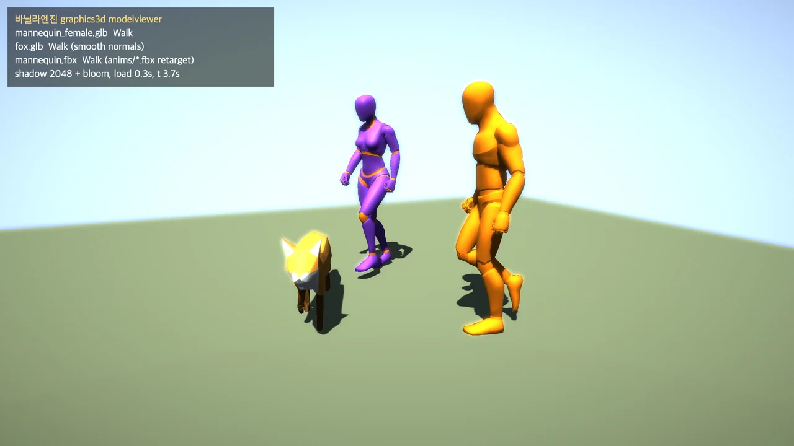
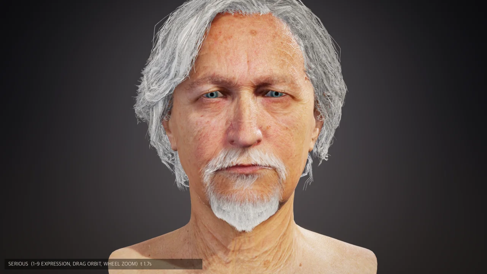
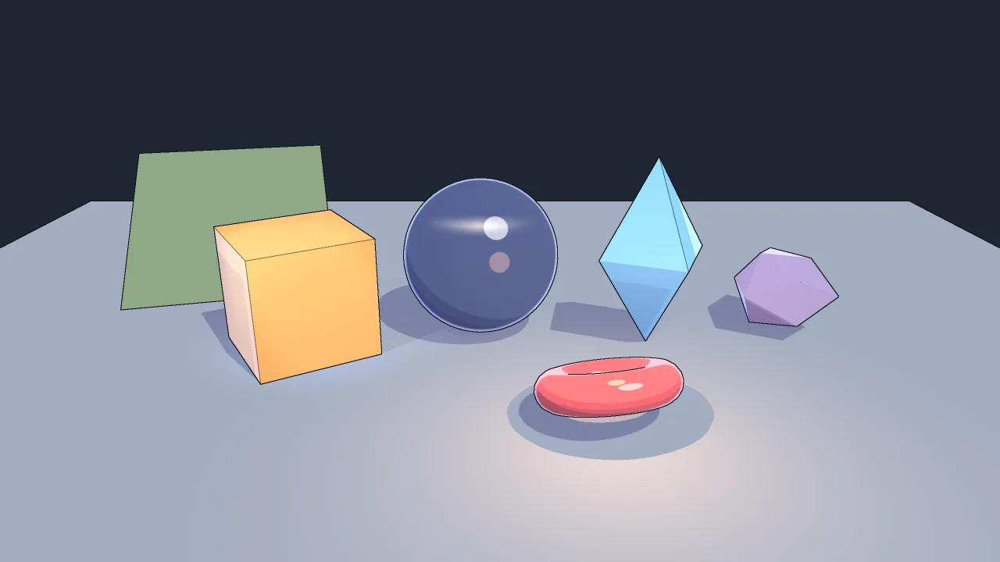
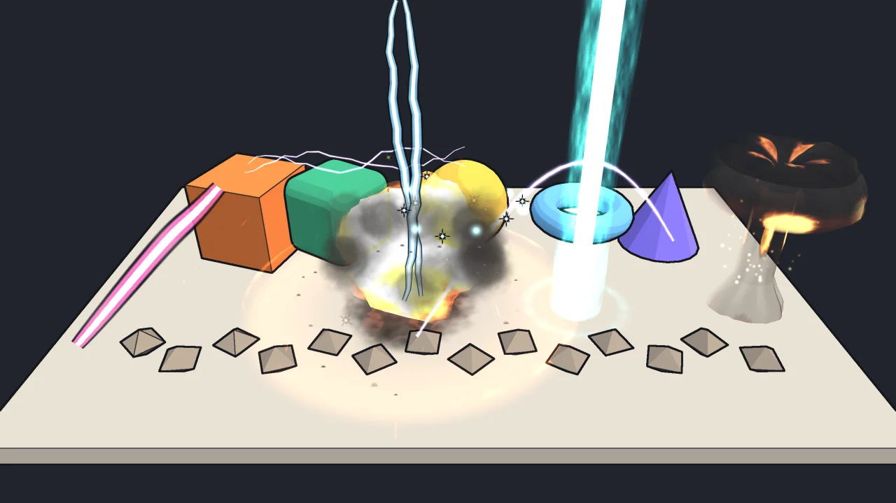
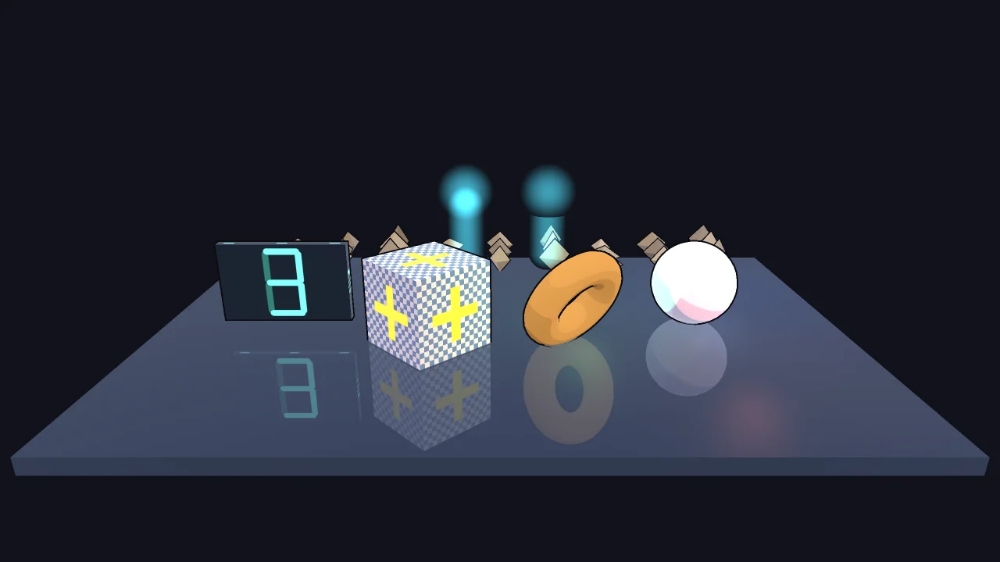

# 3D

glTF(GLB)와 FBX 모형을 불러 애니메이션을 틀고, 엔진의 2D 화면 사이에 3D 로 그리는 방법을 다룹니다. 모형을 담는 `SkinnedModel`, 그리는 `SkinnedModelRenderer`, 보기와 투영을 맡는 `Camera3D`, 재질 `Material`, 그림자 `ShadowMap`, 화면 밖 그림판 `RenderTarget`, 후처리 `BloomEffect` 와 `FullscreenPass` 차례로 보고, 끝에 툰 3D 를 짧게 소개합니다.



원본의 3D(`src/graphics3d`)를 러스트 판은 `vanilla::graphics3d` 모듈로 옮겼습니다. 타입 이름은 `vanilla::SkinnedModel` 처럼 크레이트 맨 위에서도 씁니다.

## 3D 의 짜임

3D 쪽은 노드와 컴포넌트로 된 씬 그래프가 아닙니다. 로더가 메시, 본, 스킨, 재질, 애니메이션이 다 이어진 `SkinnedModel` 인스턴스를 만들고, 게임은 모델 행렬과 카메라 행렬을 직접 들고 렌더러에 넘겨 그립니다. 모델은 데이터와 포즈만 갖고, 그리기와 환경 상태(태양, 안개, 그림자)는 렌더러가 맡습니다.

| 타입 | 하는 일 |
| --- | --- |
| `SkinnedModel` | GLB(바이너리 glTF)와 바이너리 FBX 를 읽은 모델 인스턴스. 포즈 계산, 애니메이션 크로스페이드, 모프 가중치 |
| `SkinnedModelLoadHandle` | 애셋 경로로 부탁한 모형의 받기 손잡이. 다 받으면 `create_model` 이 모델을 짓습니다 |
| `SkinnedModelRenderer` | 스키닝 PBR 셰이더로 모델을 그림. 태양 방향, 안개, 그림자 받기 상태를 가짐 (씬마다 하나) |
| `Camera3D` | 원근이나 직교 투영과 보는 자리. 보기, 투영 행렬과 월드 점, 화면 자리 셈 |
| `Material` | metallic-roughness PBR 값과 텍스처 |
| `ShadowMap` | 방향광 그림자의 깊이 텍스처와 광원 행렬 |
| `RenderTarget` | 화면 밖 프레임버퍼(컬러, 깊이, 멀티샘플, 실수 컬러) |
| `FullscreenPass` | 화면 전체를 덮는 삼각형 하나와 프래그먼트 셰이더 |
| `BloomEffect`, `MultiLevelBloomEffect` | 밝은 곳을 뽑아 흐리는 블룸 |

원본은 객체마다 `webGL2RenderingContext` 를 들지만, 러스트 판의 3D 객체는 컨텍스트를 들지 않고 GL 을 쓰는 함수마다 `gl: &GlContext` 를 받습니다. 컨텍스트는 `Graphic` 이 들고 있어 `graphic.get_gl()` 로 꺼내거나 `run_external_pass` 의 인자로 받습니다. 그래서 GL 객체(렌더러, 모델, 렌더 타겟 같은)는 `Graphic` 을 받는 그리기 함수(`pre_draw`, `draw`, `post_draw`)에서 처음 짓습니다. 씬의 `load` 와 `initialize` 는 `Graphic` 을 받지 않습니다. 깊이 시험처럼 GL 상태를 직접 바꾸려면 게임의 `Cargo.toml` 에 엔진과 같은 판의 `glow`(지금 0.18)를 더해 씁니다. `get_gl` 과 `run_external_pass` 가 주는 것은 `GlContext` 입니다. 상태 함수(`enable`, `viewport`, `bind_texture` 같은 것)가 엔진의 GL 상태 캐시를 거치므로, 바꾼 직후 엔진 그리기를 이어 불러도 엔진이 바뀐 상태를 압니다. `GlContext` 는 glow 의 `HasContext` 메서드 모두를 같은 이름, 같은 꼴로 두므로 `use glow::HasContext;` 없이 부릅니다. 게임의 도움 함수도 `gl: &GlContext` 로 받습니다. 안의 `glow::Context` 는 꺼낼 수 없어 `&glow::Context` 를 받는 함수에는 넘기지 못하고(컴파일 오류), 그래서 상태 캐시를 건너뛰는 길이 없습니다. 엔진 함수에는 `GlContext` 를 그대로 넘깁니다.

## 엔진 화면에 3D 끼우기

엔진의 `Graphic`(2D)과 3D 타입은 같은 GL 컨텍스트를 함께 씁니다. 2D 그리기 사이에 3D 를 그릴 때는 `graphic.run_external_pass(is_depth_cleared, |gl| { ... })` 로 감쌉니다.

- 앞에 쌓인 2D 묶음을 먼저 그리고, `is_depth_cleared` 가 참이면 깊이 버퍼를 비운 뒤 클로저에 GL 컨텍스트를 넘깁니다. 클로저가 돌려준 값을 그대로 돌려줍니다.
- 클로저 안에서는 프로그램, 버텍스 어레이, 뷰포트, 섞기, 깊이, 면 가리기를 마음대로 바꿔도 됩니다. 끝나면(패닉해도) `restore_render_state` 가 뷰포트, 2D 프로그램, 버텍스 어레이를 되돌리고 섞기를 켜고 깊이 시험과 면 가리기를 끕니다(클립 중이면 스텐실 시험을 다시 켭니다).
- 프레임버퍼 묶음은 되돌리지 않습니다. 렌더 타겟에 그렸으면 클로저 끝에서 기본 프레임버퍼(`None`)를 다시 묶습니다.
- 씬의 `pre_draw` 에서 3D 장면을 먼저 다 그리는 길도 있습니다. `graphic.flush_batch()` 로 2D 를 내보내고 3D 를 그린 뒤 `graphic.restore_render_state()` 를 부르고 2D 를 이어 그립니다(저장소의 `examples/modelviewer.rs`).

아래 예제는 `fox.glb` 를 불러 걷는 애니메이션을 틀고, 씬의 `draw` 에서 3D 를 먼저 그린 뒤 `self.scene_base.draw(graphic)` 로 2D 노드(글자)를 그 위에 그립니다. 모형 파일은 이 저장소에 없으므로 원본 vanilla.js 저장소(https://github.com/ddukbaek2/vanilla.js)의 `examples/ancientmountain/assets/fox.glb` 를 애셋 폴더에 두고 씁니다. 이 칸은 깊이 시험을 켜려고 `glow` 를 직접 씁니다. 게임 크레이트의 Cargo.toml 에 엔진과 같은 판의 `glow = "0.18"` 을 더합니다.

```rust,no_run
use std::f64::consts::PI;
use vanilla::{Camera3D, Colors, Engine, EngineConfiguration, GlContext, Graphic, Matrix4, Scene, SceneBase, SkinnedModel, SkinnedModelLoadHandle, SkinnedModelRenderer, Text, Vector2, Vector3};

struct FoxResources {
	skinned_model_renderer: SkinnedModelRenderer,
	fox_model: SkinnedModel,
}

struct FoxScene {
	scene_base: SceneBase,
	fox_load_handle: Option<SkinnedModelLoadHandle>,
	resources: Option<FoxResources>,
	camera: Camera3D,
	angle: f64,
}

impl FoxScene {
	fn create_resources(&mut self, gl: &GlContext) -> Option<FoxResources> {
		let fox_load_handle = self.fox_load_handle.take()?;
		let mut skinned_model_renderer = match SkinnedModelRenderer::new(gl, None, None) {
			Ok(skinned_model_renderer) => {
				skinned_model_renderer
			}
			Err(error) => {
				eprintln!("{}", error);
				return None;
			}
		};
		skinned_model_renderer.set_sun_direction(0.45, 0.76, 0.47);
		skinned_model_renderer.set_fog_range(300.0, 800.0);
		let mut fox_model = match fox_load_handle.create_model(gl, &skinned_model_renderer)? {
			Ok(fox_model) => {
				fox_model
			}
			Err(error) => {
				eprintln!("{}", error);
				return None;
			}
		};
		fox_model.play_animation("Walk", 0.0);
		fox_model.update(0.0);
		Some(FoxResources {
			skinned_model_renderer,
			fox_model,
		})
	}

	fn draw_fox(&mut self, gl: &GlContext, width: i32, height: i32) {
		if self.resources.is_none() {
			self.resources = self.create_resources(gl);
		}
		let resources = match self.resources.as_mut() {
			Some(resources) => {
				resources
			}
			None => {
				return;
			}
		};
		unsafe {
			gl.viewport(0, 0, width, height);
			gl.enable(glow::DEPTH_TEST);
			gl.enable(glow::CULL_FACE);
			gl.disable(glow::BLEND);
		}
		self.camera.set_aspect_ratio(width as f64 / height.max(1) as f64);
		let view_projection_matrix = self.camera.get_view_projection_matrix();
		let eye_position = self.camera.get_eye_position();
		let model_matrix = Matrix4::create_rotation_y(self.angle);
		resources.skinned_model_renderer.draw(gl, &mut resources.fox_model, view_projection_matrix.get_elements(), model_matrix.get_elements(), eye_position.x, eye_position.y, eye_position.z);
	}
}

impl Scene for FoxScene {
	fn get_scene_base(&self) -> &SceneBase {
		&self.scene_base
	}

	fn get_scene_base_mut(&mut self) -> &mut SceneBase {
		&mut self.scene_base
	}

	fn load(&mut self, engine: &Engine) {
		let fox_load_handle = SkinnedModel::load_from_url(engine, "fox.glb");
		self.scene_base.track_load_handle(fox_load_handle.get_load_handle());
		self.fox_load_handle = Some(fox_load_handle);

		self.camera.set_perspective(PI / 3.0, 1.0, 2000.0);
		self.camera.look_at(Vector3::create(0.0, 80.0, 220.0), Vector3::create(0.0, 45.0, 0.0), Vector3::up());

		let root_id = self.scene_base.get_root_id();
		let node_tree = self.scene_base.get_node_tree_mut();
		let label_id = node_tree.create_child(root_id, "Label");
		let label_node = &mut node_tree[label_id];
		label_node.set_content_size(Vector2::create(400.0, 60.0));
		label_node.set_local_position(Vector2::create(640.0, 80.0));
		let text = label_node.add_component(Text::create_with_text("fox.glb", 40.0));
		text.set_text_color(Colors::WHITE);
	}

	fn tick(&mut self, time_delta: f64) {
		self.scene_base.tick(time_delta);
		self.angle += time_delta * 0.5;
		if let Some(resources) = self.resources.as_mut() {
			resources.fox_model.update(time_delta);
		}
	}

	fn draw(&mut self, graphic: &mut Graphic) {
		let width = graphic.get_drawing_buffer_width();
		let height = graphic.get_drawing_buffer_height();
		graphic.run_external_pass(true, |gl| {
			self.draw_fox(gl, width, height);
		});
		self.scene_base.draw(graphic);
	}
}

fn main() {
	let mut engine_configuration = EngineConfiguration::new();
	engine_configuration.reference_resolution_size = Vector2::create(1280.0, 720.0);
	engine_configuration.auto_resize_on_window_resize = true;
	let engine = Engine::new(engine_configuration);
	let fox_scene = FoxScene {
		scene_base: SceneBase::new(),
		fox_load_handle: None,
		resources: None,
		camera: Camera3D::new(),
		angle: 0.0,
	};
	if let Err(error) = engine.run(Box::new(fox_scene)) {
		eprintln!("{}", error);
	}
}
```

- `SkinnedModelRenderer::new(gl, fragment_shader_source, vertex_shader_source)` 는 씬에 하나 만듭니다(셰이더 소스에 `None` 이면 기본 PBR). 셰이더를 컴파일하지 못하면 `Err` 입니다. 모델을 지을 때 이 렌더러의 셰이더로 재질을 짓기 때문에 모델보다 먼저 만듭니다.
- `SkinnedModel::load_from_url(engine, path)` 는 엔진의 애셋 받기(데스크탑은 애셋 폴더 후보, 웹은 `asset_base_url` 에서 받기)로 GLB 바이트를 부탁하고 받기 손잡이(`SkinnedModelLoadHandle`)를 돌려줍니다. `scene_base.track_load_handle(handle.get_load_handle())` 로 맡기면 다 받은 뒤 `initialize` 가 불립니다. 손잡이의 `create_model(gl, &renderer)` 는 아직 받는 중이면 `None`, 받기나 해석에 실패하면 `Some(Err)` 입니다.
- 원본의 `await SkinnedModel.loadFromUrl(...)` 자리는 엔진 작업 안에서 `SkinnedModel::load_from_url_async(engine, path, &renderer).await` 입니다("async/await" 장). 이미 받은 바이트는 `SkinnedModel::load_from_bytes(gl, &bytes, &renderer)` 가 그 자리에서 읽습니다. GLB 가 아니면(머리가 다르면) `Err` 이고, 클립이 있으면 첫 클립을 재생 중으로 둡니다.
- `update(delta_time)` 은 시간을 흘리고 포즈를 샘플링해 조인트 행렬을 셈합니다. GL 을 쓰지 않으므로 씬의 `tick` 에서 부릅니다. 애니메이션이 없는 정적 모델도 기본 포즈의 행렬을 셈하려면 그리기 전에 한 번은 부릅니다.
- `draw(gl, &mut model, view_projection_elements, model_matrix_elements, camera_x, camera_y, camera_z)` 의 행렬은 열 우선 16 칸(`&[f32; 16]`)입니다. `Matrix4::get_elements()` 가 이 꼴을 돌려줍니다. 카메라 자리는 반사광과 안개 거리 셈에 씁니다. 모델을 `&mut` 로 받는 것은 바뀐 모프 타깃을 그리기 전에 올리기 때문입니다.
- 렌더러는 깊이 시험, 면 가리기, 섞기, 프레임버퍼를 건드리지 않습니다. 그리기 전에 부르는 쪽이 정합니다.
- 렌더러의 처음 값은 태양 방향 (0, 1, 0), 안개 색 (0.8, 0.85, 0.92), 안개 거리 55 ~ 250, 그림자 세기 0 입니다. `set_sun_direction(x, y, z)`, `set_fog_color(red, green, blue)`, `set_fog_range(start_distance, end_distance)` 로 바꿉니다. 안개 거리는 월드 단위라서, 위 예제처럼 모형이 크면(여우는 키가 약 79 단위) 늘립니다.
- 모델 행렬은 `Matrix4::create_translation`, `create_rotation_y`, `create_scale` 같은 것으로 만듭니다. `multiply`, `translate`, `rotate_y`, `scale` 은 오른쪽에 곱해 쌓습니다(`this = this x other`).

## Camera3D

`Camera3D` 는 원근이나 직교 투영과 보는 자리를 들고, 값이 바뀐 뒤 처음 읽을 때만 행렬을 다시 셈합니다. 좌표는 y 가 위인 오른손 좌표이고, 카메라는 -Z 쪽을 봅니다. 처음 값은 원근, 세로 시야각 0.8 라디안, 가로 세로 비 1, 거리 0.1 ~ 1000, 눈 (0, 0, 10) 에서 원점을 보는 자리입니다.

```rust
use std::f64::consts::PI;
use vanilla::{Camera3D, Rect, Vector2, Vector3};

let mut camera = Camera3D::new();
camera.set_perspective(PI / 3.0, 0.1, 500.0);
camera.set_aspect_ratio(1280.0 / 720.0);
camera.look_at(Vector3::create(0.0, 10.0, 20.0), Vector3::create(0.0, 0.0, 0.0), Vector3::up());

let view_rect = Rect::create(0.0, 0.0, 1280.0, 720.0);
let center_point = camera.project_to_view(0.0, 0.0, 0.0, view_rect);
assert!(center_point.is_in_front);
assert!((center_point.x - 640.0).abs() < 0.01);
assert!((center_point.y - 360.0).abs() < 0.01);
let behind_point = camera.project_to_view(0.0, 10.0, 40.0, view_rect);
assert!(!behind_point.is_in_front);

let ground_point = camera.unproject_to_plane(Vector2::create(640.0, 360.0), 0.0, view_rect).expect("ground");
assert!(ground_point.x.abs() < 0.01);
assert!(ground_point.z.abs() < 0.01);
assert!(camera.unproject_to_plane(Vector2::create(640.0, 0.0), 0.0, view_rect).is_none());

camera.set_orthographic(30.0, 0.1, 500.0);
assert!(camera.is_orthographic());
assert!((camera.read_view_depth(0.0, 0.0, 0.0) - 500.0f64.sqrt()).abs() < 0.01);
```

- `set_perspective(field_of_view_radian, near_distance, far_distance)`, `set_orthographic(orthographic_height, near_distance, far_distance)`(너비는 높이 x 가로 세로 비), `set_aspect_ratio(aspect_ratio)`(그리는 사각형이 바뀔 때마다 넣음), `look_at(eye_position, target_position, up_direction)`. 원본과 달리 위쪽에 기본값이 없어서 보통 `Vector3::up()` 을 넘깁니다.
- `get_view_matrix()`, `get_projection_matrix()`, `get_view_projection_matrix()`, `get_inverse_view_projection_matrix()` 는 담아 둔 행렬의 복사본(`Matrix4`)을 돌려줍니다.
- `project_to_view(x, y, z, view_rect)` 는 월드 점을 `view_rect` 안의 자리(왼쪽 위가 원점, 아래로 늘어남)로 옮겨 `ProjectedPoint { x, y, depth, is_in_front }` 를 돌려줍니다. 눈의 면보다 뒤면 `is_in_front` 가 거짓이고 x, y 는 0 입니다. 3D 점 위에 이름표나 단추를 얹을 때 씁니다. 원본의 `result` 인자는 없고, 값으로 돌려줍니다.
- `unproject_to_plane(view_position, plane_height, view_rect)` 는 화면 자리에서 나간 시선이 수평면 `y = plane_height` 와 만나는 월드 점(`Vector3`)을, 만나지 않으면 `None` 을 돌려줍니다. 땅을 누른 자리를 찾을 때 씁니다.
- `read_view_depth(x, y, z)` 는 카메라가 보는 쪽으로 잰 깊이(눈의 면보다 뒤면 음수)입니다. 비치는 것을 먼 것부터 그리도록 정렬할 때 씁니다.
- `set_matrices(&view_matrix, &projection_matrix)` 로 게임이 셈한 행렬을 그대로 쓸 수 있습니다. `set_perspective`, `set_orthographic`, `look_at` 을 부르면 그 행렬을 버리고 셈하는 길로 돌아갑니다(`has_raw_matrices()`, `clear_raw_matrices()`).

## 애니메이션

모형 파일에 든 클립은 `get_animation_name_list()` 로 이름을 봅니다. `fox.glb` 에는 `Survey`, `Walk`, `Run` 이 있습니다.

`SkinnedModel::create_without_shader_program()` 으로 만든 모델은 GL 없이 glTF 내용을 해석하고(`interpret_content`) 포즈를 셈할 수 있습니다. 아래는 노드 하나를 1 초 동안 위로 4 만큼 올리는 클립 `Rise` 를 코드로 만들어 틀어 봅니다. 스킨이 없는 메시는 노드 자신이 조인트인 합성 스킨으로 읽혀서, 조인트 행렬의 이동 칸(13 번)에 노드의 높이가 나옵니다.

```rust
use serde_json::json;
use vanilla::{Quaternion, SkinnedModel};

let mut float_list: Vec<f32> = vec![0.0, 0.0, 0.0, 1.0, 0.0, 0.0, 0.0, 1.0, 0.0];
float_list.extend_from_slice(&[0.0, 1.0]);
float_list.extend_from_slice(&[0.0, 0.0, 0.0, 0.0, 4.0, 0.0]);
let binary_buffer: Vec<u8> = float_list.iter().flat_map(|value| value.to_le_bytes()).collect();
let json = json!({
	"scenes": [{ "nodes": [0] }],
	"nodes": [{ "name": "Head", "mesh": 0 }],
	"meshes": [{ "primitives": [{ "attributes": { "POSITION": 0 } }] }],
	"accessors": [
		{ "bufferView": 0, "componentType": 5126, "count": 3, "type": "VEC3" },
		{ "bufferView": 1, "componentType": 5126, "count": 2, "type": "SCALAR" },
		{ "bufferView": 2, "componentType": 5126, "count": 2, "type": "VEC3" }
	],
	"bufferViews": [
		{ "buffer": 0, "byteOffset": 0, "byteLength": 36 },
		{ "buffer": 0, "byteOffset": 36, "byteLength": 8 },
		{ "buffer": 0, "byteOffset": 44, "byteLength": 24 }
	],
	"animations": [{
		"name": "Rise",
		"channels": [{ "sampler": 0, "target": { "node": 0, "path": "translation" } }],
		"samplers": [{ "input": 1, "output": 2, "interpolation": "LINEAR" }]
	}]
});

let mut skinned_model = SkinnedModel::create_without_shader_program();
skinned_model.interpret_content(&json, &binary_buffer).unwrap();
assert_eq!(skinned_model.get_animation_name_list(), vec![String::from("Rise")]);
skinned_model.play_animation("Rise", 0.0);
skinned_model.update(0.5);
assert_eq!(skinned_model.get_skin_list()[0].joint_matrix_array[13], 2.0);

skinned_model.set_time_scale(0.5);
skinned_model.update(0.5);
assert_eq!(skinned_model.get_skin_list()[0].joint_matrix_array[13], 3.0);

skinned_model.set_joint_rotation_offset("Head", Quaternion::create_from_euler(0.0, 0.0, 0.3));
skinned_model.update(0.0);
skinned_model.clear_joint_rotation_offsets();
```

- `play_animation(animation_name, fade_duration)` 는 지금 클립에서 새 클립으로 `fade_duration` 초 동안 섞어 넘어갑니다. 0 이면 다음 `update` 에서 바로 바뀝니다. 원본의 기본값(0.25)은 러스트에 없어서 늘 넘깁니다. 지금 트는 클립과 같은 이름이거나 없는 이름이면 아무것도 하지 않습니다.
- 클립은 늘 반복합니다(클립 시간을 클립 길이로 나눈 나머지로 샘플링). 한 번만 트는 갈래나 끝 알림은 없으므로, 필요하면 게임이 클립 길이만큼 시간을 재어 다음 클립으로 넘깁니다. 클립 길이는 `get_animation_list()` 로 봅니다.
- `set_time_scale(time_scale)` 는 재생 빠르기입니다(처음 1, 0 이면 멈춤, 크로스페이드 시간에는 걸리지 않음).
- `set_joint_rotation_offset(joint_name_part, offset_rotation)` 는 이름에 `joint_name_part` 가 든 모든 노드의 로컬 회전에 `Quaternion` 을 더 곱합니다. 애니메이션을 샘플링한 뒤에 걸리므로 고개 돌리기 같은 절차 포즈에 씁니다. `clear_joint_rotation_offsets()` 로 모두 풉니다. (여우의 머리 본 이름은 `b_Head_05` 입니다)
- 모프 타깃(glTF 의 `weights` 와 애니메이션)은 `set_morph_weight(target_name, weight)`, `get_morph_weight(target_name)` 로 다룹니다. `add_morph_target(drawable_index, target_name, position_deltas, normal_deltas)` 로 코드에서 타깃을 더할 수도 있습니다. 드로어블 하나에 타깃은 `MORPH_TARGET_MAXIMUM`(96) 개까지입니다.
- 기본 스키닝 셰이더의 조인트 행렬 배열은 96 칸입니다.
- `destroy(gl)` 는 모델의 GL 리소스(버텍스 어레이, 버퍼, 모프 텍스처, 이 모델이 읽으며 지은 재질의 텍스처)를 지웁니다. 재질 가운데 다른 곳에서 `Rc` 로 쥐고 있는 것은 남깁니다.

## FBX 모형과 애니메이션 더하기

바이너리 FBX 는 `SkinnedModel::load_from_fbx_url(engine, path)` 로 부탁합니다(받은 바이트는 `load_from_fbx_bytes(gl, &bytes, &renderer)`). 스킨이 붙은 메시만 드로어블이 됩니다. 애니메이션을 클립마다 따로 내보낸 FBX 는 `add_animations_from_fbx_url(engine, path, clip_name, ignore_translation)` 로 같은 뼈대의 모델에 클립을 더합니다. 본 이름을 맞춰 지금 모델의 노드로 다시 잇고, `ignore_translation` 이 참이면 이동 채널을 버립니다(위치를 게임이 정하는데 클립에 루트 이동이 박혀 있을 때). 모델을 지은 뒤에 부릅니다.

- `add_animations_from_fbx_url` 은 await 할 수 있는 `AnimationLoadHandle` 을 돌려줍니다. await 하지 않아도 다 받은 뒤 다음 `update` 나 `play_animation` 에서 받은 차례로 클립을 더합니다. 데스크탑은 그 자리에서 읽혀 바로 더해지고, 웹은 받기가 끝나야 더해지므로 그 전에 부른 `play_animation` 은 없는 이름이라 무시됩니다.
- 이미 받은 바이트는 `add_animations_from_fbx_bytes(&bytes, clip_name, ignore_translation)` 가 그 자리에서 더하고, 파싱에 실패하면 `Err` 입니다.

아래 두 함수는 캐릭터 FBX 를 부탁하고, 다 받은 뒤(`Graphic` 과 `Engine` 을 함께 받는 `pre_draw` 같은 곳에서) 모델을 짓고 애니메이션 FBX 셋을 더합니다. 파일은 원본 vanilla.js 저장소의 `examples/ancientmountain/assets/` 에 있는 것을 애셋 폴더에 두고 씁니다.

```rust,no_run
use vanilla::{Engine, Graphic, SkinnedModel, SkinnedModelLoadHandle, SkinnedModelRenderer};

fn request_character(engine: &Engine) -> SkinnedModelLoadHandle {
	SkinnedModel::load_from_fbx_url(engine, "mannequin.fbx")
}

fn create_character(engine: &Engine, graphic: &mut Graphic, skinned_model_renderer: &SkinnedModelRenderer, load_handle: &SkinnedModelLoadHandle) -> Option<Result<SkinnedModel, String>> {
	let model_result = load_handle.create_model(graphic.get_gl(), skinned_model_renderer)?;
	Some(model_result.map(|mut character_model| {
		character_model.add_animations_from_fbx_url(engine, "anims/idle.fbx", "Idle", false);
		character_model.add_animations_from_fbx_url(engine, "anims/walk.fbx", "Walk", false);
		character_model.add_animations_from_fbx_url(engine, "anims/climb.fbx", "Climb", true);
		character_model.play_animation("Idle", 0.0);
		character_model.update(0.0);
		character_model
	}))
}
```

예제 마네킹(Quaternius, CC0)은 미터 단위라 크기를 그대로 씁니다. 센티미터 단위로 내보낸 모형은 모델 행렬에 0.01 배를 곱해 줄입니다.

## Material

모형을 읽으면 파일의 재질로 `Material` 이 저절로 지어집니다. 다른 텍스처나 색으로 바꾸려면 재질을 지어 `set_material(drawable_index, Rc<Material>)` 로 드로어블에 넣습니다(드로어블이 없으면 `Err`).

- `Material::create_default_description()` 은 흰색, 메탈릭 0, 러프니스 1, 빛남 0 과 비어 있는(`None`) 그림 칸 8 개(`base_color_image`, `normal_image`, `metallic_roughness_image`, `glossiness_image`, `occlusion_image`, `emissive_image`, `specular_image`, `opacity_image`)를 가진 `MaterialDescription` 을 돌려줍니다. 비어 있는 그림 칸은 1x1 단색 텍스처가 됩니다.
- 그림 서술(`ImageDescription`)은 `Material::create_image_description(bytes, mime_type, options)`(이미 받은 바이트로, 여기서는 풀지 않고 텍스처를 지을 때 풂)이나 `Material::load_image_description(engine, path, options)`(받기 손잡이 `ImageDescriptionLoadHandle`, 다 받으면 `get_image_description()`, await 도 됨)으로 만듭니다. `options` 는 `ImageDescriptionOptions { flip_y, is_color_data, anisotropy }` 이고 `None` 이면 모두 끄고 0 입니다. `is_color_data` 가 참이면 sRGB 로 저장된 색으로 보고 텍스처를 `SRGB8_ALPHA8` 로 올려 선형으로 풀어 읽습니다. `anisotropy` 는 이방성 거르기 단계입니다. 그림은 png, jpeg, webp, gif, bmp, ico 를 풉니다.
- `Material::create_from_description(gl, shader_program, &description)` 에는 그 재질을 쓸 렌더러의 셰이더(`renderer.get_shader_program()`, `Rc<ShaderProgram>`)를 줍니다. 그림을 풀지 못하면 `Err` 입니다.
- 텍스처 유닛은 0 이 기본 색, 1 이 그림자 맵 자리(재질에 쓰지 않음), 2 ~ 8 이 노멀, 메탈릭 러프니스, 글로스, 차폐, 빛남, 스펙큘러, 불투명도입니다. 셰이더에 따로 둔 텍스처는 `set_texture(uniform_name, texture_unit, Some(texture))` 로 9 번부터 겁니다.
- 불투명도 그림이 있으면 알파 컷아웃(머리카락 카드의 투명한 곳 버리기)을 씁니다. 나중에 붙인 경우 `set_use_alpha_cutout(true)` 로 켭니다.
- 직접 지은 재질은 다 쓰면 `material.destroy(gl)` 를 부릅니다(기본 슬롯 텍스처만 지우고, `set_texture` 로 넣은 텍스처는 남깁니다).

```rust
use vanilla::{ImageDescriptionOptions, Material};

let mut description = Material::create_default_description();
assert_eq!(description.base_color_factor, [1.0, 1.0, 1.0]);
assert_eq!(description.metallic_factor, 0.0);
assert_eq!(description.roughness_factor, 1.0);
assert!(description.normal_image.is_none());

description.base_color_factor = [1.0, 0.85, 0.7];
description.roughness_factor = 0.6;
let image_bytes: Vec<u8> = vec![0u8; 16];
let options = ImageDescriptionOptions { is_color_data: true, anisotropy: 4.0, ..ImageDescriptionOptions::default() };
description.base_color_image = Some(Material::create_image_description(image_bytes, Some(String::from("image/png")), Some(options)));
let base_color_image = description.base_color_image.as_ref().unwrap();
assert!(base_color_image.is_color_data);
assert!(!base_color_image.flip_y);
assert_eq!(base_color_image.anisotropy, 4.0);
```

위의 바이트는 자리만 채운 것이고, 실제로는 파일이나 `BlobAsset` 에서 받은 그림 바이트를 넘깁니다. 서술로 재질을 지어 모델에 넣는 쪽은 GL 이 있어야 하므로 그리기 함수에서 부릅니다.

```rust,no_run
use std::rc::Rc;
use vanilla::{Graphic, Material, MaterialDescription, SkinnedModel, SkinnedModelRenderer};

fn apply_material(graphic: &mut Graphic, skinned_model_renderer: &SkinnedModelRenderer, skinned_model: &mut SkinnedModel, description: &MaterialDescription) -> Result<Rc<Material>, String> {
	let material = Rc::new(Material::create_from_description(graphic.get_gl(), skinned_model_renderer.get_shader_program(), description)?);
	skinned_model.set_material(0, material.clone())?;
	println!("{} drawables, roughness {}", skinned_model.get_drawable_list().len(), material.get_roughness_factor());
	Ok(material)
}
```

## 그림자와 후처리

그림자는 빛의 자리에서 깊이만 그리는 패스(깊이 패스)를 먼저 그린 뒤, 본 패스에서 그 깊이 텍스처를 읽어 받습니다. 블룸 같은 후처리는 본 패스를 화면 대신 `RenderTarget` 에 그린 뒤, 그 텍스처를 가공해 화면에 합칩니다. 아래 두 함수는 깊이 패스, 멀티샘플 렌더 타겟에 그리는 본 패스, 블룸, 합성을 차례로 그립니다. 씬의 `draw` 에서 `graphic.run_external_pass(true, |gl| { ... })` 안에 넣어 부르고(처음 한 번 `create_post_process_resources`), 그 뒤 2D 를 그립니다. 첫 예제처럼 `glow` 를 직접 씁니다.



```rust,no_run
use vanilla::{BloomEffect, Camera3D, FullscreenPass, GlContext, Matrix4, RenderTarget, RenderTargetOptions, ShadowMap, SkinnedModel, SkinnedModelRenderer, Vector3};

const COMPOSITE_FRAGMENTSHADER_SOURCE: &str = "#version 300 es
precision highp float;
in vec2 fragmentTextureCoordinate;
uniform sampler2D sceneTexture;
uniform sampler2D bloomTexture;
uniform float bloomStrength;
out vec4 outputColor;
void main() {
	vec3 sceneColor = texture(sceneTexture, fragmentTextureCoordinate).rgb;
	vec3 bloomColor = texture(bloomTexture, fragmentTextureCoordinate).rgb;
	outputColor = vec4(sceneColor + bloomColor * bloomStrength, 1.0);
}
";

struct PostProcessResources {
	shadow_map: ShadowMap,
	scene_render_target: RenderTarget,
	bloom_effect: BloomEffect,
	composite_pass: FullscreenPass,
}

fn create_post_process_resources(gl: &GlContext) -> Result<PostProcessResources, String> {
	let shadow_map = ShadowMap::new(gl, 1024)?;
	let render_target_options = RenderTargetOptions {
		sample_count: 4,
		..RenderTargetOptions::default()
	};
	let scene_render_target = RenderTarget::new(gl, 2, 2, true, Some(render_target_options))?;
	let mut bloom_effect = BloomEffect::new(gl)?;
	bloom_effect.set_threshold(0.6, 0.9);
	bloom_effect.set_iteration_count(3);
	let composite_pass = FullscreenPass::new(gl, COMPOSITE_FRAGMENTSHADER_SOURCE)?;
	Ok(PostProcessResources {
		shadow_map,
		scene_render_target,
		bloom_effect,
		composite_pass,
	})
}

fn render_with_post_process(gl: &GlContext, resources: &mut PostProcessResources, skinned_model_renderer: &mut SkinnedModelRenderer, skinned_model: &mut SkinnedModel, model_matrix: &Matrix4, camera: &mut Camera3D, width: i32, height: i32) -> Result<(), String> {
	resources.shadow_map.update_light_matrix(Vector3::create(0.0, 40.0, 0.0), Vector3::create(-0.45, -0.76, -0.47), 150.0, 1.0, 600.0);
	let light_view_projection_elements = *resources.shadow_map.get_light_view_projection_matrix().get_elements();
	resources.shadow_map.begin_render(gl);
	unsafe {
		gl.disable(glow::BLEND);
	}
	skinned_model_renderer.draw_depth(gl, skinned_model, &light_view_projection_elements, model_matrix.get_elements());
	let texel_size = 1.0 / resources.shadow_map.get_resolution() as f64;
	skinned_model_renderer.set_shadow_map(Some(resources.shadow_map.get_depth_texture()), Some(&light_view_projection_elements), texel_size);
	skinned_model_renderer.set_shadow_strength(0.8);

	resources.scene_render_target.resize(gl, width, height)?;
	resources.scene_render_target.bind(gl);
	unsafe {
		gl.clear_color(0.16, 0.2, 0.26, 1.0);
		gl.depth_mask(true);
		gl.clear(glow::COLOR_BUFFER_BIT | glow::DEPTH_BUFFER_BIT);
		gl.enable(glow::DEPTH_TEST);
		gl.enable(glow::CULL_FACE);
	}
	camera.set_aspect_ratio(width as f64 / height.max(1) as f64);
	let view_projection_matrix = camera.get_view_projection_matrix();
	let eye_position = camera.get_eye_position();
	skinned_model_renderer.draw(gl, skinned_model, view_projection_matrix.get_elements(), model_matrix.get_elements(), eye_position.x, eye_position.y, eye_position.z);
	resources.scene_render_target.resolve(gl);

	let scene_color_texture = resources.scene_render_target.get_color_texture(0);
	resources.bloom_effect.resize(gl, width, height)?;
	resources.bloom_effect.render(gl, scene_color_texture);

	let composite_pass = &resources.composite_pass;
	unsafe {
		gl.bind_framebuffer(glow::FRAMEBUFFER, None);
		gl.viewport(0, 0, width, height);
	}
	composite_pass.use_program(gl);
	unsafe {
		gl.uniform_1_i32(composite_pass.get_uniform_location(gl, "sceneTexture").as_ref(), 0);
		gl.uniform_1_i32(composite_pass.get_uniform_location(gl, "bloomTexture").as_ref(), 1);
		gl.uniform_1_f32(composite_pass.get_uniform_location(gl, "bloomStrength").as_ref(), 0.8);
		gl.active_texture(glow::TEXTURE1);
		gl.bind_texture(glow::TEXTURE_2D, resources.bloom_effect.get_result_texture());
		gl.active_texture(glow::TEXTURE0);
		gl.bind_texture(glow::TEXTURE_2D, scene_color_texture);
	}
	composite_pass.draw(gl);
	unsafe {
		gl.active_texture(glow::TEXTURE1);
		gl.bind_texture(glow::TEXTURE_2D, None);
		gl.active_texture(glow::TEXTURE0);
	}
	Ok(())
}
```

### ShadowMap

- `ShadowMap::new(gl, resolution)` 은 한 변 `resolution` 픽셀의 깊이 텍스처(24 비트, 비교 샘플링)와 깊이 전용 프레임버퍼를 짓습니다. 원본의 기본값 2048 은 `vanilla::graphics3d::shadowmap::DEFAULT_SHADOWMAP_RESOLUTION` 입니다.
- `update_light_matrix(focus_position, light_direction, extent, near_distance, far_distance)` 는 `focus_position` 둘레 `extent`(가운데부터 한쪽 폭)를 덮는 직교 광원 행렬을 셈합니다. `light_direction` 은 빛이 나아가는 방향이라, 렌더러의 `set_sun_direction`(해가 있는 쪽)과 부호가 반대입니다. 움직일 때 그림자 가장자리가 떨리지 않게 텍셀 단위로 맞춥니다. 빛 방향의 y 성분 절댓값이 0.99 를 넘으면(거의 바로 위나 아래로) 위쪽을 z 축으로 바꿔 셈합니다.
- `begin_render(gl)` 은 그 프레임버퍼를 묶고 뷰포트를 맞추고 깊이 시험과 깊이 쓰기를 켜고 깊이를 비웁니다. 그 뒤 그림자를 드리울 모델마다 `renderer.draw_depth(gl, &mut model, &light_view_projection_elements, model_matrix_elements)` 를 부릅니다.
- 본 패스 전에 `renderer.set_shadow_map(Some(depth_texture), Some(&light_view_projection_elements), texel_size)` 와 `set_shadow_strength(strength)`(0 이면 받지 않음)를 겁니다.
- `destroy(gl)` 는 프레임버퍼와 깊이 텍스처를 지웁니다.

이 예제에는 바닥이 없어 모델이 제 몸에 드리운 그림자만 보입니다. 바닥 같은 다른 메시가 그림자를 받으려면 그 메시도 같은 렌더러로 그리거나, 셰이더가 같은 깊이 텍스처와 광원 행렬을 읽어야 합니다(저장소의 `examples/modelviewer.rs` 는 코드로 지은 땅 GLB 를 같은 렌더러로 그립니다).

### RenderTarget

- `RenderTarget::new(gl, width, height, use_depth, options)` 의 `options` 는 `Option<RenderTargetOptions>` 이고, `RenderTargetOptions { color_attachment_count, use_float_color, use_depth_texture, sample_count, depth_bits }` 의 기본값은 컬러 1 장, RGBA8, 깊이 렌더버퍼 16 비트, 멀티샘플 없음입니다(`None` 도 같음). GL 객체를 짓지 못하면 `Err` 입니다.
- `bind(gl)` 는 프레임버퍼를 묶고 뷰포트를 그 크기로 맞춥니다. `resize(gl, width, height)` 는 크기가 같으면 아무것도 하지 않고, 다르면 리소스를 다시 짓습니다.
- `sample_count` 가 2 이상이면 멀티샘플 렌더버퍼에 그리고, `resolve(gl)` 가 컬러 텍스처(와 깊이 텍스처)로 풉니다. 텍스처를 읽기 전에 `resolve` 를 부릅니다. 기기가 받는 수를 넘으면 그 밑의 가장 큰 수로 줄이고, 받지 못하면 멀티샘플 없이 짓습니다(`get_sample_count()`). 멀티샘플이 아니면 `resolve` 는 아무것도 하지 않습니다.
- `use_float_color` 는 RGBA16F 컬러(HDR)이고, `color_attachment_count` 가 2 이상이면 여러 컬러 어태치먼트(MRT)입니다. `depth_bits` 는 깊이 렌더버퍼의 비트 수(24 면 24, 그 밖은 16)입니다. `get_color_texture(attachment_index)`, `get_depth_texture()` 로 텍스처(`Option`)를 꺼냅니다.

```rust
use vanilla::RenderTargetOptions;

let default_options = RenderTargetOptions::default();
assert_eq!(default_options.color_attachment_count, 1);
assert!(!default_options.use_float_color);
assert!(!default_options.use_depth_texture);
assert_eq!(default_options.sample_count, 0);
assert_eq!(default_options.depth_bits, 16);

let hdr_options = RenderTargetOptions {
	use_float_color: true,
	sample_count: 4,
	depth_bits: 24,
	..RenderTargetOptions::default()
};
assert_eq!(hdr_options.color_attachment_count, 1);
```

### BloomEffect 와 FullscreenPass

- `BloomEffect::new(gl)` 는 밝은 곳을 반 해상도로 뽑아 가로, 세로 가우시안 블러를 되풀이합니다. `resize(gl, scene_width, scene_height)`, `render(gl, scene_color_texture)`, `get_result_texture()` 차례로 쓰고, 결과 텍스처를 합성 패스에서 더합니다.
- `set_threshold(threshold_start, threshold_end)`(처음 0.5, 0.95)는 세 채널 가운데 가장 큰 밝기로 뽑기 시작하는 값과 다 뽑는 값입니다. `set_iteration_count(iteration_count)`(처음 2)는 블러 한 쌍을 되풀이할 수입니다. 판은 처음에 RGBA8 이라 1 을 넘는 값이 잘리고, `set_use_float_color(gl, true)` 면 RGBA16F 로 지어 HDR 값을 그대로 흐립니다.
- `render` 는 깊이 시험과 섞기를 끄고, 0 번 텍스처 유닛을 활성으로 두고, 프레임버퍼 묶음을 바꿉니다. 그 뒤에 화면에 그리려면 기본 프레임버퍼를 다시 묶고 뷰포트를 맞춥니다.
- `MultiLevelBloomEffect::new(gl, level_count, use_float_color)` 는 반씩 줄여 가며 흐리고 거꾸로 키우며 더하는 다단 블룸입니다(원본 기본값은 5, `true`). `set_threshold(threshold, knee)` 이고 쓰는 차례는 `BloomEffect` 와 같습니다.
- `FullscreenPass::new(gl, fragment_shader_source)` 는 화면 전체를 덮는 삼각형 하나를 그립니다. 프래그먼트 셰이더는 GLSL ES 3.00 이고(데스크탑은 머리만 `#version 330 core` 로 바꿔 컴파일) `in vec2 fragmentTextureCoordinate`(0 ~ 1)와 `in vec2 fragmentCoordinate`(-1 ~ 1)를 받습니다. `use_program(gl)`, `get_uniform_location(gl, uniform_name)`, 유니폼 설정, `draw(gl)` 차례로 부르고 `destroy(gl)` 로 지웁니다. 만들지 못하면 `Err` 입니다.
- 이 타입들은 모두 생성과 크기 바꾸기에서 GL 객체를 짓지 못하면 `Err` 를 돌려줍니다(원본은 그대로 진행합니다).

## 그 밖의 3D 타입

- `HumanSkinRenderer`: `SkinnedModelRenderer` 의 스키닝 경로 위에 피부, 눈, 머리카락 셰이딩을 세운 렌더러. 여러 버퍼(MRT)로 나눠 그리고 합성은 부르는 쪽이 합니다.
- `SubsurfaceScatteringEffect`: 화면 공간 피하 산란. 조도 텍스처를 깊이를 보며 흐려 피부를 부드럽게 합니다.
- `AmbientOcclusionEffect`: 화면 공간 앰비언트 오클루전. 깊이와 노멀 버퍼로 가려진 정도를 셈합니다.
- `SkinnedModelRenderer::new` 에 프래그먼트 셰이더(와 버텍스 셰이더) 소스를 주면 같은 스키닝, 모프 경로 위에 다른 셰이딩을 세웁니다. 바꾼 버텍스 셰이더는 기본과 같은 어트리뷰트와 출력 규약을 지키고, 모프 타깃은 `MORPH_GLSL` 조각을 넣어 씁니다.
- `draw_wireframe(gl, &mut model, view_projection_elements, model_matrix_elements, red, green, blue, alpha)` 는 모서리 선을 그립니다. 섞기와 깊이 상태는 부르는 쪽이 정합니다.

앞의 셋은 저장소의 `examples/oldface.rs` 가 씁니다.

## 툰 3D

툰 3D 는 셀 셰이딩으로 그리는 따로 된 3D 묶음입니다(`vanilla::graphics3d::toon`). 원본에서도 실험 기능이라 API 가 바뀔 수 있어, 이 장에서는 무엇이 있는지와 가장 짧은 쓰임만 적습니다. 자세한 쓰임은 저장소의 `examples/toonshowcase.rs`, `toonview.rs`, `toonfx.rs`, `toonpost.rs`, `toonmaterial.rs`, `toonstyle.rs` 에서 봅니다.







- `MeshBuilder` 와 기본 도형 함수(`create_box_geometry`, `create_rounded_box_geometry`, `create_sphere_geometry`, `create_cylinder_geometry`, `create_capsule_geometry`, `create_torus_geometry`, `create_lathe_geometry`, `create_octahedron_geometry`, `create_faceted_chunk_geometry`): 가운데가 원점인 도형(`ToonGeometry`)을 `create_part_matrix` 의 자리, 돌림, 크기로 놓아 한 덩어리의 꼭짓점 배열(`ToonMeshArrays`)에 담습니다. 부품마다 `ToonPartOptions`(빛남, 빛 받지 않음, 바깥선 여부와 굵기)를 줍니다. `MeshBuilder::combine` 은 배열 여럿을 잇습니다.
- `read_glb_arrays` 와 그 짝(`read_glb_node_arrays`, `read_glb_node_infos`, `read_animation_swing`, `write_skin_pose`, `ToonSkeleton`, `ToonAnimation`): GLB 에서 툰 꼭짓점 배열, 뼈대, 움직임을 읽고 자세를 셈합니다.
- `ToonRenderer`: 셀 셰이딩 렌더러. `create_mesh(gl, &arrays)`(`Option<ToonMesh>`), 매 프레임 `begin_frame_with_camera(gl, &camera)` 와 `draw_mesh`, `draw_mesh_instanced`, 끝에 `end_frame(gl)`. `begin_frame` 이 앞의 그리기 상태를 적어 두고 깊이 시험과 면 가리기를 켜며, `end_frame` 이 적어 둔 상태로 돌립니다. 껍데기 바깥선, GPU 인스턴싱, 화면 밖 거르기, 그림자를 가집니다.
- `ToonLightSet`, `ToonMaterial`: 빛 묶음(해, 바탕빛, 림, 정반사, 점광, 띠)과 머티리얼 셰이더 조각.
- `ToonDrawQueue`: 한 프레임에 그릴 모형(`add_mesh`, `add_mesh_instanced`)과 단계 콜백(`add_pass`)을 담아 두었다가 불투명한 것, 바깥선, 비치는 것 차례로 맞춰 그리는 줄(`draw(gl, renderer, camera)`, 그림자는 `draw_shadows`).
- `ToonScreenOutline`, `ToonVfx`, `ToonPostProcess`: 화면 공간 바깥선, 3D 효과(파티클, 불덩이, 충격파, 자국, 빔, 번개 같은 것), 후처리(MSAA, 다단 블룸, 색 보정).
- `ToonView3D`: 노드의 사각형 안에 툰 3D 를 그리는 컴포넌트. 안에서 `run_external_pass` 를 씁니다. 렌더러는 처음 그릴 때 짓고, 셰이더를 짓지 못하는 기기면 `set_fallback_draw_callback` 의 2D 그리기로 대신합니다. 여러 노드가 렌더러 하나를 함께 쓰려면 `set_renderer(Some(Rc<RefCell<ToonRenderer>>))` 로 넣습니다.

꼭짓점 배열 짓기는 GL 없이 됩니다.

```rust
use std::f64::consts::PI;
use vanilla::{create_box_geometry, create_part_matrix, create_sphere_geometry, MeshBuilder, ToonPartOptions, VERTEX_FLOAT_COUNT};

let box_geometry = create_box_geometry(1.0, 1.0, 1.0);
assert_eq!(box_geometry.positions.len(), 24 * 3);
assert_eq!(box_geometry.indices.len(), 36);

let mut mesh_builder = MeshBuilder::new();
mesh_builder.add_part(&box_geometry, &create_part_matrix(None, [0.0, 0.5, 0.0], None, None), "#ff8844", ToonPartOptions::default());
let sphere_options = ToonPartOptions {
	has_outline: false,
	..ToonPartOptions::default()
};
mesh_builder.add_part(&create_sphere_geometry(0.5, 24, 16, PI), &create_part_matrix(None, [0.0, 1.5, 0.0], None, None), "#ffd257", sphere_options);
let arrays = mesh_builder.read_arrays();
assert_eq!(arrays.vertex_data.len() % VERTEX_FLOAT_COUNT, 0);
assert_eq!(arrays.index_data.len(), mesh_builder.get_index_count());
assert!(!arrays.outline_index_data.is_empty());
```

아래는 노드 사각형 안에 도는 상자 하나를 그립니다. 그리기 함수는 (렌더러, 카메라, 화면 사각형, GL, 출력)을 받고(출력 `ToonViewOutput` 은 지금 묶인 프레임 버퍼와 그 안의 GL 뷰포트로, `ToonPostProcess::end` 에 그대로 넘깁니다), 모형은 처음 그릴 때 한 번 짓습니다. 카메라의 가로 세로 비는 그릴 때마다 노드 사각형의 비로 맞춰지고, 3D 점 위의 2D 표시는 같은 카메라(`get_camera()`)의 `project_to_view` 로 셈합니다.

```rust,no_run
use std::cell::Cell;
use std::rc::Rc;
use vanilla::{create_box_geometry, create_part_matrix, Color, Engine, EngineConfiguration, Matrix4, MeshBuilder, Paint, Scene, SceneBase, ToonDrawOptions, ToonDrawQueue, ToonMesh, ToonPartOptions, ToonView3D, Vector2, Vector3};

struct ToonScene {
	scene_base: SceneBase,
	elapsed_seconds: Rc<Cell<f64>>,
}

impl Scene for ToonScene {
	fn get_scene_base(&self) -> &SceneBase {
		&self.scene_base
	}

	fn get_scene_base_mut(&mut self) -> &mut SceneBase {
		&mut self.scene_base
	}

	fn load(&mut self, _engine: &Engine) {
		let root_id = self.scene_base.get_root_id();
		let node_tree = self.scene_base.get_node_tree_mut();
		let panel_id = node_tree.create_child(root_id, "ToonPanel");
		let panel_node = &mut node_tree[panel_id];
		panel_node.set_content_size(Vector2::create(640.0, 480.0));
		panel_node.set_local_position(Vector2::create(640.0, 360.0));
		panel_node.add_component(Paint::create_with_color(Color::create_from_hex("#2d3a4f")));

		let toon_view = panel_node.add_component(ToonView3D::new());
		let elapsed_seconds = self.elapsed_seconds.clone();
		let mut box_mesh: Option<ToonMesh> = None;
		toon_view.set_draw_callback(Some(Box::new(move |renderer, camera, _screen_rect, gl, _output| {
			if box_mesh.is_none() {
				let mut mesh_builder = MeshBuilder::new();
				mesh_builder.add_part(&create_box_geometry(1.0, 1.0, 1.0), &create_part_matrix(None, [0.0, 0.5, 0.0], None, None), "#ff8844", ToonPartOptions::default());
				box_mesh = renderer.create_mesh(gl, &mesh_builder.read_arrays());
			}
			if let Some(box_mesh) = box_mesh.as_ref() {
				let model_matrix = Matrix4::create_rotation_y(elapsed_seconds.get());
				let mut queue = ToonDrawQueue::new();
				queue.add_mesh(box_mesh, &model_matrix, ToonDrawOptions::default());
				queue.draw(gl, renderer, camera);
			}
		})));
		let camera = toon_view.get_camera_mut();
		camera.set_perspective(0.75, 0.1, 100.0);
		camera.look_at(Vector3::create(0.0, 2.5, 4.0), Vector3::create(0.0, 0.5, 0.0), Vector3::up());
	}

	fn tick(&mut self, time_delta: f64) {
		self.scene_base.tick(time_delta);
		self.elapsed_seconds.set(self.elapsed_seconds.get() + time_delta);
	}
}

fn main() {
	let mut engine_configuration = EngineConfiguration::new();
	engine_configuration.reference_resolution_size = Vector2::create(1280.0, 720.0);
	let engine = Engine::new(engine_configuration);
	let toon_scene = ToonScene {
		scene_base: SceneBase::new(),
		elapsed_seconds: Rc::new(Cell::new(0.0)),
	};
	if let Err(error) = engine.run(Box::new(toon_scene)) {
		eprintln!("{}", error);
	}
}
```

## 주의할 점

- 3D 타입은 GL 컨텍스트를 들지 않고 함수마다 `gl` 을 받습니다. GL 객체는 `Graphic` 을 받는 그리기 함수에서 처음 짓고, 다 쓰면 `destroy(gl)` 에 같은 컨텍스트를 넘깁니다.
- `run_external_pass` 는 프레임버퍼 묶음을 되돌리지 않습니다. 렌더 타겟에 그렸으면 끝에서 기본 프레임버퍼를 묶습니다.
- `SkinnedModelRenderer` 는 깊이 시험, 면 가리기, 섞기를 정하지 않습니다. 3D 를 그리기 전에 켜고 끕니다(이때 게임에 `glow` 가 있어야 합니다). 툰의 `ToonRenderer` 는 `begin_frame` 과 `end_frame` 이 이것을 맡습니다.
- 모델은 매 프레임 `update` 를 불러야 움직이고, 정적 모델도 그리기 전에 한 번은 부릅니다.
- 클립은 늘 반복합니다. 한 번만 트는 동작은 게임이 시간을 재어 넘깁니다.
- `ShadowMap::update_light_matrix` 의 빛 방향은 렌더러의 태양 방향과 부호가 반대입니다.
- `set_material` 로 넣은 재질과 직접 지은 `ShadowMap`, `RenderTarget`, `BloomEffect`, `FullscreenPass` 는 다 쓰면 `destroy(gl)` 를 부릅니다.

## 관련 타입

SkinnedModel, SkinnedModelLoadHandle, AnimationLoadHandle, SkinnedModelRenderer, Camera3D, ProjectedPoint, Material, MaterialDescription, ImageDescription, ImageDescriptionOptions, ShadowMap, RenderTarget, RenderTargetOptions, FullscreenPass, BloomEffect, MultiLevelBloomEffect, HumanSkinRenderer, SubsurfaceScatteringEffect, AmbientOcclusionEffect, Matrix4, Vector3, Quaternion, Graphic, MeshBuilder, ToonRenderer, ToonMesh, ToonDrawQueue, ToonView3D, ToonLightSet, ToonMaterial, ToonScreenOutline, ToonVfx, ToonPostProcess
