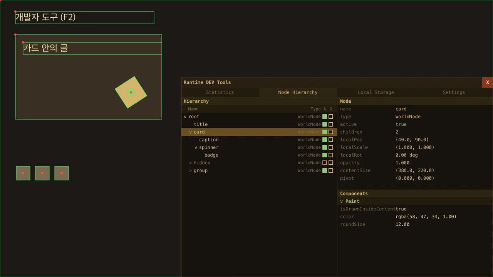
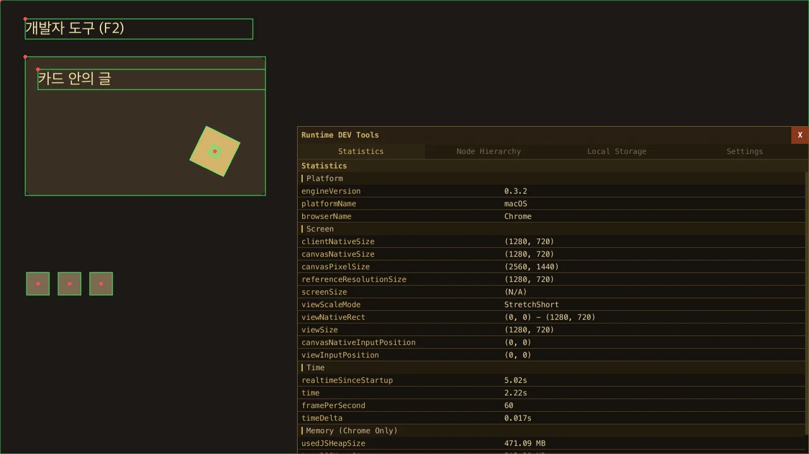

# 개발자 도구

개발하는 동안 화면 위에 정보를 띄우고, 노드를 살펴보고, 기기 성능을 재는 기능을 다룹니다. F2 로 여닫는 개발자 도구 패널(`DevTools`), 엔진 정보창(`use_statistics`), 기즈모, 그리기 통계, 검증용 화면 저장, 처지는 기기를 가리는 `FrameProbe` 와 `GraphicsQualityGovernor`, 배포 판을 읽는 `BuildInfo` 차례로 봅니다.

## F2 개발자 도구 패널

`EngineConfiguration.use_dev_tools` 가 켜져 있으면(처음 값 `true`) `GameSceneBase` 가 초기화할 때 개발자 도구 패널을 만듭니다. `UIScene` 도 `GameSceneBase` 를 품고 있어 같습니다. 게임 화면에서 F2 를 누르면 패널이 창 오른쪽 아래에 붙어 열리고, 다시 누르면 닫힙니다. 패널은 뷰 배율 모드와 상관없이 창 안쪽 논리 좌표(canvas native)로 그려져 늘 같은 크기입니다.





```rust,no_run
use vanilla::{Color, Engine, EngineConfiguration, GameScene, GameSceneBase, Paint, Pivot, Text, TextAlign, Vector2};

struct DebugScene {
	game_scene_base: GameSceneBase,
}

impl GameScene for DebugScene {
	fn get_game_scene_base(&self) -> &GameSceneBase {
		&self.game_scene_base
	}

	fn get_game_scene_base_mut(&mut self) -> &mut GameSceneBase {
		&mut self.game_scene_base
	}

	fn initialize(&mut self, _engine: &Engine) {
		let scene_base = self.game_scene_base.get_scene_base_mut();
		let root_id = scene_base.get_root_id();
		let node_tree = scene_base.get_node_tree_mut();

		let panel_id = node_tree.create_child(root_id, "Panel");
		let panel_node = &mut node_tree[panel_id];
		panel_node.set_pivot(Pivot::TOP_LEFT);
		panel_node.set_local_position(Vector2::create(40.0, 40.0));
		panel_node.set_content_size(Vector2::create(400.0, 200.0));
		let paint = panel_node.add_component(Paint::create_with_color(Color::create(0.15, 0.17, 0.22, 1.0)));
		paint.set_round_size(16.0);

		let title_id = node_tree.create_child(panel_id, "Title");
		let title_node = &mut node_tree[title_id];
		title_node.set_pivot(Pivot::TOP_LEFT);
		title_node.set_local_position(Vector2::create(24.0, 24.0));
		title_node.set_content_size(Vector2::create(352.0, 40.0));
		let text = title_node.add_component(Text::create_with_text("Press F2", 28.0));
		text.set_text_align(TextAlign::Left);
	}
}

vanilla::game_scene!(DebugScene);

fn main() {
	let mut engine_configuration = EngineConfiguration::new();
	engine_configuration.reference_resolution_size = Vector2::create(1280.0, 720.0);
	engine_configuration.auto_resize_on_window_resize = true;
	engine_configuration.use_dev_tools = true;
	let engine = Engine::new(engine_configuration);
	let mut game_scene_base = GameSceneBase::new();
	game_scene_base.set_loading_min_duration_ms(0.0);
	let debug_scene = DebugScene {
		game_scene_base,
	};
	if let Err(error) = engine.run(Box::new(debug_scene)) {
		eprintln!("{}", error);
	}
}
```

패널은 처음 810 x 520 크기(가장 작게 300 x 200)이고 왼쪽 칸 너비는 405 입니다. 제목 줄을 끌어 옮기고, 가장자리와 귀퉁이를 끌어 크기를 바꾸고, 가운데 구분선을 끌어 좌우 비율을 바꿉니다. 제목 줄 오른쪽의 닫기 단추(X)로도 닫습니다. 패널이 열려 있고 포인터가 그 위에 있는 동안에는 `GameSceneBase` 가 터치와 휠을 UI 노드와 놀이 입력으로 넘기지 않습니다. 씬에서 입력을 직접 다룰 때는 `is_dev_tools_capturing_input(engine)` 이 참이면 건너뜁니다. 만든 패널은 `get_dev_tools()`, `get_dev_tools_mut()` 로 꺼냅니다. (`initialize` 전이거나 `use_dev_tools` 가 꺼져 있으면 `None`)

패널에는 탭이 넷 있습니다. 처음 열리는 탭은 Node Hierarchy 입니다.

| 탭 | 보이는 것 |
| --- | --- |
| Statistics | Platform(엔진 판, 플랫폼, 브라우저), Screen(창, 캔버스, 기준 해상도, 뷰 배율 모드, 뷰 영역, 입력 자리), Time(시작 뒤 시간, 엔진 시간, FPS, 프레임 간격), Memory(웹은 크롬의 JS 힙, 데스크탑은 시스템 할당자의 힙) |
| Node Hierarchy | 왼쪽은 루트부터의 노드 트리(이름, 종류, 켜짐 A, 기즈모 G 칸), 오른쪽은 고른 노드의 이름, 종류, 켜짐, 자식 수, 위치, 배율, 회전, 투명도, 내용 크기, 피벗과 붙은 컴포넌트마다 `get`, `is` 로 읽히는 값 |
| Local Storage | `LocalStorage` 의 키와 값 목록. + Add 로 더하고, Clear 로 모두 지우고, 줄의 × 로 하나를 지웁니다. 줄을 고르면 Edit Key, Edit Value, Duplicate, Remove 단추가 나옵니다 |
| Settings | Dim Background, Show All Gizmos, Show Height Aspect Guide, Show Width Aspect Guide, Show FPS 켜고 끄기 |

- 트리의 A 칸을 누르면 그 노드의 켜짐이, G 칸을 누르면 기즈모 표시가 바뀝니다. 인스펙터의 컴포넌트 머리를 누르면 그 컴포넌트의 값 목록을 접고 폅니다.
- 러스트 판의 노드는 `WorldNode` 한 가지라서 종류 칸은 늘 `WorldNode` 입니다.
- 인스펙터의 컴포넌트 값은 원본이 실행 중에 객체를 훑던 자리를 `#[vanilla::reflect]` 매크로가 컴파일 때 지은 목록으로 대신합니다. `Reflect` 가 `Component` 의 상위 트레이트라 매크로를 빠뜨린 컴포넌트는 컴파일되지 않고, 원본처럼 모든 컴포넌트의 값이 보입니다. ("반사 매크로" 장)
- Local Storage 탭의 더하기, 고치기, 지우기는 원본 `prompt`, `confirm` 자리인 `Engine::prompt`, `Engine::confirm` 으로 묻습니다. 웹은 브라우저 창이, 데스크탑은 엔진이 그린 같은 질문 창이 뜹니다. Clear 는 `LocalStorage::clear()` 라서 그 저장소의 값을 모두 지웁니다.
- Settings 의 Dim Background 는 패널 밖의 화면을 어둡게 덮습니다. Show All Gizmos(처음 켜짐)는 패널이 열려 있는 동안 모든 노드의 기즈모를 그립니다. 두 비율 안내선은 뷰 배율 모드가 늘이는 모드(`StretchWidth`, `StretchHeight`, `StretchShort` 와 그 `Expand` 갈래)일 때만 화면 가운데에 사각형을 그립니다. Show FPS 는 원본처럼 값만 저장하고 패널이 그리지 않습니다. (`is_frame_per_second_visible()` 로 읽습니다)
- Settings 의 값은 `LocalStorage` 의 `hierarchy.settings` 키에 원본과 같은 JSON 으로 저장되어 다음에 켤 때도 남습니다.

출시 빌드처럼 사용자에게 보이면 안 되는 곳에서는 `engine_configuration.use_dev_tools = false` 로 끕니다. 끄면 패널을 만들지 않고 F2 도 받지 않습니다.

### Scene 에 직접 붙이기

`Scene` 을 바로 구현한 씬에는 패널이 저절로 생기지 않습니다. 원본과 달리 패널은 씬이 품는 값(`DevTools`)이라서, 씬이 직접 만들고 `tick` 과 `post_draw` 에서 부릅니다. 엔진은 하나라 원본 `setEngine` 이 없고 `tick`, `draw`, `is_pointer_inside_panel` 이 엔진을 받으며, 노드는 `NodeId` 로 가리킵니다.

```rust,no_run
use vanilla::{DevTools, Engine, EngineConfiguration, Graphic, Scene, SceneBase};

struct MainScene {
	scene_base: SceneBase,
	dev_tools: DevTools,
}

impl Scene for MainScene {
	fn get_scene_base(&self) -> &SceneBase {
		&self.scene_base
	}

	fn get_scene_base_mut(&mut self) -> &mut SceneBase {
		&mut self.scene_base
	}

	fn create(&mut self, _engine: &Engine) {
		self.dev_tools.set_root_nodes(vec![self.scene_base.get_root_id()]);
	}

	fn tick(&mut self, engine: &Engine, time_delta: f64) {
		let is_capturing_input = self.dev_tools.is_visible() && self.dev_tools.is_pointer_inside_panel(engine);
		self.scene_base.get_node_tree_mut().tick(engine, time_delta);
		if !is_capturing_input {
			self.scene_base.tick_touch(engine);
		}
		self.scene_base.tick_tweens(time_delta);
		let unscaled_time_delta = engine.get_time_manager().get_unscale_delta_time();
		self.dev_tools.tick(engine, self.scene_base.get_node_tree_mut(), unscaled_time_delta);
	}

	fn pre_draw(&mut self, engine: &Engine, graphic: &mut Graphic) {
		self.scene_base.draw_scene_background(engine, graphic);
	}

	fn post_draw(&mut self, engine: &Engine, graphic: &mut Graphic) {
		self.dev_tools.draw(engine, self.scene_base.get_node_tree(), graphic);
	}
}

fn main() {
	let engine = Engine::new(EngineConfiguration::new());
	let main_scene = MainScene {
		scene_base: SceneBase::new(),
		dev_tools: DevTools::new(),
	};
	if let Err(error) = engine.run(Box::new(main_scene)) {
		eprintln!("{}", error);
	}
}
```

패널은 코드로도 다룹니다. `set_visible(engine, is_visible)` 는 F2 와 같고, `set_active_tab(tab_index)` 는 탭(0 Statistics, 1 Node Hierarchy, 2 Local Storage, 3 Settings)을 고르고, `inspect_node(engine, node_tree, node_id)` 는 패널을 열고 그 노드의 조상을 펼쳐 고릅니다. 지운 노드는 트리와 인스펙터에서 빠지고, 고른 노드가 지워지면 고르지 않은 것으로 돌아갑니다.

```rust
use vanilla::{DevTools, Engine, EngineConfiguration, NodeTree};

let engine = Engine::new(EngineConfiguration::new());
engine.get_view_manager_mut().calculate_view_rect(1280, 720, 1.0);
let mut node_tree = NodeTree::new();
let root_id = node_tree.get_root_id();
let group_id = node_tree.create_child(root_id, "Group");
let hero_id = node_tree.create_child(group_id, "Hero");

let mut dev_tools = DevTools::new();
dev_tools.set_root_nodes(vec![root_id]);
dev_tools.inspect_node(&engine, &node_tree, hero_id);
assert!(dev_tools.is_visible());
assert_eq!(dev_tools.get_active_tab(), 1);
assert_eq!(dev_tools.get_selected_node(), Some(hero_id));
assert!(dev_tools.is_node_expanded(group_id));

dev_tools.set_active_tab(3);
dev_tools.set_visible(&engine, false);
assert_eq!(dev_tools.get_active_tab(), 3);
assert!(!dev_tools.is_visible());
```

## 엔진 정보창

`EngineConfiguration.use_statistics` 를 켜면(처음 값 `false`) 엔진이 매 프레임 모든 씬을 그린 뒤 화면 왼쪽 위에 정보창을 그립니다. 씬 종류와 상관없이 동작하고, 창 안쪽 논리 좌표로 그립니다.

```rust
use vanilla::{Engine, EngineConfiguration, Vector2};

let mut engine_configuration = EngineConfiguration::new();
engine_configuration.reference_resolution_size = Vector2::create(1280.0, 720.0);
engine_configuration.use_statistics = true;
let engine = Engine::new(engine_configuration);
assert!(engine.get_engine_configuration().use_statistics);
```

러스트 판의 정보창은 원본보다 짧습니다. 반투명 검은 띠 위에 `FPS 60  DrawCall 12  Vertex 480  Culled 0` 꼴의 한 줄(FPS, 지난 프레임의 드로우 콜 수, 정점 수, 화면 밖이라 건너뛴 노드 수)을 기본 글꼴 14 픽셀로 씁니다. 엔진 판, 화면 크기, 입력 자리 같은 나머지 값은 개발자 도구 패널의 Statistics 탭에서 봅니다.

## 기즈모

기즈모는 개발 중에만 보는 표시(영역, 기준점, 시야 범위 같은 것)입니다. 씬, 노드, 컴포넌트가 저마다 `set_gizmo_visible(is_gizmo_visible)` 와 `is_gizmo_visible()`, 덮어쓸 수 있는 `draw_gizmos` 를 가집니다. 처음에는 모두 꺼져 있습니다.

- 씬: `scene_base.set_gizmo_visible(true)` 면 엔진이 그 씬의 `pre_draw`, `draw`, `post_draw` 뒤에 `Scene::draw_gizmos(engine, graphic)` 를 부릅니다. 기본 구현은 아무것도 그리지 않으므로 덮어써서 그립니다.
- 노드: `set_gizmo_visible(true)` 면 그 노드를 그릴 때 노드의 좌표계에서 노드의 기즈모를 그립니다. 내용 영역 테두리를 초록색 1 픽셀 선으로, 피벗 자리에 빨간 점(반지름 3)을 그리고, 기즈모가 켜진 컴포넌트의 `draw_gizmos` 를 부릅니다. (원본은 초록 점, 반지름 4 입니다)
- 컴포넌트: `Component::draw_gizmos(transform, graphic)` 는 노드의 기즈모를 그릴 때만 그 안에서 불립니다. 컴포넌트의 기즈모를 보려면 컴포넌트와 노드를 둘 다 켭니다. `transform` 은 그 노드의 `NodeTransform` 입니다.
- `graphic.set_force_gizmos_visible(true)` 는 노드마다의 설정과 상관없이 모든 노드의 기즈모를 그리게 합니다. 개발자 도구 패널의 Show All Gizmos 가 이것을 씁니다.

```rust,no_run
use vanilla::{Color, Component, ComponentBase, Engine, EngineConfiguration, Graphic, NodeTransform, Paint, Scene, SceneBase, Vector2};

struct SightGizmo {
	component_base: ComponentBase,
	radius: f64,
}

#[vanilla::reflect]
impl SightGizmo {}

#[vanilla::reflect]
impl Component for SightGizmo {
	fn get_component_base(&self) -> &ComponentBase {
		&self.component_base
	}

	fn get_component_base_mut(&mut self) -> &mut ComponentBase {
		&mut self.component_base
	}

	fn get_component_type(&self) -> &'static str {
		"SightGizmo"
	}

	fn draw_gizmos(&mut self, transform: &NodeTransform, graphic: &mut Graphic) {
		let content_size = transform.get_content_size();
		let center = Vector2::create(content_size.x * 0.5, content_size.y * 0.5);
		graphic.set_stroke_color("#ffcc00");
		graphic.draw_stroke_circle(center, self.radius, 2.0);
	}
}

struct GizmoScene {
	scene_base: SceneBase,
}

impl Scene for GizmoScene {
	fn get_scene_base(&self) -> &SceneBase {
		&self.scene_base
	}

	fn get_scene_base_mut(&mut self) -> &mut SceneBase {
		&mut self.scene_base
	}

	fn initialize(&mut self, _engine: &Engine) {
		let root_id = self.scene_base.get_root_id();
		let node_tree = self.scene_base.get_node_tree_mut();
		let enemy_id = node_tree.create_child(root_id, "Enemy");
		let enemy_node = &mut node_tree[enemy_id];
		enemy_node.set_content_size(Vector2::create(80.0, 80.0));
		enemy_node.set_local_position(Vector2::create(640.0, 360.0));
		enemy_node.add_component(Paint::create_with_color(Color::create(0.8, 0.3, 0.3, 1.0)));
		let sight_gizmo = enemy_node.add_component(SightGizmo {
			component_base: ComponentBase::new(),
			radius: 120.0,
		});
		sight_gizmo.set_gizmo_visible(true);
		enemy_node.set_gizmo_visible(true);
		self.scene_base.set_gizmo_visible(true);
	}

	fn pre_draw(&mut self, engine: &Engine, graphic: &mut Graphic) {
		self.scene_base.draw_scene_background(engine, graphic);
	}

	fn draw_gizmos(&mut self, engine: &Engine, graphic: &mut Graphic) {
		let view_manager = engine.get_view_manager();
		view_manager.apply_view_rect(graphic);
		let view_size = view_manager.get_view_size();
		graphic.set_stroke_color("#00ffff");
		graphic.draw_line(&[Vector2::create(view_size.x * 0.5, 0.0), Vector2::create(view_size.x * 0.5, view_size.y)], 1.0);
		graphic.draw_line(&[Vector2::create(0.0, view_size.y * 0.5), Vector2::create(view_size.x, view_size.y * 0.5)], 1.0);
	}
}

fn main() {
	let mut engine_configuration = EngineConfiguration::new();
	engine_configuration.reference_resolution_size = Vector2::create(1280.0, 720.0);
	let engine = Engine::new(engine_configuration);
	let gizmo_scene = GizmoScene {
		scene_base: SceneBase::new(),
	};
	if let Err(error) = engine.run(Box::new(gizmo_scene)) {
		eprintln!("{}", error);
	}
}
```

씬의 `draw_gizmos` 가 불릴 때의 좌표계는 그 앞에서 그린 것이 남긴 그대로입니다. 뷰 좌표로 그리려면 위 예제처럼 `view_manager.apply_view_rect(graphic)` 를 먼저 부릅니다. 노드와 컴포넌트의 기즈모는 노드의 좌표계(내용 영역의 왼쪽 위가 0, 0)에서 그립니다.

## 그리기 통계 읽기

정보창에 나오는 값은 코드에서도 읽습니다. 엔진은 씬을 그리기 전에 지난 프레임의 값을 넘겨 두고 이번 프레임을 새로 셉니다. 러스트 판의 `Graphic` 은 그리기 함수(`pre_draw`, `draw`, `post_draw`)에서만 받으므로 그리기 통계는 그곳에서 읽습니다.

- `graphic.get_last_frame_draw_call_count()`, `get_last_frame_vertex_count()`, `get_last_frame_triangle_count()`: 지난 프레임의 드로우 콜, 정점, 삼각형 수. 2D 경로만 세고 3D 렌더러와 화면 효과 패스는 세지 않습니다.
- `graphic.get_last_frame_culled_node_count()`: 지난 프레임에 화면 밖이라 컴포넌트를 건너뛴 노드 수.
- `time_manager.get_frame_per_second()`: 지난 1 초 동안 센 프레임 수(처음 1 초 동안은 0).

```rust,no_run
use vanilla::{Color, Engine, EngineConfiguration, Graphic, Paint, Scene, SceneBase, Vector2};

struct ProfileScene {
	scene_base: SceneBase,
	elapsed_seconds: f64,
}

impl Scene for ProfileScene {
	fn get_scene_base(&self) -> &SceneBase {
		&self.scene_base
	}

	fn get_scene_base_mut(&mut self) -> &mut SceneBase {
		&mut self.scene_base
	}

	fn initialize(&mut self, _engine: &Engine) {
		let root_id = self.scene_base.get_root_id();
		let node_tree = self.scene_base.get_node_tree_mut();
		for index in 0..100 {
			let box_id = node_tree.create_child(root_id, "Box");
			let box_node = &mut node_tree[box_id];
			box_node.set_content_size(Vector2::create(20.0, 20.0));
			box_node.set_local_position(Vector2::create((index % 10) as f64 * 120.0 + 60.0, (index / 10) as f64 * 70.0 + 40.0));
			box_node.add_component(Paint::create_with_color(Color::create(0.9, 0.6, 0.2, 1.0)));
		}
	}

	fn tick(&mut self, engine: &Engine, time_delta: f64) {
		self.scene_base.tick(engine, time_delta);
		self.elapsed_seconds += time_delta;
	}

	fn pre_draw(&mut self, engine: &Engine, graphic: &mut Graphic) {
		self.scene_base.draw_scene_background(engine, graphic);
	}

	fn post_draw(&mut self, engine: &Engine, graphic: &mut Graphic) {
		if self.elapsed_seconds < 0.5 {
			return;
		}
		self.elapsed_seconds = 0.0;
		let frame_per_second = engine.get_time_manager().get_frame_per_second();
		let draw_call_count = graphic.get_last_frame_draw_call_count();
		let triangle_count = graphic.get_last_frame_triangle_count();
		let culled_node_count = graphic.get_last_frame_culled_node_count();
		println!("{} {} {} {}", frame_per_second, draw_call_count, triangle_count, culled_node_count);
	}
}

fn main() {
	let mut engine_configuration = EngineConfiguration::new();
	engine_configuration.reference_resolution_size = Vector2::create(1280.0, 720.0);
	let engine = Engine::new(engine_configuration);
	let profile_scene = ProfileScene {
		scene_base: SceneBase::new(),
		elapsed_seconds: 0.0,
	};
	if let Err(error) = engine.run(Box::new(profile_scene)) {
		eprintln!("{}", error);
	}
}
```

## 검증용 화면 저장

`engine.request_frame_capture(frame_number, capture_handler)` 는 그 프레임을 다 그린 뒤 화면을 PNG 바이트로 `capture_handler` 에 넘깁니다. (원본은 PNG data URL 을 Promise 로 넘깁니다) 이미 지난 번호면 이번(프레임 사이에 부르면 다음) 프레임을 저장합니다. 프레임 번호는 첫 프레임이 1 이고 프레임을 마칠 때마다 1 씩 늘어납니다. (`get_frame_number()`) 엔진 작업 안에서 await 하려면 `request_frame_capture_async(frame_number)` 가 돌려준 `Promise<Vec<u8>>` 를 씁니다.

```rust,no_run
use vanilla::{Color, Engine, EngineConfiguration, Graphic, Paint, Scene, SceneBase, Vector2};

struct CaptureScene {
	scene_base: SceneBase,
}

impl Scene for CaptureScene {
	fn get_scene_base(&self) -> &SceneBase {
		&self.scene_base
	}

	fn get_scene_base_mut(&mut self) -> &mut SceneBase {
		&mut self.scene_base
	}

	fn initialize(&mut self, engine: &Engine) {
		let root_id = self.scene_base.get_root_id();
		let node_tree = self.scene_base.get_node_tree_mut();
		let box_id = node_tree.create_child(root_id, "Box");
		let box_node = &mut node_tree[box_id];
		box_node.set_content_size(Vector2::create(200.0, 200.0));
		box_node.set_local_position(Vector2::create(640.0, 360.0));
		box_node.add_component(Paint::create_with_color(Color::create(0.4, 0.8, 0.5, 1.0)));

		engine.request_frame_capture(30, Box::new(|png_bytes: &[u8]| {
			std::fs::write("capture_30.png", png_bytes).unwrap();
		}));
	}

	fn pre_draw(&mut self, engine: &Engine, graphic: &mut Graphic) {
		self.scene_base.draw_scene_background(engine, graphic);
	}
}

fn main() {
	let mut engine_configuration = EngineConfiguration::new();
	engine_configuration.reference_resolution_size = Vector2::create(1280.0, 720.0);
	let engine = Engine::new(engine_configuration);
	let capture_scene = CaptureScene {
		scene_base: SceneBase::new(),
	};
	if let Err(error) = engine.run(Box::new(capture_scene)) {
		eprintln!("{}", error);
	}
}
```

코드를 고치지 않고도 겁니다. 데스크탑은 환경 변수로, 웹은 원본처럼 페이지 주소의 쿼리로 겁니다. 엔진을 만들 때 읽습니다.

```bash
VANILLA_CAPTURE_PATH=shots/shot_{frame}.png VANILLA_CAPTURE_FRAMES=120,240 VANILLA_CAPTURE_EXIT=1 cargo run --example quickstart
```

```text
index.html?capture=120,240&captureName=shot_{frame}.png&captureExit=1
```

| 데스크탑 | 웹 | 뜻 |
| --- | --- | --- |
| `VANILLA_CAPTURE_PATH` | `captureName` | 저장할 파일 경로(웹은 내려받을 파일 이름). `{frame}` 은 프레임 번호로 바뀝니다. 데스크탑은 이 변수가 있어야 저장하고, 웹의 처음 값은 `capture_{frame}.png` 입니다 |
| `VANILLA_CAPTURE_FRAMES` | `capture` | 저장할 프레임 번호들(쉼표로 나눔). 맞는 번호가 하나도 없으면 120 입니다 |
| `VANILLA_CAPTURE_EXIT=1` | `captureExit=1` | 마지막 저장 뒤 끝냅니다. (웹은 원본처럼 창 닫기를 시도합니다) |
| `VANILLA_CAPTURE_SHOW_WINDOW=1` | 없음 | 저장하는 동안 창을 보입니다. 데스크탑은 저장 모드에서 창을 숨기고 돕니다 |

헤드리스로 화면을 비교하는 검증에 씁니다. 창을 숨긴 저장 모드는 화면에 아무것도 띄우지 않고 돌아 끝납니다.

## 처지는 기기 가리기

`FrameProbe` 는 켜진 뒤 처음 몇 초의 프레임 간격을 재어 처지는 기기인지 정합니다. 엔진을 들여오지 않는 계산기라서 프레임 간격과 최대 FPS 는 부르는 쪽이 넘깁니다.

- 재기 시작한 뒤 기다리는 초(처음 2)가 지나면, 재는 초(처음 4) 동안 매 프레임의 간격을 봅니다. 처음 몇 초는 모형과 그림을 받느라 끊기기 때문입니다. `set_seconds(warmup_seconds, probe_seconds)` 로 바꿉니다.
- 목표 간격은 최대 FPS 의 한 칸(최대 FPS 가 0 이하면 `set_unlimited_target_frame_per_second` 의 값, 처음 60)입니다. 목표 간격의 1.4 배를 넘긴 프레임을 처진 프레임으로 세고, 처진 프레임이 0.25 몫 이상이면 처지는 기기입니다. `set_slow_frame_threshold(slow_frame_ratio, slow_frame_share)` 로 바꿉니다. (1.4 배로 보는 까닭: 90 Hz 화면에서 최대 60 이면 엔진이 한 장 걸러 그려 늘 약 22 ms 간격이고, 그것은 처지는 것이 아닙니다)
- `measure_frame(frame_seconds, maximum_frame_per_second)` 를 매 프레임 부르면 다 재는 프레임에 `true` 를 돌려줍니다. 그 뒤 `is_finished()`, `is_slow()` 를 읽습니다. `read_slow_frame_share()` 는 지금까지의 처진 프레임 몫입니다. 0 이하이거나 NaN 인 간격은 무시합니다.
- 처지는 기기로 정하면 다시 재지 않습니다. 다 재기 전에 창이 가려지면 `restart()` 로 처음부터 다시 잽니다. 처지지 않았으면 무거운 장면에서 `measure_again()` 으로 한 번 더 잴 수 있습니다.

```rust
use vanilla::FrameProbe;

let mut frame_probe = FrameProbe::new();
frame_probe.set_seconds(0.5, 1.0);
let mut frame_index = 0;
let mut is_done = false;
while !is_done {
	let frame_seconds = if frame_index % 3 == 0 {
		1.0 / 20.0
	}
	else {
		1.0 / 60.0
	};
	is_done = frame_probe.measure_frame(frame_seconds, 60.0);
	frame_index += 1;
}
assert!(frame_probe.is_finished());
assert!(frame_probe.is_slow());
assert!(frame_probe.read_slow_frame_share() >= 0.25);
```

씬에서는 `tick` 에서 `engine.get_time_manager().get_unscale_delta_time()` 과 `engine.get_maximum_frame_per_second()` 를 넘깁니다.

## 그래픽 품질 정하기

`GraphicsQualityGovernor` 는 설정과 `FrameProbe` 로 가벼운 길(`is_lite()`)을 쓸지 정하고, 길마다 렌더 배율 상한을 겁니다. 가벼운 길에서 무엇을 줄일지(그림자, 바깥선, 효과, 그리는 수)는 게임이 `is_lite()` 를 읽어 정합니다.

- 가벼운 길을 정하는 차례: 덮어쓰기(`set_lite_override`, `apply_search_text`, `apply_page_query`) → 품질 설정(`set_quality`, `GraphicsQuality::Low` 는 늘 가벼움, `High` 는 늘 아님) → 자동(`GraphicsQuality::Auto`, 처음 값). 자동이면 `set_auto_lite_default(true)`(손가락 기기처럼 재기 전부터 가볍게 갈 때)이거나 `FrameProbe` 가 처지는 기기로 잰 때 가벼운 길입니다.
- `apply_search_text(search_text, lite_key)` 는 쿼리 글에 `lite_key` 가 있으면 가벼운 길로, 값이 `"0"` 이나 `"false"` 면 늘 보통 길로 덮어씁니다. 원본 `URLSearchParams` 처럼 읽습니다. 러스트에는 기본 인자가 없어 `lite_key`(원본 처음 값 `"light"`)를 늘 넘깁니다.
- `apply_page_query(lite_key)` 는 웹에서 페이지 주소의 쿼리를 읽습니다. 데스크탑은 주소가 없어 환경 변수 `VANILLA_` 뒤에 그 이름을 대문자 뱀꼴로 붙인 것(`light` 면 `VANILLA_LIGHT`)을 읽습니다.
- `update(frame_seconds, maximum_frame_per_second)` 를 매 프레임 부르면 자동일 때만 프레임을 재고, 가벼운 길이 바뀐 프레임에 `true` 를 돌려줍니다.
- `set_render_pixel_ratio_limits(normal, lite)` 로 길마다 렌더 배율 상한(0 이면 제한 없음)을 주고, `apply_render_pixel_ratio(view_manager)` 가 `ViewManager::set_max_render_pixel_ratio` 로 겁니다. 값이 같으면 다시 걸지 않고 `false` 를 돌려줍니다.
- `get_frame_probe_mut()` 로 안의 `FrameProbe` 를 꺼내 기다리는 초나 판정 문턱을 바꿉니다.

```rust
use vanilla::{GraphicsQuality, GraphicsQualityGovernor, Vector2, ViewManager, ViewScaleMode};

let mut governor = GraphicsQualityGovernor::new();
governor.set_quality(GraphicsQuality::Auto);
governor.apply_search_text("?light=0", "light");
assert_eq!(governor.get_lite_override(), Some(false));
governor.set_lite_override(None);

governor.set_render_pixel_ratio_limits(0.0, 1.5);
governor.get_frame_probe_mut().set_seconds(0.0, 1.0);
let mut changed_count = 0;
for _ in 0..40 {
	if governor.update(0.05, 60.0) {
		changed_count += 1;
	}
}
assert!(governor.is_lite());
assert_eq!(changed_count, 1);

let mut view_manager = ViewManager::new(Vector2::create(1280.0, 720.0), ViewScaleMode::StretchShort);
assert!(governor.apply_render_pixel_ratio(&mut view_manager));
assert_eq!(view_manager.get_max_render_pixel_ratio(), 1.5);
assert!(!governor.apply_render_pixel_ratio(&mut view_manager));
```

씬에서는 `initialize` 에서 `apply_render_pixel_ratio(&mut engine.get_view_manager_mut())` 를 한 번 부르고, `tick` 에서 `update` 가 `true` 를 돌려준 프레임에 다시 부릅니다.

## 빌드 정보

`BuildInfo` 는 배포 빌드가 적어 둔 판을 앱이 켜질 때 한 번 읽어, 설정 화면 구석 같은 곳에 보이게 합니다. `load(engine)` 는 이 차례로 읽고, 실패해도 오류를 내지 않습니다.

1. 문서 머리의 `build-version` meta 의 `content`. 있으면 앞뒤 빈칸을 뗀 그 글입니다. 웹은 원본처럼 페이지의 `<meta>` 이고, 데스크탑은 엔진이 든 문서의 meta 라서 배포 빌드가 `EngineConfiguration.document_meta_list` 에 넣습니다. 이름은 `set_meta_name` 으로 바꿉니다.
2. 없으면 `version.json`(처음 경로 `"version.json"`, `set_version_json_path` 로 바꿈, 빈 글이면 받지 않음)을 읽습니다. 웹은 페이지 기준 주소를 캐시 없이(`cache: "no-cache"`) 받아 새 판을 올려도 옛 판 표시가 남지 않게 하고, 데스크탑은 애셋 폴더에서 그 자리에서 읽습니다.
3. 다 없으면 `set_package_version` 으로 넣은 판(보통 `env!("CARGO_PKG_VERSION")`), 그것도 없으면 빈 글입니다.

```text
<meta name="build-version" content="2026-11-26 07:30 (a1b2c3d)">
```

```json
{ "version": "1.2.0", "date": "2026-11-26", "time": "07:30", "hash": "a1b2c3d" }
```

`version.json` 에서 읽으면 글은 `"날짜 시각 (해시)"` 꼴이고, 해시가 없으면 `version`, 그것도 없으면 빈 글입니다. (`BuildInfo::compose_text`) 게임마다 판을 쓰는 꼴이 다르면 `read_version_data()` 로 받은 값을 게임이 엮습니다.

```rust
use vanilla::{BuildInfo, Engine, EngineConfiguration};

let mut engine_configuration = EngineConfiguration::new();
engine_configuration.document_meta_list = vec![(String::from("build-version"), String::from("2026-11-26 07:30 (a1b2c3d)"))];
let engine = Engine::new(engine_configuration);

let mut build_info = BuildInfo::new();
build_info.set_package_version("0.4.0-dev");
build_info.load(&engine);
assert!(build_info.is_loaded());
assert_eq!(build_info.read_text(), "2026-11-26 07:30 (a1b2c3d)");
assert!(build_info.read_version_data().is_none());

let composed_text = BuildInfo::compose_text(&serde_json::json!({ "version": "1.2.0", "date": "2026-11-26", "time": "07:30", "hash": "a1b2c3d" }));
assert_eq!(composed_text, "2026-11-26 07:30 (a1b2c3d)");
```

- 원본의 `await load()` 자리는 `load(engine)` 가 돌려준 `BuildInfoLoadHandle` 을 엔진 작업 안에서 await 하는 것입니다. (`wait_for_load().await` 도 같습니다) meta 로 읽었으면 바로 끝납니다.
- await 없이는 `is_loaded()` 로 마쳤는지(실패해도 마친 것) 보고, 씬이 기다리게 하려면 `get_load_handle()` 의 손잡이를 `track_load_handle` 로 맡깁니다.
- `read_text()` 는 읽은 글(meta, version.json, 넣은 판 차례)을, `read_version_data()` 는 `version.json` 에서 읽은 객체(meta 로 읽었거나 읽지 못했으면 `None`)를 돌려줍니다. 원본 생성자의 경로 인자는 `new()` 와 `set_version_json_path` 로 나눴습니다.

## 주의할 점

- 개발자 도구 패널은 `GameSceneBase` 를 품은 씬(`GameScene`, `UIScene`)이 만듭니다. `Scene` 을 바로 구현한 씬은 `DevTools` 를 직접 품고 `tick` 과 `post_draw` 에서 부릅니다.
- 출시 빌드에서는 `use_dev_tools` 를 끄고 `use_statistics` 를 켜지 않습니다.
- 패널의 Local Storage 탭에서 Clear 를 누르면 그 저장소의 값이 모두 지워집니다.
- 게임 컴포넌트의 값을 인스펙터에서 보려면 `#[vanilla::reflect]` 를 붙입니다.
- 컴포넌트의 기즈모는 노드의 기즈모가 그려질 때만 그려집니다.
- 그리기 통계는 2D 경로만 셉니다. 3D 패스의 드로우 콜은 들어가지 않습니다. `Graphic` 은 그리기 함수에서만 받으므로 통계도 그곳에서 읽습니다.
- `FrameProbe` 는 한 번 처지는 기기로 정하면 다시 재지 않습니다.

## 관련 타입

DevTools, EngineConfiguration, Engine, GameScene, GameSceneBase, UIScene, UISceneBase, Scene, SceneBase, Component, WorldNode, NodeTransform, Graphic, TimeManager, ViewManager, LocalStorage, FrameProbe, GraphicsQualityGovernor, GraphicsQuality, BuildInfo, BuildInfoLoadHandle
