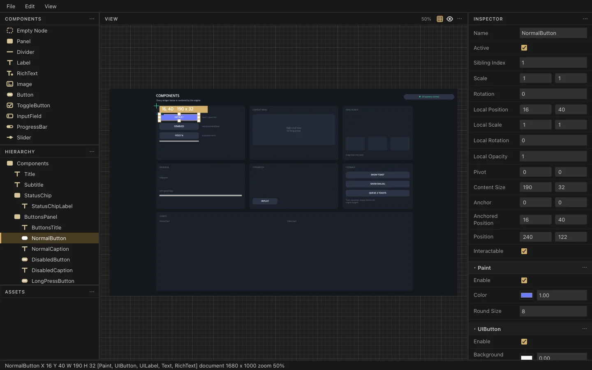
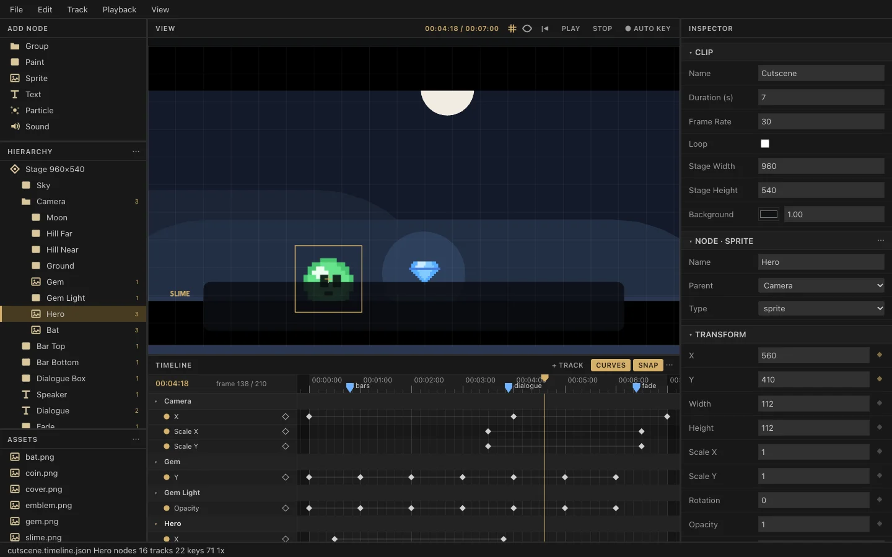
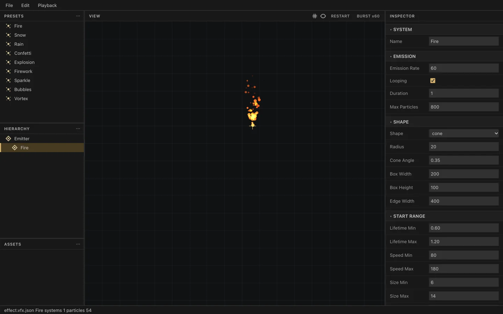
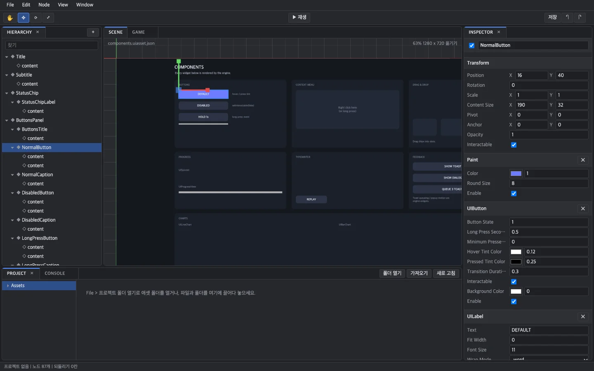

# 저작 도구와 두 엔진이 같이 쓰는 파일

원본 vanilla.js 와 함께 오는 저작 도구가 만드는 파일을 러스트 판에서 불러 쓰는 방법을 다룹니다. 러스트 판에는 따로 편집기가 없고, vanilla.js 의 편집기와 명령줄 도구가 저장하는 파일을 원본과 같은 꼴로 읽습니다. UI Editor 의 `.uiasset.json`, Timeline Editor 의 `.timeline.json`, Particle Editor 의 `.vfx.json`, Visual Editor 의 `.scene.json` 과 `.prefab.json` 차례로 보고, 끝에 스프라이트 아틀라스, 언어 파일, 글꼴 목록, 저장 값처럼 두 엔진이 같이 쓰는 다른 파일을 정리합니다. 도구 목록과 여는 곳은 "도구" 장에 있습니다.

## 도구와 파일

| 도구 | 데모 | 만드는 파일 | 러스트 판에서 읽는 곳 |
| --- | --- | --- | --- |
| UI Editor | [열기](https://vanillapunch.com/tools/editor/uieditor/) | `.uiasset.json` (처음 이름 `ui.uiasset.json`) | `UIDocument::from_json_text` |
| Timeline Editor | [열기](https://vanillapunch.com/tools/editor/timelineeditor/) | `.timeline.json` (처음 이름 `titlecard.timeline.json`) | `Timeline::load_from_text`, `load_from_url`, `create_from_json_asset` |
| Particle Editor | [열기](https://vanillapunch.com/tools/editor/particleeditor/) | `.vfx.json` (처음 이름 `effect.vfx.json`) | `ParticleSystem::apply_description` |
| Visual Editor | [열기](https://vanillapunch.com/tools/editor/visualeditor/) | `scenes/*.scene.json`, `prefabs/*.prefab.json` | `UIDocument::from_json_text` |

- 편집기는 [vanilla.js 저장소](https://github.com/ddukbaek2/vanilla.js)의 `tools/<도구 이름>/<도구 이름>.html` 이고, 엔진까지 한 파일에 담은 빌드라서 서버 없이 파일로 열어도 동작합니다.
- UI Editor, Timeline Editor, Particle Editor 는 저장하면 브라우저 내려받기로 파일을 받습니다. Visual Editor 는 크롬 계열 브라우저에서 폴더 열기로 연 폴더에 바로 쓰고, 그 밖의 브라우저에서는 내려받기로 받습니다.
- 받은 파일은 게임의 애셋 폴더(데스크탑은 `EngineConfiguration.asset_directory_paths`, 웹은 `asset_base_url` 기준)에 두고 아래처럼 불러옵니다.

## UI Editor 문서 불러오기

`.uiasset.json` 은 노드 트리를 그대로 적은 UI 문서입니다. 판 번호와 뿌리 노드 하나로 되어 있고, 노드마다 종류, 이름, 켜짐, 위치, 배율, 회전, 투명도, 피벗, 앵커, 내용 크기, 터치 받기, 컴포넌트, 자식을 적습니다.



```json
{
	"version": 1,
	"root": {
		"type": "WorldNode",
		"name": "Root",
		"position": [0, 0],
		"contentSize": [960, 640],
		"components": [],
		"children": [
			{
				"type": "WorldNode",
				"name": "StartButton",
				"position": [40, 300],
				"contentSize": [240, 64],
				"components": [
					{ "type": "Paint", "color": [0.25, 0.5, 0.9, 1], "roundSize": 12 },
					{ "type": "UIButton" },
					{ "type": "UILabel", "text": "Start", "fontSize": 24 }
				],
				"children": []
			}
		]
	}
}
```

원본의 `UIDocument` 는 정적 클래스와 모듈 전역 표입니다. 러스트 판은 종류 표를 든 `UIDocument` 값을 만들어 씁니다. `UIDocument::new()` 는 엔진 컴포넌트를 등록해 둡니다. `from_json_text(node_tree, json_text)` 는 문서 글을 노드 트리에 지어 어느 부모에도 붙지 않은 뿌리의 `NodeId` 를 돌려줍니다. JSON 이 아니거나 `root` 객체가 없으면 `Err` 입니다. 씬에 보이려면 `add_child` 로 씬의 루트에 붙이고, 이름으로 노드를 찾아 동작을 붙입니다. `UIDocument::find_node_by_path(node_tree, root_id, path_text)` 는 문서 뿌리부터 이름을 `/` 로 이은 경로(뿌리 이름은 빼고 `/` 로 시작)로 노드를 찾고, 없으면 `None` 입니다.

```rust
use vanilla::{NodeTree, Paint, UIButton, UIDocument, UILabel};

let json_text = r#"{
	"version": 1,
	"root": {
		"type": "WorldNode",
		"name": "Root",
		"contentSize": [960, 640],
		"components": [],
		"children": [
			{
				"type": "WorldNode",
				"name": "StartButton",
				"position": [40, 300],
				"contentSize": [240, 64],
				"components": [
					{ "type": "Paint", "color": [0.25, 0.5, 0.9, 1], "roundSize": 12 },
					{ "type": "UIButton" },
					{ "type": "UILabel", "text": "Start", "fontSize": 24 }
				],
				"children": []
			}
		]
	}
}"#;

let mut node_tree = NodeTree::new();
let mut document = UIDocument::new();
let document_root_id = document.from_json_text(&mut node_tree, json_text).unwrap();
let root_id = node_tree.get_root_id();
node_tree.add_child(root_id, document_root_id);

let start_button_id = UIDocument::find_node_by_path(&node_tree, document_root_id, "/StartButton").unwrap();
let start_button_node = &node_tree[start_button_id];
assert!(start_button_node.get_component::<Paint>().is_some());
assert!(start_button_node.get_component::<UIButton>().is_some());
assert_eq!(start_button_node.get_component::<UILabel>().unwrap().get_text(), "Start");
assert!(UIDocument::find_node_by_path(&node_tree, document_root_id, "/Missing").is_none());
```

- 스크롤 뷰처럼 content 노드를 만드는 위젯은 붙을 때 안쪽 content 노드를 스스로 만듭니다. 그래서 문서에는 위젯만 적고, content 안에 넣은 자식(목록 항목 등)은 `contentChildren` 으로 따로 적었다가 되살릴 때 content 아래에 붙입니다. content 노드의 이름은 `content` 이므로 경로에 넣어 찾습니다. (예: `/Panel/ItemList/content/Item0`)
- 다른 노드를 가리키는 값(노드 참조)은 문서에 `$nodeRef` 와 뿌리 기준 경로로 적혀 있고, 트리를 다 지은 뒤 이어 붙입니다.
- 읽을 때 노드에 이미 있는 컴포넌트와 자식(노드 종류나 위젯이 붙을 때 지은 것)은 차례와 종류가 맞으면 그것에 문서 값을 넣고 다시 짓지 않습니다. 원본처럼 겹쳐 붙지 않습니다.
- 에디터가 얹는 `frameSize` 같은 모르는 키는 건너뜁니다.

### 그림 경로 해석

문서에는 그림 원본이 아니라 경로(`imagePath`)만 적힙니다. `Sprite`, `UIImageView`, `ShadowImage` 가 이 칸을 씁니다. 그림을 잇는 길은 둘입니다.

- 애셋 폴더에서 읽기: `from_json_text` 앞에 `load_images(engine, json_text)` 를 부르면 문서의 `imagePath` 마다 `ImageAsset` 을 요청해 문서 안에 들고, 새로 요청한 읽기 손잡이 목록을 돌려줍니다. 씬이 `create` 에서 부르면 손잡이를 `track_load_handle` 로 맡겨 `initialize` 를 기다리게 할 수 있습니다. 데스크탑은 그 자리에서 읽히고, 웹처럼 나중에 읽히면 아직 읽히지 않은 그림은 문서가 맡아 두었다가 `bind_pending_images(node_tree)` 가 붙입니다. 남은 수가 0 이 될 때까지 씬의 `tick` 에서 부릅니다.
- 해석기: `set_image_resolver(resolver)` 로 경로 → `Option<Rc<Image>>` 함수를 걸면 애셋 창고 대신 그것으로 찾습니다. 바로 돌려줘야 하므로 그림은 먼저 받아 둡니다.

찾지 못한 그림은 경고를 찍고 버리고, 그 컴포넌트는 원본처럼 그림 없이 남습니다.

```rust
use std::rc::Rc;
use vanilla::{Image, NodeTree, Sprite, UIDocument};

let star_image = Image::create_from_pixels(1, 1, vec![255, 255, 255, 255]);
let resolved_image = star_image.clone();
let mut document = UIDocument::new();
document.set_image_resolver(move |image_path: &str| {
	if image_path == "images/star.png" {
		Some(resolved_image.clone())
	}
	else {
		None
	}
});

let json_text = r#"{"version":1,"root":{"name":"Star","components":[{"type":"Sprite","imagePath":"images/star.png"}]}}"#;
let mut node_tree = NodeTree::new();
let star_id = document.from_json_text(&mut node_tree, json_text).unwrap();
let sprite = node_tree[star_id].get_component::<Sprite>().unwrap();
assert!(sprite.get_image().is_some_and(|image| Rc::ptr_eq(image, &star_image)));
```

### 컴포넌트와 노드 종류 등록

`UIDocument::new()` 가 처음부터 아는 컴포넌트는 원본 표의 `Paint`, `Sprite`, `Text`, `RichText`, `Mask`, `Outline`, `SoftShade`, `ShadowText`, `UIProgressRing`, `UILabel`, `UIImageView`, `UIButton`, `UIToggleButton`, `UIProgressView`, `UISlider`, `UIScrollView` 와 러스트 판이 더한 `ShadowImage` 입니다. (`get_component_type_names()`) 노드 종류는 없습니다. UI Editor 는 엔진이 내보내는 모든 컴포넌트와 `WorldNode` 파생 노드를 문서 꼴에 등록해 씁니다. 그래서 편집기에서 쓴 종류가 게임 쪽 표에 없으면, 그 컴포넌트는 읽을 때 경고를 찍고 빠지고 그 노드는 그냥 노드로 되살아납니다.

러스트 판은 `register_editor_types()` 한 줄로 편집기와 같은 종류(컴포넌트 35, 노드 종류 12)를 등록합니다. 편집기가 저장한 문서를 읽는 게임은 이것을 한 번 부릅니다. 종류마다 등록할 수도 있습니다.

- 원본 노드 종류(`WorldNode` 를 이어받은 클래스, `registerNodeType`)는 러스트 판에서 노드에 붙는 컴포넌트입니다. `register_node_type(type_name, create_component)` 로 등록하면 원본 문서와 같은 꼴로 쓰고 읽습니다. 그 컴포넌트가 붙은 노드의 `type` 이 그 이름이고, 컴포넌트 목록에는 적지 않습니다. (`UIInputField`, `UIScrollBar`, `UIWindow` 같은 것)
- 컴포넌트는 `register_component_type(type_name, create_component)` 로 등록합니다. 쓰기, 읽기 함수가 따로 있는 종류는 `register_component_type_with_handler`, content 노드를 만드는 위젯은 `register_widget_type` 으로 등록합니다.
- 전용 저장 규칙이 없는 컴포넌트는 짝이 맞는 게터와 세터로 읽고 쓰는 값으로 저장되고 되살아납니다. (`save_by_reflection`, `load_by_reflection`) 원본은 실행 중에 객체를 훑고, 러스트 판은 `#[vanilla::reflect]` 매크로가 컴파일 때 지은 목록을 씁니다. 엔진 컴포넌트는 모두 붙어 있고, 게임 컴포넌트를 문서로 다루려면 매크로를 붙입니다. ("반사 매크로" 장)

```rust
use vanilla::{NodeTree, UIDocument, UIInputField};

let mut document = UIDocument::new();
assert!(!document.get_component_type_names().contains(&"UISnapScrollView"));
document.register_editor_types();
let component_type_names = document.get_component_type_names();
assert!(component_type_names.contains(&"UISnapScrollView"));
assert!(component_type_names.contains(&"ParticleSystem"));

let json_text = r#"{"version":1,"root":{"type":"UIInputField","name":"NameField","contentSize":[320,48]}}"#;
let mut node_tree = NodeTree::new();
let field_id = document.from_json_text(&mut node_tree, json_text).unwrap();
assert!(node_tree[field_id].get_component::<UIInputField>().is_some());
```

### 게임에서 문서 저장하기

`to_json_text(node_tree, root_id, is_pretty)` 는 노드 트리를 같은 꼴의 글로 바꿉니다. 키 차례와 들여쓰기(탭)는 원본 `JSON.stringify` 와 같고, 수는 `f32` 를 가장 짧은 십진으로 적습니다. 등록한 종류는 등록한 이름으로 적고, 등록하지 않은 컴포넌트는 원본처럼 게터와 세터로 적되 `#[vanilla::reflect]` 가 없으면 적을 수 없어 경고를 찍고 뺍니다. 원본처럼 번들러가 클래스 이름을 바꿀 걱정은 없습니다. `&mut self` 게터가 있는 컴포넌트를 적을 때는 `to_json_text_mut` 를 씁니다.

## Timeline Editor 문서 재생하기

`.timeline.json` 은 무대 노드 목록, 트랙(대상 이름, 속성, 키), 마커로 이루어진 문서입니다. 맨 위에 `name`, `duration`(초), `frameRate`, `loop`, `stage`(`width`, `height`, `backgroundColor`, `nodes`), `tracks`, `markers` 가 있습니다.



```rust
use std::cell::RefCell;
use std::rc::Rc;
use vanilla::{NodeTree, Timeline, TimelineMarker};

let timeline_text = r##"{
	"name": "Logo",
	"duration": 1,
	"frameRate": 30,
	"loop": false,
	"stage": { "width": 960, "height": 540, "backgroundColor": "#101114ff", "nodes": [
		{ "name": "Emblem", "type": "paint", "width": 120, "height": 120, "color": "#ffcc33ff" }
	] },
	"tracks": [
		{ "target": "Emblem", "property": "x", "keys": [{ "time": 0, "value": 0 }, { "time": 1, "value": 480 }] }
	],
	"markers": [{ "time": 0.5, "name": "half" }]
}"##;

let mut timeline = Timeline::load_from_text(timeline_text).unwrap();
let mut node_tree = NodeTree::new();
let root_id = node_tree.get_root_id();
let node_table = timeline.build_stage(&mut node_tree, root_id, None);

let event_list = Rc::new(RefCell::new(Vec::new()));
let marker_event_list = event_list.clone();
timeline.set_marker_handler(Some(Box::new(move |marker_name: &str, _marker: &TimelineMarker, _timeline: &mut Timeline, _node_tree: &mut NodeTree| {
	marker_event_list.borrow_mut().push(format!("marker {}", marker_name));
})));
let complete_event_list = event_list.clone();
timeline.set_complete_handler(Some(Box::new(move |_timeline: &mut Timeline, _node_tree: &mut NodeTree| {
	complete_event_list.borrow_mut().push(String::from("complete"));
})));

timeline.play();
timeline.tick(&mut node_tree, 0.6);
timeline.tick(&mut node_tree, 0.6);
assert_eq!(*event_list.borrow(), vec![String::from("marker half"), String::from("complete")]);
assert_eq!(node_tree[node_table["Emblem"]].get_local_position().x, 480.0);
assert!(!timeline.is_playing());
```

- 읽기: `Timeline::load_from_text(text)`(JSON 글에서, 실패하면 `Err`), `Timeline::create_from_json_asset(&mut json_asset)`(읽은 `JsonAsset` 에서, 서술을 복제해 씀, 안 읽혔으면 `None`), `Timeline::load_from_url(engine, url)`(원본 `loadFromUrl`, 엔진 작업 안에서 await 하면 `Result<Timeline, String>` 이 나오는 퓨처). 씬은 `create` 에서 `JsonAsset` 을 요청해 `track_asset` 으로 맡기고, `initialize` 에서 `create_from_json_asset` 으로 만드는 꼴이 가장 쉽습니다. `AssetLoader` 로 다른 애셋과 함께 받아도 됩니다.
- 무대: `build_stage(node_tree, parent_id, image_resolver)` 는 문서의 무대 노드를 만들어 `parent_id` 아래에 붙이고, 이름 → `NodeId` 표(`HashMap`)를 돌려줍니다. 이미 지은 노드 트리에 트랙을 걸려면 `bind(node_tree, root_id)` 로 트랙의 대상 이름과 같은 이름의 노드를 찾아 붙입니다. 대상은 `TimelineTarget` 으로, 노드는 `Node(NodeId)`, 노드가 아닌 것(화면 효과 같은)은 `External` 이고, `set_target(name, target)` 이나 `set_target_resolver(resolver)` 로 겁니다.
- 그림: 편집기에서 가져온 그림은 문서의 `image` 칸에 `data:` 주소로 들어가고, 런타임이 스스로 풉니다. (데스크탑은 그 자리에서, 웹은 브라우저가 풀면 겁니다) 이름으로 적힌 그림은 `image_resolver` 가 돌려줘야 합니다. 해석기는 `Some(&|image_name: &str| image_table.get(image_name).cloned())` 처럼 넘깁니다.
- 재생: `play()`, `pause()`, `stop(node_tree)`(처음으로), `seek(node_tree, time)`(이벤트를 내지 않음)과, 매 프레임 `tick(node_tree, time_delta)` 를 부릅니다. 노드를 움직이는 함수는 `NodeTree` 를 같이 받습니다. `set_loop`, `set_speed` 로 반복과 빠르기를 바꿉니다.
- 알림: `set_marker_handler`, `set_event_handler`, `set_complete_handler` 는 원본처럼 마지막에 타임라인 자신을 받고, 그 뒤에 노드 트리를 같이 받습니다. 완료는 반복이 아닐 때 끝에 닿으면 불립니다. 핸들러는 씬을 빌릴 수 없으므로 나눌 값은 `Rc<RefCell>` 에 담습니다.
- 소리 노드가 있는 문서는 원본 `Timeline.setAudioManager` 대신, 무대를 만든 뒤 `load_sounds(node_tree, engine)` 를 한 번 불러 소리마다 오디오 애셋을 읽습니다.

트랙, 이징, 키의 자세한 규칙은 "트윈, 애니메이션, 타임라인" 장에서 다룹니다.

## Particle Editor 애셋 쓰기

`.vfx.json` 은 파티클 시스템 서술의 목록입니다. 시스템마다 이름과 `ParticleSystem::apply_description` 이 받는 서술 칸을 함께 적습니다. 서술 칸은 원본과 같은 이름(`looping`, `emissionRate`, `shape`, `lifetime`, `renderShape`, `blendMode` 같은)이고, 모양과 합성은 원본의 글로 적힌 것을 읽어 열거형으로 바꿉니다. 모르는 이름의 모양과 합성은 무시합니다.



```json
{
	"systems": [
		{ "name": "Fire", "looping": true, "duration": 1, "emissionRate": 60, "shape": "cone", "lifetime": [0.6, 1.2], "speed": [80, 180], "renderShape": "circle", "blendMode": "lighter" }
	]
}
```

엔진에서는 시스템마다 노드를 하나 만들어 `ParticleSystem` 을 붙이고 서술을 넣습니다. `ParticleSystem` 은 처음부터 재생 중입니다. 게임에서는 파일을 `JsonAsset` 으로 받아 `get_data()` 의 `systems` 를 아래처럼 돕니다. 편집기는 `systems` 가 없는 옛 꼴(서술 하나만 있는 객체)도 읽으므로, 그런 파일이면 객체 하나를 서술로 씁니다.

```rust
use vanilla::{NodeTree, ParticleSystem, Vector2};

let vfx_asset_text = r#"{
	"systems": [
		{
			"name": "Sparks",
			"looping": true,
			"duration": 1,
			"emissionRate": 80,
			"shape": "circle",
			"shapeRadius": 10,
			"lifetime": [0.4, 0.8],
			"speed": [120, 260],
			"size": [3, 6],
			"gravity": [0, 300],
			"startColorA": [1, 0.9, 0.4, 1],
			"startColorB": [1, 0.5, 0.1, 1],
			"colorOverLifetime": [{ "time": 0, "color": [1, 1, 1, 1] }, { "time": 1, "color": [1, 0.3, 0.05, 0] }],
			"renderShape": "streak",
			"blendMode": "lighter"
		}
	]
}"#;

let vfx_asset: serde_json::Value = serde_json::from_str(vfx_asset_text).unwrap();
let description_list = match vfx_asset.get("systems").and_then(|systems| systems.as_array()) {
	Some(system_array) => {
		system_array.clone()
	}
	None => {
		vec![vfx_asset.clone()]
	}
};

let mut node_tree = NodeTree::new();
let root_id = node_tree.get_root_id();
for description in description_list.iter() {
	let system_name = description["name"].as_str().unwrap_or("ParticleSystem");
	let system_id = node_tree.create_child(root_id, system_name);
	let system_node = &mut node_tree[system_id];
	system_node.set_local_position(Vector2::create(640.0, 360.0));
	let particle_system = system_node.add_component(ParticleSystem::new());
	particle_system.apply_description(description);
	particle_system.simulate(0.5);
	assert!(particle_system.get_particle_count() > 0);
}
assert!(node_tree.find_child_by_name(root_id, "Sparks").is_some());
```

편집기에서 파티클 그림을 가져왔으면 그 그림이 서술의 `imageDataUrl` 칸에 `data:` 주소로 들어갑니다. `apply_description` 은 원본처럼 이 칸을 읽지 않으므로, `ImageAsset::load(engine, data_url)` 로 그림을 읽고(애셋 경로 자리에 `data:` 주소도 됩니다) 다 읽힌 뒤 `set_image(image_asset.get_image())` 로 줍니다.

```rust
use vanilla::{Engine, EngineConfiguration, ImageAsset, ParticleSystem};

let engine = Engine::new(EngineConfiguration::new());
let description = serde_json::json!({
	"name": "Dust",
	"renderShape": "image",
	"imageDataUrl": "data:image/png;base64,iVBORw0KGgoAAAANSUhEUgAAAAEAAAABCAYAAAAfFcSJAAAADUlEQVR42mP8z8BQDwAEhQGAhKmMIQAAAABJRU5ErkJggg==",
});

let mut particle_system = ParticleSystem::new();
particle_system.apply_description(&description);
let mut image_asset = ImageAsset::new();
if let Some(image_data_url) = description["imageDataUrl"].as_str() {
	image_asset.load(&engine, image_data_url);
}
particle_system.set_image(image_asset.get_image());
assert!(image_asset.get_image().is_some());
```

데스크탑은 `data:` 주소를 그 자리에서 풉니다. 웹은 나중에 읽히므로 `get_image()` 가 `Some` 이 될 때(또는 읽기 손잡이가 끝날 때) 겁니다. 서술 칸의 뜻은 "파티클" 장에서 다룹니다.

## Visual Editor 씬 불러오기

Visual Editor 는 씬을 UI 문서와 같은 꼴로 저장합니다. 처음 저장 경로는 `scenes/untitled.scene.json` 이고, 편집기만 쓰는 틀 크기(`frameSize`)를 같은 JSON 에 함께 둡니다. `UIDocument` 는 모르는 키를 건너뛰므로 게임은 `from_json_text` 로 그대로 읽습니다. 씬 뿌리는 이름이 `sceneRoot` 이고 피벗이 왼쪽 위인 노드입니다. Visual Editor 의 `Sprite` 는 그림의 프로젝트 기준 경로를 `imagePath` 에 적으므로, 애셋 폴더를 같은 프로젝트 폴더로 두면 `load_images` 가 그 경로로 읽습니다.



아래 예제는 저장소의 `examples/assets/scenedocument.scene.json`(Visual Editor 저장 꼴로 만든 씬)을 읽습니다. 씬 파일은 `create` 에서 `TextAsset` 으로 요청해 맡기고, `initialize` 에서 그림을 요청한 뒤 트리를 짓고, `tick` 에서 늦게 읽힌 그림을 붙입니다. 단추 누름은 `set_clicked_event` 의 함수가 씬을 빌릴 수 없으므로 `Rc<Cell>` 로 알리고 `tick` 에서 받습니다. 이 씬 파일의 그림 몇 장은 저장소에 없어 경고를 찍고 그림 없이 남습니다.

```rust,no_run
use std::cell::Cell;
use std::path::PathBuf;
use std::rc::Rc;
use vanilla::{ComponentContext, Engine, EngineConfiguration, Graphic, NodeId, Scene, SceneBase, TextAsset, UIButton, UIDocument, UILabel};

struct VisualScene {
	scene_base: SceneBase,
	scene_asset: TextAsset,
	document: UIDocument,
	label_id: Option<NodeId>,
	is_button_clicked: Rc<Cell<bool>>,
}

impl Scene for VisualScene {
	fn get_scene_base(&self) -> &SceneBase {
		&self.scene_base
	}

	fn get_scene_base_mut(&mut self) -> &mut SceneBase {
		&mut self.scene_base
	}

	fn create(&mut self, engine: &mut Engine) {
		self.scene_asset.load(engine, "scenedocument.scene.json");
		self.scene_base.track_asset(&self.scene_asset);
	}

	fn initialize(&mut self, engine: &mut Engine) {
		let scene_text = match self.scene_asset.get_text() {
			Some(scene_text) => {
				scene_text.to_string()
			}
			None => {
				return;
			}
		};
		self.document.register_editor_types();
		self.document.load_images(engine, &scene_text);
		let root_id = self.scene_base.get_root_id();
		let node_tree = self.scene_base.get_node_tree_mut();
		let scene_root_id = match self.document.from_json_text(node_tree, &scene_text) {
			Ok(scene_root_id) => {
				scene_root_id
			}
			Err(error) => {
				eprintln!("{}", error);
				return;
			}
		};
		node_tree.add_child(root_id, scene_root_id);

		self.label_id = UIDocument::find_node_by_path(node_tree, scene_root_id, "/Panel/label");
		if let Some(button_id) = UIDocument::find_node_by_path(node_tree, scene_root_id, "/Panel/button") {
			if let Some(button) = node_tree[button_id].get_component_mut::<UIButton>() {
				let is_button_clicked = self.is_button_clicked.clone();
				button.set_clicked_event(Box::new(move |_button: &mut UIButton, _context: &mut ComponentContext| {
					is_button_clicked.set(true);
				}));
			}
		}
	}

	fn tick(&mut self, engine: &mut Engine, time_delta: f32) {
		self.scene_base.tick(engine, time_delta);
		let node_tree = self.scene_base.get_node_tree_mut();
		self.document.bind_pending_images(node_tree);
		if self.is_button_clicked.replace(false) {
			if let Some(label_id) = self.label_id {
				if let Some(label) = node_tree[label_id].get_component_mut::<UILabel>() {
					label.set_text("Clicked");
				}
			}
		}
	}

	fn pre_draw(&mut self, engine: &mut Engine, graphic: &mut Graphic) {
		self.scene_base.draw_scene_background(engine, graphic);
	}
}

fn main() {
	let mut engine_configuration = EngineConfiguration::new();
	engine_configuration.asset_directory_paths = vec![PathBuf::from("examples/assets")];
	let engine = Engine::new(engine_configuration);
	let visual_scene = VisualScene {
		scene_base: SceneBase::new(),
		scene_asset: TextAsset::new(),
		document: UIDocument::new(),
		label_id: None,
		is_button_clicked: Rc::new(Cell::new(false)),
	};
	if let Err(error) = engine.run(Box::new(visual_scene)) {
		eprintln!("{}", error);
	}
}
```

고른 노드를 프리팹으로 저장하면 `prefabs/<이름>.prefab.json` 에 그 노드 하나를 뿌리로 하는 UI 문서가 생깁니다. 같은 프리팹을 여러 번 쓰려면 글을 한 번 받아 두고 `from_json_text` 를 쓸 때마다 부릅니다. 부를 때마다 새 노드 트리가 나옵니다.

```rust
use vanilla::{NodeTree, Paint, UIDocument, Vector2};

let prefab_json_text = r#"{"version":1,"root":{"type":"WorldNode","name":"Coin","contentSize":[80,80],"components":[{"type":"Paint","color":[1,0.8,0.2,1],"roundSize":40}],"children":[]}}"#;

let mut node_tree = NodeTree::new();
let root_id = node_tree.get_root_id();
let mut document = UIDocument::new();
for index in 0..3 {
	let coin_id = document.from_json_text(&mut node_tree, prefab_json_text).unwrap();
	node_tree[coin_id].set_local_position(Vector2::create(200.0 + index as f32 * 120.0, 120.0));
	node_tree.add_child(root_id, coin_id);
}
let coin_ids = node_tree.get_child_ids(root_id).to_vec();
assert_eq!(coin_ids.len(), 3);
assert!(node_tree[coin_ids[2]].get_component::<Paint>().is_some());
assert_eq!(node_tree[coin_ids[2]].get_local_position().x, 440.0);
```

`VisualAsset` 은 Visual Editor 가 저장한 씬과 프리팹(`.scene.json`, `.prefab.json`, `UIDocument` 꼴)을 읽어 그 문서를 든 `Visual` 을 담습니다. `VisualAsset::load(engine, path)` 는 기다릴 수 있는 읽기 손잡이를 돌려주고, 받기에 실패하거나 문서 꼴(JSON 객체와 root)이 틀리면 읽히지 않은 것으로 남습니다. 받은 바이트는 `load_from_bytes`, 글은 `VisualAsset::create_visual_from_text` 로도 됩니다. `Visual::create_node(&mut document, &mut node_tree)` 가 문서의 노드 트리를 새로 지어 뿌리의 로컬 위치를 `location` 으로 두고 그 뿌리를 돌려줍니다. (문서가 없으면 `Ok(None)`, 문서 꼴이 틀리면 `Err`, 부르는 쪽이 원하는 부모에 붙입니다) 원본 `VisualAsset`, `Visual.createNode` 와 같습니다.

## 두 엔진이 같이 쓰는 다른 파일

| 파일 | 만드는 곳 | 러스트 판에서 읽는 곳 |
| --- | --- | --- |
| 스프라이트 아틀라스 JSON 과 쪽 그림 | vanilla.js 의 `tools/atlas.cjs` | `SpriteAtlas::load`, `load_data` |
| 언어 목록 `languages.json` 과 언어 파일 | 손으로 쓰거나 번역 도구 | `languagepack` ("언어" 장) |
| 글꼴 색인 `fonts.json` 과 묶음 목록 | 손으로 쓰거나 글꼴 조각 도구 | `uifont` ("언어" 장) |
| 저장 값 (`window.localStorage`) | 게임 | `LocalStorage`, `PersistedStore` ("저장" 장) |
| 빌드 판 `version.json` | 배포 빌드 | `BuildInfo` ("개발자 도구" 장) |
| 소리 파일 `.webm` (Opus) | vanilla.js 의 `tools/webm.cjs` | `AudioAsset`, `AssetLoader` ("소리" 장) |

- 웹의 저장 값은 키와 값의 꼴, 숫자 글, `PersistedStore` 의 `{"version":..,"state":..}` 가 원본과 같아서, 같은 출처의 원본 게임 저장을 러스트 판이 그대로 읽고 씁니다.
- 데스크탑의 소리 해석은 크롬과 같은 해석기 묶음이라 `webm.cjs` 가 만든 Opus 파일을 그대로 틉니다.

### 스프라이트 아틀라스

`SpriteAtlas` 는 원본과 같은 두 꼴의 JSON 을 읽습니다.

1. `tools/atlas.cjs` 가 만든 것. `{ images: { "이름.png": { x, y, width, height, page } }, meta: { imageFileName, pages: [{ imageFileName }] } }` 이고, `page` 가 없으면 0 쪽, `meta.pages` 가 없으면 `meta.imageFileName` 한 장입니다.
2. 쪽 경로와 표. `{ pagePaths: ["경로"], frames: { "이름": [쪽, x, y, 가로, 세로] } }`

그림 이름은 확장자를 뗀 이름으로도 찾습니다. (`"coin.png"` 는 `"coin"` 으로도 찾습니다) 쪽 경로에 빗금(`/`)이 없으면 JSON 이 있는 폴더를 기준으로, 있으면 적힌 그대로 읽습니다. `load(engine, json_path)` 는 원본처럼 await 할 수 있는 `SpriteAtlasLoadHandle` 을 돌려줍니다. 데스크탑은 그 자리에서 다 읽히고, 웹은 JSON 과 쪽 그림이 차례로 오므로 `is_loaded()` 가 참이 될 때까지 `tick` 에서 `update(engine)` 를 부르거나 손잡이를 await 합니다.

```rust,no_run
use std::path::PathBuf;
use vanilla::{Engine, EngineConfiguration, Sprite, SpriteAtlas};

let mut engine_configuration = EngineConfiguration::new();
engine_configuration.asset_directory_paths = vec![PathBuf::from("examples/assets")];
let engine = Engine::new(engine_configuration);

let mut sprite_atlas = SpriteAtlas::new();
sprite_atlas.load(&engine, "atlas/icons.json");
assert!(sprite_atlas.is_loaded());
assert!(sprite_atlas.has_frame("coin"));
assert!(sprite_atlas.has_frame("coin.png"));

let mut sprite = Sprite::new();
assert!(sprite_atlas.apply_frame(&mut sprite, "star"));
```

자세한 쓰임은 "애셋" 장에서 다룹니다.

## 명령줄 도구

러스트 판 저장소의 명령줄 도구는 API 문서 자료를 뽑는 `vanilla-engine-apidoc` 하나입니다. 쓰는 법의 전체는 [`tools/TOOLS.md`](https://github.com/ddukbaek2/vanilla-engine/blob/dev/tools/TOOLS.md) 에 있습니다.

```bash
cargo run -p vanilla-engine-apidoc -- 0.4.0
cargo run -p vanilla-engine-apidoc -- 0.4.0 --check
cargo test --doc -p vanilla-engine-apidoc
```

- 첫 줄은 엔진 소스의 문서 주석에서 `docs/api/<판>.json` 을 씁니다. 자료 꼴은 vanilla.js 의 `apidoc.cjs` 와 같습니다.
- `--check` 는 자료의 꼴과 이 가이드(ko 와 en 의 파일 이름과 코드 칸이 같은지)를 봅니다.
- `cargo test --doc -p vanilla-engine-apidoc` 는 이 가이드의 rust 코드 칸을 doctest 로 컴파일하고 돌립니다.

vanilla.js 의 명령줄 도구는 Node.js 로 실행하고, 결과물 가운데 러스트 판이 쓰는 것은 위 표의 둘입니다. `atlas.cjs` 의 아틀라스는 `SpriteAtlas` 가, `webm.cjs` 의 `.webm` 은 `AudioAsset` 이 읽습니다. `project.cjs`(esbuild 로 묶기), `mangle.cjs`(묶은 자바스크립트의 이름 줄이기)는 자바스크립트 빌드용이라 러스트 판에는 쓸 곳이 없습니다. 러스트 판의 데스크탑 빌드는 `cargo build`, 웹 빌드는 `cargo build --target wasm32-unknown-unknown` 입니다. ("프로젝트 시작" 장)

## 주의할 점

- UI 문서의 그림은 경로만 적힙니다. `from_json_text` 앞에 `load_images` 를 부르거나 `set_image_resolver` 를 겁니다. 웹처럼 그림이 늦게 오면 `bind_pending_images` 를 `tick` 에서 부릅니다.
- 편집기에서 쓴 컴포넌트와 노드 종류가 게임 쪽 `UIDocument` 표에 없으면 경고를 찍고 빠지거나 그냥 노드가 됩니다. 편집기 문서를 읽는 게임은 `register_editor_types()` 를 부릅니다.
- 게임 컴포넌트를 문서로 쓰고 읽으려면 `#[vanilla::reflect]` 를 붙이고 등록합니다.
- `Timeline` 은 매 프레임 `tick` 을 불러야 움직입니다. 소리가 있는 문서는 무대를 만든 뒤 `load_sounds` 를 부릅니다.
- `.vfx.json` 의 `imageDataUrl` 은 `apply_description` 이 읽지 않습니다. 그림은 직접 읽어 `set_image` 로 줍니다.
- `Visual::create_node` 는 넘긴 `UIDocument` 의 표로 짓습니다. 편집기가 저장한 문서면 그 문서에 `register_editor_types()` 를 먼저 부릅니다.

## 관련 타입

UIDocument, UIDocumentSaveContext, UIDocumentLoadContext, NodeTree, TextAsset, JsonAsset, ImageAsset, Image, Timeline, TimelineTarget, TimelineMarker, ParticleSystem, WorldNode, UIButton, UILabel, UIInputField, UIScrollBar, UISnapScrollView, Visual, VisualAsset, SpriteAtlas, SpriteAtlasLoadHandle, AudioAsset, AssetLoader
