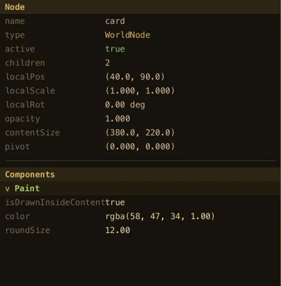

# 반사 매크로 #[reflect]

원본 vanilla.js 는 자바스크립트라 실행 중에 객체의 `get`, `is`, `set` 함수를 훑어 씁니다. UI 문서(`UIDocument`)가 등록한 쓰기 함수가 없는 컴포넌트를 저장하고 읽을 때(`saveByReflection`, `loadByReflection`), 개발자 도구 인스펙터가 컴포넌트의 값을 보일 때(`getComponentProperties`)가 그렇습니다. 러스트에는 실행 중에 함수 목록을 읽는 길이 없어서, 바닐라엔진은 절차 매크로 `#[vanilla::reflect]` 가 컴파일 때 같은 목록과 부르는 코드를 짓습니다. 언리얼의 UHT, Qt 의 moc 와 같은 방식입니다.

이 장에서는 컴포넌트에 매크로를 붙이는 법, 게터와 세터를 고르는 규칙, 반사 값의 꼴, 함수와 블록에 붙이는 옵션, 원본 상위 클래스 자리를 잇는 `base`, 반사를 쓰는 곳(UI 문서와 개발자 도구), 빠뜨리면 어떻게 막히는지를 차례로 봅니다. 이 장은 러스트 판에만 있습니다.

## 컴포넌트에 붙이기

컴포넌트의 `impl` 블록과 `impl Component` 블록 두 곳에 모두 `#[vanilla::reflect]` 를 붙입니다. 매크로는 엔진이 다시 내보낸 것이라 게임의 `Cargo.toml` 에는 엔진 하나만 있으면 됩니다.

```rust
use vanilla::core::reflection::{collect_reflected_getters, collect_reflected_properties, read_reflected_property, write_reflected_property};
use vanilla::{Component, ComponentBase, ReflectValue};

struct Spin {
	component_base: ComponentBase,
	degrees_per_second: f64,
}

#[vanilla::reflect]
impl Spin {
	pub fn new() -> Spin {
		Spin {
			component_base: ComponentBase::new(),
			degrees_per_second: 90.0,
		}
	}

	pub fn set_degrees_per_second(&mut self, degrees_per_second: f64) {
		self.degrees_per_second = degrees_per_second;
	}

	pub fn get_degrees_per_second(&self) -> f64 {
		self.degrees_per_second
	}
}

#[vanilla::reflect]
impl Component for Spin {
	fn get_component_base(&self) -> &ComponentBase {
		&self.component_base
	}

	fn get_component_base_mut(&mut self) -> &mut ComponentBase {
		&mut self.component_base
	}

	fn get_component_type(&self) -> &'static str {
		"Spin"
	}
}

let mut spin = Spin::new();
let property_names: Vec<&str> = collect_reflected_properties(&spin).iter().map(|property| property.name).collect();
assert_eq!(property_names, ["DegreesPerSecond", "GizmoVisible", "Enable", "ComponentType"]);
let getter_names: Vec<&str> = collect_reflected_getters(&spin).iter().map(|getter| getter.name).collect();
assert_eq!(getter_names, ["getDegreesPerSecond"]);
assert_eq!(read_reflected_property(&spin, "DegreesPerSecond"), Some(ReflectValue::Number(90.0)));
assert!(write_reflected_property(&mut spin, "DegreesPerSecond", &ReflectValue::Number(45.0)));
assert_eq!(spin.get_degrees_per_second(), 45.0);
```

- `impl` 블록의 매크로는 그 블록의 게터와 세터를 모아 `Reflect` 구현을 짓습니다. `impl Component` 블록의 매크로는 그 블록에서 다시 정의한 게터를 인스펙터용으로 모읍니다.
- `Reflect` 가 `Component` 의 상위 트레이트라 어느 쪽을 빠뜨려도 컴파일 에러가 붙일 블록을 알려 줍니다. 게터가 없는 타입은 빈 블록 `#[vanilla::reflect] impl 타입 {}` 에 붙입니다. 반사는 `Component` 를 구현한 타입에만 붙일 수 있습니다.
- 반사로 볼 함수는 매크로를 붙인 `impl` 블록 하나에 모읍니다. 매크로를 붙이지 않은 다른 `impl` 블록의 함수는 보지 않습니다. 같은 타입의 `impl` 블록 두 곳에 붙이면 `Reflect` 구현이 둘이 되어 컴파일되지 않습니다.
- 트레이트 `impl` 가운데 `Component` 가 아닌 것에는 붙일 수 없습니다.
- 저장 속성 목록 끝에는 원본 `Component` 기반 클래스의 공통 속성 `GizmoVisible`, `Enable`, `ComponentType` 이 붙습니다. `ComponentType` 은 러스트에 세터가 없어(종류는 타입이 정합니다) 쓰기만 합니다.

## 게터와 세터를 고르는 규칙

매크로는 원본이 프로토타입을 훑는 규칙을 그대로 따릅니다.

| 갈래 | 규칙 |
| --- | --- |
| 게터 | `pub fn get_*`, `pub fn is_*` 이고 `&self` 하나만 받고 무언가를 돌려주는 함수 (`()` 이나 `!` 를 돌려주면 게터가 아닙니다) |
| 트리를 받는 게터 | `&self` 와 `&NodeTree` 를 받는 게터. 원본은 이웃 컴포넌트를 바로 쥐지만 러스트 판은 트리에서 꺼냅니다. 인스펙터만 부르고 저장 속성은 아닙니다 |
| `&mut self` 게터 | 게터입니다. (원본 함수에는 구별이 없습니다) 이름이 `_mut` 로 끝나거나 `&mut` 를 돌려주는 함수는 러스트의 접근자라 뺍니다 |
| 세터 | `pub fn set_*` 이고 `&mut self` 와 값 하나를 받는 함수. `impl Into<Color>` 처럼 `impl Trait` 을 받으면 짝 게터가 돌려주는 꼴로 바꿔 넘깁니다 |
| 트리를 받는 세터 | `&mut self`, `&mut NodeTree`, 값을 받는 세터. 트리를 쥔 쪽(UI 문서 읽기)이 부릅니다 |
| 저장 속성 | 같은 키의 세터가 있는 게터. 키는 접두어를 떼고 낱말마다 머리를 대문자로 이은 원본 이름입니다 (`get_line_width` 는 `LineWidth`, 원본 함수 이름은 `getLineWidth`) |

- `pub` 이 아닌 함수(`pub(crate)` 포함)는 보지 않습니다. 원본의 `#` 비공개 함수가 프로토타입에 보이지 않는 것과 같습니다.
- `unsafe`, `async`, `extern` 함수와 타입이나 상수 제네릭이 있는 함수는 부를 수 없어 뺍니다. 수명 제네릭은 됩니다.
- 값 말고 인자를 더 받는 세터(`set_image(그림, 조각)` 같은 것)도 짝 게터가 있으면 속성 목록에 들지만 반사로 넣지는 않습니다.
- 차례는 정의 차례이고, 같은 키가 둘이면 먼저 나온 것을 씁니다.

```rust
use vanilla::core::reflection::{collect_reflected_getters, collect_reflected_properties, read_reflected_property, write_reflected_property};
use vanilla::{Color, Component, ComponentBase, ReflectValue, Vector2};

struct Badge {
	component_base: ComponentBase,
	label: String,
	tint: Color,
	offset: Vector2,
	is_blinking: bool,
	points: Vec<Vector2>,
}

#[vanilla::reflect]
impl Badge {
	pub fn new() -> Badge {
		Badge {
			component_base: ComponentBase::new(),
			label: String::from("new"),
			tint: Color::white(),
			offset: Vector2::zero(),
			is_blinking: false,
			points: vec![Vector2::zero(), Vector2::create(1.0, 1.0)],
		}
	}

	pub fn set_label(&mut self, label: &str) {
		self.label = String::from(label);
	}

	pub fn get_label(&self) -> &str {
		&self.label
	}

	pub fn set_tint(&mut self, tint: impl Into<Color>) {
		self.tint = tint.into();
	}

	pub fn get_tint(&self) -> Color {
		self.tint
	}

	pub fn set_offset(&mut self, offset: Vector2) {
		self.offset = offset;
	}

	pub fn get_offset(&self) -> Vector2 {
		self.offset
	}

	pub fn set_blinking(&mut self, is_blinking: bool) {
		self.is_blinking = is_blinking;
	}

	pub fn is_blinking(&self) -> bool {
		self.is_blinking
	}

	pub fn get_point_count(&self) -> usize {
		self.points.len()
	}

	pub fn get_points(&self) -> &[Vector2] {
		&self.points
	}
}

#[vanilla::reflect]
impl Component for Badge {
	fn get_component_base(&self) -> &ComponentBase {
		&self.component_base
	}

	fn get_component_base_mut(&mut self) -> &mut ComponentBase {
		&mut self.component_base
	}

	fn get_component_type(&self) -> &'static str {
		"Badge"
	}
}

let mut badge = Badge::new();
let property_names: Vec<&str> = collect_reflected_properties(&badge).iter().map(|property| property.name).collect();
assert_eq!(property_names, ["Label", "Tint", "Offset", "Blinking", "GizmoVisible", "Enable", "ComponentType"]);

let getter_list = collect_reflected_getters(&badge);
let getter_names: Vec<&str> = getter_list.iter().map(|getter| getter.name).collect();
assert_eq!(getter_names, ["getLabel", "getTint", "getOffset", "isBlinking", "getPointCount", "getPoints"]);
assert_eq!(getter_list[4].value, ReflectValue::Number(2.0));
assert_eq!(getter_list[5].value, ReflectValue::Object(String::from("Array")));

let red = ReflectValue::List(vec![ReflectValue::Number(1.0), ReflectValue::Number(0.0), ReflectValue::Number(0.0), ReflectValue::Number(1.0)]);
assert!(write_reflected_property(&mut badge, "Tint", &red));
assert_eq!(badge.get_tint(), Color::create(1.0, 0.0, 0.0, 1.0));
assert!(write_reflected_property(&mut badge, "Label", &ReflectValue::String(String::from("boss"))));
assert_eq!(badge.get_label(), "boss");
assert!(!write_reflected_property(&mut badge, "Label", &ReflectValue::Number(3.0)));
assert_eq!(read_reflected_property(&badge, "Blinking"), Some(ReflectValue::Boolean(false)));
```

- `is_blinking` 과 `set_blinking` 은 키가 같은 `Blinking` 이라 짝입니다.
- `get_point_count`, `get_points` 는 세터가 없어 저장 속성이 아니고 인스펙터에만 보입니다.
- `set_tint` 는 `impl Into<Color>` 를 받으므로 짝 게터 `get_tint` 의 꼴(`Color`)로 읽어 넘깁니다. 수 넷의 목록도 `Color` 로 읽힙니다.
- 세터의 꼴과 맞지 않는 값을 넣으면 `write_reflected_property` 가 `false` 를 돌려주고 값은 그대로입니다.

## 반사 값의 꼴

게터가 돌려준 값은 `ReflectValue` 로 바뀝니다. 바꿀 수 없는 꼴의 게터도 컴파일 에러를 내지 않고(자동 참조 특수화로 고릅니다), 원본처럼 저장에서 빠지고 인스펙터에는 `[종류 이름]` 으로 보입니다.

| 러스트 꼴 | 반사 값 | UI 문서에 저장 |
| --- | --- | --- |
| `bool` | `Boolean` | 불 |
| `f32`, `f64`, 정수 꼴 (`i8` ~ `i64`, `u8` ~ `u64`, `isize`, `usize`) | `Number` (`f32` 는 가장 짧은 십진으로 읽어 0.22 는 0.22) | 수 |
| `str`, `String` | `String` | 글 |
| `Vector2` | `Vector2` | 수 둘의 배열 |
| `Color` | `Color` | 수 넷의 배열 |
| `NodeId` | `Node` | `{ "$nodeRef": 경로 }` (트리를 다 지은 뒤 잇습니다) |
| `Rect` | `Rect` | 저장하지 않음 (인스펙터에만) |
| `Option<T>` | `None` 은 `Null`, `Some` 은 안의 값 | `Null` 은 저장하지 않음 |
| 엔진의 원본 글 열거 (`TextAlign`, `TextBaseline`, `TextDirection`, `TextWrapMode`, `SpriteDrawMode`, `BlendMode`, `ScrollMode`, `ProgressDirection`, `ScrollBarAxis`, `SoftShadeShape`, `ButtonMotionStyle`, `ToastPhase`, `ParticleEmitterShape`, `ParticleRenderShape`, `ShaderSpriteEffect`) | 원본과 같은 글의 `String` | 글 |
| `ButtonState` | 원본 `Enum` 의 수 (Normal 1 ~ Disabled 5) | 수 |
| `Vec`, 배열, 조각 | `Object("Array")` | 저장하지 않음 |
| 그 밖의 꼴 (`Rc<Image>`, 콜백 같은 것) | `Object(짧은 종류 이름)` (`Rc`, `RefCell` 같은 감싼 꼴은 벗깁니다) | 저장하지 않음 |

세터 쪽은 `FromReflectValue` 를 구현한 꼴만 읽습니다. `bool`, `f32`, `f64`, 정수 꼴, `String`, `&str`, `Vector2`(수 둘의 목록도), `Color`(수 넷의 목록도), `NodeId`, `Option<T>`(`Null` 은 `None`), 엔진의 원본 글 열거입니다. 그 밖의 꼴을 받는 세터는 읽기를 건너뜁니다. (컴파일 에러는 없습니다)

게임의 열거를 저장하고 싶으면 `ToReflectValue` 와 `FromReflectValue` 를 직접 구현합니다. 엔진이 원본 글 열거에 쓰는 매크로는 엔진 안에서만 쓰입니다.

```rust
use vanilla::core::reflection::{read_reflected_property, write_reflected_property};
use vanilla::{Component, ComponentBase, FromReflectValue, ReflectValue, ToReflectValue};

#[derive(Clone, Copy, Debug, PartialEq)]
enum Team {
	Red,
	Blue,
}

impl ToReflectValue for Team {
	fn to_reflect_value(&self) -> ReflectValue {
		match self {
			Team::Red => {
				ReflectValue::String(String::from("red"))
			}
			Team::Blue => {
				ReflectValue::String(String::from("blue"))
			}
		}
	}
}

impl<'a> FromReflectValue<'a> for Team {
	fn from_reflect_value(value: &'a ReflectValue) -> Option<Team> {
		match value {
			ReflectValue::String(name) => {
				match name.as_str() {
					"red" => {
						Some(Team::Red)
					}
					"blue" => {
						Some(Team::Blue)
					}
					_ => {
						None
					}
				}
			}
			_ => {
				None
			}
		}
	}
}

struct TeamFlag {
	component_base: ComponentBase,
	team: Team,
}

#[vanilla::reflect]
impl TeamFlag {
	pub fn set_team(&mut self, team: Team) {
		self.team = team;
	}

	pub fn get_team(&self) -> Team {
		self.team
	}
}

#[vanilla::reflect]
impl Component for TeamFlag {
	fn get_component_base(&self) -> &ComponentBase {
		&self.component_base
	}

	fn get_component_base_mut(&mut self) -> &mut ComponentBase {
		&mut self.component_base
	}

	fn get_component_type(&self) -> &'static str {
		"TeamFlag"
	}
}

let mut team_flag = TeamFlag {
	component_base: ComponentBase::new(),
	team: Team::Red,
};
assert_eq!(read_reflected_property(&team_flag, "Team"), Some(ReflectValue::String(String::from("red"))));
assert!(write_reflected_property(&mut team_flag, "Team", &ReflectValue::String(String::from("blue"))));
assert_eq!(team_flag.get_team(), Team::Blue);
assert!(!write_reflected_property(&mut team_flag, "Team", &ReflectValue::String(String::from("green"))));
```

## 함수와 블록에 붙이는 옵션

| 옵션 | 붙이는 곳 | 하는 일 |
| --- | --- | --- |
| `#[reflect(skip)]` | 함수 | 반사에서 뺍니다. `impl Component` 블록에서 원본 클래스에 없는 덮어쓰기(`is_tick_needed` 같은 것)를 숨길 때도 씁니다 |
| `#[reflect(transient)]` | 게터 | 인스펙터에는 보이되 저장 속성 목록에서 뺍니다 |
| `#[reflect(unsaved)]` | 게터 | 속성 목록에는 두되 반사 저장과 읽기에서 뺍니다 (`ReflectedProperty.is_saved` 가 `false`). 원본에서 값이 객체라 `saveByReflection` 이 적지 않는 속성 자리입니다 |
| `#[reflect(name = "UIScale")]` | 게터, 세터 | 키 이름을 정합니다. 머리글자 낱말처럼 snake_case 에서 되돌릴 수 없는 원본 이름에 씁니다. 짝은 키로 지으므로 게터와 세터에 같은 이름을 줍니다 |
| `#[reflect(after = "getFittedFontSize")]` | `impl Component` 블록의 게터 | 인스펙터 목록에서 그 원본 게터 바로 뒤에 둡니다 (원본 클래스 몸통의 차례). 없으면 이 블록의 게터는 목록 맨 앞입니다. `impl` 블록에 쓰면 에러입니다 |
| `#[vanilla::reflect(base = 필드)]` | `impl` 블록 | 품은 컴포넌트의 반사를 원본 상위 클래스처럼 뒤에 잇습니다. (다음 절) `impl Component` 블록에 쓰면 에러입니다 |
| `#[vanilla::reflect(crate = 경로)]` | `impl` 블록 | 지은 코드가 엔진을 가리키는 경로입니다. 기본은 `::vanilla` 이고, `Cargo.toml` 에서 엔진 의존성의 이름을 바꿨을 때만 줍니다 |

```rust
use vanilla::core::reflection::{collect_reflected_getters, collect_reflected_properties};
use vanilla::{Component, ComponentBase};

struct Gauge {
	component_base: ComponentBase,
	ui_scale: f64,
	fill_ratio: f64,
	font_face: String,
}

#[vanilla::reflect]
impl Gauge {
	pub fn new() -> Gauge {
		Gauge {
			component_base: ComponentBase::new(),
			ui_scale: 1.0,
			fill_ratio: 0.5,
			font_face: String::from("GameUI"),
		}
	}

	#[reflect(name = "UIScale")]
	pub fn set_ui_scale(&mut self, ui_scale: f64) {
		self.ui_scale = ui_scale;
	}

	#[reflect(name = "UIScale")]
	pub fn get_ui_scale(&self) -> f64 {
		self.ui_scale
	}

	pub fn set_fill_ratio(&mut self, fill_ratio: f64) {
		self.fill_ratio = fill_ratio;
	}

	#[reflect(transient)]
	pub fn get_fill_ratio(&self) -> f64 {
		self.fill_ratio
	}

	pub fn set_font_face(&mut self, font_face: &str) {
		self.font_face = String::from(font_face);
	}

	#[reflect(unsaved)]
	pub fn get_font_face(&self) -> &str {
		&self.font_face
	}

	#[reflect(skip)]
	pub fn get_debug_text(&self) -> String {
		format!("{} {}", self.ui_scale, self.fill_ratio)
	}
}

#[vanilla::reflect]
impl Component for Gauge {
	fn get_component_base(&self) -> &ComponentBase {
		&self.component_base
	}

	fn get_component_base_mut(&mut self) -> &mut ComponentBase {
		&mut self.component_base
	}

	fn get_component_type(&self) -> &'static str {
		"Gauge"
	}

	#[reflect(skip)]
	fn is_tick_needed(&self) -> bool {
		false
	}

	fn is_drawn_inside_content(&self) -> bool {
		true
	}
}

let gauge = Gauge::new();
let property_list = collect_reflected_properties(&gauge);
let property_names: Vec<&str> = property_list.iter().map(|property| property.name).collect();
assert_eq!(property_names, ["UIScale", "FontFace", "GizmoVisible", "Enable", "ComponentType"]);
assert!(property_list[0].is_saved);
assert!(!property_list[1].is_saved);

let getter_names: Vec<&str> = collect_reflected_getters(&gauge).iter().map(|getter| getter.name).collect();
assert_eq!(getter_names, ["isDrawnInsideContent", "getUIScale", "getFillRatio", "getFontFace"]);
assert_eq!(gauge.get_debug_text(), "1 0.5");
```

- `impl Component` 블록에서 다시 정의한 게터(`is_drawn_inside_content`)는 원본 인스펙터가 하위 클래스의 함수로 보이듯 목록 앞에 옵니다. `get_component_base`, `get_component_type` 은 원본 `Component` 기반 클래스 몫이라 보이지 않습니다.

## 원본 상위 클래스 잇기 (base)

원본에서는 상위 클래스의 게터가 프로토타입 사슬로 따라옵니다. 러스트에는 클래스 상속이 없어 상위 클래스 몫을 필드로 품고, `impl` 블록에 `#[vanilla::reflect(base = 필드)]` 를 붙여 그 필드의 반사를 뒤에 잇습니다. 엔진의 `UIButton`(`UIControl` 을 품음), `UIControl`(`UIView` 를 품음), `RichText`(`Text` 를 품음)가 이렇게 합니다.

```rust
use vanilla::core::reflection::{collect_reflected_getters, collect_reflected_properties, read_reflected_property, write_reflected_property};
use vanilla::{Component, ComponentBase, Reflect, ReflectValue};

struct Unit {
	component_base: ComponentBase,
	speed: f64,
}

#[vanilla::reflect]
impl Unit {
	pub fn new() -> Unit {
		Unit {
			component_base: ComponentBase::new(),
			speed: 100.0,
		}
	}

	pub fn set_speed(&mut self, speed: f64) {
		self.speed = speed;
	}

	pub fn get_speed(&self) -> f64 {
		self.speed
	}
}

#[vanilla::reflect]
impl Component for Unit {
	fn get_component_base(&self) -> &ComponentBase {
		&self.component_base
	}

	fn get_component_base_mut(&mut self) -> &mut ComponentBase {
		&mut self.component_base
	}

	fn get_component_type(&self) -> &'static str {
		"Unit"
	}
}

struct Hero {
	unit: Unit,
	title: String,
}

#[vanilla::reflect(base = unit)]
impl Hero {
	pub fn new() -> Hero {
		Hero {
			unit: Unit::new(),
			title: String::from("knight"),
		}
	}

	pub fn set_title(&mut self, title: &str) {
		self.title = String::from(title);
	}

	pub fn get_title(&self) -> &str {
		&self.title
	}
}

#[vanilla::reflect]
impl Component for Hero {
	fn get_component_base(&self) -> &ComponentBase {
		self.unit.get_component_base()
	}

	fn get_component_base_mut(&mut self) -> &mut ComponentBase {
		self.unit.get_component_base_mut()
	}

	fn get_component_type(&self) -> &'static str {
		"Hero"
	}
}

let mut hero = Hero::new();
assert_eq!(hero.get_reflected_type_name(), "Hero");
let property_names: Vec<&str> = collect_reflected_properties(&hero).iter().map(|property| property.name).collect();
assert_eq!(property_names, ["Title", "Speed", "GizmoVisible", "Enable", "ComponentType"]);
let getter_names: Vec<&str> = collect_reflected_getters(&hero).iter().map(|getter| getter.name).collect();
assert_eq!(getter_names, ["getTitle", "getSpeed"]);
assert_eq!(read_reflected_property(&hero, "Speed"), Some(ReflectValue::Number(100.0)));
assert!(write_reflected_property(&mut hero, "Speed", &ReflectValue::Number(150.0)));
assert_eq!(hero.unit.get_speed(), 150.0);
```

- 품은 필드의 타입도 두 블록에 매크로를 붙인 컴포넌트여야 합니다.
- 속성과 게터는 이 타입의 것 뒤에 품은 값의 것 가운데 아직 없는 키만 잇습니다. 결과 목록과 차례가 원본의 상속과 같습니다.
- 읽기와 넣기는 원본 `component[getterName]`, `component[setterName]` 처럼 따로 가장 아래 타입의 것부터 찾습니다. 그래서 게터는 품은 값에서 받고 세터만 이 타입이 다시 정의해도 됩니다.
- 이 타입에서 편의로 다시 둔 함수가 원본에서는 상위 클래스 몫이면 `#[reflect(skip)]` 으로 빼서 차례를 원본처럼 둡니다.

## 반사를 쓰는 곳

### UI 문서 (UIDocument)

`register_component_type(이름, 짓는 함수)` 로 등록한 컴포넌트는 원본 `registerComponentType` 처럼 반사로 쓰고 읽습니다. 키와 차례와 값이 원본 `saveByReflection` 과 같아서, 두 엔진이 같은 `.scene.json` 을 같게 읽습니다.

```rust
use vanilla::{Component, ComponentBase, NodeTree, UIDocument};

struct Spin {
	component_base: ComponentBase,
	degrees_per_second: f64,
}

#[vanilla::reflect]
impl Spin {
	pub fn new() -> Spin {
		Spin {
			component_base: ComponentBase::new(),
			degrees_per_second: 0.0,
		}
	}

	pub fn set_degrees_per_second(&mut self, degrees_per_second: f64) {
		self.degrees_per_second = degrees_per_second;
	}

	pub fn get_degrees_per_second(&self) -> f64 {
		self.degrees_per_second
	}
}

#[vanilla::reflect]
impl Component for Spin {
	fn get_component_base(&self) -> &ComponentBase {
		&self.component_base
	}

	fn get_component_base_mut(&mut self) -> &mut ComponentBase {
		&mut self.component_base
	}

	fn get_component_type(&self) -> &'static str {
		"Spin"
	}
}

struct Marker {
	component_base: ComponentBase,
}

#[vanilla::reflect]
impl Marker {}

#[vanilla::reflect]
impl Component for Marker {
	fn get_component_base(&self) -> &ComponentBase {
		&self.component_base
	}

	fn get_component_base_mut(&mut self) -> &mut ComponentBase {
		&mut self.component_base
	}

	fn get_component_type(&self) -> &'static str {
		"Marker"
	}
}

let mut document = UIDocument::new();
document.register_component_type("Spin", Spin::new);
let mut node_tree = NodeTree::new();
let root_id = node_tree.create_node("root");
node_tree[root_id].add_component(Spin::new()).set_degrees_per_second(45.0);
node_tree[root_id].add_component(Marker {
	component_base: ComponentBase::new(),
});

let json_text = document.to_json_text(&mut node_tree, root_id, false);
assert!(json_text.contains("\"DegreesPerSecond\":45"));
assert!(json_text.contains("\"type\":\"Spin\""));
assert!(json_text.contains("\"type\":\"Marker\""));

let loaded_id = document.from_json_text(&mut node_tree, &json_text).expect("document");
let loaded_spin = node_tree[loaded_id].get_component::<Spin>().expect("spin");
assert_eq!(loaded_spin.get_degrees_per_second(), 45.0);
```

- 등록하지 않은 컴포넌트도 반사가 있으면 원본처럼 반사로 적고, `type` 은 타입 이름입니다. 읽을 때는 등록한 종류만 짓고 나머지는 경고를 내고 건너뜁니다.
- 게터가 없는 컴포넌트(위의 `Marker`)도 반사가 있어 원본처럼 공통 속성과 `type`(타입 이름)으로 적힙니다. 반사 없는 컴포넌트는 컴파일되지 않아 빠지는 컴포넌트가 없습니다.
- 원본 `REFLECTED_PROPERTY_EXCLUDE_NAMES` 처럼 키가 `Parent`, `Node`, `Owner`, `Scene`, `Content`, `Children`, `AllComponents`, `Component`, `Components`, `Root`, `Graphic`, `Camera`, `Target` 인 속성은 저장하지 않습니다. 게임 컴포넌트의 `get_target`, `set_target` 도 저장되지 않으니 다른 이름을 씁니다.
- `to_json_text`, `serialize_node` 는 원본 `toJsonText`, `serializeNode` 처럼 한 함수로 `&mut self` 게터까지 읽습니다. 그래서 `&mut NodeTree` 를 받습니다.
- 트리와 값을 받는 세터는 문서를 읽을 때 컴포넌트를 트리에서 잠깐 꺼내 그 자리에서 부릅니다. (원본과 같은 차례)
- 쓰기, 읽기 함수를 손으로 짜고 싶으면 반사 대신 `register_component_type_with_handler(이름, 짓는 함수, 쓰기, 읽기)` 로 등록합니다. 노드를 가리키는 반사 속성은 이때도 원본 `saveNodeReferences` 처럼 따로 얹습니다.

### 개발자 도구 인스펙터 (DevTools)

인스펙터는 원본 `getComponentProperties` 처럼 고른 노드의 컴포넌트마다 게터를 모두 불러 보입니다.



- 이름은 원본 `formatMethodName` 꼴입니다. `getDegreesPerSecond` 는 `degreesPerSecond`, `is` 로 시작하면 `isBlinking` 그대로입니다.
- 값은 원본 `formatPropertyValue` 꼴입니다. 수는 소수 둘째 자리, `Vector2` 는 `(x, y)`, `Rect` 는 `(x, y, 너비, 높이)` 소수 첫째 자리, `Color` 는 `rgba(...)`, `Null` 은 `null`, 노드는 `[WorldNode]`, 배열은 `[Array]`, 그 밖은 `[종류 이름]` 입니다.
- 트리를 받는 게터는 그릴 때 트리를 넘겨 부르고, `&mut self` 게터가 있는 컴포넌트는 `tick` 이 트리를 쥐고 읽어 둔 값을 보입니다.
- 모든 컴포넌트가 반사되어 원본처럼 모든 컴포넌트의 게터를 보입니다. 게터가 없는 컴포넌트는 "(프로퍼티 없음)" 줄입니다.

예제 `examples/devtoolsshowcase.rs` 의 `Spin` 이 매크로를 붙여 인스펙터에 `degreesPerSecond` 를 보입니다.

### 직접 읽고 쓰기

`vanilla::core::reflection` 의 함수로 게임 코드도 같은 목록을 씁니다. (편집기, 저장 도구 같은 것)

| 함수 | 하는 일 |
| --- | --- |
| `collect_reflected_properties(component)` | 저장 속성 목록 (`ReflectedProperty { name, getter_name, setter_name, is_saved }`, 공통 속성 포함) |
| `read_reflected_property(component, 키)`, `read_reflected_property_mut` | 속성 값 읽기. `_mut` 은 `&mut self` 게터까지 |
| `write_reflected_property(component, 키, 값)`, `write_reflected_property_in_tree` | 속성 값 넣기. `_in_tree` 는 트리를 받는 세터까지 (컴포넌트는 `NodeTree::with_component_at_mut` 로 꺼낸 채로) |
| `collect_reflected_getters(component)`, `collect_reflected_getters_in_tree`, `collect_reflected_getters_mut` | 인스펙터용 게터 이름과 값 (`ReflectedGetter { name, value }` 목록) |
| `has_mutable_getters(component)` | `&mut self` 게터가 있는지 |

## 빠뜨릴 수 없다

원본은 모든 객체가 반사됩니다. 러스트 판도 같게, `Reflect` 가 `Component` 의 상위 트레이트라 매크로를 빠뜨린 컴포넌트는 컴파일되지 않습니다. 엔진 컴포넌트도 모두 같은 길로 만듭니다.

| 빠뜨린 곳 | 결과 |
| --- | --- |
| `impl` 블록 | 컴파일 에러 "반사 구현이 없다" 가 `impl 타입` 블록에 붙이라고 알려 줍니다. 게터가 없는 타입은 빈 블록 `#[vanilla::reflect] impl 타입 {}` 에 붙입니다 |
| `impl Component` 블록 | 컴파일 에러가 `impl Component for 타입` 블록에 붙이라고 알려 줍니다 |

그래서 UI 문서는 등록하지 않은 컴포넌트도 원본처럼 반사로 쓰고, 개발자 도구 인스펙터는 모든 컴포넌트의 게터를 보입니다. 엔진은 `&dyn Component` 를 `&dyn Reflect` 로 올려(트레이트 업캐스팅) 반사를 부릅니다.

## 관련 타입

- `vanilla::reflect` (절차 매크로, `vanilla-engine-macros` 크레이트를 엔진이 다시 내보냄)
- `Reflect`, `ReflectComponentGetters`, `ReflectValue`, `ReflectedProperty`, `ReflectedGetter`
- `ToReflectValue`, `FromReflectValue`
- `vanilla::core::reflection` 의 `collect_reflected_properties`, `read_reflected_property`, `read_reflected_property_mut`, `write_reflected_property`, `write_reflected_property_in_tree`, `collect_reflected_getters`, `collect_reflected_getters_in_tree`, `collect_reflected_getters_mut`, `has_mutable_getters`, `COMPONENT_REFLECTED_PROPERTIES`
- `Component` (상위 트레이트 `Reflect`)
- `UIDocument` (`register_component_type`, `register_component_type_with_handler`, `save_by_reflection`, `load_by_reflection`, `get_reflected_properties`, `to_json_text`)
- `DevTools` (`set_ui_document`, `get_ui_document_mut`)
