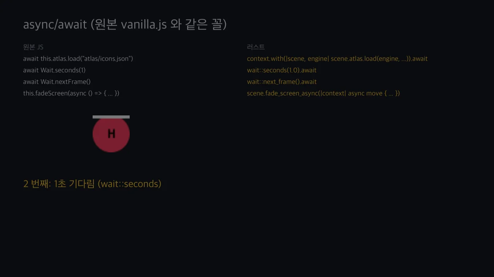

# async/await

원본 vanilla.js 는 브라우저가 Promise 를 돌리고, `async` 함수는 `await` 에서 멈췄다가 Promise 가 풀리면 이어 갑니다. `async load`, `await asset.load(경로)`, `await Wait.seconds(1)`, `fadeScreen(async () => ...)` 가 모두 이 위에 있습니다. 바닐라엔진은 엔진이 스레드 하나짜리 실행기를 품고, 같은 꼴의 코드를 러스트의 `async`/`await` 로 씁니다. 외부 런타임은 쓰지 않고 데스크탑과 웹이 같은 코드로 돌며, 퓨처는 `Send` 가 아니어도 됩니다. (`Rc` 를 들어도 됩니다)

이 장에서는 작업을 맡기는 법, 작업 안에서 씬과 엔진을 만지는 `with`, 기다릴 수 있는 것들, 씬 불러오기와 내리기를 작업에 맡기는 법, `Promise` 로 콜백을 기다리는 법, 화면 페이드, 작업이 도는 차례, 원본과 다른 점을 차례로 봅니다. 이 장은 러스트 판에만 있습니다.

## 작업 맡기기

`engine.spawn_task` 에 `EngineContext` 를 받아 퓨처를 돌려주는 함수를 넘깁니다. 보통 `|mut engine_context| async move { ... }` 꼴입니다. 작업은 원본 `async` 함수를 부를 때처럼 맡기는 그 자리에서 첫 `await` 까지 돌고, 남은 것은 깨어날 때마다 프레임의 폴링 차례에 돕니다.

```rust
use std::cell::Cell;
use std::rc::Rc;
use vanilla::{Engine, EngineConfiguration, Promise};

let mut engine = Engine::new(EngineConfiguration::new());
let (start_promise, start_resolver) = Promise::<u32>::create();
let received_value = Rc::new(Cell::new(0));
let task_received_value = received_value.clone();
let task_handle = engine.spawn_task(move |mut engine_context| async move {
	engine_context.with(|engine| {
		engine.set_maximum_frame_per_second(30.0);
	});
	let value = start_promise.await;
	task_received_value.set(value);
});
assert_eq!(engine.get_maximum_frame_per_second(), 30.0);
assert!(!task_handle.is_finished());

start_resolver.resolve(7);
assert_eq!(received_value.get(), 0);
```

- 첫 `await` 앞의 `with` 는 `spawn_task` 가 돌아오기 전에 이미 돌았습니다. 작업은 아직 풀리지 않은 Promise 를 기다리며 남습니다.
- `resolve` 는 작업을 깨워 줄에 넣기만 합니다. 작업은 다음 폴링 차례(엔진이 돌면 다음 프레임 첫머리)에 이어 가서 값을 받습니다.
- 돌려받은 `TaskHandle` 로 끝났는지 묻거나(`is_finished`), 다른 작업에서 `await` 하거나, 씬에 맡깁니다.

| 함수 | 받는 것 | 처음 도는 때 |
| --- | --- | --- |
| `engine.spawn_task(작업 함수)` | `&mut Engine`, 작업 함수는 `EngineContext` 를 받음 | 맡기는 자리에서 첫 `await` 까지 |
| `engine.spawn_scene_task(씬, 작업 함수)` | `&mut Engine` 과 `&mut 씬`, 작업 함수는 `SceneContext<씬 타입>` 을 받음 | 맡기는 자리에서 첫 `await` 까지 |
| `engine.spawn_deferred_task(작업 함수)` | `&Engine` 만 있는 자리 (컴포넌트 문맥 같은 곳) | 다음 폴링 차례 |
| `engine.spawn_deferred_scene_task(씬, 작업 함수)` | `&Engine` 과 `&씬` 만 있는 자리 | 다음 폴링 차례 |

## 작업 안에서 씬과 엔진 만지기 (with)

러스트의 퓨처는 `&mut` 를 `await` 너머로 쥘 수 없습니다. 그래서 작업은 컨텍스트의 `with` 클로저 안에서만 씬과 엔진을 빌립니다. 원본에서 `await` 다음 줄이 `this` 와 엔진을 바로 쓰던 자리입니다.

```rust
use vanilla::{Engine, EngineConfiguration, Scene, SceneBase, SceneContext, TextAsset};

struct TitleScene {
	scene_base: SceneBase,
	greeting_asset: TextAsset,
	greeting: String,
}

impl Scene for TitleScene {
	fn get_scene_base(&self) -> &SceneBase {
		&self.scene_base
	}

	fn get_scene_base_mut(&mut self) -> &mut SceneBase {
		&mut self.scene_base
	}
}

let mut engine = Engine::new(EngineConfiguration::new());
let mut title_scene = TitleScene {
	scene_base: SceneBase::new(),
	greeting_asset: TextAsset::new(),
	greeting: String::new(),
};
let task_handle = engine.spawn_scene_task(&mut title_scene, |mut scene_context: SceneContext<TitleScene>| async move {
	let load_handle = scene_context.with(|scene, engine| scene.greeting_asset.load(engine, "data:text/plain,hello"));
	if load_handle.await.is_ok() {
		scene_context.with(|scene, _engine| {
			let greeting = String::from(scene.greeting_asset.get_text().unwrap_or(""));
			scene.greeting = greeting;
		});
	}
});
assert!(task_handle.is_finished());
assert_eq!(title_scene.greeting, "hello");
```

- `SceneContext<S>::with` 는 그 씬을 제 타입(`&mut S`)으로, 엔진을 `&mut Engine` 으로 줍니다. `EngineContext::with` 는 엔진만 줍니다.
- `with` 의 클로저는 동기라 안에서 `await` 할 수 없습니다. 클로저가 받은 참조는 돌려주는 값에 담을 수 없어(수명이 클로저마다 새로 매겨집니다) 밖으로 새지 않습니다.
- 그래서 원본에서 Promise 를 돌려주던 `load` 들은 애셋이나 씬을 빌리지 않는 손잡이를 돌려줍니다. 클로저 안에서 `load` 를 부르고, 돌려받은 손잡이를 클로저 밖에서 `await` 합니다. 원본 `await this.atlas.load(경로)` 가 `scene_context.with(|scene, engine| scene.atlas.load(engine, 경로)).await` 한 줄입니다.
- 데스크탑은 애셋을 그 자리에서 읽어 손잡이가 이미 끝나 있습니다. 위 예제가 맡기는 자리의 첫 폴링에서 끝까지 도는 것도 그래서입니다. 웹은 받는 동안 프레임이 돌고, 받으면 이어 갑니다. 게임 코드는 같습니다.
- GL 이 있어야 하는 일은 `with_graphic` 으로 그래픽까지 빌립니다. (`with` 안에서 `engine.get_graphic()` 으로 꺼내도 됩니다) 맡기는 자리의 첫 구간도 그래픽을 받습니다. 그래픽을 붙이기 전이거나, 그리기 함수 안에서 맡겨 엔진이 그래픽을 그 함수에 내어 준 동안이면 클로저를 부르지 않고 `None` 을 돌려줍니다.
- 컨텍스트는 복제할 수 없고 `with` 가 `&mut self` 를 받아서, `with` 안에서 `with` 를 겹쳐 부르는 코드는 컴파일되지 않습니다. 컨텍스트를 빼돌려 작업 밖에서 부르거나 다른 씬의 작업에서 부르면 까닭을 적은 패닉이 납니다.
- `scene_context.get_scene_id()` 는 작업을 맡긴 씬의 핸들입니다.

## 기다릴 수 있는 것

| 기다리는 것 | 만드는 곳 | `await` 결과 |
| --- | --- | --- |
| `AssetLoadHandle` | `ImageAsset`, `TextAsset`, `JsonAsset`, `BlobAsset`, `BunchAsset` 의 `load(engine, 경로)`, `VisualAsset::load(경로)`, `engine.request_asset_bytes(경로)` | `Result<Rc<Vec<u8>>, String>` (그림은 풀기까지 기다리고, 풀지 못하면 `Err`) |
| `FontLoadHandle` | `FontAsset::load_font(engine, 패밀리, 경로)` 와 그 갈래, `engine.register_font_face_when_loaded` | `Result<(), String>` (글꼴 목록에 올리기까지) |
| `AudioLoadHandle` | `AudioAsset` 의 `load`, `load_from_asset`, `load_from_bytes` | `Result<(), String>` (디코딩까지) |
| `AssetLoaderLoadHandle` | `AssetLoader::load(engine)` | `Vec<AssetLoadFailure>` (실패 목록) |
| `SpriteAtlasLoadHandle` | `SpriteAtlas::load(engine, 경로)`, `load_data` | `()` (JSON 과 쪽 그림을 받아 조각을 지을 때까지) |
| `SoundLoadHandle`, `BuildInfoLoadHandle` | `SoundSystem::load_sounds(engine)`, `BuildInfo::load(engine)` | `()` |
| `LanguageLoadHandle`, `UiFontLoadHandle`, `UiFontTextLoadHandle` | `languagepack::load_language_list`, `load_language`, `uifont::load_ui_font`, `load_ui_font_text` (엔진을 `&mut` 로 받아 `with` 안에서 부릅니다) | `()` |
| `WaitSeconds`, `NextFrame` | `wait::seconds(초)`, `wait::next_frame()` | `()` |
| `Promise<T>` | `Promise::create()`, `Promise::resolved(값)`, 엔진의 `_async` 함수들 | `T` |
| `TaskHandle` | `spawn_task` 들 | `()` (그 작업이 끝날 때) |
| 씬 불러오기, 내리기 | `engine.load_scene_async(씬)`, `unload_scene_async(씬)`, `unload_all_scenes_async()` | `SceneId`, `()`, `()` |
| 질문 창, 클립보드, 화면 저장 | `engine.alert_async`, `confirm_async`, `prompt_async`, `read_clipboard_text_async`, `request_frame_capture_async(프레임 번호)` | `()`, `bool`, `Option<String>`, `Option<String>`, `Vec<u8>` (PNG) |
| 3D 와 타임라인 | `FbxLoader::load_from_url`, `Material::load_image_description`, `SkinnedModel::load_from_url_async`, `load_from_fbx_url_async`, `add_animations_from_fbx_url`, `Timeline::load_from_url` | 각각 `Result<..., String>` |

- 이미 `load` 한 애셋은 `wait_for_load()` 로도 기다립니다. (`Asset` 트레이트, `SpriteAtlas`, `AssetLoader`, `SoundSystem`, `BuildInfo`, `AudioAsset`)
- `wait::seconds` 는 원본 `setTimeout` 처럼 벽시계 시간입니다. 시간 배율(`time_scale`)을 곱하지 않고, 부른 때부터 잽니다. 0 초라도 폴링 차례를 한 번 쉬고 끝납니다. `wait::next_frame` 은 다음 폴링 차례에 끝납니다.
- 실패한 애셋도 끝난 것으로 칩니다. `Result` 를 받는 손잡이는 `Err(까닭)` 으로 끝납니다.

## 씬 불러오기를 기다리게 하기

원본 씬은 `async load(engine)` 이 끝나야 `initialize` 로 넘어갑니다.

```javascript
class StageScene extends Scene {
	async load(engine) {
		await super.load(engine);
		await this.stageAsset.load("stage.json");
		await Wait.seconds(0.5);
	}

	initialize(engine) {
		super.initialize(engine);
		console.log(this.stageAsset.data);
	}
}
```

러스트 판은 `create` 에서 불러오기 작업을 맡기고 `scene_base.track_task` 로 씬에 맡깁니다. 엔진은 맡긴 작업이 끝날 때까지 `draw_on_load` 만 부르고, 끝난 뒤 원본처럼 0.3 초를 더 기다려 `initialize` 를 부릅니다.

```rust,no_run
use std::path::PathBuf;
use vanilla::{wait, Engine, EngineConfiguration, JsonAsset, Scene, SceneBase, Vector2};

struct StageScene {
	scene_base: SceneBase,
	stage_asset: JsonAsset,
}

impl Scene for StageScene {
	fn get_scene_base(&self) -> &SceneBase {
		&self.scene_base
	}

	fn get_scene_base_mut(&mut self) -> &mut SceneBase {
		&mut self.scene_base
	}

	fn create(&mut self, engine: &mut Engine) {
		let load_task_handle = engine.spawn_scene_task(self, |mut scene_context| async move {
			let load_result = scene_context.with(|scene, engine| scene.stage_asset.load(engine, "scenedocument.scene.json")).await;
			if let Err(reason) = load_result {
				eprintln!("{}", reason);
			}
			wait::seconds(0.5).await;
		});
		self.scene_base.track_task(&load_task_handle);
	}

	fn initialize(&mut self, _engine: &mut Engine) {
		if let Some(stage_data) = self.stage_asset.get_data() {
			println!("{}", stage_data["version"]);
		}
	}
}

fn main() {
	let mut engine_configuration = EngineConfiguration::new();
	engine_configuration.reference_resolution_size = Vector2::create(1280.0, 720.0);
	engine_configuration.asset_directory_paths = vec![PathBuf::from("examples/assets")];
	let engine = Engine::new(engine_configuration);
	let stage_scene = StageScene {
		scene_base: SceneBase::new(),
		stage_asset: JsonAsset::new(),
	};
	if let Err(error) = engine.run(Box::new(stage_scene)) {
		eprintln!("{}", error);
	}
}
```

- 손잡이를 맡기는 동기 꼴(`load` 뒤 `scene_base.track_asset(&self.stage_asset)`)도 그대로 됩니다. `await` 꼴은 받은 다음 일을 같은 함수 안에 차례대로 쓸 수 있을 때 씁니다.
- `GameScene` 은 바탕의 로딩 이미지를 요청한 뒤 `load_assets(engine)` 을 부릅니다. 여기서 같은 방법으로 작업을 맡기고 `get_game_scene_base_mut().get_scene_base_mut().track_task(&작업)` 으로 씬에 맡깁니다. (예제 `examples/asyncawait.rs`, 원본 `async loadAssets` 자리)
- `unload` 에서 `track_task` 로 맡긴 작업은 원본 `await scene.unload()` 처럼 끝나야 내리기가 끝납니다. 그동안 씬은 목록에 남아 `tick`, `draw` 를 받습니다.
- 다른 작업에서 씬을 불러 다 될 때까지 기다리려면 `engine_context.with(|engine| engine.load_scene_async(씬)).await` 입니다. `initialize` 까지 끝나면 그 씬의 핸들로 풀립니다. 다 불러오기 전에 그 씬을 내리면 풀리지 않습니다. `unload_scene_async` 는 `unload` 가 맡긴 작업까지 끝나야 풀립니다.

```rust,no_run
use vanilla::{Engine, Scene, SceneId};

fn change_scene(engine: &mut Engine, current_scene_id: SceneId, next_scene: Box<dyn Scene>) {
	engine.spawn_task(move |mut engine_context| async move {
		let next_scene_id = engine_context.with(|engine| engine.load_scene_async(next_scene)).await;
		engine_context.with(|engine| engine.unload_scene_async(current_scene_id)).await;
		println!("{:?}", next_scene_id);
	});
}
```

## Promise 로 기다리기

원본 `new Promise((resolve, reject) => ...)` 자리는 `Promise::create()` 입니다. 기다릴 `Promise` 와 푸는 손잡이 `PromiseResolver` 를 짝으로 줍니다. 실패할 수 있는 일은 `Promise<Result<T, E>>` 로 두고 `resolve(Ok(값))` 또는 `reject(까닭)` 으로 풉니다. (예외 대신 `Result`)

```rust
use std::cell::RefCell;
use std::rc::Rc;
use vanilla::{Engine, EngineConfiguration, Promise};

let mut engine = Engine::new(EngineConfiguration::new());
let (score_promise, score_resolver) = Promise::<Result<u32, String>>::create();
score_resolver.reject(String::from("timeout"));

let score_result = Rc::new(RefCell::new(None));
let task_score_result = score_result.clone();
let task_handle = engine.spawn_task(move |_engine_context| async move {
	let bonus = Promise::resolved(10).await;
	let score = score_promise.await.map(|score| score + bonus);
	*task_score_result.borrow_mut() = Some(score);
});
assert!(task_handle.is_finished());
assert_eq!(*score_result.borrow(), Some(Err(String::from("timeout"))));
```

- `resolve` 는 손잡이를 가져가 한 번만 풀 수 있습니다. 손잡이를 버리고 풀지 않으면 원본처럼 그 Promise 는 끝나지 않습니다.
- `Promise::resolved(값)` 은 원본 `Promise.resolve(값)` 처럼 처음 폴링에 그 값으로 끝납니다.

콜백으로 끝을 알리는 API 를 `await` 할 수 있게 바꿀 때는 콜백에서 손잡이를 풉니다.

```rust,no_run
use vanilla::{Engine, Promise};

fn read_clipboard_promise(engine: &Engine) -> Promise<String> {
	let (clipboard_promise, clipboard_resolver) = Promise::create();
	engine.read_clipboard_text_with_callback(move |clipboard_text| {
		clipboard_resolver.resolve(clipboard_text);
	});
	clipboard_promise
}
```

## 화면 페이드 (fade_screen_async)

원본 `this.fadeScreen(async () => { ... })` 는 `GameScene` 의 `fade_screen_async` 입니다. 화면이 다 어두워진 `tick` 에서 `game_scene!` (또는 `ui_scene!`) 이 넘긴 함수를 씬 작업으로 맡겨 그 자리에서 첫 `await` 까지 돌리고, 퓨처가 끝나면 다시 밝아집니다. 이미 페이드 중이면 `false` 를 돌려주고 아무것도 하지 않습니다.



```rust,no_run
use vanilla::{wait, Engine, GameScene, GameSceneBase};

struct StoryScene {
	game_scene_base: GameSceneBase,
	chapter: u32,
}

impl GameScene for StoryScene {
	fn get_game_scene_base(&self) -> &GameSceneBase {
		&self.game_scene_base
	}

	fn get_game_scene_base_mut(&mut self) -> &mut GameSceneBase {
		&mut self.game_scene_base
	}

	fn initialize(&mut self, _engine: &mut Engine) {
		self.fade_screen_async(|mut scene_context| async move {
			scene_context.with(|scene, _engine| {
				scene.chapter += 1;
			});
			wait::seconds(0.4).await;
		});
	}
}

vanilla::game_scene!(StoryScene);
```

- 페이드가 끝나기를 다른 작업에서 기다리려면 넘긴 퓨처 끝에서 `Promise` 를 풉니다. (예제 `examples/asyncawait.rs`)
- `Scene` 을 직접 구현한 씬은 바탕 `tick` 뒤에 `take_screen_fade_dark_starter` 로 꺼내 직접 시작합니다.

## 작업이 도는 차례

- 엔진은 프레임마다 시간과 입력을 갱신한 뒤, 씬의 `tick` 앞에서 깨어난 작업을 폴링합니다. 원본 마이크로태스크 줄처럼 깨운 차례대로 줄에 넣고 줄이 빌 때까지 앞에서부터 폴링합니다.
- 한 작업이 Promise 를 풀거나 끝나면, 그것을 기다리던 작업은 같은 폴링 차례에 풀린 차례대로 이어 갑니다.
- 엔진의 상태를 보며 스스로를 깨우는 퓨처(애셋 손잡이, `wait::seconds`, `wait::next_frame`)는 다음 프레임 줄에 들어갑니다. 원본에서 그런 Promise 가 브라우저 일이 끝난 다음 태스크에 풀리는 것과 같습니다.
- 씬의 `tick`, 터치 같은 폴링 차례 밖에서 Promise 를 풀면 기다리던 작업은 다음 프레임의 폴링 차례에 이어 갑니다.
- 데스크탑 질문 창(`alert`, `confirm`, `prompt`)이 떠 있는 동안은 씬과 작업이 함께 멈춥니다.

## 원본과 다른 점과 주의할 점

- `await` 다음 줄에서 `this` 를 바로 쓰지 않고 `with` 안에서 만집니다. 전역 엔진이 없고 노드를 `NodeId` 로 가리키는 것과 같은 까닭입니다.
- 원본 `reject` 와 `try`/`catch` 자리는 `Result` 입니다. 실패할 수 있는 손잡이의 `await` 는 `Result` 로 끝나니 `match` 나 `if let` 으로 가립니다.
- 씬을 내려도 그 씬의 작업은 원본의 Promise 사슬처럼 이어 돕니다. 엔진은 작업이 다 끝날 때까지 씬 값을 살려 두고(목록에서는 빠져 `tick`, `draw` 를 받지 않습니다) `with` 는 그 씬을 계속 줍니다. 다 끝나면 `destroy` 를 부르고 버립니다. 끝나지 않는 `loop` 작업은 씬을 내린 뒤에도 돌므로 끝낼 조건을 둡니다.
- 불러오는 도중에 내린 씬은 원본 `loadScene` 처럼 불러오기가 끝나면 `initialize` 까지 받습니다.
- `load_scene` 전의 씬에 `spawn_scene_task` 로 맡긴 작업은 맡기는 자리의 첫 구간만 돌고 버려집니다. 버려진 작업의 `TaskHandle` 도 끝난 것으로 칩니다.
- 엔진은 외부 런타임을 띄우지 않습니다. 다른 런타임이 있어야 도는 퓨처 대신 엔진의 손잡이, `wait`, `Promise` 를 씁니다.
- 손잡이를 맡기는 동기 꼴과 콜백 API(`read_clipboard_text_with_callback`, `fade_screen` 같은 것)도 그대로 있습니다.

## 관련 타입

- `EngineContext`, `SceneContext`, `TaskHandle`, `Promise`, `PromiseResolver`
- `Engine` 의 `spawn_task`, `spawn_scene_task`, `spawn_deferred_task`, `spawn_deferred_scene_task`, `load_scene_async`, `unload_scene_async`, `unload_all_scenes_async`, `alert_async`, `confirm_async`, `prompt_async`, `read_clipboard_text_async`, `request_frame_capture_async`
- `SceneBase` 의 `track_task`, `track_asset`, `track_load_handle`, `track_audio_asset`
- `wait::seconds`, `wait::next_frame`, `WaitSeconds`, `NextFrame`
- `AssetLoadHandle`, `AssetLoadFuture`, `FontLoadHandle`, `FontLoadFuture`, `AudioLoadHandle`, `AudioLoadFuture`, `AssetLoaderLoadHandle`, `AssetLoaderLoadFuture`, `SpriteAtlasLoadHandle`, `SpriteAtlasLoadFuture`, `SoundLoadHandle`, `SoundLoadFuture`, `BuildInfoLoadHandle`, `BuildInfoLoadFuture`, `LanguageLoadHandle`, `LanguageLoadFuture`, `UiFontLoadHandle`, `UiFontLoadFuture`, `UiFontTextLoadHandle`, `UiFontTextLoadFuture`
- `GameScene::fade_screen_async`, `GameSceneBase::fade_screen_async`, `GameSceneBase::take_screen_fade_dark_starter`, `ScreenFadeDarkStarter`
