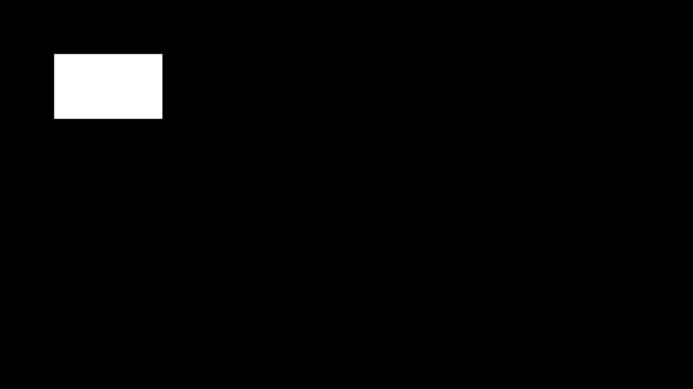

# 빠른 시작

엔진을 의존성으로 넣고, 흰 사각형 하나를 그리는 씬을 데스크탑 창으로 띄운 뒤, 같은 코드를 웹으로 빌드합니다. 끝에 저장소의 예제 목록이 있습니다.

## 의존성

`Cargo.toml`:

```toml
[dependencies]
vanilla-engine = { git = "https://github.com/ddukbaek2/vanilla-engine" }
```

크레이트 이름은 `vanilla-engine` 이고, 코드에서는 짧게 `vanilla` 로 씁니다. (엔진 `Cargo.toml` 의 `[lib]` 이름이 `vanilla` 입니다. 고도가 `godot`, 베비가 `bevy` 로 쓰는 것과 같은 꼴입니다)

## 첫 씬

`src/main.rs`:

```rust,no_run
use vanilla::{Colors, Engine, EngineConfiguration, Graphic, Rect, Scene, SceneBase, Vector2};

struct MainScene {
	scene_base: SceneBase,
}

impl Scene for MainScene {
	fn get_scene_base(&self) -> &SceneBase {
		&self.scene_base
	}

	fn get_scene_base_mut(&mut self) -> &mut SceneBase {
		&mut self.scene_base
	}

	fn pre_draw(&mut self, graphic: &mut Graphic) {
		self.scene_base.draw_scene_background(graphic);
	}

	fn draw(&mut self, graphic: &mut Graphic) {
		graphic.set_fill_color(Colors::WHITE);
		graphic.draw_rect(Rect::create(100.0, 100.0, 200.0, 120.0));
	}
}

fn main() {
	let mut engine_configuration = EngineConfiguration::new();
	engine_configuration.title = String::from("My Game");
	engine_configuration.auto_resize_on_window_resize = true;
	engine_configuration.reference_resolution_size = Vector2::create(1280.0, 720.0);
	let engine = Engine::new(engine_configuration);
	let main_scene = MainScene {
		scene_base: SceneBase::new(),
	};
	if let Err(error) = engine.run(Box::new(main_scene)) {
		eprintln!("{}", error);
		std::process::exit(1);
	}
}
```

```bash
cargo run
```



엔진 저장소 안에서는 같은 코드가 `examples/quickstart.rs` 에 있습니다. (`cargo run --example quickstart`, 창 제목만 다릅니다)

- 씬은 `Scene` 트레이트를 구현합니다. 꼭 구현할 것은 씬 공통 상태(`SceneBase`)를 내주는 `get_scene_base`, `get_scene_base_mut` 둘이고, 나머지 훅(`load`, `initialize`, `tick`, `pre_draw`, `draw` 같은 것)은 필요한 것만 덮어씁니다. 훅의 이름과 인자는 원본과 같습니다. (`load(engine)`, `tick(time_delta)`, `draw(graphic)`, 엔진을 받지 않는 훅에서는 `Engine::get_engine()`)
- `pre_draw` 에서 부른 `SceneBase::draw_scene_background` 는 창 전체를 씬 배경색(처음 검정)으로 칠하고, 그다음 그리기를 뷰 좌표로 바꿉니다. 그래서 `draw` 의 `Rect::create(100.0, 100.0, 200.0, 120.0)` 은 기준 해상도 1280 x 720 안의 자리입니다.
- 기본 `draw` 는 씬의 노드 트리를 그립니다. 이 예제는 노드가 없어 덮어쓴 `draw` 에서 사각형만 그립니다. 노드를 쓰는 씬은 덮어쓴 `draw` 에서 `self.scene_base.draw(graphic)` 을 함께 부릅니다.
- `reference_resolution_size` 는 게임이 그리는 기준 해상도입니다. 창 크기가 달라도 뷰 스케일 모드(처음 `ViewScaleMode::StretchShort`)가 이 크기를 창에 맞춰 늘이고 줄입니다.
- `auto_resize_on_window_resize` 를 켜면 창 크기가 바뀔 때 캔버스를 창에 맞춥니다.
- 데스크탑 창은 `EngineConfiguration::window_size` 가 0 이면(처음 값) 기준 해상도 크기로 열립니다.
- `Engine::run` 은 데스크탑에서는 창을 닫거나 `Engine::exit_application` 을 부를 때까지 돌아오지 않고, 웹에서는 프레임 콜백을 걸어 둔 뒤 바로 돌아옵니다. 창이나 GL 컨텍스트를 만들지 못하면 `Err` 에 까닭을 담아 돌려줍니다.

## 웹으로 빌드

`wasm32-unknown-unknown` 타깃과 [wasm-bindgen](https://github.com/rustwasm/wasm-bindgen) 명령줄 도구가 있으면 됩니다. 엔진 저장소에서 위 예제를 빌드하면 이렇습니다.

```bash
rustup target add wasm32-unknown-unknown
cargo build --profile wasm-release --example quickstart --target wasm32-unknown-unknown
wasm-bindgen --target web --no-typescript --remove-name-section --remove-producers-section --out-dir web target/wasm32-unknown-unknown/wasm-release/examples/quickstart.wasm
```

`web/index.html`:

```html
<!doctype html>
<html>
<head><meta charset="utf-8"><style>html, body { margin: 0; overflow: hidden; background: #000; }</style></head>
<body>
<script type="module">
import init from "./quickstart.js";
init();
</script>
</body>
</html>
```

- `wasm-release` 프로필은 엔진 `Cargo.toml` 에 있습니다. 자기 게임 크레이트에서는 같은 프로필을 게임의 `Cargo.toml` 에 둡니다. ("프로젝트 시작" 장)
- 캔버스는 `EngineConfiguration::canvas_id`(처음 `mainCanvas`)로 찾고, 페이지에 없으면 엔진이 그 아이디로 만들어 `body` 끝에 붙입니다.
- 모듈 스크립트와 애셋 받기는 `file://` 로 연 페이지에서 브라우저가 막습니다. 로컬 웹 서버로 엽니다. (예: `python3 -m http.server --directory web 8000` 뒤 `http://localhost:8000`)

## 예제

모두 엔진 저장소의 `examples/` 에 소스가 있습니다.

```bash
cargo run --example uigallery
cargo run --release --example modelviewer
```

| 예제 | 내용 |
| --- | --- |
| `quickstart` | 이 장의 첫 씬과 같은 코드 |
| `nodebasics` | 노드, `Paint`, `Text`, 직접 만든 컴포넌트 |
| `uigallery`, `uigallery2` | UI 위젯 전부 |
| `inputgallery` | 입력 필드, 한글 IME 조합, 선택 영역, 리치텍스트, 게임패드 진동 시험 |
| `effectgallery` | 셰이더 스프라이트 49 종, 화면 효과, 트레일, 파티클 |
| `misctour` | 카메라, 길찾기, 대화 시스템, 화면 흔들림, 플로팅 텍스트 |
| `cameratour` | Camera2D 회전 둘러보기: 천천히 도는 카메라, 끌어 팬, 커서 고정 휠 줌, 흔들림, 노드 배율 트윈, Indicator |
| `timelineshowcase` | 타임라인 문서 재생 |
| `modelviewer` | 스키닝 3D(glTF, FBX), 그림자, 블룸 |
| `engineextras` | 테, 진행 고리, 부드러운 그늘, 마우스 커서, 카메라 손짓, 마우스 단추와 손가락 입력 |
| `devtoolsshowcase` | 개발자 도구(F2): 하이어라키, 인스펙터, 통계, 로컬 스토리지, 설정 |
| `toonshowcase` | 툰 3D: 기본 도형과 바깥선, GLB 모형의 뼈대 움직임, 셀 셰이딩, 인스턴싱과 화면 밖 거르기, 그림자, HDR 블룸 |
| `toonview` | 노드 사각형 안 툰(`ToonView3D`), `Camera3D` 로 3D 점 위에 얹은 2D |
| `toonfx` | 툰 화면 공간 바깥선과 GPU 효과 |
| `toonpost` | 툰 HDR 마무리 세 판 |
| `toonmaterial` | 툰 머티리얼 셰이더 조각, 텍스처와 데칼, 점광, 평면 거울, 영구 인스턴스 버퍼 |
| `toonstyle` | 툰 셰이딩과 바깥선 견주기 |
| `audiotone` | 소리 재생, 효과음 풀, 비프 |
| `gamepadlist` | 연결된 게임패드 목록 |
| `uiscenelayout` | `UIScene` 과 `UINode` 오토레이아웃 |
| `windowshowcase` | 창 쌓기와 확인 창, 화면 페이드, UI 가 받지 않은 누름만 놀이 입력으로 |
| `loadingshowcase` | `AssetLoader` 로 함께 받기, 바꾼 로딩 화면, 빌드 판, `FixedStepper` |
| `asyncawait` | 원본처럼 async/await: 불러오기 작업, `wait::seconds`, `wait::next_frame`, `fade_screen_async`, `Promise` |
| `textnodeextras` | 글자 칸 맞춤, 배율이 움직이는 글, 반투명 고리와 호와 선분, 스프라이트 아틀라스, 그림자 글 |
| `panelayout` | 화면 분할 패널(`Pane`) |
| `blendmodes` | 블렌드 모드 26 가지 |
| `textshaping` | 오른쪽에서 왼쪽 글, 가짜 기울임과 굵게, 한중일 낱말 줄바꿈, `DynamicFont` |
| `scenedocument` | vanilla.js 비주얼 에디터 꼴의 씬 파일(`.scene.json`)을 읽어 노드 트리를 짓고 다시 내보내 견주기 |

- `modelviewer`, `toonshowcase`, `timelineshowcase`, `loadingshowcase`, `scenedocument` 는 vanilla.js 의 예제 애셋을 씁니다. vanilla.js 저장소를 엔진 저장소 옆에 받아 둡니다. (`vanilla.js` 와 `vanilla-engine` 폴더가 나란히)
- 예제는 애셋 경로를 저장소 루트 기준으로 적어 두었으므로 저장소 루트에서 실행합니다.
- 무거운 3D 예제는 `--release` 로 돌립니다. (Cargo 의 dev 빌드는 최적화를 하지 않습니다)

## 관련 타입

Engine, EngineConfiguration, Scene, SceneBase, Graphic, Rect, Colors, Vector2, ViewScaleMode
