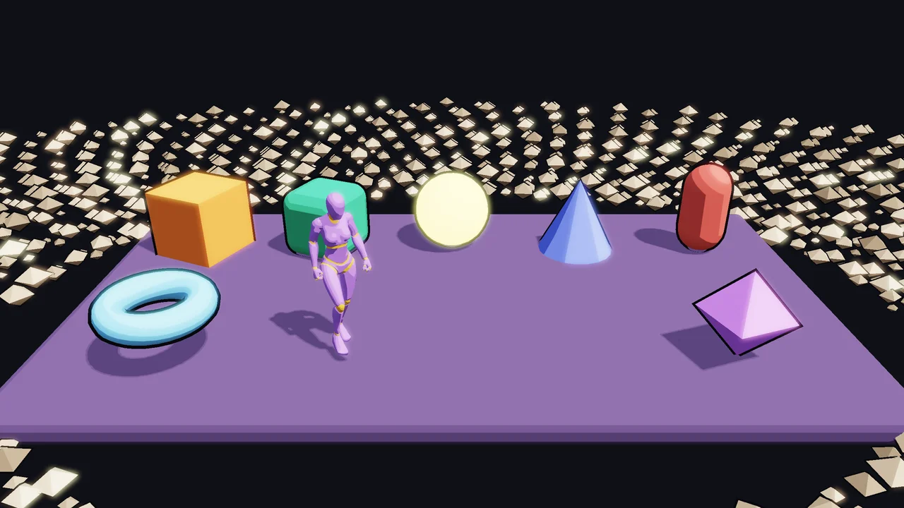

# 바닐라엔진

**한 번 짠 러스트 게임 코드가 데스크탑 창에서도, 웹 브라우저에서도 그대로 도는 2D/3D 게임 엔진**

## 소개

바닐라엔진(vanilla-engine)은 웹게임 엔진 [vanilla.js](https://github.com/ddukbaek2/vanilla.js) 를 러스트로 옮긴 엔진입니다. 원본의 공개 API 와 씬 구조를 그대로 가져오고, 이름은 러스트 규칙으로 바꿨습니다. (원본 `setFillColor` 는 `set_fill_color`, `Colors.white` 는 `Colors::WHITE`) 크레이트 이름은 `vanilla-engine` 이고, 코드에서는 `vanilla` 로 씁니다.

- 같은 게임 코드로 데스크탑 실행 파일(윈도우, macOS, OpenGL 3.3 코어)과 브라우저용 wasm(WebGL2)을 만듭니다. 창, GL, 입력, 애셋 읽기, 소리, 클립보드, 한글 입력(IME), 시스템 글꼴의 차이는 엔진의 플랫폼 층이 맡습니다
- 노드는 씬의 `NodeTree` 가 들고, 게임 코드는 `NodeId` 핸들로 가리킵니다. 지운 노드의 핸들은 `None` 이 되어 댕글링 참조가 생기지 않고, `Rc<RefCell>` 없이 노드를 만들고 지웁니다
- ECS 가 아니라 원본처럼 노드에 컴포넌트를 붙이는 구조입니다. 원본과 이름과 흐름이 같아 자바스크립트 게임을 옮기기 쉽습니다
- 묶어 그리기와 화면 밖 거르기가 기본으로 켜져 있습니다. 블렌드 모드는 Canvas2D 합성 26 가지를 모두 그립니다
- 엔진이 스레드 하나짜리 실행기를 품어 원본의 async/await 를 같은 흐름으로 씁니다. tokio 같은 외부 런타임이 없어도 데스크탑과 웹이 같은 코드로 돕니다
- 원본이 실행 중에 하던 반사(리플렉션)는 절차 매크로 `#[vanilla::reflect]` 가 컴파일 때 짓습니다. UI 문서 저장과 개발자 도구 인스펙터가 이것을 씁니다
- 두 엔진은 기능 차이를 두지 않습니다. 언어나 플랫폼 때문에 정말 맞출 수 없는 것과 러스트에 맞게 정한 꼴은 "구조" 장에 모았습니다

## 주요 기능

| 갈래 | 내용 |
| --- | --- |
| 코어 | `Engine`(최대 FPS, 페이지 이벤트, 검증용 화면 저장), `EngineConfiguration`, `Scene` / `SceneBase`, `NodeTree` / `WorldNode` / `NodeId`, `Component` / `ComponentBase`, `TimeManager`, `InputManager`, `InputActions`, `GamepadManager`, `ViewManager`(기준 해상도, 세이프 에어리어, 렌더 배율 상한), `TouchRecognizer`, `PointerCursor` |
| 렌더링 | `Graphic`(스프라이트, 글, 도형, 스텐실 클립, 블렌드 모드 26 가지), `Paint`, `Sprite`, `Text`, `RichText`, `Mask`, `Outline`, `SoftShade`, `ShadowText`, `ShadowImage`, `Camera2D`, `ShaderProgram`, `ShaderWarmer` |
| UI | `UIButton`, `UIToggleButton`, `UISlider`, `UIScrollView`, `UISnapScrollView`, `UIScrollBar`, `UIInputField`, `UIProgressView`, `UIProgressRing`, `UIListView`, `UIDropdown`, `UIContextMenu`, `UIDialog`, `UIToast`, `UISpinner`, `UILineChart`, `UIBarChart`, 창 쌓기(`UIWindowLayer`, `UIWindow`, `UIConfirmWindow`), `ButtonMotion`, `ToastMotion`, `UIHitArea`, `UIScale`, `UIDocument`, 제약 기반 레이아웃(`LayoutSolver`, `UINode`, `UIScene`) |
| 효과 | `ParticleSystem`, `TrailRenderer`, `ShaderSprite`(효과 49 종), `ScreenEffect`(58 종), `HeatHazeEffect`, `Shaker`, `FloatingText` |
| 애니메이션 | `Timeline`(이징 31 종과 계단, 베지어), `Animator`, `Action`, `Tween`, `SpriteAnimator` |
| 3D | `SkinnedModel`(glTF, GLB, FBX, 스키닝, 모프 타깃), `SkinnedModelRenderer`, `HumanSkinRenderer`, `ShadowMap`, `BloomEffect`, `MultiLevelBloomEffect`, `AmbientOcclusionEffect`, `SubsurfaceScatteringEffect`, `Camera3D`, `Material`, `RenderTarget`, `FullscreenPass` |
| 툰 3D | `ToonRenderer`, `ToonLightSet`, `ToonMaterial`, `MeshBuilder`, GLB 읽기(`read_glb_arrays` 등), `ToonDrawQueue`, `ToonScreenOutline`, `ToonVfx`, `ToonPostProcess`, `ToonView3D` |
| 게임 보조 | `FiniteStateMachine`, `PathFinder`, `Grid`, `Collision2D`, `Steering2D`, `PlatformerBody`, `ObjectPool`, `SeededRandom`, `FixedStepper`, `Localization`, `languagepack`, `uifont`, `DynamicFont`, `format`, `PersistedStore`, `LocalStorage`, `DialogueRunner`, `Typewriter`, `CameraGestures`, `FocusNavigator`, `VirtualPad`, `FrameProbe`, `GraphicsQualityGovernor`, `BuildInfo` |
| 애셋 | `ImageAsset`, `TextAsset`, `JsonAsset`, `BlobAsset`, `BunchAsset`, `FontAsset`, `AudioAsset`, `VisualAsset`, `AssetLoader`, `LoadingProgress`, `SpriteAtlas` |
| 소리 | `AudioPlayer`, `AudioBus`, `SoundSystem`, `SoundEffectPool`, `BeepPlayer` |
| 웹 | `WebSocketClient`, `Pane` |
| 러스트 판만 | async/await(`Engine::spawn_task`, `Engine::spawn_scene_task`, `Promise`, `TaskHandle`, `wait`), 반사 매크로(`#[vanilla::reflect]`), 데스크탑에서 브라우저 기능을 대신하는 것(`Canvas2D`, `Engine::alert`, `Engine::confirm`, `Engine::prompt`, `Document`) |

## 플랫폼

| 대상 | 창과 그리기 | 확인한 곳 |
| --- | --- | --- |
| 데스크탑 | winit 창과 glutin 의 OpenGL 3.3 코어 컨텍스트 (깊이 24, 스텐실 8) | 윈도우 11, macOS(애플 실리콘)에서 돌려 확인했습니다. 리눅스는 그 대상으로 컴파일해 본 것까지입니다 |
| 웹 | `wasm32-unknown-unknown`, 캔버스와 WebGL2, `requestAnimationFrame` | 크롬에서 돌려 확인했습니다 |

실제 모바일 기기에서는 아직 돌려 보지 않았습니다.

## 저장소 구조

| 자리 | 내용 |
| --- | --- |
| `src/lib.rs` | 공개 이름을 크레이트 맨 위로 다시 내보냅니다 (원본 `import.js` 자리) |
| `src/base/` | 엔진을 모르는 기반 타입 (수학, 색, 난수, 타이머, 판, `wait`) |
| `src/core/` | 엔진 본체 (엔진, 씬, 노드 트리, `Graphic`, 컴포넌트, 입력, 소리, async 실행기) |
| `src/resource/` | 애셋과 `AssetLoader`, `SpriteAtlas` |
| `src/effect/` | 파티클, 트레일, `ShaderSprite`, `ScreenEffect`, `HeatHazeEffect` |
| `src/ui/` | UI 컴포넌트, 창 쌓기, 오토레이아웃, `UIDocument` |
| `src/game/` | `GameScene` (게임용 공통 씬) |
| `src/misc/` | 게임 보조 기능과 개발자 도구 |
| `src/animation/` | `Timeline`, `Animator`, `Action` |
| `src/graphics3d/` | 3D 와 툰 3D |
| `src/web/` | `WebSocketClient`, `Pane` |
| `src/platform/` | 데스크탑과 웹의 창, GL, 입력, 프레임 루프, 애셋 읽기, 소리 |
| `macros/` | 반사 절차 매크로 (엔진이 `vanilla::reflect` 로 다시 내보냅니다) |
| `examples/` | 예제 (`cargo run --example 이름`) |
| `tests/` | 시험과 시험용 애셋 |
| `tools/apidoc/` | API 문서 자료 뽑기와 가이드 코드 검사 |
| `docs/` | API 문서 자료, 가이드, 업데이트 문서 |
| `ARCHITECTURE.md` | 구조 설계 문서 |
| `UPDATE.md` | 업데이트 기록 |

## 개발 환경

- Windows 11 Pro, macOS(애플 실리콘)
- Rust 1.100.0

## 링크

- 저장소: <https://github.com/ddukbaek2/vanilla-engine>
- 원본 엔진: <https://github.com/ddukbaek2/vanilla.js>
- 엔진 소개: <https://vanillapunch.com/tools/#vanilla-engine>
- 문서: <https://vanillapunch.com/docs/vanilla-engine/>
- 업데이트 소식: <https://vanillapunch.com/news/?kind=patch>
- 문의: <https://vanillapunch.com/support/>

## 라이선스

[MIT](https://github.com/ddukbaek2/vanilla-engine/blob/release/LICENSE) © vanillapunch
